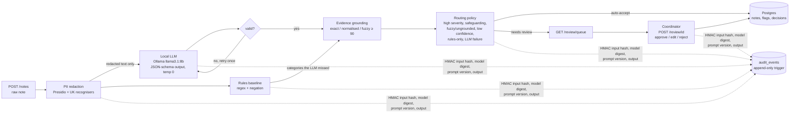

# SMARTPBL Prototype

A portfolio prototype of an AI platform for domiciliary care. It has three parts:

1. **Care-notes NLP**: a local LLM turns free-text notes into evidence-grounded risk flags, with human review and an audit trail.
2. **Carer matching**: OR-Tools VRPTW that balances travel time against continuity of care.
3. **Attrition prediction**: explainable models that flag carers at risk of leaving.

> **All data is synthetic.** No real people, clients or PBL Care records are used. Results on synthetic data do not show real-world performance.

## Status

- [x] Step 0: setup
- [x] Tier 1: care-notes NLP (schemas, synthetic data, PII redaction, rules baseline, LLM extraction, grounding + routing, persistence + audit, API + human review, evaluation)
- [ ] Tier 2: carer matching
- [ ] Tiers 3–6: attrition, production layer, Flutter app, packaging

## Quick start

Prerequisites: Python 3.12 (managed by `uv`), Docker, Ollama.

```bash
uv sync                                   # create .venv and install deps
uv run pre-commit install                 # git hooks: ruff + hygiene checks
cp .env.example .env
docker compose up -d db                   # PostgreSQL 16 on 127.0.0.1:5442
uv run alembic upgrade head               # create tables + append-only audit trigger
ollama pull llama3.1:8b                   # default LLM (qwen2.5:3b optional)
uv run pytest                             # tests
uv run uvicorn app.main:app --reload      # API at http://localhost:8000/docs
```

## Tier 1: care-notes NLP

A coordinator gets a queue of risk flags from carers' free-text visit notes. Each flag carries a verbatim quote, and every automated and human decision is in an append-only audit log.

### Architecture



**Design principles:**
- **Data minimisation:** the LLM, the audit log and API responses never contain raw identifiers.
- **Local inference:** no note leaves the machine.
- **Every flag must quote the note,** and quotes that can't be found are rejected.
- **Nothing is silently dropped:** every flag is auto-accepted or queued, with reasons.
- **Graceful degradation:** if the LLM is down, the note is kept with the rules' flags and queued.

Each module is explained in [`docs/learning/`](docs/learning/) (notes 01–09), and the decisions are in [`DECISIONS.md`](docs/learning/DECISIONS.md).

### Results: held-out test split

The test split has 40 synthetic notes, 56 gold flags and 8 per category, with seed 42. It was opened once, after all tuning was finished. Full tables, dev results and method: [`docs/results/tier1_eval_test.md`](docs/results/tier1_eval_test.md).

| System | Precision | Recall (95% CI) | F1 (95% CI) | Severity agreement | Median latency |
|---|---|---|---|---|---|
| llama3.1:8b + prompt v2 | 0.960 | **0.857** (0.776–0.930) | **0.906** (0.847–0.955) | 0.81 | 5.8 s |
| qwen2.5:3b + prompt v2 | 0.933 | 0.500 (0.391–0.618) | 0.651 (0.541–0.759) | 0.57 | 2.3 s |
| Rules baseline | 0.977 | 0.768 (0.642–0.885) | 0.860 (0.777–0.933) | 0.98* | 0.3 ms |

The deployed pipeline is llama + rules safety net + routing:

| Notes sent to review | Gold flags with no flag at all | High-severity escapes | Auto-accepted false positives | Schema-valid first try | Evidence grounded |
|---|---|---|---|---|---|
| 50% | 4 / 56 (7.1%) | 0 / 19 | 0 / 27 | 40 / 40 | 100% |


**Reading the results honestly:**
- **The LLM vs the rules is not statistically settled at n = 40.** The paired bootstrap F1 difference is +0.046 (95% CI −0.034 to +0.141).
- **The rules overfit their tuning data.** They dropped from 0.986 F1 on dev to 0.860 on test, with 0.59 recall on test-only phrasings against the LLM's 0.81.
- **The two systems are complementary:** union recall is 0.929, which is why the rules act as a safety net.
- **\*The rules' severity agreement is inflated.** The same author wrote both the rules and the gold severities.
- **qwen2.5:3b finds about half the risks on both splits.** It is not a viable fallback without its own prompt work.
- **All four escaped flags use phrasings that appear only in the test split.** Examples: concealed medication ("pills hidden in a tissue"), a subtle mood change, and a shortened visit.

### Run the pipeline and the evaluation

```bash
# One note through the API (Ollama running):
curl -X POST localhost:8000/notes -H 'content-type: application/json' -d '{"note_id":"DEMO-1",
  "client_ref":"CL-0001","carer_ref":"CR-0001","visit_time":"2026-11-07T08:00:00Z",
  "text":"Visited Mrs Testperson. Found her on the floor in the hallway. Refused morning tablets."}'
curl localhost:8000/review/queue

# Re-score the committed predictions (no Ollama needed):
uv run python -m scripts.eval --split test --final
# Regenerate predictions from scratch:
uv run python -m scripts.run_extraction --split test --model llama3.1:8b --prompt v2 --final
```

### Tier 1 limitations

- **Synthetic, template-generated notes.** One author wrote the data, rules, prompts and labels, so the evaluation is partly circular and absolute numbers are optimistic. Real notes are longer, messier and contain risks spread across sentences.
- **Small test set.** 40 notes gives wide confidence intervals. The test set is now spent: any further prompt or rule iteration needs a fresh held-out set.
- **LLM self-reported confidence is uninformative:** 86% of flags have confidence 1.0. Routing therefore relies on policy, grounding and the rules safety net, not on confidence.
- **Grounding checks that a quote exists, not that it supports the flag.** A negation misread ("no signs of falls" flagged as a fall) passes grounding.
- **The audit log is append-only against the application only.** A database owner or superuser can disable the trigger. Production needs separate DB roles and tamper evidence such as a hash chain or write-once storage.
- **No authentication yet.** The reviewer is identified by an `X-Reviewer` header, replaced by JWT and roles in Tier 4. The API returns redacted text only.
- **Ingestion is synchronous** (6–18 s per note), and raw text is not encrypted at rest. Both are in [`BACKLOG.md`](docs/learning/BACKLOG.md).

## Layout

```
app/        core (config, db) · nlp (schemas, redact, baseline, extract, ground, route, review, evaluation) · audit · api
prompts/    versioned prompt templates          data/      synthetic notes, data card, cached predictions
scripts/    data generation, extraction, eval   migrations/ Alembic
tests/      unit + Postgres integration tests   docs/      learning notes, results, figures
```

## Limitations

Synthetic data only: see [`data/care_notes/DATA_CARD.md`](data/care_notes/DATA_CARD.md) for how it was generated and its known biases (narrow vocabulary, artificial prevalence). Developed and tested on one Apple M1 Pro (16 GB) machine. Tier-specific limitations are listed in each tier's section above.
