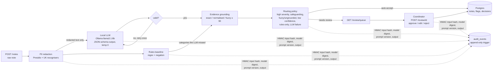
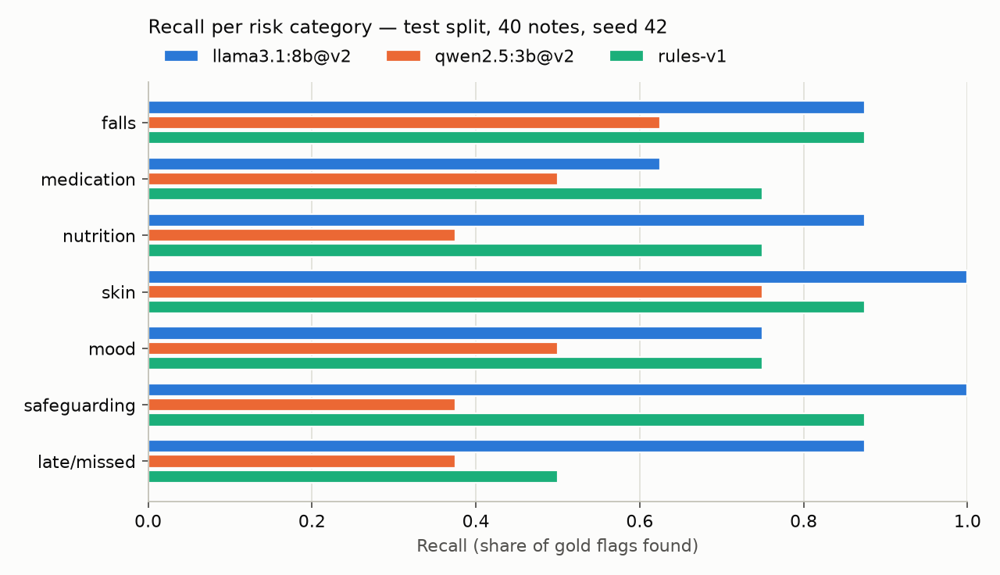
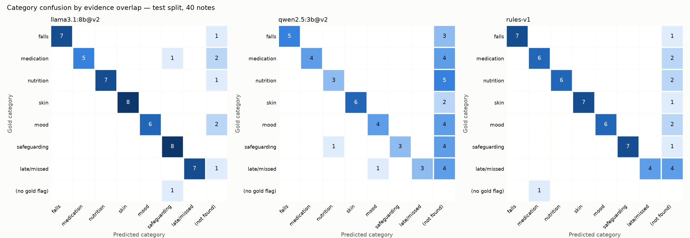
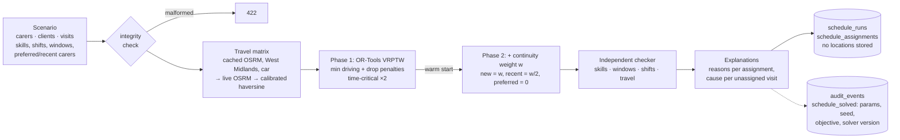
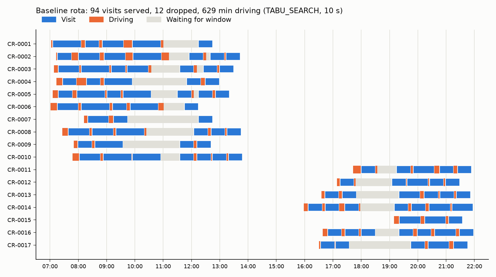
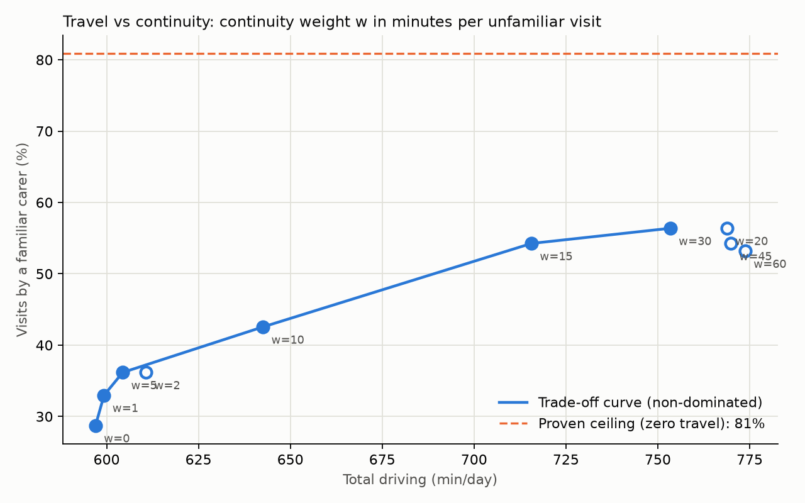
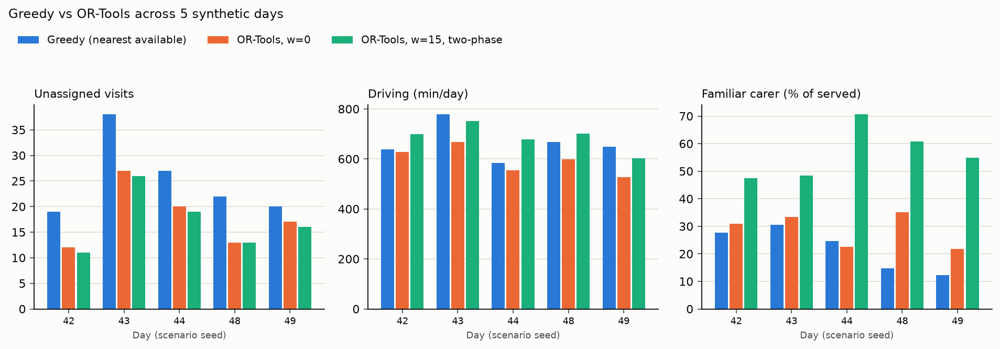
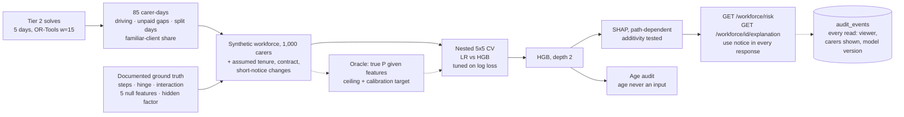
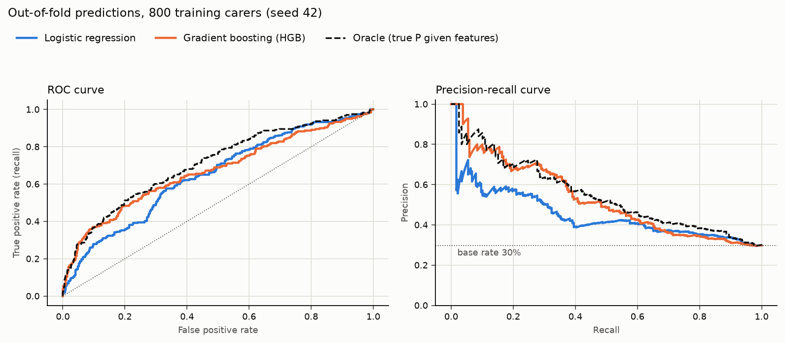
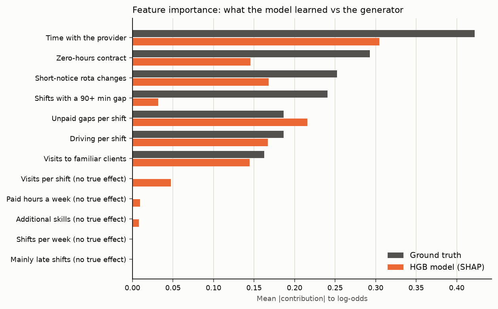

# SMARTPBL Prototype

A portfolio prototype of an AI platform for domiciliary care. It has three parts:

1. **Care-notes NLP**: a local LLM turns free-text notes into evidence-grounded risk flags, with human review and an audit trail.
2. **Carer matching**: OR-Tools VRPTW that balances travel time against continuity of care.
3. **Attrition prediction**: explainable models that flag carers at risk of leaving.

> **All data is synthetic.** No real people, clients or PBL Care records are used. Results on synthetic data do not show real-world performance.

## Status

- [x] Step 0: setup
- [x] Tier 1: care-notes NLP (schemas, synthetic data, PII redaction, rules baseline, LLM extraction, grounding + routing, persistence + audit, API + human review, evaluation)
- [x] Tier 2: carer matching (scheduling data, OSRM travel matrix, OR-Tools VRPTW, continuity trade-off, greedy comparison, schedule API)
- [x] Tier 3: attrition prediction (synthetic workforce from Tier 2 schedules, LR vs gradient boosting with nested CV, SHAP explanations checked against ground truth, age audit, model card, workforce API)
- [ ] Tier 4: production layer. Done: 4.1 JWT auth with refresh rotation and role-based permissions; 4.2 unified audit (middleware access log, request-id correlation, fail-closed reads); 4.3 OWASP API Top 10 review ([`docs/SECURITY.md`](docs/SECURITY.md)): rate limits, size limits, secure defaults, CORS
- [ ] Tiers 5–6: coordinator dashboard and carer app, packaging

## Quick start

Prerequisites: Python 3.12 (managed by `uv`), Docker, Ollama.

```bash
uv sync                                   # create .venv and install deps
uv run pre-commit install                 # git hooks: ruff + hygiene checks
cp .env.example .env
docker compose up -d db                   # PostgreSQL 16 on 127.0.0.1:5442
uv run alembic upgrade head               # create tables + append-only audit trigger
ollama pull llama3.1:8b                   # default LLM (qwen2.5:3b optional)
uv run pytest                             # tests
uv run python -m scripts.create_user coord.demo coordinator   # prompts for a password
uv run uvicorn app.main:app --reload      # API at http://localhost:8000/docs

# Every endpoint except /health and /auth/* needs a bearer token (Step 4.1):
TOKEN=$(curl -s -X POST localhost:8000/auth/token -d 'username=coord.demo&password=<yours>' \
  | python -c 'import sys, json; print(json.load(sys.stdin)["access_token"])')
AUTH="Authorization: Bearer $TOKEN"       # used by the curl examples below

# Optional, Tier 2: road travel times (the committed matrix works without it)
scripts/prepare_osrm.sh                   # download West Midlands OSM + preprocess (~1 min)
docker compose --profile osrm up -d osrm  # OSRM on 127.0.0.1:5005
```

## Tier 1: care-notes NLP

A coordinator gets a queue of risk flags from carers' free-text visit notes. Each flag carries a verbatim quote, and every automated and human decision is in an append-only audit log.

### Architecture



**Design principles:**
- **Data minimisation:** the LLM, the audit log and API responses never contain raw identifiers.
- **Local inference:** no note leaves the machine.
- **Every flag must quote the note,** and quotes that can't be found are rejected.
- **Nothing is silently dropped:** every flag is auto-accepted or queued, with reasons.
- **Graceful degradation:** if the LLM is down, the note is kept with the rules' flags and queued.

Each module is explained in [`docs/learning/`](docs/learning/) (notes 01–09), and the decisions are in [`DECISIONS.md`](docs/learning/DECISIONS.md).

### Results: held-out test split

The test split has 40 synthetic notes, 56 gold flags and 8 per category, with seed 42. It was opened once, after all tuning was finished. Full tables, dev results and method: [`docs/results/tier1_eval_test.md`](docs/results/tier1_eval_test.md).

| System | Precision | Recall (95% CI) | F1 (95% CI) | Severity agreement | Median latency |
|---|---|---|---|---|---|
| llama3.1:8b + prompt v2 | 0.960 | **0.857** (0.776–0.930) | **0.906** (0.847–0.955) | 0.81 | 5.8 s |
| qwen2.5:3b + prompt v2 | 0.933 | 0.500 (0.391–0.618) | 0.651 (0.541–0.759) | 0.57 | 2.3 s |
| Rules baseline | 0.977 | 0.768 (0.642–0.885) | 0.860 (0.777–0.933) | 0.98* | 0.3 ms |

The deployed pipeline is llama + rules safety net + routing:

| Notes sent to review | Gold flags with no flag at all | High-severity escapes | Auto-accepted false positives | Schema-valid first try | Evidence grounded |
|---|---|---|---|---|---|
| 50% | 4 / 56 (7.1%) | 0 / 19 | 0 / 27 | 40 / 40 | 100% |





**Reading the results honestly:**
- **The LLM vs the rules is not statistically settled at n = 40.** The paired bootstrap F1 difference is +0.046 (95% CI −0.034 to +0.141).
- **The rules overfit their tuning data.** They dropped from 0.986 F1 on dev to 0.860 on test, with 0.59 recall on test-only phrasings against the LLM's 0.81.
- **The two systems are complementary:** union recall is 0.929, which is why the rules act as a safety net.
- **\*The rules' severity agreement is inflated.** The same author wrote both the rules and the gold severities.
- **qwen2.5:3b finds about half the risks on both splits.** It is not a viable fallback without its own prompt work.
- **All four escaped flags use phrasings that appear only in the test split.** Examples: concealed medication ("pills hidden in a tissue"), a subtle mood change, and a shortened visit.

### Run the pipeline and the evaluation

```bash
# One note through the API (Ollama running):
curl -X POST localhost:8000/notes -H "$AUTH" -H 'content-type: application/json' -d '{"note_id":"DEMO-1",
  "client_ref":"CL-0001","carer_ref":"CR-0001","visit_time":"2026-11-07T08:00:00Z",
  "text":"Visited Mrs Testperson. Found her on the floor in the hallway. Refused morning tablets."}'
curl -H "$AUTH" localhost:8000/review/queue

# Re-score the committed predictions (no Ollama needed):
uv run python -m scripts.eval --split test --final
# Regenerate predictions from scratch:
uv run python -m scripts.run_extraction --split test --model llama3.1:8b --prompt v2 --final
```

### Tier 1 limitations

- **Synthetic, template-generated notes.** One author wrote the data, rules, prompts and labels, so the evaluation is partly circular and absolute numbers are optimistic. Real notes are longer, messier and contain risks spread across sentences.
- **Small test set.** 40 notes gives wide confidence intervals. The test set is now spent: any further prompt or rule iteration needs a fresh held-out set.
- **LLM self-reported confidence is uninformative:** 86% of flags have confidence 1.0. Routing therefore relies on policy, grounding and the rules safety net, not on confidence.
- **Grounding checks that a quote exists, not that it supports the flag.** A negation misread ("no signs of falls" flagged as a fall) passes grounding.
- **The audit log is append-only against the application only.** A database owner or superuser can disable the trigger. Production needs separate DB roles and tamper evidence such as a hash chain or write-once storage.
- **Authentication arrived in Step 4.1** (JWT + roles; the reviewer is the authenticated user). The API returns redacted text only.
- **Ingestion is synchronous** (6–18 s per note), and raw text is not encrypted at rest. Both are in [`BACKLOG.md`](docs/learning/BACKLOG.md).

## Tier 2: carer matching

A day's visits are assigned to carers, respecting skills, shifts and arrival windows, while trading travel against continuity of care. Every assignment comes with checkable reasons.

### Architecture



**Design principles:**
- **Hard constraints in the model, preferences as priced costs.** w = minutes of driving accepted to send a familiar carer.
- **Never "infeasible".** An overloaded day returns the best partial plan, plus the reason each visit is unassigned.
- **Continuity never costs a visit.** A penalty guard plus the two-phase warm start ensure this.
- **Every solution is re-verified,** and every number is framed against a proven CP-SAT bound.
- **Client locations stay in-house:** self-hosted routing, and runs store only a keyed hash of the input.

Notes 10–15 in [`docs/learning/`](docs/learning/) explain each part.

### Results

**Travel times** (58 points, 3,306 ordered pairs; [`tier2_travel.md`](docs/results/tier2_travel.md)):
- Road distance is **1.34×** the straight line.
- The fitted fallback is **115 s + road distance at 42.3 km/h** (free-flow), with a mean absolute error of 1.3 minutes against OSRM.
- A naive straight line at 30 km/h underestimates by 1.4 minutes per trip.

**Baseline day** (seed 42: 17 carers, 106 visits; [`tier2_baseline.md`](docs/results/tier2_baseline.md)):
- OR-Tools leaves **12 visits unassigned** (11 with 60 s of search). A CP-SAT relaxation proves at least **2** are unavoidable even with zero travel.
- The causes are a morning dementia/catheter skill-mix bottleneck and an evening bed-time peak.
- Staffing what-ifs: training one carer and adding one late carer cuts unassigned visits to 7.



**Travel vs continuity** (94 visits with coverage fixed; [`tier2_continuity.md`](docs/results/tier2_continuity.md)):
- Familiar carers rise from **29% to 56%** as w goes from 0 to 30 minutes, against a proven ceiling of 81%.
- The first 7 points cost only 7 minutes a day.
- The middle of the curve costs about **6.5 minutes of driving per extra familiar visit**, and about 19 minutes past the knee at w ≈ 15.



**OR-Tools vs a nearest-available-carer greedy**, mean over 5 synthetic days ([`tier2_comparison.md`](docs/results/tier2_comparison.md)):

| | Greedy | OR-Tools, w=0 | OR-Tools, w=15, two-phase |
|---|---|---|---|
| Unassigned visits (of ~106) | 25.2 | 17.8 | **17.0** |
| Time-critical visits unassigned | **5.4** | **0** | **0** |
| Driving (min/day) | 663 | **596** | 687 |
| Familiar carer (% of served) | 22% | 29% | **56%** |
| Runtime | 7 ms | 10 s | 20 s |



**Reading the results honestly:**
- **The optimiser wins on coverage, driving and safety on every day tested.** Greedy's myopia costs about 5 time-critical medication visits a day.
- **Continuity has a clear price curve.** Choosing a point on it is a decision for the registered manager, carers and families, not a technical one.
- **Utilisation is only about 50–55% for every method.** Demand peaks at 08:00 and 20:00, so workforce design (split shifts, staggered starts) matters as much as routing.

### Plan a day through the API

```bash
uv run uvicorn app.main:app --reload
curl -X POST localhost:8000/schedule/solve -H "$AUTH" \
  -H 'content-type: application/json' -d '{"time_limit_s": 10, "continuity_weight_min": 15}'
# -> routes per carer with reasons, unassigned visits with causes, metrics, run id
curl -H "$AUTH" localhost:8000/schedule/<run id>

# Reproduce the Tier 2 results (OSRM optional; committed matrices are used):
uv run python -m scripts.solve_baseline     # strategies, bound, what-ifs (~5 min)
uv run python -m scripts.sweep_continuity   # Pareto sweep (~6 min)
uv run python -m scripts.compare_solvers    # greedy vs OR-Tools over 5 days (~3 min)
```

### Tier 2 limitations

- **One synthetic city day per seed.** The generator's staffing is tight for its demand peaks (12–27 visits unassigned even by OR-Tools). It rejected 3 of 8 seeds for skill-mix gaps, so the valid days are a filtered sample.
- **Simplified workforce:** everyone drives; continuous shifts without breaks; no double-up (two-carer) calls; waiting time isn't costed, which leaves visible 1–2.5 h mid-shift gaps.
- **Free-flow travel times.** OSRM has no traffic, so peak-hour Birmingham is slower than modelled. There's no parking or door-to-door overhead.
- **Heuristic search with a wall-clock limit.** Results vary a few percent between identical runs (3 of 10 sweep points changed on a rerun), and nothing is proven optimal. The proven bounds show the remaining gap.
- **The fair real-world baseline is PBL's actual rota,** replayed with call-monitoring data, not the greedy heuristic.
- **Synchronous API** (up to 60 s per request) with no authentication yet (Tier 4).

## Tier 3: attrition prediction

Predicts which carers are likely to leave within 12 months, so a coordinator can offer support with **working conditions the provider controls**: rota notice, unpaid gaps, regular clients, induction. The model card prohibits any adverse use.

### Architecture



**Design principles:**
- **Features come from the scheduler,** so rota decisions (such as the continuity weight) feed directly into retention risk.
- **A known mechanism, stated up front.** Synthetic labels are circular, so the generator's ground truth is documented, and every result is read as "does the pipeline recover it?". This data says nothing about real carers.
- **Probabilities are the product.** Models are tuned on log loss, checked for calibration, and class reweighting is rejected.
- **Supportive by contract.** Factors are framed as provider levers with support actions; the label and age are never served; every view is audited.

Notes 16–19 in [`docs/learning/`](docs/learning/) explain each part. The model card is [`docs/model-cards/attrition-model.md`](docs/model-cards/attrition-model.md).

### Results

**Data** ([data card](data/workforce/DATA_CARD.md)):
- **1,000 carers, 29.8% leavers.** The **oracle ROC-AUC is 0.726**: the best any model can do with these features. It is 0.754 even without the hidden factor, because the outcome itself is a coin flip.
- **The 200-carer test split is unusually easy** (97th percentile of possible splits), so cross-validation is the main estimate.

**Models**, nested 5×5 repeated stratified CV on 800 training carers ([`tier3_models.md`](docs/results/tier3_models.md)):

| | ROC-AUC | PR-AUC (AP) | Brier ↓ | Top-10% precision |
|---|---|---|---|---|
| Base rate | 0.500 | 0.297 | 0.209 | 30% |
| Logistic regression | 0.655 | 0.483 | 0.196 | 57% |
| LR, balanced class weights | 0.653 | 0.476 | 0.232 | 59% |
| **Gradient boosting (HGB)** | **0.675** | **0.538** | **0.188** | **69%** |
| Oracle (ceiling) | 0.709 | 0.556 | 0.181 | 71% |

- **HGB beats LR** in 18/25 folds on ROC-AUC, 20/25 on AP and 22/25 on Brier. It captures 84% of the achievable gain over chance, and its top-of-list precision is close to the oracle's.
- **Balanced weights:** same ranking, but mean predicted risk 48% against a true 30%.
- **The test split can't separate the models** (LR 0.772, HGB 0.759, CIs ±0.07).



**Explanations vs ground truth** ([`tier3_explain.md`](docs/results/tier3_explain.md)):
- The global ranking matches the truth with Spearman **0.81**. Per-carer SHAP tracks true contributions for tenure, contract and short-notice changes (r ≥ 0.90).
- **Split shifts are under-credited** (r 0.13): the correlated unpaid-gap feature carries their signal. SHAP explains the model, not the world.



**Age audit** (age is never a model input): flagging the top 20% selects **47% of 18–24s and 8% of over-55s** (ratio 0.17), carried by tenure, while predictions stay roughly calibrated within each band. Accurate and disparate at once, which is why the controls are on use.

### Explore the workforce API

```bash
uv run uvicorn app.main:app --reload
# Needs a manager token (coordinators get 403): create_user manager.demo manager
curl -H "$AUTH" 'localhost:8000/workforce/risk?limit=5'
curl -H "$AUTH" localhost:8000/workforce/WF-0461/explanation

# Reproduce the Tier 3 results (deterministic):
uv run python -m scripts.calibrate_workforce  # re-solve Tier 2 days (~2 min; output committed)
uv run python -m scripts.generate_workforce   # synthetic workforce + oracle
uv run python -m scripts.train_attrition      # nested CV, test, calibration (~2 min)
uv run python -m scripts.explain_attrition    # SHAP, truth check, age audit (~30 s)
```

### Tier 3 limitations

- **Circular by construction.** Every metric measures recovery of a mechanism I wrote. The effect sizes are invented; only their directions follow UK care workforce reporting.
- **Small, simple workforce.** 1,000 carers from 84 Tier 2 rounds; employment features are mostly independent draws; one snapshot with no censoring; leavers aren't split by reason.
- **SHAP mode.** Interventional SHAP fails additivity for HistGradientBoosting in shap 0.54.1, so explanations use the path-dependent mode, which follows feature correlations.
- **Fairness audit covers age only,** because that's all the synthetic data contains. Real deployment needs audits of every lawfully measurable characteristic, a DPIA and worker consultation.
- **Access is manager-only since Step 4.1,** but not yet scoped per patch, and carers can't yet see their own explanation. The model retrains on first request (~4 s).

## Roadmap: Tiers 4–6

| Tier | What | Builds on |
|---|---|---|
| **4 · Production layer** | JWT auth with coordinator/manager/carer roles replacing `X-Reviewer`; unified audit middleware with a generic subject id; OWASP API Top 10 review (rate limits for `/schedule/solve`, input limits, secrets, CORS); Docker Compose for API + DB + OSRM; GitHub Actions CI | Backlog items from Tiers 1–2: DB roles for the append-only audit, async jobs, raw-text access control |
| **5 · Coordinator dashboard and carer app** | React (Vite, TypeScript, TanStack Query, an OpenAPI-generated client): review queue with highlighted evidence, schedule map (react-leaflet, OSM) with the trade-off chart, supportive workforce-risk screen. A Flutter carer app (mobile + PWA): today's visits and care-note submission. Demo deployments with seeded results (ADR-024) | Tier 1–3 APIs as built; spans, assignment reasons, SHAP factors and the use notice are already in the responses |
| **6 · Packaging** | Final README and architecture diagram, DPIA-style data-protection note, model cards, 3-minute demo script, interview pack | Learning notes 00–19, the ADR log, `INTERVIEW_PREP.md`, the attrition model card |

## Layout

```
app/        core (config, db) · nlp (schemas, redact, baseline, extract, ground, route, review, evaluation)
            matching (data, travel, solver, check, bounds, continuity, greedy, explain, service)
            workforce (data, features, models, explain, service) · audit · api
prompts/    versioned prompt templates          data/      synthetic notes, data card, cached predictions
scripts/    data generation, extraction, eval   migrations/ Alembic
tests/      unit + Postgres integration tests   docs/      learning notes, results, figures, model cards
```

## Limitations

Synthetic data only: see [`data/care_notes/DATA_CARD.md`](data/care_notes/DATA_CARD.md) for how it was generated and its known biases (narrow vocabulary, artificial prevalence). Developed and tested on one Apple M1 Pro (16 GB) machine. Tier-specific limitations are listed in each tier's section above.
