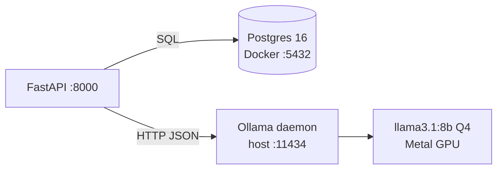

# 00 — Setup

## 1. What was built

| File | Purpose |
|---|---|
| `pyproject.toml`, `uv.lock`, `.python-version` | Project metadata, runtime and dev dependency groups, ruff and pytest config. Python pinned to 3.12. |
| `app/main.py` | FastAPI app with a `/health` liveness endpoint. |
| `app/core/config.py` | `Settings` (pydantic-settings). Reads `SMARTPBL_*` env vars or `.env`. Cached with `lru_cache`. |
| `tests/test_smoke.py` | Health endpoint test plus a test that env vars override settings. |
| `docker-compose.yml` | PostgreSQL 16 (alpine) with a named volume and a `pg_isready` healthcheck. |
| `.pre-commit-config.yaml` | Hygiene hooks (whitespace, YAML/TOML, large files, private keys) plus ruff run through `uv run`. |
| `.env.example`, `.gitignore`, `README.md` | Config template, ignore rules, README stub. |
| `app/{core,audit,nlp,matching,workforce,api}/`, `prompts/`, `data/`, … | Empty skeleton matching the planned layout. |

Host setup: Ollama installed with Homebrew and run as a `brew services` daemon on `:11434`. Pulled `llama3.1:8b` (default) and `qwen2.5:3b` (for comparison).

## 2. Why this way

- **Ollama runs on the host, not in Docker.** On macOS, Docker containers can't use the Apple GPU through Metal, so a containerised LLM would fall back to CPU and run several times slower. Running locally also means care-note text never leaves the machine. That is the data-protection argument behind local inference.
- **Python pinned to 3.12, not the system 3.14.** spaCy and Presidio (Step 1.3) and their compiled dependencies are slow to ship wheels for new Python versions. Pinning avoids failures halfway through the build. See ADR-002.
- **Two models.** On an M1 Pro with 16 GB, the 8B model at Q4 (~4.9 GB) fits with headroom. The 3B model gives a measured size-versus-quality comparison in Step 1.9 instead of a guess. That kind of comparison is evidence a panel will respect.
- **Settings through env vars with a `SMARTPBL_` prefix** (12-factor). Secrets stay out of code, and swapping the model is a config change, not a code change.
- **Ruff runs through `uv run` in pre-commit** (a local hook). The hook and CLI use the same locked ruff version, so "passes locally, fails in the hook" drift can't happen.
- **`/health` checks liveness only.** A readiness check (DB and Ollama reachable) belongs with the production layer (Tier 4).

## 3. Alternatives considered

| Option | Pros | Cons | When I'd choose it |
|---|---|---|---|
| uv (chosen) | Very fast resolver, lockfile, manages the Python version, one tool | Newer, less familiar to some teams | New projects, CI speed |
| Poetry | Mature, widespread | Slower, doesn't manage Python itself | Existing Poetry codebases |
| pip + venv + requirements.txt | Universal, no extra tool | No lockfile by default, manual Python management | Minimal scripts, constrained environments |
| Ollama in Docker | Whole stack in one Compose file | No Metal GPU on macOS, so CPU-only and slow | Linux servers with NVIDIA GPUs |
| llama.cpp directly | Maximum control over quantisation and flags | More plumbing, no simple model registry | Squeezing performance on edge hardware |

## 4. How it works

**Quantisation (why an 8B model fits in 16 GB).** At fp16, an 8B-parameter model needs 8×10⁹ × 2 bytes ≈ 16 GB, which is all of the RAM. Ollama's library models are typically GGUF files quantised to about 4 bits (Q4_K_M). The weights are stored in blocks with a shared scale, so 8×10⁹ × ~4.5 bits ≈ 4.9 GB. Perplexity rises slightly, but for extraction tasks the quality loss is usually small. Step 1.9 measures that loss rather than assuming it.

**Unified memory.** On Apple Silicon, CPU and GPU share the same RAM, so "VRAM" is simply part of the 16 GB. This is why a laptop can run models that would need a discrete GPU on a PC.

**Lockfile.** `uv.lock` records the exact version and hash of every transitive dependency, so `uv sync` rebuilds the same environment on any machine or in CI. That reproducibility matters when you have to defend evaluation numbers.

## 5. Interview questions and answers

**Q1. Why run the LLM locally rather than call a hosted API?**
Care notes are special-category health data under UK GDPR (Article 9). Sending them to a third-party API makes that provider a processor, which needs contracts, international-transfer checks and a broader DPIA. Local inference keeps data on infrastructure PBL controls and simplifies data minimisation. The trade-off is lower model quality and the operational load of running the model. That is acceptable because the task is narrow extraction, and everything is human-reviewed and evaluated against a baseline.

**Q2. How did you choose the model size?**
I matched it to the hardware first: an M1 Pro with 16 GB of unified memory comfortably fits an 8B model at 4-bit quantisation (~4.9 GB). I also pulled a 3B model so that Step 1.9 can measure the quality-versus-latency trade-off on the same test set, instead of asserting it. If the 3B model met recall targets on safety flags, it would be the cheaper choice to deploy on PBL hardware.

**Q3. What is quantisation and what does it cost you?**
Quantisation stores weights in fewer bits, for example 4 bits with per-block scales instead of 16-bit floats. That cuts memory about 4× and speeds up inference, which is memory-bandwidth bound. The cost is a small loss of accuracy, which can show up in subtle reasoning such as negation ("no signs of falls"). That's why my evaluation includes negated cases explicitly.

**Q4. Why pin Python 3.12 when 3.14 was available?**
The NLP stack (spaCy, Presidio and their compiled extensions) usually trails new Python releases by several months. Pinning a supported version up front avoids a broken install halfway through the project. The pin is recorded in `.python-version` and `requires-python`, so CI and other developers get the same interpreter.

**Q5. With real PBL data and at scale, what changes in this setup?**
Ollama on a laptop becomes a dedicated inference server inside PBL's network, or an inference engine such as vLLM on a GPU host, with authentication and TLS in front. Postgres moves to a managed, encrypted, backed-up instance with restricted network access. Secrets move from `.env` to a secrets manager, and the health check gains readiness probes for orchestration. The architecture itself (API → DB, API → local model) stays the same. That is the point of setting it up this way from day one.

**Q6. Trade-off: why not containerise everything, Ollama included, for one-command setup?**
One-command setup is valuable. But on macOS, Docker can't use the Metal GPU, so the LLM would run on CPU and be several times slower, which would distort the latency measurements. I chose correct performance characteristics over setup convenience and documented Ollama as a host service. On a Linux GPU server I would containerise it.

## 6. Learn more

**Official documentation**
- uv: Managing dependencies (dev dependencies and groups): https://docs.astral.sh/uv/concepts/projects/dependencies/
- Ruff: Configuring Ruff: https://docs.astral.sh/ruff/configuration/
- Ollama FAQ (model storage, keep-alive, context window, concurrency): https://docs.ollama.com/faq
- Docker Compose: Control startup order (healthchecks and `service_healthy`): https://docs.docker.com/compose/how-tos/startup-order/

**Videos**
- *"Is uv the Future of Python Packaging?"*, Hynek Schlawack (linked from his own newsletter): https://youtu.be/_FdjW47Au30. Explains where uv came from and how it compares with pip, Poetry and pyenv, which helps you justify the tooling choice.
- For quantisation, no video was verified in this session. Search YouTube for: `GGUF quantization explained Q4_K_M llama.cpp`.

## 7. Check your understanding

1. Run `SMARTPBL_LLM_MODEL=qwen2.5:3b uv run python -c "from app.core.config import get_settings; print(get_settings().llm_model)"`. **Predict the output.** Expected: `qwen2.5:3b`, because the env var overrides both the default and `.env`.
2. Now add a test that sets the env var *after* calling `get_settings()` once, then calls it again. **Predict whether it changes.** Expected: it does **not** change, because `lru_cache` returns the cached instance. Tests that change settings must call `get_settings.cache_clear()` (or build `Settings()` directly, as `test_smoke.py` does).
