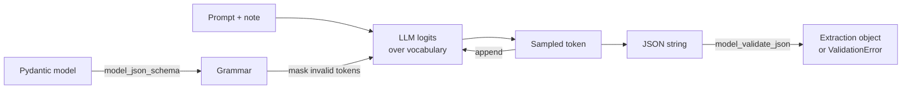

# 01 — Domain model and schemas

## 1. What was built

| File | Purpose |
|---|---|
| `app/nlp/schemas.py` | Enums `RiskCategory` (7), `Severity` (3) and `MedicationStatus` (5). Models `CareNote` (input), `RiskFlag` and `Extraction` (LLM output contract). `extraction_json_schema()` returns the schema for Ollama's `format` parameter. |
| `tests/test_schemas.py` | 9 tests: valid parsing into enums, empty flags, invalid category/severity/confidence/evidence rejected, extra fields rejected, whitespace-only note rejected, schema shape (required fields, no `additionalProperties`, field order, enum values). |

**Risk taxonomy:** `falls`, `medication`, `nutrition_hydration`, `skin_integrity`, `mood_behaviour`, `safeguarding`, `missed_late_visit`.
**Severity:** `low` (record it; review at the routine care-plan review) · `medium` (coordinator follow-up within the day) · `high` (same-shift escalation; always goes to human review).

## 2. Why this way

- **One Pydantic model is both the decoding constraint and the validator.** The JSON schema that restricts generation and the code that checks the response come from the same class, so they can't drift apart.
- **Evidence is a verbatim quote, not character offsets.** LLMs work in tokens, not characters, so they can't count characters reliably. They can copy text. Step 1.6 finds the quote in the note (exact match, then fuzzy) to compute offsets and reject hallucinated evidence. In a care setting, every flag a coordinator sees has to point at what the carer actually wrote.
- **Evidence comes before severity and confidence in the field order.** Generation is autoregressive: each token is conditioned on the ones before it. Having the model write the quote first means its severity judgement is conditioned on the evidence, which works like a tiny chain of reasoning. If severity came first, the evidence would tend to be picked afterwards to justify it.
- **Three severity levels, each tied to an action.** Finer scales (1–5, or adding "critical") increase disagreement between annotators and between model runs, without changing what a coordinator does. Each level maps to a concrete workflow.
- **`extra="forbid"` and every field required.** This produces `additionalProperties: false` and a full `required` list, so the model can't invent fields (e.g. `"diagnosis"`) or leave out `risk_flags`. An empty list has to be written explicitly, which is a positive statement of "no risks found".
- **Negation lives in the field description**, which the model sees through the schema. Negated risks ("no signs of falls") are left out instead of being flagged as low severity. That keeps the semantics simple: a flag means there is evidence *for* the risk.
- **`CareNote` uses pseudonymous refs (`CL-0001`), never names.** Identity data is kept apart from the narrative from the start. That's data minimisation built into the schema (and the redaction in Step 1.3 handles names that appear inside the free text).

**A finding from this step.** I sent the schema to `llama3.1:8b` at temperature 0 with a single-line prompt and the note *"found on floor by bed, says she slipped… Refused morning tablets…"*. Ollama accepted the schema (`$defs`/`$ref` work) and the output **validated**. But `risk_flags` was `[]`: the fall was missed, even though `medication_status` correctly said `refused`. **Constrained decoding guarantees the output's shape, not that it's correct.** That's why there is a rules baseline (1.4), versioned prompts (1.5), grounding (1.6), human review (1.8) and measured recall (1.9).

## 3. Alternatives considered

| Option | Pros | Cons | When I'd choose it |
|---|---|---|---|
| **Pydantic schema + constrained decoding (chosen)** | Output always parses; one source of truth; types flow into the API | Format constraints can slightly hurt reasoning; still semantically fallible | Extraction into a known, closed schema |
| Free-text answer, then regex/LLM parsing | The model "speaks freely"; best raw reasoning | Brittle parsing; a second failure point | Open-ended reasoning, or a two-step "reason then format" pipeline |
| `format: "json"` (JSON mode only) | Simple; always valid JSON | No enforcement of fields, types or enums | Prototyping before the schema is stable |
| Character offsets for evidence | Precise highlighting; no fuzzy matching needed | LLMs can't count characters; high error rate | Fine-tuned span-extraction models (e.g. token-classification NER) |

## 4. How it works

**Schema-constrained decoding.** At each step the LLM produces a probability for every token in its vocabulary (~128k for Llama 3.1). Ollama compiles the JSON schema into a grammar and, before sampling, **masks every token that would break the grammar**. Inside `"severity": "`, only tokens that continue `low`, `medium` or `high` survive. Validity is guaranteed by construction, not hoped for.

**Worked example.** Partway through generation the output so far is `{"risk_flags":[{"category":"fa`. The grammar allows only `lls"` next, because `falls` is the only enum value starting with `fa`. Even a token the model rates highly, like `tigue`, gets probability 0.

**Why validate again afterwards?** Some keywords (`maxLength`, `minimum`/`maximum`) may not be enforced by the grammar. Grammar engines usually handle structure, types and enums well, but numeric and length bounds less consistently. Pydantic re-checks everything, so the guarantee doesn't depend on Ollama's internals. A failure triggers a retry (Step 1.5).

**Why self-reported `confidence` is weak.** The number is just generated tokens, not a probability that has been calibrated. It's still useful for *ranking* and routing (Step 1.6), but it's not trustworthy as a probability. Tier 3 introduces calibration properly. Token log-probabilities would be a better signal, and that's noted as future work.

## 5. Interview questions and answers

**Q1. How does schema design affect LLM reliability?**
The schema is both a constraint on decoding and a specification the model reads. Closed enums remove free-text variation ("Fall", "fell", "falls risk" all collapse to `falls`). `required` plus `additionalProperties: false` stop omitted or invented fields. Field order shapes what the model conditions on, which is why evidence comes before severity. Descriptions work as inline instructions, for example on negation. The schema stays small and flat, because deep nesting and unions make grammars harder and degrade output quality.

**Q2. Why ask for a verbatim quote instead of character offsets?**
LLMs process tokens, so character arithmetic is unreliable, while copying text is something they do well. A verbatim quote can also be verified mechanically: if it isn't a substring of the note (allowing fuzzy matching for whitespace and typos), the flag is rejected as possibly hallucinated. Offsets are then computed deterministically for highlighting in the review UI.

**Q3. If decoding is constrained, why validate with Pydantic as well?**
Defence in depth. Grammar support varies by keyword and engine version, so length and numeric bounds may not be enforced during decoding. A malformed response could also come from a timeout or truncation. Pydantic gives one authoritative check with typed errors that drive a retry. And the schema guarantees shape, not truth: my sanity check produced a valid but wrong extraction that missed a fall.

**Q4. Trade-off: does forcing JSON make the model worse?**
It can. Tam et al. (2024), "Let Me Speak Freely?", found that strict format constraints reduce performance on reasoning-heavy tasks, while classification-style tasks often benefit. Ours is extraction and classification over a closed taxonomy, which is closer to the favourable case. Putting evidence first acts as built-in reasoning. If evaluation showed recall dropping, I'd compare a two-step approach (free-text analysis, then formatting) against the constrained version in Step 1.9.

**Q5. Why three severity levels, and who decides them?**
Each level corresponds to a distinct action: record, same-day follow-up, same-shift escalation. More levels add disagreement without adding decisions. With real PBL data, the definitions would be agreed with registered managers and aligned to their existing escalation and safeguarding policies. Inter-annotator agreement (e.g. Cohen's kappa) would be measured on a sample to check the scale is usable.

**Q6. With real PBL data, what would change in the schema?**
The taxonomy would be validated against PBL's real incident categories and CQC-relevant reporting, and probably extended, e.g. with continence or end-of-life care. I'd version the schema (`schema_version` in the audit record) so stored extractions can still be interpreted after changes. Severity might take account of client context, such as a falls history from the care plan. That would need careful access control, because it adds data the model sees.

**Q7. Why is the model's self-reported confidence not a probability?**
It's generated text, shaped by training, not by a calibrated estimate of being right. LLMs often cluster their verbal confidence at high values. I use it only to rank and route, and always send high-severity flags to human review regardless of confidence. A stronger signal would be token log-probabilities or agreement across several samples, calibrated against labelled data.

## 6. Learn more

**Official documentation**
- Ollama: Structured Outputs (the `format` parameter, Pydantic schemas, temperature tips): https://docs.ollama.com/capabilities/structured-outputs
- Ollama blog: "Structured outputs" (6 Dec 2024, introduction with extraction examples): https://ollama.com/blog/structured-outputs
- Pydantic: JSON Schema (`model_json_schema`, `$defs`): https://pydantic.dev/docs/validation/latest/concepts/json_schema/

**Paper**
- Tam et al., "Let Me Speak Freely? A Study on the Impact of Format Restrictions on Performance of Large Language Models" (2024): https://arxiv.org/abs/2408.02442

**Videos**
- *"No more bad outputs with structured generation"*, Rémi Louf (creator of Outlines), AI Engineer World's Fair 2024: https://www.youtube.com/watch?v=aNmfvN6S_n4. The clearest explanation of how token masking against a schema works, from someone who built one of the main libraries. (Talk page: https://ai.engineer/talks/no-more-bad-outputs-with-structured-generation)

## 7. Check your understanding

The models use `str_strip_whitespace=True`. Write two tests and **predict each result before running**:

1. `RiskFlag(category="falls", evidence="x", severity="low ", confidence=0.5)`, with a trailing space on the severity.
2. `RiskFlag(category="falls", evidence="  on floor  ", severity="low", confidence=0.5).evidence`

Expected: (1) **raises `ValidationError`**. Stripping applies only to plain `str` fields; enum fields are matched exactly, so `"low "` is not a member. (2) returns **`"on floor"`**, stripped. Why it matters: stripping evidence is harmless for grounding (Step 1.6), because a stripped substring is still a substring. If you wanted lenient enum matching, you'd add an explicit `field_validator(mode="before")`, a deliberate choice rather than a side effect.
