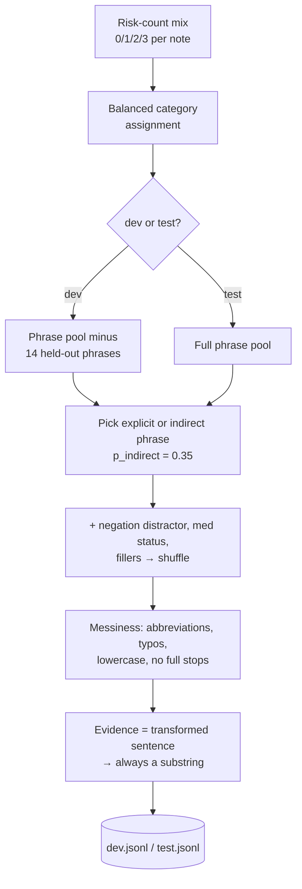

# 02 — Synthetic data generator

## 1. What was built

| File | Purpose |
|---|---|
| `app/nlp/dataset.py` | Gold-label models (`GoldFlag`, `GoldLabel`, `LabelledNote`, frozen) and JSONL read/write. |
| `scripts/note_templates.py` | Phrase library: 48 labelled risk phrases (32 explicit, 16 indirect), negations, fillers, synthetic identifiers, abbreviations. |
| `scripts/generate_notes.py` | Builds 80 dev and 40 test notes (seed 42). Balanced category assignment, held-out phrases, messiness, synthetic PII. |
| `data/care_notes/{dev,test}.jsonl` | The dataset. |
| `data/care_notes/DATA_CARD.md` | How the data was generated, statistics, intended use, biases. |
| `tests/test_dataset.py` | 12 tests: deterministic, sizes and unique IDs, test split balanced for 4 seeds, evidence is verbatim, negated categories carry no flag, follow-up rule, held-out phrases absent from dev, PII is synthetic and present, committed files match the generator. |

## 2. Why this way

- **Templates rather than LLM-written notes.** With templates the labels are **correct by construction**: every gold flag comes from a known phrase, so there's no label noise. If an LLM wrote the notes, I'd need to label them, and labelling with an LLM makes evaluating an LLM circular. The model family being tested would effectively be grading its own style. Templates are also deterministic and reviewable line by line, which matters in a sector where people need to see exactly what a test covered.
- **Two problems I hit and fixed rather than worked around:**
  1. *Uneven categories.* Picking categories at random left only 2 mood examples in test. Trying seeds until the check passed would have been **tuning the dataset to pass its own check**. Instead, categories are now assigned in a balanced way (least-used first), so test has exactly 8 per category for *any* seed. A test checks this across 4 seeds.
  2. *Phrase leakage.* Dev and test shared all phrases, so rules written against dev (Step 1.4) would match test text exactly and score unrealistically well. Now 14 phrases are test-only, and the `unseen_phrase` tag lets Step 1.9 report seen vs unseen phrases separately. This is a generalisation test, in the same spirit as Google's advice to remove duplicates between training and test data.
- **Hard cases on purpose.** Indirect phrasings (no keyword), negations ("no signs of dehydration"), "no" used to state a risk ("She is **no** longer finishing her meals"), multiple risks per note, typos, abbreviations, lowercase. Each one targets a specific way a keyword baseline or an LLM is likely to fail.
- **Obviously synthetic PII is built into the data.** Step 1.3 needs something to redact. Ofcom's drama number range and the NHS 999 test range can't belong to a real person. `ZZ` is not a real postcode area.
- **Every split is fixed and committed, with a test that the files match the generator.** Evaluation numbers can be reproduced exactly, and nobody can hand-edit the test set without a test failing.

## 3. Alternatives considered

| Option | Pros | Cons | When I'd choose it |
|---|---|---|---|
| **Templates + noise (chosen)** | Labels correct by construction; deterministic; easy to inspect; controlled hard cases | Narrow vocabulary; can favour keyword rules | Small eval sets where label correctness matters most |
| LLM-generated notes + LLM labels | Rich, natural variety | Circular when evaluating an LLM; label noise; not reproducible | Augmenting *training* data, with human-checked labels |
| LLM-generated notes + human labels | Natural text, trusted labels | Slow; one annotator has no agreement check; costly | When a domain expert has time to annotate (e.g. PBL staff) |
| Real, de-identified PBL notes | The true distribution | Needs a DPIA, data-sharing agreement, ethics approval; not available for a portfolio | The KTP project itself, after governance sign-off |

## 4. How it works

**Balanced assignment, worked example.** With 7 categories and usage counts so far of `{falls: 3, meds: 3, mood: 2, …all others: 3}`, a note that needs 2 risks takes `mood` (count 2) first. Next, one of the 3-count categories is chosen by a seeded random tie-break. Over the test stream, 56 slots ÷ 7 categories = exactly 8 each.

**Why negation is hard for keywords.** A rule `falls ← r"\bfall"` fires on "No falls reported since last visit", which is a false positive. Adding "no" handling (e.g. NegEx-style trigger words in a window) then wrongly suppresses "She is **no** longer finishing her meals". This dataset includes both cases, so a baseline can't do well on one by sacrificing the other without that showing up.

**Why evidence is computed after the messiness.** If the gold evidence were the clean phrase ("tablets") but the note said "tabelts", gold evidence wouldn't be a substring of the note. Then the grounding check (Step 1.6) and any evidence-match metric would penalise correct predictions.

## 5. Interview questions and answers

**Q1. Why build synthetic data from templates instead of asking an LLM to write notes?**
Templates give correct labels by construction, so evaluation measures the system and not labelling errors. LLM-written notes would need labels, and having an LLM label data for evaluating an LLM is circular: shared biases in phrasing and judgement would inflate scores. Templates are deterministic and reviewable line by line. The cost is narrow vocabulary, which I document as the main limitation and partly offset with indirect phrasings, negations, held-out phrases and noise.

**Q2. What is data leakage, and where could it happen here?**
Leakage is when information from the evaluation set influences the system being evaluated, so scores come out too optimistic. Here the subtle form is *phrase leakage*: if dev and test share exact phrases, keyword rules or few-shot prompts written on dev effectively memorise test. I hold out 14 phrases as test-only and tag notes that use them, so I can report seen vs unseen performance. Procedurally, test is never opened until Step 1.9.

**Q3. Your first generator produced 2 mood examples in test. Why not just change the seed?**
Picking a seed because the output passes a check is a mild form of p-hacking. The dataset becomes whatever passed, and the problem would come back with any other seed. Fixing the cause, by assigning categories in a balanced way, makes coverage a structural property, and a test proves it for several seeds. It's the same principle as stratified splitting in classical ML.

**Q4. What biases does this dataset have, and how do they affect your results?**
The biggest is narrow vocabulary, which favours keyword rules, so the baseline will look stronger than it would on real notes. Prevalence is unrealistic: 83% of notes have a risk, which inflates precision compared with real data, where most notes are routine. Low severity is under-represented, all clients are female, negation is simple, and every risk sits in one sentence. All of these are in the data card. I'd present results as a comparison between methods on controlled cases, not as accuracy estimates for real use.

**Q5. With real PBL data, how would you build the evaluation set?**
First, governance: a DPIA, a data-sharing agreement, and de-identification before anything leaves PBL's systems. Then stratified sampling of real notes across services and carers, labelled by two trained annotators (e.g. senior carers or registered managers) using written guidelines, with inter-annotator agreement measured (Cohen's kappa) and disagreements resolved. I'd keep this synthetic set as a regression suite for known hard cases, and split real data by client, so one client's notes never appear in both train and test.

**Q6. Trade-off: controlled difficulty vs realism.**
Controlled data tells you exactly *which* skill failed, for example negation or indirect phrasing, through tags. Realistic data tells you *how much* it matters in practice. I chose control because this set compares methods and diagnoses failures; it isn't for estimating deployment accuracy. Ideally you need both: a synthetic suite of targeted cases, like unit tests, and a real held-out sample, like integration tests.

**Q7. How do you make sure the dataset is reproducible and can't be tampered with?**
The generator uses a single seeded `random.Random(42)` with no global state, so the output is deterministic, and a test checks that two runs give identical results. The committed JSONL files are compared with a fresh generation in CI, so a hand edit or a stale file fails the build. The data card records the seed and every probability used.

## 6. Learn more

**Official documentation and references**
- Google ML Crash Course, "Datasets: Dividing the original dataset" (duplicates between training and test sets inflate metrics): https://developers.google.com/machine-learning/crash-course/overfitting/dividing-datasets
- Ofcom, "Telephone numbers for use in TV and radio drama programmes" (the 07700 900xxx range): https://www.ofcom.org.uk/phones-and-broadband/phone-numbers/numbers-for-drama
- Gebru et al., "Datasheets for Datasets" (the origin of dataset documentation practice): https://arxiv.org/abs/1803.09010
- Pushkarna et al. (Google Research), "Data Cards: Purposeful and Transparent Dataset Documentation for Responsible AI": https://arxiv.org/abs/2204.01075

**Videos**
- I couldn't verify a video for this step in this session. Search YouTube for `StatQuest data leakage` and `Datasheets for Datasets FAccT talk Gebru`.

## 7. Check your understanding

In `scripts/generate_notes.py`, change the indirect-phrase probability in `_make_note` from `0.35` to `1.0` and regenerate. **Predict:** (a) does generation crash, given that held-out phrases are removed from dev? (b) how many dev notes get the `hard` tag? (c) how many *distinct* indirect phrases can dev use?

Expected (checked by running it):
- (a) **No crash.** Every (category, indirect) group has at least 2 phrases (`falls` and `nutrition_hydration` have 3, the rest have 2), so holding out the last one always leaves at least one for dev.
- (b) **66**, meaning every dev note with at least one risk (test: 34).
- (c) **9** (2 + 2 + 5 × 1). Yet dev contains 34 distinct evidence *strings*, only because typos and lowercasing create surface variants.

Lesson: surface noise hides how little real variety there is. Count distinct *source phrases*, not distinct strings, when judging how varied a dataset is. Revert the change and regenerate; `test_committed_data_matches_generator` fails until you do.
