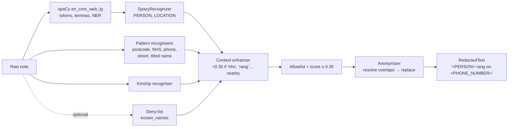

# 03 — PII redaction

## 1. What was built

| File | Purpose |
|---|---|
| `app/nlp/redact.py` | Presidio `AnalyzerEngine` on spaCy `en_core_web_lg` plus 6 custom recognisers (UK postcode, NHS-like number, UK phone, street address, titled name, kinship name). An entity allowlist. `redact(text, known_names=())` → `RedactedText` (masked text plus spans holding no original values). |
| `tests/test_redact.py` | 26 tests: every postcode format, NHS with no checksum, UK phone formats, names (capitalised, lowercase, word-like first names), street address, the `known_names` deny-list, clinical text left unchanged, spans hold no PII, and dataset-level regression floors. |
| `pyproject.toml` | Adds `presidio-analyzer`, `presidio-anonymizer`, `spacy`, `en_core_web_lg 3.8.0` (pinned wheel URL). |

**Measured on the synthetic dataset** (seed 42; generic pipeline, no `known_names`):

| Split | PII values | Leaked | PII recall | Gold evidence sentences | Altered | Evidence preserved |
|---|---|---|---|---|---|---|
| dev (80 notes) | 164 | 2 | **98.8%** | 109 | 0 | **100%** |
| test (40 notes) | 59 | 1 | **98.3%** | 56 | 2 | **96.4%** |

Latency is about 6.5 ms per note after a one-off model load of about 1 s (M1 Pro).

## 2. Why this way

- **Redact before the LLM, and enforce it with a type.** Even with local inference, the model only needs the *clinical* content to decide "is this a fall?" and not *who* fell. UK GDPR Article 5(1)(c) requires personal data to be "adequate, relevant and limited to what is necessary". Names, phones and addresses aren't necessary for risk extraction, so the model doesn't see them. Step 1.5's extractor will accept only `RedactedText`, which makes skipping redaction a type error rather than something to remember.
- **Recall over precision.** A leaked name is a data-protection incident. An over-masked word ("Pills" → `<PERSON>`) costs a little extraction accuracy. Hence: no NHS checksum (a mistyped number is still an identifier), a low score threshold (0.35), and pattern recognisers that add to NER rather than replace it.
- **Allowlist, not Presidio's defaults.** The defaults include `DATE_TIME`, which would mask "9:40 for the 8:30 call", the very evidence for a late visit. They also include US recognisers that produced noise (a phone fragment tagged as a US driver's licence). The allowlist is: `PERSON, LOCATION, PHONE_NUMBER, EMAIL_ADDRESS, UK_NHS, UK_POSTCODE, UK_STREET_ADDRESS`.
- **The custom recognisers came from measured failures, not guesses:**
  - spaCy alone labelled `07700 900231` as a **DATE**, missed lowercase `ms dummyford`, and missed the street and postcode.
  - Presidio's built-in NHS recogniser requires a valid checksum, so it ignored `999 899 2200` (which then showed up as a low-score phone number).
  - The first full run leaked 9 names, all family members called "Delta" or "Echo". NER doesn't treat these word-like names as people. The kinship recogniser (`daughter Delta Fakename`) fixed most of them.
- **The kinship recogniser is case-sensitive on purpose.** A case-insensitive version would mask "her nephew **takes her** bank card", wiping out safeguarding evidence. This is the central trade-off of the step: making redaction more aggressive eventually destroys the information the system exists to detect.
- **The `known_names` deny-list is a hook for production.** PBL already holds each client's name and next-of-kin in the care record, and an exact-match deny-list catches what no generic model can (lowercase, word-like names). It is **not** used in the dataset metrics, because passing the gold PII list would be cheating.
- **Fixes were tuned on dev; test is reported separately.** Test recall is the honest number.

## 3. Alternatives considered

| Option | Pros | Cons | When I'd choose it |
|---|---|---|---|
| **Presidio + spaCy lg + custom UK patterns (chosen)** | Local, configurable, explainable (each mask names its recogniser), well-tested framework | NER misses lowercase or word-like names; needs tuning per locale | Default for UK free text processed on-premises |
| Regex only | Fast, deterministic, no model download | Can't find names in free text at all | Structured identifiers only (NHS numbers in forms) |
| spaCy `trf` (transformer) NER | Better NER accuracy | Slower, heavier; still case-sensitive in practice | When name recall on real notes is below target |
| Use the LLM to redact | Handles context and lowercase | Defeats the purpose (raw PII goes into the model); non-deterministic; hard to audit | Never for the primary safeguard; maybe as a second-pass *detector* on already-redacted text |
| Gazetteer/deny-list from the care record | Near-perfect recall for *known* people | Misses people not on file (a neighbour, a new carer) | Always, *in addition to* generic detection, in production |

## 4. How it works

**Scores and context, worked example.** In `"call to ms dummyford (nhs no 999 899 2200)"`:
- The NHS-like pattern matches `999 899 2200` with base score **0.5**. The context word "nhs" is in the window just before it, so the enhancer adds 0.35, giving **0.85**.
- The built-in phone recogniser also matches the same span at **0.4**.
- The anonymizer's overlap rule (*same span → keep the higher score*) keeps `UK_NHS`, so the output is `<UK_NHS>`, not `<PHONE_NUMBER>`.

**Overlap rules** (from the Presidio anonymizer docs):
- identical spans → the higher score wins
- one span inside another → the **longer** span wins, even with a lower score
- partial overlap → both are masked

That's why lowercase `zz5 6bq` came out as `<LOCATION>` (from spaCy) rather than `<UK_POSTCODE>`. The label is less precise, but the value is still masked.

**Why typed placeholders rather than deletion or fake names.** `<PERSON> rang on <PHONE_NUMBER>` keeps the sentence grammatical and the roles clear, so the LLM can still reason ("a family member called"). Fake replacement names would read naturally but could confuse a reviewer and might collide with real names. Deletion breaks sentences.

**A consequence for Step 1.6.** The LLM only sees redacted text, so it quotes evidence from the *redacted* text. Grounding therefore has to check against the redacted text, not the original. In 2 of 56 test evidence sentences, a word was masked by mistake ("Pills", "Cilent").

## 5. Interview questions and answers

**Q1. Your LLM runs locally. Why redact at all?**
Data minimisation is a principle of its own, not only a rule about third parties: UK GDPR Article 5(1)(c) limits processing to what's necessary for the purpose, and identifying a fall doesn't need the client's name. Redaction also limits the damage from things we don't control: model inputs could end up in logs, prompt traces, crash dumps or a future switch to a hosted model. And it reduces the chance of the model copying identifiers into summaries that are shown more widely than the original note. It's defence in depth, and it will be central to the DPIA.

**Q2. Why prioritise recall over precision, and where does that stop?**
The costs aren't symmetric. A leaked identifier is a potential personal-data breach, while an over-masked word usually costs a little extraction accuracy. So I skip the NHS checksum, use a low threshold and layer several recognisers. It stops where over-redaction destroys clinical meaning. A case-insensitive kinship rule would mask "takes her" in "her nephew takes her bank card", which is safeguarding evidence. So I measure both PII recall *and* evidence preservation, and I treat the second as a safety metric too.

**Q3. How do you know the redaction works?**
Unit tests per recogniser on synthetic identifiers in every format. A test that clinical sentences come through unchanged. And dataset-level regression floors: PII recall of 98.8% on dev and 98.3% on test, with evidence preserved at 100% and 96.4%. I tuned only on dev and report test separately. The residual leaks are lowercase family names, and they're documented rather than hidden. I'm explicit that synthetic data overstates real-world recall, because real notes have far more varied names and formats.

**Q4. What would you do differently with real PBL data?**
First, add a per-client gazetteer from the care record (client and next-of-kin names, address), which the `known_names` hook already supports. Second, build a de-identification evaluation set from real notes, double-annotated, and measure recall per entity type, with recall on names as the target. Third, consider `en_core_web_trf` or a fine-tuned NER model if name recall falls short. Fourth, add carer names, which also appear in notes. All of this happens inside PBL's environment under the DPIA.

**Q5. Trade-off: typed placeholders vs consistent pseudonyms (PERSON_1, PERSON_2)?**
Typed placeholders are simplest and leak nothing, but they lose who is who. "<PERSON> said <PERSON> takes her card" hides whether the client or the nephew did what. Consistent numbering within a note keeps those relationships, which helps safeguarding reasoning, at the cost of more complex code and a mapping that is itself sensitive. I started with typed tags. If evaluation showed safeguarding recall suffering from lost relationships, consistent pseudonyms within a note would be the next step.

**Q6. Can you just let the LLM redact the text?**
Not as the primary safeguard: it means sending the raw PII into the model, which is exactly what redaction prevents. It's also non-deterministic and harder to audit. A defensible use would be a second-pass *detector* run on already-redacted text, flagging residual identifiers for human review. But it would never be the gate itself.

**Q7. Is redacted data anonymous under UK GDPR?**
No. This is pseudonymisation at best. The notes are still linked to `client_ref`, the original is stored, and the remaining context (dates, rare conditions, events) could re-identify someone. So the redacted text is still personal data and needs the same protections. Redaction lowers risk; it doesn't take the data out of scope.

## 6. Learn more

**Official documentation**
- Presidio, "Supporting detection of new types of PII entities" (PatternRecognizer, deny-lists, custom `EntityRecognizer`, ad-hoc recognisers): https://presidio.dataprivacystack.org/analyzer/adding_recognizers/
- Presidio Anonymizer (the default replace operator and the overlap rules): https://presidio.dataprivacystack.org/anonymizer/
- ICO, "Principle (c): Data minimisation": https://ico.org.uk/for-organisations/uk-gdpr-guidance-and-resources/data-protection-principles/a-guide-to-the-data-protection-principles/data-minimisation/
- ICO, "Special category data" (health data is special category): https://ico.org.uk/for-organisations/uk-gdpr-guidance-and-resources/lawful-basis/a-guide-to-lawful-basis/special-category-data/

> Note: Presidio has moved from `github.com/microsoft/presidio` (which now redirects) to `github.com/data-privacy-stack/presidio`, with docs at `presidio.dataprivacystack.org`. I confirmed this against the installed package's own metadata.

**Videos**
- I couldn't verify a video in this session. Search YouTube for: `PyData Presidio PII anonymization` and `PyData Paris 2025 text anonymization`.

## 7. Check your understanding

In `app/nlp/redact.py`, make the kinship *name* group case-insensitive. Replace `([A-Z][a-z'-]+(?:\s+[A-Z][a-z'-]+)?)` with `((?i:[a-z][a-z'-]+(?:\s+[a-z][a-z'-]+)?))`. Keep the outer parentheses: `(?i:…)` on its own is *non-capturing*, so `m.start(1)` would raise `IndexError`. Run `uv run pytest tests/test_redact.py`. **Predict** (a) which tests fail, and (b) PII recall and evidence preservation on test.

Expected (checked by running it):
- (a) 4 failures:
  - `test_clinical_content_not_redacted[...nephew takes her bank card...]`: "takes her" is now masked.
  - `test_known_names_catch_what_generic_recognisers_miss`: its "documented residual gap" assertion no longer holds, because the lowercase name is now caught.
  - Both dataset tests: evidence preservation drops below the 0.95 floor.
- (b) PII recall rises to **100%** on dev and test, but evidence preservation falls to **92.7% (dev) and 83.9% (test)**. One in six test risk sentences gets damaged.

The lesson: one regex flag trades the last 2% of identifier recall for 12 points of lost clinical evidence. That's why both metrics are tracked, and why the production answer is a gazetteer from the care record rather than more aggressive patterns. Revert the change.
