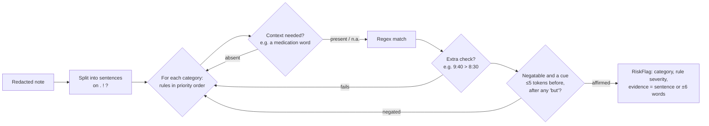

# 04 — Keyword/rules baseline

## 1. What was built

| File | Purpose |
|---|---|
| `app/nlp/baseline.py` | `extract(text) -> Extraction`, the same schema as the LLM. It has:<ul><li>a regex lexicon per category, with a severity on each pattern and an order of priority</li><li>context requirements (medication words)</li><li>NegEx-style negation: a cue up to 5 tokens before the match, with the scope cut at but/however</li><li>a time-comparison rule for late visits</li><li>`medication_status()`</li><li>evidence = the containing sentence, or a ±6-word window when the note has no punctuation</li></ul>Version `rules-v1`. |
| `app/nlp/metrics.py` | `PRF` and `category_report()`: per-category TP/FP/FN, micro and macro averages. Step 1.9 reuses it. |
| `tests/test_baseline.py`, `tests/test_metrics.py` | 23 tests on **new** sentences (not template text), plus a regression floor on dev. |

**Results on redacted dev only.** These are tuning-set numbers, so they're optimistic. Test stays closed until Step 1.9.

| Version | Micro P | Micro R | Micro F1 | Macro F1 | Med-status acc | Follow-up acc | Severity agreement on TPs |
|---|---|---|---|---|---|---|---|
| rules-v0 (generic lexicon) | 1.000 | 0.651 | 0.789 | 0.780 | 0.912 | 0.838 | 0.930 (n=71) |
| rules-v1 (after dev error analysis) | 1.000 | 0.972 | 0.986 | 0.986 | 0.975 | 1.000 | 0.953 (n=106) |

n = 80 notes, 109 gold flags, seed 42. The remaining 3 misses are all typos (`tabelts`, `Aigtated`, `folor`).

**v0 → v1 changelog** (each change justified by a dev error):
1. **Bug fix:** "no" meaning *number* ("NHS no 999…", "tel no") was read as negation. In notes without full stops it suppressed the next risk ("(NHS no `<UK_NHS>`) Arrived late…").
2. **Bug fix:** `\bn't` can never match inside "hasn't", because there's no word boundary between `s` and `n`. Changed to `(?:\bnot|n't)`.
3. Lexicon additions:
   - falls: on the (…) floor, "went down"
   - medication: found tablets → dropped/missed dose
   - nutrition: dry lips / not thirsty, empty fridge / out-of-date food
   - skin: body site + looks red/sore
   - mood: not dressed/washed (self-neglect)
   - safeguarding: someone taking her bank card
   - missed/late: **arrived at X for the Y call, flagged only if X > Y**
4. Deliberately **not** fixed: typos. A strict keyword baseline is the comparison we want. Fuzzy matching would be a different baseline.

## 2. Why this way

- **A baseline makes the LLM's numbers mean something.** "The LLM gets 0.85 F1" means nothing alone. "The LLM beats tuned rules on unseen phrasings and typos, and loses on X" is a claim a panel can probe. In a care setting, if rules perform as well, they are cheaper, deterministic, auditable and have no hallucination risk, so they should win. Google's *Rules of ML* Rule #1 is "Don't be afraid to launch a product without machine learning".
- **Same output schema as the LLM.** One evaluation harness, one review UI, one audit format. Baseline evidence is always grounded, because it's a slice of the input.
- **Run on redacted text.** The LLM will only see redacted text, so for a fair comparison the baseline sees the same. That's how the "Put" → `<PERSON>` over-redaction in run-on notes showed up.
- **Precision-first design.** Context requirements ("refused" only counts as a medication risk next to a medication word) and negation keep false positives at 0 on dev. Rules naturally sit at high precision and limited recall. That's the exact gap an LLM should fill, and the one to measure.
- **An honest conflict of interest.** I wrote the template phrases, *including the 14 test-only ones*, so I can't build a truly blind baseline. Mitigations: v0 came from generic care-sector vocabulary; v1 changes were made **only** for observed dev errors and are logged above; test stays closed. A properly independent setup would have one person write the test phrases and someone else write the rules. That's what I'd do with a real team, or with real PBL notes, where nobody authored the data.

## 3. Alternatives considered

| Option | Pros | Cons | When I'd choose it |
|---|---|---|---|
| **Regex lexicon + NegEx-style negation (chosen)** | Transparent, deterministic, fast (~µs), every flag traceable to a rule | Brittle to typos and paraphrase; maintenance grows with vocabulary | Baseline; also production for well-defined, high-precision triggers |
| spaCy `Matcher`/`PhraseMatcher` + negspaCy | Token-aware patterns, lemmas ("fell"/"falls"), a maintained NegEx implementation | Extra dependencies; still keyword-bound | A larger rule set maintained by several people |
| Fuzzy keyword matching (edit distance) | Handles typos ("folor") | False matches on short words ("fall"/"tall"/"ball"); a threshold to tune | Noisy text where typos are a major source of misses |
| Classic ML (TF-IDF + logistic regression per category) | Learns phrasings from data; calibrated probabilities | Needs hundreds of labelled notes per category; weak on negation without features | Once PBL has a labelled dataset of real notes |

## 4. How it works



**Negation, worked through:**

| Sentence | Trigger | Tokens before (≤5, after any 'but') | Result |
|---|---|---|---|
| "Mobilised well with frame, no trips or falls." | falls | `with frame no trips or` → contains **no** | negated ✅ |
| "No injury seen but she fell in the garden." | fell | scope cut at *but* → `she` | **affirmed** ✅ |
| "(NHS no `<UK_NHS>`) Arrived late" | arrived late | `NHS no` removed as a number abbreviation → `call to person uk nhs` | affirmed ✅ (the v1 fix) |
| "She hasn't eaten since breakfast." | `n't eaten` | pattern not negatable: the negation *is* the risk | affirmed ✅ |

**Micro vs macro F1.** Micro pools TP/FP/FN across categories, so frequent categories dominate. Macro averages each category's F1, so rare categories count equally. For safety flags, macro matters: missing every safeguarding concern shouldn't be hidden by doing well on falls. `test_metrics.py` shows this. With 3/3 falls right and 1/1 safeguarding missed, micro recall is 0.75, but macro F1 is 1/7, because 5 categories have no data and score 0.

## 5. Interview questions and answers

**Q1. Why build a rules baseline when you have an LLM?**
Without a baseline, an LLM metric has nothing to compare against. You can't tell whether 0.85 F1 is good or whether a regex would do the same. If rules match the LLM, they win on cost, latency, determinism and auditability, with zero hallucination risk, which matters in regulated care. The baseline also tells me *where* the LLM adds value: on dev, rules miss typos and indirect phrasings, so that's where I'll expect, and test for, an LLM advantage. Google's Rules of ML says the same: don't be afraid to launch without ML.

**Q2. Dev F1 went from 0.79 to 0.99. Is the baseline that good?**
No. Those are tuning-set numbers. I changed the rules after looking at dev errors, so dev performance is optimistic by construction. The honest estimate comes from the test set, especially the 17 notes with phrases never seen in dev, which I'll report separately in Step 1.9. I expect a clear drop on unseen phrases. If there isn't one, that suggests my test phrases are too similar to dev, which is itself a finding about the dataset.

**Q3. How does your negation handling work, and where does it fail?**
It's a simplified NegEx (Chapman et al., 2001): a negation cue within five tokens *before* the trigger, with the scope ending at "but"/"however", and patterns where the negation is the risk ("hasn't eaten") exempted. It fails on negation after the trigger ("falls: none"), on long-distance scope, on double negation, and on hedging ("?fall", "possible fall"). I hit one real failure: "NHS no" being read as negation. That's why I fixed it as a general case (number abbreviations), not as a one-off.

**Q4. Trade-off: why not add fuzzy matching to catch typos?**
It would raise recall but bring false positives on short words: "fall" is one edit away from "tall", "ball" and "fail". And it needs a tuned threshold per word length. More importantly, the baseline's job is to be a *clear, standard* comparison. Mixing in fuzzy logic blurs what "rules" means. Typo robustness is one of the things I want to measure the LLM on, so I keep the baseline strict and report its typo failures separately.

**Q5. With real PBL data, would you keep the rules?**
Probably, as a layer rather than the main extractor. High-precision rules for unambiguous, high-severity triggers (e.g. "unexplained bruising", "missed call") make a cheap safety net that runs even if the LLM is down, and they can flag LLM omissions for review. I'd mine real notes for vocabulary, use spaCy matchers with lemmas, and version the rules like code with tests. If labelled data built up, a TF-IDF + logistic regression model would be the next step before an LLM, because it gives calibrated probabilities.

**Q6. Why report macro F1 as well as micro?**
Micro F1 is dominated by frequent categories, so a system could miss all safeguarding concerns and still look fine if falls are common. In real notes, safeguarding is rare and high-impact. Macro F1 weights every category equally and exposes that failure. For safety I'd also look at per-category recall directly, and macro *recall* in particular.

**Q7. You wrote the test phrases and the rules. Isn't the evaluation compromised?**
Partly, yes, and I say so. Holding out phrases protects against tuning on dev, but not against knowledge I carry as the author. I mitigated it by building v0 from generic vocabulary, making v1 changes only from logged dev errors, and never opening test. The proper fix is separation of roles: someone else writes the evaluation phrases, or, best of all, real notes that nobody on the team wrote. With PBL, the evaluation set would be real notes labelled by care staff, which removes this problem.

## 6. Learn more

**Official documentation and references**
- Google, *Rules of Machine Learning*: Rule #1 "Don't be afraid to launch a product without machine learning"; Rule #3 "Choose machine learning over a complex heuristic": https://developers.google.com/machine-learning/guides/rules-of-ml
- Python `re` documentation (`\b` word boundaries; why `\bn't` fails inside "hasn't"): https://docs.python.org/3/library/re.html
- Chapman WW, Bridewell W, Hanbury P, Cooper GF, Buchanan BG. "A Simple Algorithm for Identifying Negated Findings and Diseases in Discharge Summaries." *Journal of Biomedical Informatics* 34(5):301–310, 2001. DOI: https://doi.org/10.1006/jbin.2001.1029 (metadata checked with Crossref)
- scikit-learn model evaluation (micro/macro averaging): **not verified**. scikit-learn.org didn't resolve from this environment. Search: `scikit-learn model evaluation multiclass multilabel averaging`.

**Videos**
- None verified this session. You already know precision and recall from your MSc; for negation, search YouTube for `NegEx clinical negation detection` or `negspacy`.

## 7. Check your understanding

Add this test to `tests/test_baseline.py` and **predict whether it passes** before running it:

```python
def test_negation_after_trigger() -> None:
    assert C.FALLS not in categories("Falls: none since last review.")
```

Expected: **it fails.** NegEx-style rules only look *before* the trigger, and "none" comes after "Falls". This is a known NegEx limitation (post-negation). Fix it by adding a narrow post-trigger check: a cue such as `none|nil|denied` within 2 tokens *after* the trigger. Then re-run the dev analysis to confirm nothing regressed. If you keep the change, bump `BASELINE_VERSION` to `rules-v2` and log it in the changelog above.
