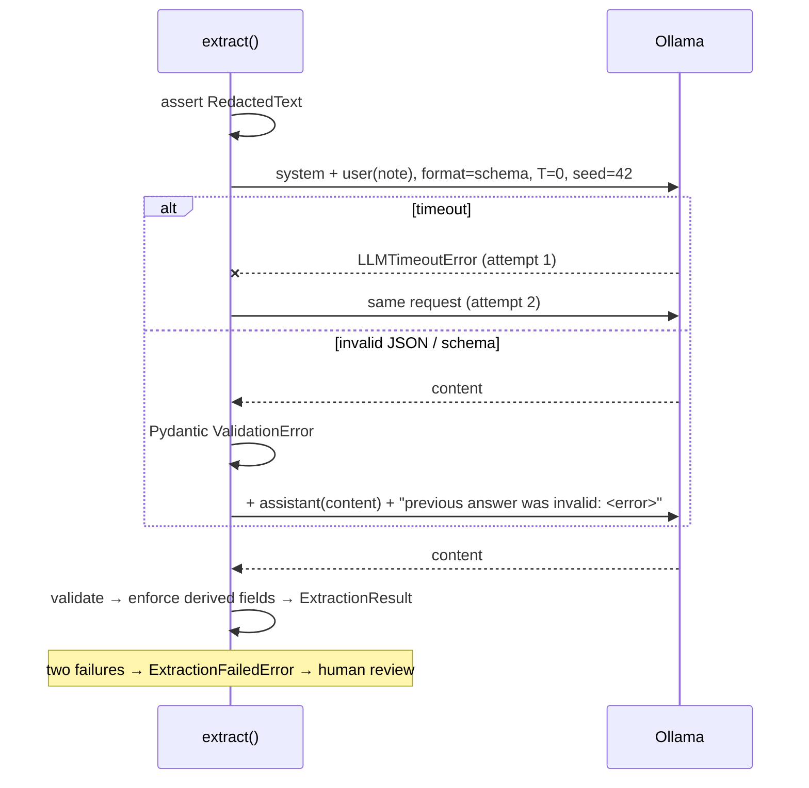

# 05 — LLM extraction

## 1. What was built

| File | Purpose |
|---|---|
| `prompts/extraction/v1/`, `v2/` | Versioned prompt templates (`system.txt`, `user.txt` with a `{{note}}` slot). v2 is the default. |
| `app/nlp/prompts.py` | `load_prompt(name, version)` → `PromptTemplate`, including a **SHA-256 of the content**. |
| `app/nlp/llm.py` | `OllamaClient` over `httpx`: `/api/chat` with `format` = JSON schema, `temperature 0`, `seed 42`, `num_ctx 4096`, connect timeout 5 s / read timeout 60 s. Maps timeouts to `LLMTimeoutError`. `model_digest` (exact weights hash). `ChatClient` protocol for fakes. |
| `app/nlp/extract.py` | `extract(RedactedText, client, prompt)`: rejects raw `str`; validates with Pydantic; **one retry** on invalid output or timeout, feeding the error back to the model; `ExtractionFailedError` after 2 attempts; **derives `follow_up_required`** from severities and records overrides. Returns `ExtractionResult` (extraction, model, digest, prompt version, prompt hash, attempts, latency, errors, overrides). |
| `scripts/run_extraction.py` | Redact → extract over a split, cached to `data/predictions/*.jsonl` (git-ignored). **Refuses the test split without `--final`.** |
| `tests/test_extract.py`, `tests/test_extract_ollama.py` | 12 tests with a fake client, plus 1 opt-in real-model test (`pytest -m ollama`, excluded by default). |

**Prompt iteration on dev only** (`llama3.1:8b` Q4_K_M, temperature 0, seed 42, 80 redacted dev notes, 109 gold flags):

| Prompt | Valid first try | Micro P | Micro R | Micro F1 | Macro F1 | Severity agreement | Med-status acc | Evidence verbatim | Median / p90 latency |
|---|---|---|---|---|---|---|---|---|---|
| v1 (definitions + rules) | 80/80 | 0.880 | 0.872 | 0.876 | 0.867 | 0.558 | 0.887 | 96.3% | 5.5 s / 8.7 s |
| v2 (+ "routine care isn't a risk", per-category severity anchors, 2 fresh examples) | 80/80 | **0.980** | **0.899** | **0.938** | **0.929** | **0.827** | 0.912 | 94.0% | 5.7 s / 9.0 s |

For reference, the rules baseline on dev: v0 F1 0.789, v1 (tuned on dev) 0.986. Both LLM and rule numbers are tuning-set numbers; the honest comparison is in Step 1.9.

## 2. Why this way

- **Every safeguard is structural, not a matter of discipline:**
  - `extract()` takes `RedactedText`, and also checks the type at runtime, so raw PII can't reach the model.
  - Test predictions need an explicit `--final` flag.
  - Derived fields are recomputed in code.
- **Schema-constrained decoding plus Pydantic validation plus one retry.** Constrained decoding made all 160 dev calls schema-valid on the first try, so the retry never fired. It's still there for truncation, timeouts, or a future model or engine with weaker grammar support. The retry sends the model its previous answer *and* the validation error, which is more useful than repeating the same request at temperature 0, where it would return the same output. After 2 attempts the note is sent to a person (Steps 1.6/1.8); it is never dropped.
- **Temperature 0 and a fixed seed:** the same note, prompt and model produce the same output, so evaluation is reproducible and an audit can replay a decision. Ollama's structured-output docs recommend low temperature for this reason.
- **Versioned prompt files plus a content hash.** A prompt is code: it changes behaviour as much as any function does. Each extraction records `extraction/v2` *and* the SHA-256, so editing a prompt without bumping its version shows up as a hash mismatch in the audit log. The model is recorded by **digest**, not just its tag, because `llama3.1:8b` can be re-pulled and change underneath you.
- **`httpx` directly, not the Ollama SDK.** About 40 lines; every field is visible to a reviewer; easy to fake. Separate connect (5 s) and read (60 s) timeouts: a missing server fails fast, while a cold model load (~16 s) is allowed.
- **Derived fields aren't left to the model.** In v2, **9/80 outputs contradicted themselves** (a medium/high flag with `follow_up_required: false`). Deriving it from severity raises dev accuracy from 0.825 to 0.938. The field stays in the schema (baseline, API and UI depend on it); the code is the source of truth, and each override is logged.
- **Prompt changes were general guidelines, not dev answers.** v2 adds what a registered manager would tell a new starter: routine administration isn't a medication risk; a carer's own late visit counts; severity anchors per category. Both examples were written from scratch, not taken from the templates. I **stopped at v2**: the remaining misses (comparing times like 9:40 vs 8:30; "missed call" filed under safeguarding) would need examples close to specific dev phrases, which is overfitting dev.
- **Self-reported confidence doesn't work as a signal.** v1: 105 of 108 flags were at 0.8–1.0. v2 *asked* for lower values on indirect evidence and the clustering got worse: 86 of 100 at exactly 1.0. Step 1.6 routing will rely on severity and grounding, not on confidence.

## 3. Alternatives considered

| Option | Pros | Cons | When I'd choose it |
|---|---|---|---|
| **Ollama `format` = JSON schema + Pydantic + 1 retry (chosen)** | Valid by construction; one schema source; simple | Ollama-specific; constraints can slightly hurt reasoning | Local inference with a fixed schema |
| JSON mode + validation + retries | Works with more engines | No field/enum enforcement; more retries | Engines without schema support |
| Instructor / Outlines libraries | Mature retry/validation loops; Outlines does constrained generation in-process | Extra abstraction to explain and audit; more dependencies | Larger teams, many schemas or providers |
| Two-step: free-text reasoning, then format | Better on reasoning-heavy cases (Tam et al., 2024) | 2× latency; the reasoning text needs redaction-safe handling too | If 1.9 shows constrained output hurting recall on hard cases |
| Few-shot with many dev examples | Often a big accuracy gain | Overfits dev; long prompts; examples can leak into outputs | With a large, separate prompt-development set |

## 4. How it works

**Temperature.** The model produces a score (logit) zᵢ for every token. Sampling uses softmax with temperature T: pᵢ = exp(zᵢ/T) / Σⱼ exp(zⱼ/T).

Worked example with logits for `high`, `medium`, `low` = 2.0, 1.0, 0.5:

| T | p(high) | p(medium) | p(low) |
|---|---|---|---|
| 1.0 | 0.63 | 0.23 | 0.14 |
| 0.5 | 0.84 | 0.11 | 0.04 |
| → 0 | 1.00 | 0 | 0 (greedy: always the top token) |

At T = 0 the output is a deterministic function of the input, given the same weights, prompt, engine version and hardware. That's what makes an audit replayable. The fixed seed covers any remaining sampling.

**Schema-constrained decoding** (see note 01): at each step, tokens that would break the JSON schema are masked before sampling. Temperature picks *among valid* tokens; the grammar decides *which* are valid.

**The retry loop:**



**Prompt versioning.** `sha256(system + "\0" + user)`. The `\0` separator stops a character moving between the two files from producing the same hash. The audit record (Step 1.7) stores `{prompt_version, prompt_sha256, model, model_digest}`, which is everything needed to reproduce or explain a past output.

## 5. Interview questions and answers

**Q1. How do you get reliable structured output from a local LLM?**
Three layers. First, schema-constrained decoding: the Pydantic model's JSON schema goes to Ollama's `format`, so invalid tokens are masked during generation. Second, Pydantic validation of the result, because grammar support for some constraints varies and output can be truncated. Third, a single retry that includes the validation error, then escalation to a person. On 160 dev calls I got 100% schema validity first time. But validity isn't correctness, so recall, grounding and severity are measured separately.

**Q2. Why temperature 0, and what does it not guarantee?**
At temperature 0 decoding is greedy, so the same input gives the same output, which makes evaluation reproducible and decisions replayable in an audit. It doesn't guarantee correctness: a deterministic model is consistently wrong on the cases it gets wrong. It also doesn't guarantee identical output across engine versions, quantisations or hardware. That's why I record the model digest and pin versions, rather than assume determinism carries over.

**Q3. Why version prompts in files with a hash?**
A prompt changes system behaviour as much as code does, so it needs review, version control and attribution. The version label is for people; the hash catches edits made without bumping the version. Each extraction is stored with prompt version, prompt hash, model and model digest, so a coordinator's question "why was this flagged?" can be traced to the exact instructions and weights. Prompt changes also go through the same dev evaluation before becoming the default, as v1 → v2 did.

**Q4. Your v2 outputs contradicted themselves 9 times out of 80. What did you do?**
`follow_up_required` is fully determined by the flags' severities, so I compute it in code and log any override, rather than trusting the model's copy. That took dev accuracy for the field from 0.825 to 0.938. The general principle: let the LLM do what needs language understanding (spotting a risk, quoting evidence, judging severity), and let code do anything that is a deterministic function. It's more reliable, it's testable, and it shrinks what the model can get wrong.

**Q5. Can you use the model's confidence score to route flags for review?**
Not as a probability, and here not even for ranking. v1 put 97% of flags at 0.8–1.0. In v2 I explicitly asked for lower values on indirect evidence and got *more* clustering: 86% at exactly 1.0. So routing will use things I can verify: severity, whether the evidence is grounded in the note, and agreement with the rules baseline. Better uncertainty signals would be token log-probabilities or agreement across several samples, calibrated against labelled data.

**Q6. Trade-off: why stop at prompt v2?**
Each prompt change is tuned on dev, so the more I iterate, the more dev scores flatter the system, and test is supposed to stay untouched. The remaining errors, like inferring lateness from "9:40 for the 8:30 call", would need examples very close to specific dev phrases, which is overfitting. Instead, I'll see in Step 1.9 whether the rules baseline covers exactly those cases (it has a time-comparison rule), which points towards a hybrid. With real data I'd use a separate prompt-development set so that iterating doesn't eat into the evaluation set.

**Q7. With real PBL data and at scale, what changes?**
Latency of 5–9 s per note on a laptop is fine for asynchronous processing (notes are written after visits), but not for interactive use. At scale I'd run a queue with worker concurrency against a GPU inference server (vLLM or Ollama on a GPU box) inside PBL's network. I'd evaluate a smaller model (qwen2.5:3b) against recall targets, monitor schema-validity and retry rates per prompt version, and re-run the evaluation whenever the model digest changes. Prompt changes would go through review and the evaluation suite like code.

## 6. Learn more

**Official documentation**
- Ollama, "Structured Outputs" (`format` with a JSON schema; Pydantic; low-temperature tip): https://docs.ollama.com/capabilities/structured-outputs
- Ollama API, "Generate a chat message" (`format`, `options`, `keep_alive`, `stream`, `prompt_eval_count`/`eval_count`): https://docs.ollama.com/api/chat
- Ollama Modelfile parameters (`temperature` default 0.8; `seed`; `num_ctx`): https://docs.ollama.com/modelfile
- HTTPX, "Timeouts" (connect / read / write / pool): https://www.python-httpx.org/advanced/timeouts/

**Videos**
- *"Transformers, the tech behind LLMs | Deep Learning Chapter 5"*, 3Blue1Brown: https://www.youtube.com/watch?v=wjZofJX0v4M. The "softmax with temperature" section is the clearest visual explanation of what T does to the next-token distribution. Companion lesson page: https://www.3blue1brown.com/lessons/gpt
- *"No more bad outputs with structured generation"*, Rémi Louf (from note 01): https://www.youtube.com/watch?v=aNmfvN6S_n4

## 7. Check your understanding

Using the worked example in §4 (logits 2.0, 1.0, 0.5 for high/medium/low), **predict p(high) at T = 2.0**, then check it with:

```bash
uv run python -c "import math; z=[2.0,1.0,0.5]; T=2.0; e=[math.exp(x/T) for x in z]; print([round(v/sum(e),2) for v in e])"
```

Expected: **≈ 0.48** (output `[0.48, 0.29, 0.23]`). Higher temperature flattens the distribution, so a "medium" severity would be sampled almost a third of the time. That's why sampling at Ollama's default (0.8) would make the same note's severity change between runs.

Second part: in `tests/test_extract.py`, write a test where the fake client returns a *valid* extraction with one `low` flag and `follow_up_required: true`. Predict `result.extraction.follow_up_required` and `result.overrides`. Expected: `False`, and `("follow_up_required: True -> False",)`.
