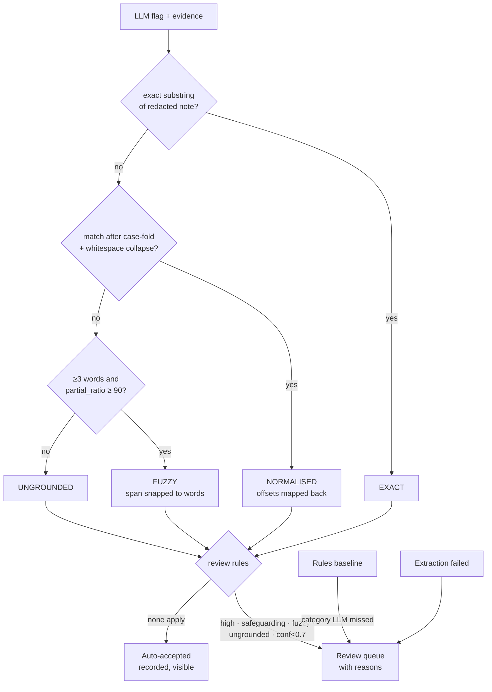

# 06 — Evidence grounding and human-in-the-loop routing

## 1. What was built

| File | Purpose |
|---|---|
| `app/nlp/ground.py` | `ground(evidence, source)` → `Grounding(status, score, start, end)`, in tiers: **exact** → **normalised** (case-fold and collapse whitespace, offsets mapped back) → **fuzzy** (`rapidfuzz.fuzz.partial_ratio_alignment` ≥ **90**, evidence of ≥ 3 words only, span snapped to whole words) → **ungrounded**. |
| `app/nlp/route.py` | `decide(llm, redacted_text, baseline)` → `NoteDecision` made of `FlagDecision`s, each with explicit `ReviewReason`s: high severity · safeguarding policy · fuzzy evidence · ungrounded · low confidence (< 0.7) · **baseline-only** · extraction failed. Nothing is dropped: every flag is either auto-accepted or queued with reasons. |
| `tests/test_ground.py`, `tests/test_route.py` | 21 tests: each tier, offsets, fabricated and near-miss evidence rejected, the short-span guard, threshold, word snapping, a pinned **limitation** (grounding checks presence, not meaning), and every routing rule including extraction failure and baseline deduplication. |

**Measured on dev** (llama3.1:8b, prompt v2, 80 notes, 109 gold flags, seed 42):

| | Notes to review | Gold flags escaped (neither correctly accepted nor reviewed) | High-severity escaped | False positives auto-accepted |
|---|---|---|---|---|
| LLM + grounding + routing | 47/80 (59%) | 11/109 (10.1%) | 2/51 | 0/37 |
| **+ baseline safety net** | 51/80 (64%) | **0/109** | **0/51** | 0/37 |

LLM flag grounding on dev: 94 exact, 6 fuzzy, **0 ungrounded**. Low-confidence routing fired **0 times**.

## 2. Why this way

- **Grounding catches fabricated evidence; it doesn't check meaning.** An LLM can produce a convincing quote that isn't in the note. Checking that the quote exists is cheap and deterministic, and turns "trust me" into "here's where it says so". But a real quote can still support a *wrong* conclusion. On dev, the 4 cross-note "negatives" scoring 100 were real sentences the model **put under the wrong category**, and `"falls"` is exactly grounded in "No falls reported." (pinned in a test). Category and negation errors are left to evaluation and human review.
- **Ground against the redacted text,** because that's what the model saw and quoted (`<PERSON> rang…`).
- **Three tiers, strictest first.** Most evidence is exact (94%). Normalisation handles harmless case and whitespace drift without fuzzy risk. Fuzzy matching covers the model's habit of **silently fixing typos** (`tabelts` → "tablets") and expanding abbreviations (`cl` → "client"), which accounted for all 6 non-verbatim dev quotes, despite the prompt's instruction not to.
- **Threshold 90, justified three ways:**
  1. *Data:* on dev, genuine evidence scores ≥ 98.1; 6,370 hallucination-like negatives (each evidence string against notes without that risk) have p99.9 = 66.7. Anything in 70–95 separates them.
  2. *Edit tolerance:* rapidfuzz's ratio is a normalised Indel similarity, and a letter swap costs 2 Indel edits. One swap in an L-character span scores ≈ 100·(1 − 1/L), so 90 accepts one typo fix in evidence of 10+ characters.
  3. *Unequal costs:* a false accept auto-accepts a hallucination; a false reject costs a reviewer a few seconds. So choose the strict end of the safe range.
- **The short-span guard:** a 2-word quote like "the flor" scores highly against almost any note mentioning a floor, so fuzzy matching needs ≥ 3 words.
- **Routing rules come from risk and policy, not model confidence.** High severity and safeguarding *always* go to a person, because the cost of a wrong automated "no action" is harm to a vulnerable adult. Confidence routing is implemented, as the spec requires, but fired 0 times, because the model reports 0.9–1.0 for nearly everything (note 05).
- **The baseline as a safety net** (beyond the spec): the LLM and the rules make *different* mistakes (the LLM misses "9:40 for the 8:30 call"; the rules miss indirect phrasings), so a category found only by the rules is surfaced for review. On dev it removed all 11 escapes for +4 reviewed notes. **But the rules were tuned on dev, so 0% escape is optimistic by construction;** Step 1.9 measures it on test.
- **Human oversight has to be meaningful.** UK GDPR Article 22A (as amended by the Data (Use and Access) Act 2025) treats a decision as *solely automated* when there is "no meaningful human involvement", and ICO guidance says meaningful review usually comes *after* the automated output and concerns the actual outcome. Here, the system never closes a risk by itself: high and safeguarding flags always go to a coordinator, who sees the highlighted evidence and can approve, edit or reject it (Step 1.8). Auto-accepted flags are recorded and visible, not acted on without a person. *(Not legal advice. ICO guidance on the amended articles is under review.)*

## 3. Alternatives considered

| Option | Pros | Cons | When I'd choose it |
|---|---|---|---|
| **Exact → normalised → fuzzy partial_ratio (chosen)** | Deterministic, explainable score and span, fast | Checks presence, not meaning | Verifying quoted evidence |
| Exact match only | Simplest, zero false accepts | Rejects every typo-corrected quote, so too much review | When the model reliably copies verbatim |
| Semantic similarity (embeddings) | Accepts paraphrases | Paraphrase acceptance is exactly the hallucination risk; opaque threshold | Checking *topic*, not evidence |
| NLI / entailment model ("does the note entail this flag?") | Checks meaning, could catch negation | Another model to evaluate; slower; can itself be wrong | A second-stage check on high-impact categories |
| Route by confidence only | Simple, common in tutorials | LLM confidence uninformative here (86% at 1.0) | With calibrated probabilities (Tier 3 methods) |

## 4. How it works



**partial_ratio, worked example.** Evidence `"found tablets on the flor under the chair"` (41 chars) against the note `"Lunch visit. Found tablets on the floor under the chair. Ate well…"`:
1. Slide a window over the note and score each with `ratio` (normalised Indel similarity).
2. The best window, `"ound tablets on the floor under the chair"`, needs 1 insertion ("o" in "flor") plus the boundary mismatch. Score: **97.6**, so it's above 90 and **FUZZY**.
3. The raw window starts mid-word ("**o**und"), so it's snapped outwards to `"Found tablets on the floor under the chair."` for highlighting. (This was a real bug, caught by a test.)

Compare fabricated `"found on the floor by the bed"` against the same note: the best window shares "on the floor" but little else, so it scores **65.5** and is UNGROUNDED.

**Escape rate, the safety metric.** Every gold flag ends up in exactly one bucket:
- *auto-accepted correctly*
- *surfaced for review* (a person will see it)
- **escaped** (nobody will see it)

Workload is the share of notes reviewed. The design goal is to minimise escapes, especially high-severity ones, at a workload the provider can sustain.

## 5. Interview questions and answers

**Q1. How do you control hallucination in the extraction pipeline?**
In layers. Constrained decoding guarantees the shape. Every flag must quote evidence, and that quote is checked against the redacted note: exact, then normalised, then fuzzy at ≥ 90 for spans of 3+ words. Ungrounded flags are never auto-accepted; they go to a reviewer with the reason. On dev, grounding rejected nothing, which tells me the model rarely invents quotes here, not that the check is unnecessary. Adversarial tests show it rejects fabricated and near-miss evidence. What grounding *can't* catch, real text supporting a wrong conclusion, is handled by routing high-impact categories to people and by measuring category accuracy.

**Q2. How did you choose the fuzzy threshold?**
From data, plus a cost argument. On dev, genuine evidence scored at least 98.1, and over 6,000 hallucination-like pairs had a 99.9th percentile of 66.7. The safe range was wide. I chose 90 because the ratio maths means it tolerates one typo correction in a 10+ character quote, and because the costs are asymmetric: a false accept passes a hallucination, a false reject costs a few seconds of review. I'd recalibrate on real notes, whose typo patterns and lengths will differ.

**Q3. What is human-in-the-loop here, concretely, and why does it matter legally?**
High-severity and safeguarding flags always go to a coordinator, along with anything fuzzy, ungrounded, low-confidence or found only by the rules. The coordinator sees highlighted evidence and approves, edits or rejects, with every action audited (Steps 1.7–1.8). The system never closes a risk by itself. Under UK GDPR Article 22A, as amended by the Data (Use and Access) Act 2025, a decision is solely automated when there's no meaningful human involvement. The ICO says meaningful review usually comes after the automated output and concerns the actual outcome. A coordinator rubber-stamping a queue wouldn't count, so workload has to stay manageable and the UI has to make the evidence quick to check.

**Q4. Trade-off: workload vs safety.**
Every rule that sends more to review lowers the escape rate and raises workload. On dev: LLM alone, 59% of notes reviewed, 10.1% of risks escaped; with the rules safety net, 64% reviewed and 0% escaped. That's a good trade. But the synthetic data has 83% risky notes, so these workload figures are far higher than real life. With PBL I'd present this as a curve, review rate against escape rate, and let the registered manager choose the operating point, much as with the continuity trade-off in Tier 2.

**Q5. What does grounding not protect against?**
Correct quotes supporting wrong conclusions. `"falls"` is exactly present in "No falls reported", so a negation error passes grounding; a test pins that limitation down. Wrong categories pass too: the dev "negatives" scoring 100 were real sentences filed under the wrong risk. And it can't see risks the model *didn't* flag; omissions are the baseline safety net's job and recall's job in evaluation. A natural next step for high-impact categories would be an entailment check: does the note actually support this flag?

**Q6. With real PBL data, what would you change?**
Recalibrate the threshold on real model outputs and real notes. Set routing rules with the registered manager and the safeguarding lead, e.g. some medium categories might always need review, or some low ones never. Measure reviewer agreement and time per item to size workload. Monitor drift: a rise in fuzzy or ungrounded rates after a model or prompt change is an early warning. And replace confidence routing with a calibrated signal, such as agreement across samples, once there are labels to calibrate against.

**Q7. Why keep a confidence rule that never fires?**
The spec requires it, and it costs nothing. If a future model or prompt produces better-spread confidence, the rule starts working without a code change. But I report that it fired 0 times on dev, so nobody mistakes it for an active safeguard. Being explicit about which controls actually do anything is part of an honest safety case.

## 6. Learn more

**Official documentation and references**
- RapidFuzz `fuzz` module (`partial_ratio`: "optimal alignment of the shorter string in the longer string"; `ratio` = normalised Indel similarity): https://rapidfuzz.github.io/RapidFuzz/Usage/fuzz.html
- RapidFuzz Indel distance (Levenshtein with substitution weight 2; normalised by combined length): https://rapidfuzz.github.io/RapidFuzz/Usage/distance/Indel.html
- ICO, "What is the impact of Article 22 of the UK GDPR on fairness?" (meaningful human review; marked *under review* after the DUAA): https://ico.org.uk/for-organisations/uk-gdpr-guidance-and-resources/artificial-intelligence/guidance-on-ai-and-data-protection/how-do-we-ensure-fairness-in-ai/what-is-the-impact-of-article-22-of-the-uk-gdpr-on-fairness/
- ICO blog (31 Mar 2026) on Article 22A after the Data (Use and Access) Act 2025: https://ico.org.uk/about-the-ico/media-centre/news-and-blogs/2026/03/automated-decisions-can-streamline-the-hiring-process-with-the-right-safeguards-in-place/
- Ji et al., "Survey of Hallucination in Natural Language Generation": https://arxiv.org/abs/2202.03629

**Videos**
- None verified this session. Search: `LLM hallucination grounding citation verification` or `human in the loop machine learning Robert Munro`.

## 7. Check your understanding

In a Python shell, predict the grounding **status and approximate score** for each, then check:

```python
from app.nlp.ground import ground

src = "Tea call. Heels look red, cream applied. Daughter visiting later."
ground("heels look red", src)  # (a)
ground("Heels looked red, cream applied", src)  # (b)
ground("heels look sore", src)  # (c)
ground("red heels", src)  # (d)
```

Expected:
- (a) **NORMALISED**: only case differs.
- (b) **FUZZY** at **93.5**: "looked" vs "look" in a 31-character span.
- (c) **UNGROUNDED** at **86.7**: "sore" vs "red" changes the meaning, and grounding correctly refuses to treat them as the same. But note the margin is only 3.3 points: at a threshold of 85 this altered quote would be **accepted**. That's a concrete reason for the strict end of the safe range, and a reminder that character-level similarity isn't semantic similarity.
- (d) **UNGROUNDED** at **66.7** with only 2 words: the short-span guard would reject it whatever the score.

Run each and print `.status`, `.score`. If (b) or (c) surprises you, work the Indel arithmetic by hand.
