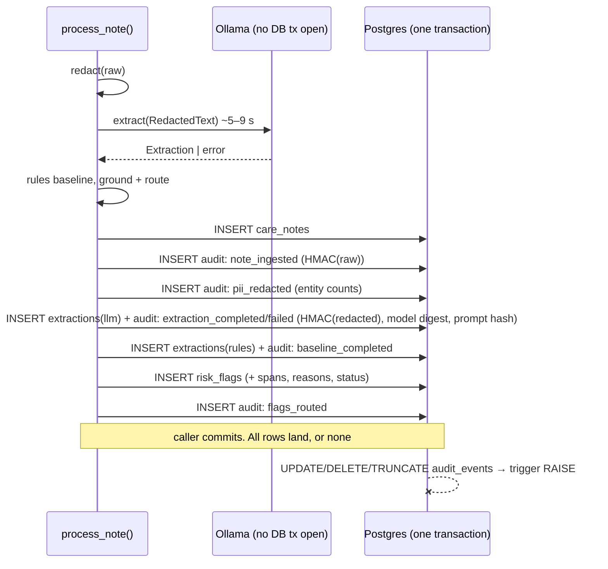

# 07 — Persistence and append-only audit log

## 1. What was built

| File | Purpose |
|---|---|
| `app/core/db.py` | SQLAlchemy 2.x `Base` with a **constraint naming convention**, `CreatedAtMixin`, cached engine, `get_session()` FastAPI dependency. |
| `app/nlp/models.py` | `care_notes` (raw + redacted text, `review_required`), `extractions` (LLM/baseline output, model, digest, prompt version + hash, attempts, latency, errors, overrides), `risk_flags` (grounding span/score, review reasons, mutable `review_status`). Enums stored as VARCHAR **with CHECK constraints**. |
| `app/audit/models.py`, `app/audit/log.py` | `audit_events`: event type, actor, note id (deliberately *not* a foreign key), model name + version (digest), prompt version + hash, **HMAC-SHA256 input hash**, output (JSONB), timestamp. `record()` adds an event to the caller's transaction. |
| `app/nlp/pipeline.py` | `process_note()`: **all model work first** (redact → LLM → rules → route), then one short write of the note, extractions, flags and 5 audit events. LLM down or invalid → note still saved with baseline flags and queued. |
| `migrations/` + `alembic.ini` | Alembic; `0001_initial.py` = autogenerated tables + **hand-written append-only trigger** (rejects UPDATE/DELETE per row and TRUNCATE per statement). Template fixed to generate lint-clean migrations. |
| `tests/conftest.py`, `test_audit.py`, `test_pipeline_persistence.py`, `tests/fakes.py` | Separate `smartpbl_test` DB, migrated down→up once per run; each test in a rolled-back transaction. 11 DB tests: keyed hash, append-only for raw SQL and ORM, CHECK constraint, full trail order and provenance, **no raw text or identifiers in any audit row**, LLM-unavailable path, atomic rollback. Skip when Postgres is down, or fail if `SMARTPBL_REQUIRE_DB=1`. |
| `docker-compose.yml` | Host port **5442**, bound to **127.0.0.1** only (see below). |

**Audit trail per note** (in order): `note_ingested` → `pii_redacted` → `extraction_completed` | `extraction_failed` → `baseline_completed` → `flags_routed`. Step 1.8 adds `review_decision`.

**Two environment issues found and fixed:**
1. `localhost:5432` was answered by a **Homebrew `postgresql@15`** (the more specific `127.0.0.1` binding beats Docker's `*`). Port 5433 was taken by another project's container. The project now uses 5442.
2. The container was published on **`0.0.0.0`**, exposing a health-data database to the local network. It's now bound to loopback.

## 2. Why this way

- **Append-only, enforced by the database.** An audit log is only evidence if past entries can't be quietly changed. Application code could "promise" not to update rows, but a bug, a careless script or a compromised component could break that promise. The trigger makes it a database guarantee for *any* client, raw SQL included. The mutation test proves it: removing the trigger from the migration makes exactly the UPDATE/DELETE tests fail.
- **Limits of a trigger (stated, not hidden):** the table *owner* or a superuser can disable the trigger or `DROP` the table, as `alembic downgrade` does. Production needs (a) the app connecting as a role that only has `INSERT`/`SELECT` on `audit_events` and doesn't own it, with migrations under a separate role, and (b) tamper-*evidence* for privileged users: a hash chain (each row hashes the previous) or shipping to WORM storage. Both are in the backlog.
- **Inputs stored as hashes, not text.** The audit log has to answer "which exact input produced this output?" and must not become a second copy of health data. It's kept longer than operational data, read by more people (auditors, incident reviewers), and must survive the note's deletion under storage limitation or erasure. A hash proves *identity* of input without *disclosing* it. `note_id` is deliberately not a foreign key, so audit rows outlive deleted notes.
- **Why HMAC rather than plain SHA-256** (a deliberate change from the spec): many care notes are short and predictable ("AM call. All well."). An attacker with the log could hash likely texts and look for matches. That's a dictionary attack, and with plain SHA-256 it reverses the "hash, not text" protection. HMAC-SHA256 with a secret key means only the key holder can test a guess. It's still SHA-256 underneath, and still deterministic, so verification works. `hash_alg` is stored per row so the scheme can change later.
- **One transaction, but not around the LLM call.** The note, flags and audit events are written together, so the audit says something happened if and only if it did. The 5–9 s model call happens *before* the transaction opens, so it never holds a pooled DB connection or locks. (Holding transactions across slow external calls is a classic production failure.)
- **Degrade, don't drop.** If Ollama is unreachable, the pipeline catches `httpx.HTTPError`, records `extraction_failed` with the reason, keeps the rules' flags, and queues the note. A care provider can't lose a note because a model server restarted.
- **CHECK constraints on enums.** I reviewed the autogenerated migration and found that `Enum(native_enum=False)` creates **no** CHECK constraint (the SQLAlchemy 1.4+ default). The database would have accepted `severity = 'catastrophic'`. Now `create_constraint=True`, so the database rejects unknown values. VARCHAR + CHECK rather than native PG enums, because adding a value is then a simple migration.
- **Tests against real Postgres, not SQLite.** Triggers, JSONB and CHECK behaviour are what's being tested. SQLite would test a different database. Each test runs in an outer transaction that's always rolled back, using SQLAlchemy's documented `join_transaction_mode="create_savepoint"` pattern.

## 3. Alternatives considered

| Option | Pros | Cons | When I'd choose it |
|---|---|---|---|
| **Append-only table + trigger (chosen)** | Simple, queryable with SQL, same transaction as the action | Owner/superuser can bypass; not tamper-*evident* | Single-database prototype or small system |
| + DB role permissions (INSERT/SELECT only) | Stops the app role even trying | Needs a separate migration role; ops overhead | Any production deployment (next step) |
| Hash-chained rows | Tamper-*evident*: any edit breaks the chain on verification | Writes must be serialised; verification job needed | Regulated audit where insiders are a threat |
| External immutable store (WORM bucket, ledger DB, SIEM) | Out of reach of DB admins; retention policies | Not transactional with the action; more infrastructure | Enterprise / NHS-integrated deployments |
| Event sourcing (state *derived* from events) | The log *is* the source of truth; full replay | Big architectural shift; harder queries | When history is the core domain, not a side record |

## 4. How it works



**HMAC in one line:** `HMAC(K, m) = H((K ⊕ opad) ‖ H((K ⊕ ipad) ‖ m))`. The key is mixed in twice around SHA-256. Without K you can't compute the tag for a guessed `m`, so you can't confirm a guess.

**Worked example (dictionary attack).** The note "AM call. All well." is in the log as plain `sha256(...)`. An attacker hashes 10,000 common short notes in milliseconds and finds a match, so the content is recovered. With HMAC under a 256-bit secret key, the same attempt needs the key. `test_input_hash_is_keyed_and_deterministic` asserts the stored hash ≠ plain SHA-256, and that it changes with the key.

**Why `id` (bigserial) orders events, not `occurred_at`.** `now()` in Postgres is the *transaction* start time, so all five events from one `process_note` share a timestamp. The sequence id gives the total order.

## 5. Interview questions and answers

**Q1. Why is the audit log append-only, and how do you enforce it?**
An audit log is evidence of what the system did and who did what. If entries can be changed, it proves nothing, in an incident review, a safeguarding inquiry or a CQC inspection. I enforce it in the database with a trigger that rejects UPDATE, DELETE and TRUNCATE for every client, not just my ORM, and a mutation test shows the tests fail without it. I'm explicit that a table owner can still drop or disable it. Production needs an app role with only INSERT/SELECT, migrations under a separate role, and ideally a hash chain or an external immutable store for tamper evidence against privileged users.

**Q2. Why store a hash of the input instead of the input?**
The audit log must prove which exact input produced each output, but it shouldn't become a second, longer-lived copy of health data read by more people. A hash establishes identity without disclosure: given the original note, anyone with the key can confirm it matches the logged hash. It also lets the audit outlive the note under storage limitation or erasure, which is why `note_id` isn't a foreign key. The operational tables hold the actual text under normal access control.

**Q3. Why HMAC and not plain SHA-256, as the spec said?**
Plain SHA-256 is vulnerable to dictionary attacks on low-entropy inputs. Many care notes are short and formulaic, so someone with the log could hash candidate notes and find matches. HMAC-SHA256 with a secret key prevents testing guesses without the key, while staying deterministic so verification works. I record `hash_alg` per row so the scheme can be rotated, and the key belongs in a secrets manager (Tier 4), not in `.env`.

**Q4. The LLM call takes seconds. How does that interact with your transaction?**
It doesn't, by design. All model work runs first with no database transaction open, then everything is written in one short transaction. Holding a transaction across a slow external call ties up a pooled connection and can hold locks, which under load turns into pool exhaustion and timeouts. The trade-off: if the process crashes after the LLM call but before the write, the work is redone. That's acceptable because extraction is idempotent at temperature 0.

**Q5. What happens if Ollama is down?**
The pipeline catches the HTTP error, records `extraction_failed` with the reason in both the extraction row and the audit log, runs the rules baseline anyway, and saves the note with those flags as pending review. A tested path makes sure no note is lost because a model server restarted. In production I'd add retry with backoff from a queue, and alerting on the failure rate.

**Q6. Trade-off: why keep mutable `review_status` on flags if you have an audit log?**
Two needs. The review queue needs fast queries on *current* state ("all pending flags"). Audit needs complete *history*. Rebuilding current state from events on every query (event sourcing) is powerful but a big architectural commitment. So I keep current state in an ordinary table and write every change to the append-only log in the same transaction. That's a common, pragmatic split: the table answers "what is", the log answers "what happened, when, by whom, with which model and prompt".

**Q7. With real PBL data, what changes?**
Encryption at rest for `raw_text` (column-level or disk encryption with key management), and a retention policy that deletes or anonymises notes after the agreed period while audit rows remain. Separate DB roles for the app, migrations and read-only audit access. The HMAC key in a secrets manager with a rotation plan. Audit export to an immutable store. And access logging of reads of `raw_text` too, which Tier 4's unified audit covers.

## 6. Learn more

**Official documentation**
- SQLAlchemy 2.0, "Joining a Session into an External Transaction (such as for test suites)" (`join_transaction_mode="create_savepoint"`): https://docs.sqlalchemy.org/en/20/orm/session_transaction.html
- Alembic, "Auto Generating Migrations" (what autogenerate can't detect; triggers need hand-written SQL or `alembic-utils`): https://alembic.sqlalchemy.org/en/latest/autogenerate.html
- PostgreSQL 16, `CREATE TRIGGER` (row-level BEFORE UPDATE/DELETE; TRUNCATE "only FOR EACH STATEMENT"): https://www.postgresql.org/docs/16/sql-createtrigger.html
- Python `hmac` (keyed hashing; `compare_digest` against timing attacks): https://docs.python.org/3/library/hmac.html
- ICO, "Principle (e): Storage limitation": https://ico.org.uk/for-organisations/uk-gdpr-guidance-and-resources/data-protection-principles/a-guide-to-the-data-protection-principles/storage-limitation/

**Videos**
- *"The Many Meanings of Event-Driven Architecture"*, Martin Fowler, GOTO 2017: https://www.youtube.com/watch?v=STKCRSUsyP0. It covers event notification, event-carried state, event sourcing and CQRS, and helps you place the "audit log vs event sourcing" trade-off in Q6.

## 7. Check your understanding

1. **Predict**, then run:
   ```bash
   docker compose exec -T db psql -U smartpbl -c "ALTER TABLE audit_events DISABLE TRIGGER audit_events_no_update_delete;"
   ```
   Does it succeed? Expected: **yes.** The `smartpbl` user *owns* the table, and owners can disable triggers. Then run `UPDATE audit_events SET actor='x';` and it succeeds too. Re-enable it with `ENABLE TRIGGER`. This is the Q1 limitation made concrete. Fix it properly by creating an `smartpbl_app` role with only `INSERT, SELECT` on `audit_events` and showing that the same `ALTER TABLE` fails for that role with `must be owner of table`.
2. In `tests/test_audit.py`, add a test that `input_hash("AM call. All well.")` equals `hmac.new(b"dev-only-not-secret", ..., hashlib.sha256).hexdigest()`, and compare them with `hmac.compare_digest`. Expected: passes, because it's the default dev key. Explain why using that default outside local development defeats the HMAC's purpose.
