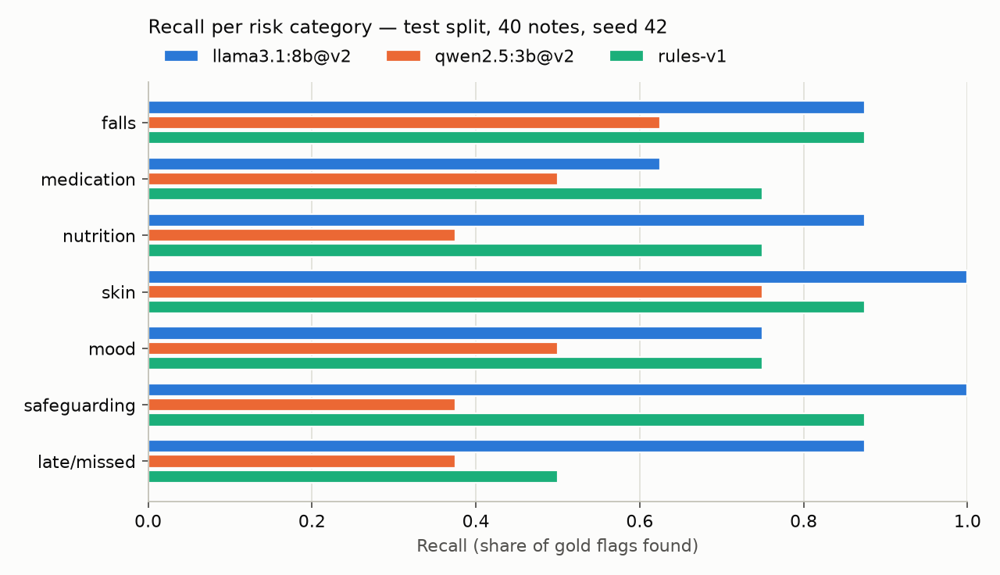
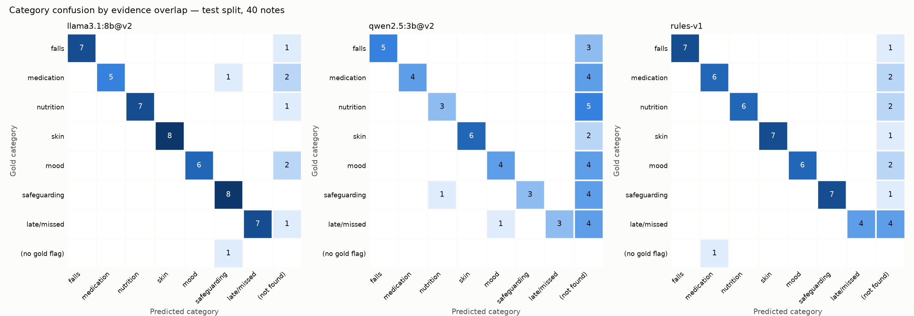

# 09 — Evaluation

## 1. What was built

| File | Purpose |
|---|---|
| `app/nlp/evaluation.py` | Scoring: - per-note category matching and confusion by evidence overlap - schema validity, grounding rate, severity agreement, latency percentiles - negation false positives and robustness-slice recall - the deployed pipeline's escape rate - bootstrap CIs, paired bootstrap comparison and union recall |
| `scripts/eval.py` | Loads cached LLM predictions, runs the rules baseline live and writes `docs/results/tier1_eval_<split>.{md,json}` plus two charts. Evaluating on the test split requires `--final` |
| `tests/test_evaluation.py` | 13 tests, including failures counted as misses, mislabel vs miss vs false positive, seeded bootstrap and paired-difference detection |
| `docs/results/`, `docs/figures/` | Dev and test results, and the recall and confusion charts |
| `data/predictions/*.jsonl` | Now committed: the exact model outputs behind every reported number (redacted synthetic text only) |

**The test split was opened exactly once:** `run_extraction --final`, then `eval --final`. Nothing was tuned afterwards.

## 2. Why this way

- **Matching is per note and category, not per span.** The review queue acts on "this note has a falls risk". Exact span boundaries don't matter to a coordinator, and span-level scoring would penalise a correct flag for quoting one sentence instead of two. Evidence spans are still checked, by grounding (100% grounded on test) and by the confusion chart, which uses span overlap to tell mislabelling apart from missing.
- **A failed extraction counts as no flags.** Otherwise a model that crashes on hard notes would look *better*. None failed here: 40/40 were valid on the first try for both models.
- **Recall is the headline metric for safety flags, but not the only one.**
  - A missed safeguarding concern (false negative) can mean harm.
  - A false positive costs a coordinator a minute.
  - Precision still matters, because alert fatigue makes reviewers rubber-stamp. A queue that is 60% noise trains people to ignore it.
  - So I report recall first, F1 alongside, and the deployed-pipeline numbers that combine both: escape rate and review workload.
- **The escape rate measures the deployed pipeline, not the model alone.** Production is LLM ∪ rules → grounding → routing → human. A gold flag *escapes* only if neither source flags it at all. That is the number a registered manager cares about.
- **Confidence intervals and a paired test are needed because 40 notes is small.** An F1 of 0.906 vs 0.860 looks like a win. The paired bootstrap says it isn't significant (p = 0.14). Reporting the point estimate alone would overclaim.
- **qwen2.5:3b was evaluated as a hardware fallback** (ADR-002). It shows what the smaller model costs, using the prompt tuned for llama, on dev as well as test.

## 3. Alternatives considered

| Option | Pros | Cons | When I'd choose it |
|---|---|---|---|
| **Category-level per-note matching, chosen** | Matches the decision the queue makes; robust to span boundaries | Can't distinguish "right category, wrong sentence" | Note-level triage, as here |
| Span-level matching (exact or overlap IoU) | Measures localisation precisely | Penalises harmless boundary differences; needs a span-matching policy | Highlighting quality, or NER-style tasks |
| scikit-learn `precision_recall_fscore_support` on a multilabel indicator matrix | Standard and battle-tested | Same numbers, but a binarisation step and no confusion-by-overlap or escape metric | Larger projects, or to cross-check `metrics.py` |
| LLM-as-judge | Scales to unlabelled data; can judge summaries | A model grading a model: biased, needs its own validation | Free-text fields (the summary) with real data |
| Larger or regenerated test set | Narrower CIs | Same author and templates, so the bias isn't fixed, only shrunk | Real annotated PBL notes, double-labelled with agreement measured |

## 4. How it works

**Precision, recall, F1** (per category, counted over notes):
- precision = TP/(TP+FP): of the flags raised, how many were right
- recall = TP/(TP+FN): of the real risks, how many were found
- F1 = their harmonic mean, which punishes imbalance: P = 1.0 with R = 0.1 gives F1 0.18, not 0.55

**Micro vs macro.** Micro pools all counts, so frequent categories dominate. Macro averages per-category F1, so every category counts equally. The test split has exactly 8 gold flags per category, so the two are close (0.906 vs 0.902). On real data, where falls are common and safeguarding is rare, macro is the one that exposes a model ignoring the rare but critical class.

**Bootstrap CI.** Resample the 40 notes with replacement 1000 times and recompute micro recall each time. The 2.5th and 97.5th percentiles give the interval. **Paired bootstrap:** in each round, score *both* systems on the same resample and record the difference. Note difficulty then cancels out, so this is far more sensitive than checking whether two separate intervals overlap. P(not better) is the share of rounds where system A ≤ system B.

**Confusion by evidence overlap.** For each gold flag: if the system has that category, it's on the diagonal. Otherwise, if a flag of another category quotes overlapping text, it's a *mislabel*: for example, on test llama filed a medication risk under safeguarding. Otherwise it's *not found*. Predictions matching no gold flag go in the "(no gold flag)" row.

### Results: held-out test split (40 notes, 56 gold flags, seed 42)

| System | Micro P | Micro R (95% CI) | Micro F1 (95% CI) | Severity agr. | p50 latency |
|---|---|---|---|---|---|
| llama3.1:8b + v2 | 0.960 | **0.857** (0.776–0.930) | **0.906** (0.847–0.955) | 0.81 | 5.8 s |
| qwen2.5:3b + v2 | 0.933 | 0.500 (0.391–0.618) | 0.651 (0.541–0.759) | 0.57 | 2.3 s |
| rules-v1 | 0.977 | 0.768 (0.642–0.885) | 0.860 (0.777–0.933) | 0.98 | 0.3 ms |

The deployed pipeline (llama + rules safety net + routing):
- **50% of notes go to review.**
- **4 of 56 gold flags (7.1%) escape.**
- **0 of 19 high-severity flags escape.**
- **0 auto-accepted flags were false positives.**
- **Union recall is 0.929.**

**What the numbers say:**
1. **The ranking flips between dev and test.** On dev, the rules beat the LLM significantly: recall difference −0.073, P(not better) 0.998. On test the LLM leads: +0.089, P(not better) 0.11, so not significant at n = 40. The rules dropped from 0.972 to 0.768 recall because they were tuned on dev phrasing; on test-only phrasings their recall is 0.59, against the LLM's 0.81. The LLM dropped less, from 0.899 to 0.857. **Hand-tuned rules overfit the data they were tuned on.** That is why the test split stayed closed until now.
2. **The LLM and the rules make different mistakes:** union recall 0.929 against 0.857 alone. That justifies the safety-net design.
3. **All 4 escapes use phrasings that appear only in the test split:**
   - "Pills were hidden in a tissue", which is concealed medication (twice)
   - "seemed a bit quieter than normal"
   - "call cut to 10 mins as i was running behind"

   None is high severity. These are exactly the subtle cases real notes are full of.
4. **qwen2.5:3b is not viable with this prompt:** recall 0.50 on test and 0.46 on dev, so it's consistently bad, not unlucky. It is 2.5× faster, but that doesn't matter at 5.8 s per note for asynchronous triage. llama3.1:8b stays the default; qwen would need its own prompt work and evaluation before use.
5. **Severity:** the rules agree with gold 98% of the time because rule authors and data authors share severity anchors (circular). The LLM's 81% is a more honest signal.

## 5. Interview questions and answers

**Q1. Which metric matters most for safety flags, and why?**
Recall, because a missed safeguarding or falls risk can mean harm, while a false positive costs a coordinator a minute. Precision can't be ignored, though: a noisy queue causes alert fatigue, and fatigued reviewers approve without reading, which turns false positives into missed risks. So I report recall first and F1 beside it. I also measure the deployed pipeline directly: escape rate (7.1%, no high-severity escapes) and review workload (50% of notes). If I had to pick a single number I'd use F2, which weights recall four times as heavily as precision.

**Q2. Your LLM's F1 is 0.906 and the rules' is 0.860. Is the LLM better?**
Not provably, on this data. A paired bootstrap over the 40 test notes gives an F1 difference of +0.046 with a 95% interval of −0.034 to +0.141, so I can't rule out no difference. What *is* robust is the pattern across splits. The rules lost 20 points of recall from dev to test, and do much worse on held-out phrasings (0.59 against the LLM's 0.81), which is the case real notes will present. And the two systems are complementary: union recall is 0.929.

**Q3. Why did the rules score 0.986 on dev and 0.860 on test?**
Overfitting by hand. I wrote and refined the rules by looking at dev errors, so they encode dev's exact phrasings. The test split includes 14 phrasings that never appear in dev, and the rules missed many of them. The LLM was also prompt-tuned on dev but generalised better, because it brings language knowledge the regexes lack. This is precisely why the test split was locked behind `--final` and opened once. Had I peeked, the rules' 0.986 would have been the reported number.

**Q4. Trade-off: llama3.1:8b vs qwen2.5:3b?**
qwen is 2.5× faster (2.3 s against 5.8 s median) and needs about 2 GB of memory instead of about 5 GB. But it found half the risks, consistently on both splits. Notes are triaged asynchronously, so 6 s is irrelevant and a miss is not. I'd choose the 8B model and only revisit if PBL's hardware can't run it. Even then I'd prompt-tune and evaluate qwen properly rather than reuse a prompt written for llama.

**Q5. How do you know the evaluation code itself is right?**
Four checks:
- It reproduces, to three decimals, the dev numbers measured independently in earlier steps (F1 0.938, 64% review rate, 0 escapes).
- It has 13 unit tests on hand-built cases with known answers, for example that a failed extraction counts as two misses, and that a late visit filed as safeguarding shows up off the diagonal.
- One test's expectation was wrong: I asserted a paired p-value of exactly 0. The 0.002 the code returned is correct, because a resample can draw only notes where both systems succeed (probability about 0.5¹⁰).
- The prediction files are committed, so anyone can re-run `scripts.eval` and get the same tables.

**Q6. With real PBL data, what would you change?**
- **Labels:** real notes, double-annotated by care staff, with inter-annotator agreement (Cohen's kappa) measured. If two coordinators only agree 80% of the time, no model can be judged above that.
- **Time-based split:** train or tune on earlier months and test on later ones, to catch drift.
- **Size:** a few hundred notes per rare category, so CIs are useful.
- **Fairness:** slices by client group and carer writing style, for example non-native English writers.
- **Monitoring:** after deployment, reviewer edit and reject rates from `review_decisions` as a continuous, label-free quality signal.

**Q7. What does your synthetic evaluation *not* tell you?**
- **It's partly circular:** the same author wrote the templates, the rules, the prompt examples and the gold labels, so absolute numbers are optimistic, especially the rules' severity agreement.
- **The notes are cleaner and shorter than real ones,** with one risk per sentence.
- **It can't measure** how coordinators interact with the queue, whether highlighted evidence speeds them up, or whether alert fatigue sets in.

What it can support: relative comparisons with uncertainty, failure modes (indirect phrasing, time arithmetic) and a tested evaluation harness ready for real data.

## 6. Learn more

**Official documentation**
- scikit-learn, [Metrics and scoring, multiclass and multilabel precision/recall/F](https://scikit-learn.org/stable/modules/model_evaluation.html#multiclass-and-multilabel-classification): formal definitions of micro, macro and weighted averaging. A useful cross-check for `metrics.py`.
- Google ML Crash Course, [Classification: Accuracy, recall, precision, and related metrics](https://developers.google.com/machine-learning/crash-course/classification/accuracy-precision-recall): when false negatives cost more than false positives, which is the recall-vs-precision argument above.

**Video**
- *Bootstrapping Main Ideas!!!*, StatQuest with Josh Starmer, https://www.youtube.com/watch?v=Xz0x-8-cgaQ. The title is verified on the page; the channel name is attributed from Class Central's StatQuest listing, because YouTube didn't render it. It explains clearly why resampling your own test set gives honest error bars, which is the idea behind every CI in this step.

## 7. Check your understanding

Add an `fbeta(beta)` method to `PRF` in `app/nlp/metrics.py`, where F-beta = (1+β²)·P·R / (β²·P + R). Before running it, predict whether F2 widens or narrows the gap between llama and the rules compared with F1, and why. Then compute it from the test counts in `docs/results/tier1_eval_test.json` and add a unit test that F1 equals `fbeta(1)`.

**Expected:**

| System | TP / FP / FN | F1 | F2 |
|---|---|---|---|
| llama | 48 / 2 / 8 | 0.906 | 0.876 |
| rules | 43 / 1 / 13 | 0.860 | 0.802 |
| qwen | 28 / 2 / 28 | 0.651 | 0.551 |

The gap widens, from 0.046 to 0.074. F2 weights recall, where the systems differ most; their precisions are nearly equal.
