# 10 — Synthetic scheduling data

## 1. What was built

| File | Purpose |
|---|---|
| `app/matching/data.py` | Frozen Pydantic models: `Skill`, `Location`, `Carer`, `Client`, `Visit` and `Scenario`. Helpers `qualified()`, `can_serve()` and `validate_scenario()` |
| `scripts/generate_schedule.py` | Seeded generator: one day, 17 carers, 40 clients, 106 visits, in three patches of inner Birmingham. `stats()` prints load figures |
| `data/scheduling/scenario.json` | The committed scenario (seed 42) |
| `data/scheduling/DATA_CARD.md` | How it was generated, load analysis and biases |
| `tests/test_matching_data.py` | 15 tests: determinism, committed file equals generator output, validity, geography bounds and precision, qualified preferences, window widths, per-shift skill coverage, `can_serve` edge cases, and validator error reporting |

## 2. Why this way

- **Minutes from midnight on a single day.** OR-Tools works in integers, and a single day removes time zones and DST from the solver entirely. Real rotas span weeks; a day is the unit a coordinator schedules.
- **Hard constraints are explicit fields.** Skills, shift window, arrival window and duration are what the solver must respect (Step 2.3). Preferences (`preferred_carers`, `recent_carers`) are *soft*: they become a weighted penalty in Step 2.4. Keeping the two apart in the data model makes that split obvious.
- **The window is an arrival window,** not "the visit must finish inside it". That matches how UK homecare plans work ("between 07:30 and 08:30") and how OR-Tools time dimensions work: the cumulative time variable at a node is the arrival time.
- **Time-critical medication gets a ±15-minute window.** Late Parkinson's medication is a known clinical risk. Encoding it as a narrower window, rather than a priority flag, lets the solver treat it as a hard constraint.
- **Preferences are drawn only from qualified carers.** A client preferring someone who can't legally do their catheter care is a data error, not a trade-off. This prevents the continuity sweep in 2.4 from chasing impossible assignments.
- **Coverage is guaranteed, load is not.**
  - Every skill has at least 2 carers per shift. That is necessary but not sufficient: a visit needs its whole **skill combination** in one person.
  - Real feasibility is enforced by `validate_scenario()`, and the generator refuses to write a scenario that fails it. (The exercise below shows the failure.)
  - The morning peak is deliberately tight (about 90% with travel), so penalties for dropped visits get exercised.
- **Privacy by construction.** The data uses reference IDs only, with no names or addresses. Coordinates are rounded to about 100 m, so a random point can't identify a real house. In production the solver would also only need refs and coordinates, never names, and travel times can be computed from postcode centroids. That is data minimisation for routing.
- **Validation before solving.** `validate_scenario()` reports structural impossibilities: unknown refs, duplicates, visits nobody can serve. When the solver later drops a visit, I'll know it's a capacity or routing issue, not bad input.

## 3. Alternatives considered

| Option | Pros | Cons | When I'd choose it |
|---|---|---|---|
| **Seeded template generator, chosen** | Full control over load, skills and edge cases; reproducible; no privacy risk | Independent random draws; unrealistic correlations | Prototype and teaching; stress-testing solver behaviour |
| Public VRPTW benchmarks (Solomon, Gehring–Homberger) | Known best solutions to compare solver quality | No skills, preferences or shifts; not care-shaped | Benchmarking the routing engine itself |
| Home-health-care benchmark instances from the OR literature | Closer domain fit (skills, synchronisation) | Varied formats; non-UK assumptions; licensing to check | A research comparison |
| Anonymised real PBL rota data | The only way to measure real impact | Needs a DPIA and data-sharing agreement; location data is personal data | The KTP project proper, after governance |

## 4. How it works

**Timeline of a day:**

```mermaid
gantt
    dateFormat HH:mm
    axisFormat %H:%M
    section Shifts
    Early shift (10 carers) :07:00, 7h30m
    Late shift (7 carers)   :15:00, 7h
    section Visit slots (arrival windows)
    Morning (40) :07:00, 3h
    Lunch (23)   :11:30, 2h
    Tea (12)     :16:00, 2h
    Bed (31)     :19:00, 2h30m
```

**`can_serve(carer, visit)`** is the per-pair feasibility check, ignoring travel:
- the carer's skills must include the visit's required skills, and
- some start time must satisfy `max(window_start, shift_start) ≤ min(window_end, shift_end − duration)`. In words: the earliest allowed arrival must be no later than the latest arrival that still lets the carer finish before the shift ends.

Worked example: shift 07:00–14:30, visit window 13:20–14:20, duration 45.
- The latest arrival that still finishes by 14:30 is 13:45.
- min(14:20, 13:45) = 13:45, and 13:20 ≤ 13:45, so the carer can serve it.
- If the window opened at 13:50 instead, it would fail: the visit would run past the end of the shift.

This check is necessary but not sufficient for an assignment, because travel and other visits use up time. Deciding which feasible pairs actually fit into routes is the solver's job.

**Load analysis** (from `stats()`): service minutes ÷ carer-minutes per shift. 56% (early) looks comfortable, but averages hide peaks. All 40 morning visits must *start* by 10:00. Including travel, that's about 90% of early capacity between 07:00 and 11:00. This is why real providers struggle with morning calls and can't offer everyone 08:00.

**Determinism:** one `random.Random(seed)`, consumed in a fixed order, is the only randomness. The scenario is a pure function of the seed, and a test compares the committed JSON with a fresh run.

## 5. Interview questions and answers

**Q1. Which constraints are hard and which are soft, and why?**
Hard constraints are those where violation is unsafe or unlawful: required skills, such as medication administration training; the carer's shift; the visit's arrival window, especially for time-critical medication; and visit duration. Soft constraints are preferences that improve quality but can be traded: preferred or recent carers for continuity, and travel time. Hard constraints go into the model as constraints, soft ones as weighted costs. I'll make the cost of breaking a preference explicit in Step 2.4 rather than hide it.

**Q2. Why model time windows as arrival windows?**
That's how care plans and commissioning contracts express them ("arrive between 07:30 and 08:30"), and electronic call monitoring records arrival against that window. It also maps directly onto OR-Tools: a time dimension tracks cumulative time, and its value at a node is the arrival time, which I constrain to the window. Duration becomes service time added before leaving the node.

**Q3. How did you make sure the data is solvable without making it trivially easy?**
I separated structural feasibility from capacity. A validator checks that every visit has at least one carer with its full skill combination and a shift covering its window, and the generator won't write a scenario that fails. Topping up each skill to two carers per shift isn't enough on its own: with fewer carers, nobody had medication + manual handling + catheter care together, and the validator caught it. Capacity is left realistic: the morning peak is about 90% loaded once travel is counted. So if visits get dropped, it's for the right reason, routing and capacity, not a data bug.

**Q4. Trade-off: why continuous shifts and no double-up calls?**
Both are real and both add solver machinery. Split shifts need break intervals. Double-ups need two carers to arrive within minutes of each other: synchronisation constraints across vehicles, which OR-Tools can model but which complicate everything downstream. For a prototype whose point is the travel-vs-continuity trade-off, I kept them out and documented them. For PBL they're the first two additions, because double-ups are where rotas most often fail.

**Q5. With real PBL data, what would change?**
- **Geography:** real client and carer locations, at postcode-centroid precision to minimise data. Location is personal data, so this needs a DPIA.
- **Travel modes:** many Birmingham carers walk or use buses, so travel times would depend on mode.
- **Preferences:** derived from actual visit history over 4–8 weeks.
- **Rules:** contractual details such as paid travel time, minimum hours and EU working-time limits on breaks.
- **Validation:** test on many historical days, not one.

**Q6. Why round coordinates, if the data is synthetic anyway?**
It costs nothing and sets the right habit. A random point at full precision can land on someone's actual front door, and a published synthetic map then appears to locate real people. At ~100 m precision, routing accuracy barely changes for travel times measured in minutes. The same logic carries to production: the solver needs approximate location, not an address.

## 6. Learn more

**Official documentation**
- Google OR-Tools, [Vehicle Routing Problem with Time Windows](https://developers.google.com/optimization/routing/vrptw): the model this data feeds in Step 2.3. Read it now to see why windows and durations are shaped as they are.
- Pydantic, [Validators](https://pydantic.dev/docs/validation/latest/concepts/validators/): `model_validator(mode="after")`, used for the shift and window checks.
- NICE quality standard QS123, [Quality statement 4: Length of home care visits](https://www.nice.org.uk/guidance/QS123/chapter/quality-statement-4-length-of-home-care-visits): why the generator has no 15-minute calls. *The page exists under this title per web search, but blocks automated fetching (HTTP 403), so I couldn't read its body this session.*

**Videos**
- I couldn't verify a suitable video this session. Search YouTube for **"OR-Tools vehicle routing time windows"** or **"home health care routing and scheduling problem"**. Check that the channel is a university, a conference (for example the CPAIOR or INFORMS channels) or Google for Developers before relying on one.

## 7. Check your understanding

In `scripts/generate_schedule.py`, change `N_CARERS = {"early": 10, "late": 7}` to `{"early": 7, "late": 7}` and run `uv run python -m scripts.generate_schedule` without committing. Predict: does the scenario still validate, and what happens to early-shift load?

**Expected (verified):**
- **It no longer validates.** The generator exits with 5 problems such as `V-0074: no carer has the skills and shift for it`.
- **Why:** V-0074 is a 07:00 visit needing catheter care + manual handling + medication. Each of those skills is covered by 2+ early carers, but no single early carer has all three. Per-skill coverage is not skill-mix coverage.
- **Load rises too.** Early service demand is about 80% of capacity (2,535 ÷ 3,150), and 106% of the 07:00–11:00 window.
- **Real-world lesson:** a provider can look fully staffed on a skills matrix and still be unable to cover a client. Recruitment and training decisions need the combination view.

Restore the file afterwards: `git checkout scripts/generate_schedule.py`. The committed-scenario test fails otherwise.
