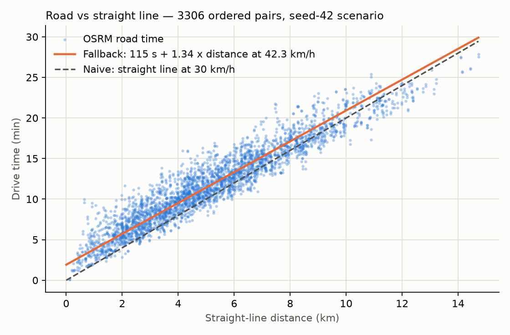
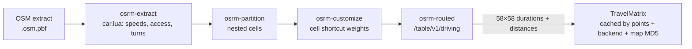

# 11 — Travel-time matrix (OSRM + haversine fallback)

## 1. What was built

| File | Purpose |
|---|---|
| `scripts/prepare_osrm.sh` | Downloads the Geofabrik West Midlands extract (56 MB, MD5-checked), then runs `osrm-extract` (car profile), `osrm-partition` and `osrm-customize`. Took 33 s on the M1 Pro |
| `docker-compose.yml` | Opt-in `osrm` service (`--profile osrm`), image pinned to `v26.4.0`, bound to `127.0.0.1:5005` |
| `app/matching/travel.py` | `TravelMatrix` (seconds and metres, square, possibly asymmetric). `haversine_m` and a calibrated `haversine_matrix`. `OSRMClient.table()` (one request, all pairs; errors on unroutable pairs). `cached_matrix()` (keyed by points + backend + map-data version). `scenario_points()` |
| `scripts/build_travel_matrix.py` | Builds and caches the scenario's OSRM matrix, calibrates the fallback against it, and writes `docs/results/tier2_travel.md` and a chart |
| `data/scheduling/travel/6018b10332dd1221.json` | Committed 58 × 58 OSRM matrix, so the solver and tests run without Docker |
| `tests/test_travel.py` | 8 tests: haversine reference distance, fallback formula, OSRM parsing and lon/lat order with a mocked HTTP transport, error handling, cache behaviour, consistency of the committed matrix, and a regression guard on fallback error |

## 2. Why this way

- **Road time, not distance, is what costs carers.** The solver's cost is minutes driven, and time windows are in minutes. A 2 km straight line can be 8 minutes across a dual carriageway or 3 minutes along a straight road.
- **OSRM, self-hosted:**
  - **Free.** Google's Distance Matrix API charges per element, and a 58-point matrix is 3,364 elements per scenario.
  - **Private.** Client locations never leave the machine, the same principle as local LLM inference in Tier 1.
  - **Deterministic.** A fixed map snapshot gives the same answer every time, which the experiments need.
- **The table service makes one call for all pairs.** It's O(n²) results but computed with one many-to-many search, not n² route queries.
- **The cache key includes the map-data version** (the extract's MD5). A new OpenStreetMap snapshot is a different backend and must not silently reuse old times. The committed matrix records exactly which map produced it.
- **The fallback is calibrated, not guessed.** I fitted "fixed overhead + detour × straight line at speed v" to all 3,306 OSRM pairs. Tests and offline work get realistic numbers with stated error, MAE 1.3 minutes, instead of a made-up speed.
- **OSRM is opt-in in Compose.** Most work, including CI later, uses the committed matrix or the fallback. Only rebuilding a matrix needs the 400 MB routing graph.

## 3. Alternatives considered

| Option | Pros | Cons | When I'd choose it |
|---|---|---|---|
| **Self-hosted OSRM, chosen** | Free, fast, private, deterministic | Free-flow speeds (no traffic); you run and update it | Prototype, and production with periodic map updates |
| Google / Mapbox / HERE matrix APIs | Live and historical traffic; maintained | Per-element cost; sends client locations to a third party (needs a DPA and DPIA); not reproducible | Production, if traffic accuracy dominates and governance allows |
| GraphHopper / Valhalla (self-hosted) | Also OSM-based; Valhalla has time-dependent costing and multimodal (bus, walk) | Heavier setup; different APIs | When carers walk or take buses (multimodal) |
| Haversine × factor only | No infrastructure; instant | MAE 1.3–1.8 min, max error ~7–9 min; blind to rivers, motorways and one-way systems | Tests, sketches, or a quick first rota |

## 4. How it works

**Why road ≠ straight line:**
1. **Detour (circuity).** Roads don't go straight. The median road-to-straight-line ratio here is **1.34**: a 3 km crow-flies hop is about 4 km by road. Canals, railways, the M6 and the A38 make some pairs much worse (up to 6.8 min off the fitted line).
2. **Fixed overhead per trip.** Getting off a residential street, junctions and lights. The fit puts this at about **115 s per trip**. That's why short trips are slow relative to their distance, and why a naive "distance ÷ 30 km/h" underestimates short hops. See the dashed line in the chart.
3. **Speed varies by road class.** The car profile assigns speeds per road type (motorway, primary, residential). The fitted *average* is 42 km/h, but that is **free-flow**: OSRM's car profile knows nothing about traffic. At 08:00 in inner Birmingham, real times are longer. This is a stated limitation.
4. **Asymmetry.** One-way streets and turn restrictions make A→B ≠ B→A: a mean difference of 0.5 min, up to 3.2 min. A VRP must use the directed matrix.

**Results** (`docs/results/tier2_travel.md`; 58 points, 3,306 ordered pairs; median trip 11.4 min, longest 27.9 min):

| Estimator vs OSRM | Bias | MAE | P90 abs error | Max abs error | MAPE |
|---|---|---|---|---|---|
| Calibrated: 115 s + 1.34 × straight line at 42.3 km/h | −0.0 min | 1.3 min | 2.7 min | 6.8 min | 14% |
| Naive: straight line at 30 km/h | −1.4 min | 1.8 min | 3.8 min | 8.7 min | 18% |

The naive model looks deceptively decent on average, because its low speed happens to offset the missing detour. But it's biased low (−1.4 min per trip, so about −2.5 hours across a 106-visit day), and its errors are worst on exactly the short trips that dominate care rounds.



**How OSRM answers a table query quickly.** Preprocessing builds a **multi-level partition (MLD)** of the road graph into cells: 2,251 at level 1, 157 at level 2, 10 at level 3. It precomputes shortcut costs across each cell's boundary nodes (`osrm-customize`). A query searches the fine graph only near the source and target, and jumps across cells using the shortcuts. The alternative, **contraction hierarchies (CH)**, is faster to query but slower to re-customise when edge weights change, for example with traffic updates. MLD's quick re-customisation is why it's the default for setups that might add traffic data later.



## 5. Interview questions and answers

**Q1. Why does road travel time differ from straight-line distance?**
Four reasons, all measured on this scenario:
- **Detour:** roads are about 1.34× longer than the straight line.
- **Fixed per-trip overhead:** about 2 minutes of junctions and getting onto main roads, which dominates short hops.
- **Road-class speeds:** the average is a mix of motorway and residential.
- **Asymmetry:** one-way systems and turn bans, up to 3 minutes here.

A naive straight-line model is biased low by 1.4 minutes per trip, about 2.5 hours across a day's rota. That's enough to make a schedule look feasible when it isn't.

**Q2. Why self-host OSRM instead of using Google's API?**
Cost, privacy and reproducibility. A care provider's client locations are personal data. Self-hosting means they never leave our infrastructure, the same principle as running the LLM locally. It's free per query, and a pinned map snapshot gives identical results for every experiment. The trade-off is that OSRM uses free-flow speeds. If traffic accuracy turned out to matter more than those benefits, I'd evaluate a commercial API with historical traffic, under a data-processing agreement and an updated DPIA.

**Q3. Trade-off: why calibrate a fallback when you have OSRM?**
Tests, CI and quick experiments shouldn't need a 400 MB routing graph and a running container. But an uncalibrated fallback gives misleading results, for example showing schedules feasible that aren't. Fitting the fallback to the real matrix gives a known error budget: zero bias, 1.3 minutes MAE, 6.8 minutes worst case. So I know when it's good enough (unit tests, rough sizing) and when it isn't (final schedules, near-tight windows).

**Q4. How do you keep cached matrices from going stale?**
The cache key is a hash of the exact ordered points plus the backend identity, which includes the map extract's MD5. New map data, a different profile or a moved point all mean a new key and a recomputed matrix. The committed matrix records its backend string, so any result can be traced back to the OpenStreetMap snapshot that produced it.

**Q5. With real PBL data at scale, what changes?**
- **Traffic:** time-of-day travel times, through a traffic-aware engine or historical speed profiles fed into OSRM's customise step (which MLD supports).
- **Travel mode** per carer: walking, bus or car.
- **Parking and door-to-door overhead,** calibrated from electronic call-monitoring timestamps.
- **Size:** a 1,000-point matrix is a million entries, still one table request, but cache per patch and per day.
- **Data protection:** client coordinates at postcode-centroid precision, governed by the DPIA.

**Q6. What is MLD and why did you use it over contraction hierarchies?**
Both preprocess the road graph so queries don't explore the whole network. Contraction hierarchies add shortcut edges in a global node ordering: very fast queries, but changing edge weights means redoing much of the preprocessing. MLD partitions the graph into nested cells and precomputes costs across cell boundaries. Queries are slightly slower, but re-customising weights takes seconds. That keeps the door open for traffic-adjusted speeds without rebuilding everything.

## 6. Learn more

**Official documentation**
- OSRM, [HTTP API, Table service](https://project-osrm.org/docs/v5.24.0/api/#table-service): request format (`lon,lat`), the `annotations=duration,distance` option, and units (seconds, metres). The `durations[i][j]` ordering is directional. These docs are for v5.24; the v26.4 image used here keeps the same API.
- OSRM, [osrm-backend repository](https://github.com/Project-OSRM/osrm-backend): the Docker quickstart this setup follows (`ghcr.io/project-osrm/osrm-backend`, the MLD pipeline).
- Geofabrik, [West Midlands extract](https://download.geofabrik.de/europe/united-kingdom/england/west-midlands.html): the source data (OpenStreetMap, ODbL licence). Data up to 2026-11-05.

**Videos**
- I couldn't verify a recording this session. Search YouTube for **"OSRM is Back State of the Map 2026"**, Dennis Luxen's talk on the project's current state ([session page](https://2026.stateofthemap.org/sessions/ZR8RTX)), or **"multi-level Dijkstra route planning"** for the MLD algorithm. Prefer conference or university channels.

## 7. Check your understanding

With OSRM running, request a single pair in both directions and compare:

```bash
curl -s "http://127.0.0.1:5005/table/v1/driving/-1.890,52.478;-1.950,52.479?annotations=duration,distance"
```

Then compute the fallback for the same pair: `uv run python -c "from app.matching.travel import *; from app.matching.data import Location as L; print(haversine_matrix([L(lat=52.478,lon=-1.890), L(lat=52.479,lon=-1.950)]).durations_s)"`. Predict which is larger and why the OSRM matrix isn't symmetric.

**Expected (verified):**
- **Straight line:** 4,065 m. The fallback gives 579 s (9.6 min: 115 s overhead + 5.4 km of road at 42.3 km/h), the same in both directions by construction.
- **OSRM:** 594 s (9.9 min) and 5,964 m one way; 620 s (10.3 min) and 5,972 m back. The return trip is 26 s slower because of one-way streets and turn restrictions.
- **Detour:** the road distance is 1.47× the straight line, above the 1.34 median, so this pair is worse than typical. Even so, the fallback is within 15–41 s here.
