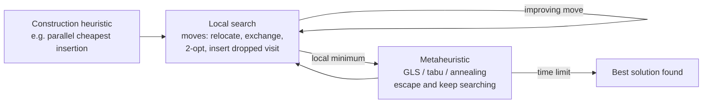
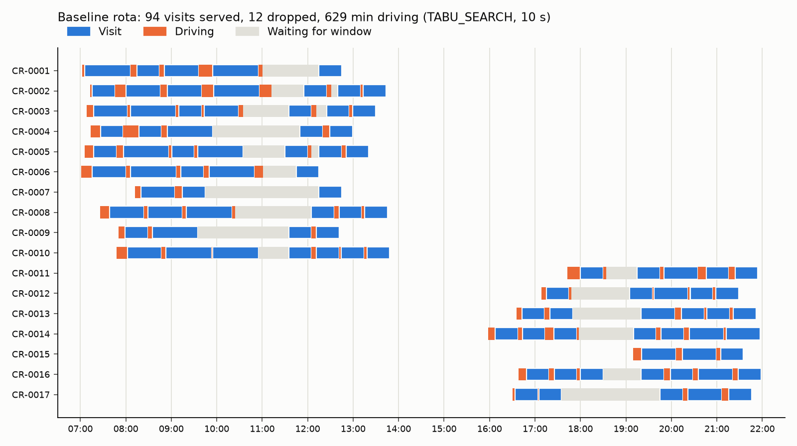

# 12 — Baseline VRPTW in OR-Tools

## 1. What was built

| File | Purpose |
|---|---|
| `app/matching/solver.py` | `solve(scenario, matrix, params) -> Solution`. The OR-Tools routing model: one vehicle per carer, open routes, a time dimension in seconds, windows, shifts, skill/shift eligibility, and drop penalties (×2 for time-critical visits). Configurable first-solution strategy, metaheuristic, time limit and first-solution-only mode |
| `app/matching/check.py` | Independent checker: skills, travel against the matrix, arrival feasibility, windows, durations, shift end, served-once, every visit accounted for |
| `app/matching/bounds.py` | Proven lower bound on dropped visits: a travel-free relaxation solved exactly with CP-SAT (optional intervals + no-overlap per carer) |
| `scripts/solve_baseline.py` | Experiments: 5 construction heuristics, 4 metaheuristics at 10 s and 60 s, drop diagnosis, staffing what-ifs, route Gantt chart. Writes `docs/results/tier2_baseline.md` |
| `tests/test_solver.py` | 8 tests on hand-built instances: ordering by windows, skill routing, impossible visit dropped, time-critical kept, first-solution mode, the checker catching a doctored solution, the bound, and a full-scenario smoke test |

## 2. Why this way

- **One vehicle per carer, open routes.** Each carer starts where their day starts (home or office), so the first drive counts. Routes end at a zero-cost dummy node, because the journey home after the last call is usually unpaid commuting. Counting it would bias the solver towards rotas that end near home, which is a different (if reasonable) objective.
- **The time dimension is in seconds,** with transit = service time at the origin + drive time. OR-Tools works in integers. Seconds avoid rounding a 5-minute drive to 0 or 10. The cumulative value at a visit is when service starts, and slack (up to 4 h) lets a carer wait for a window to open.
- **Hard constraints are enforced in the model:**
  - **Windows and shifts** are ranges on the time dimension's cumulative variables.
  - **Skills, and whether the visit fits the shift,** restrict each visit's vehicle variable to eligible carers. Infeasible pairs are removed before search, which also shrinks the search space.
- **Visits are optional, with large penalties.** A real day can be over capacity, as this one is. Without disjunctions the solver would just report "infeasible" and give the coordinator nothing. With them, it returns the best partial rota and a precise list of unfilled calls.
- **The penalty is big enough to drop only when forced.** The maximum possible total driving (all carers driving their entire shifts) is about 446,000 s. One drop costs 1,000,000. Serving one more visit therefore always beats any travel saving. Time-critical medication costs double, so if something must go, it isn't that.
- **Every solution passes an independent checker.** The checker re-derives arrival times from the matrix and doesn't trust OR-Tools' own numbers. It caught nothing wrong in the solver, but it was what exposed my test's wrong status expectation and an unreadable error message.
- **A proven bound puts the drops in perspective.** "The solver dropped 12" is meaningless without knowing the minimum possible. CP-SAT proves that even with zero travel at least 2 drops are unavoidable. That separates capacity problems from routing problems.

## 3. Alternatives considered

| Option | Pros | Cons | When I'd choose it |
|---|---|---|---|
| **OR-Tools routing library, chosen** | Purpose-built for VRP variants; dimensions, disjunctions, many heuristics; free | Heuristic, so no optimality proof; SWIG API quirks; time-limited runs can vary across machines | Most practical VRPTW work |
| CP-SAT with circuit constraints | Exact, so it can prove optimality and gives bounds | Scales poorly past ~50–100 visits with windows | Small instances, or certifying a heuristic's gap |
| MIP (time-indexed or flow formulation, e.g. HiGHS or Gurobi) | LP bounds; mature solvers | Big-M time constraints give weak relaxations; slow at this size | Research or benchmarking with a commercial solver |
| Custom metaheuristic (ALNS) or a dedicated VRP library (PyVRP, HGS) | State-of-the-art quality on benchmarks | More code to own, or narrower constraint support (skills, open routes) | Large-scale production after profiling OR-Tools |

## 4. How it works

**The VRPTW** (vehicle routing problem with time windows): choose, for each vehicle, an ordered sequence of stops so that every stop is visited once, arrivals fall inside windows, and total cost is minimised. It generalises the travelling salesman problem, so it's NP-hard. Exact methods hit a wall quickly, which is why practical solvers combine a fast construction heuristic with local search.



**Dimensions.** OR-Tools tracks a quantity accumulated along each route, here time. For an arc i→j: `cumul(j) ≥ cumul(i) + transit(i, j)`, with slack allowed for waiting. Constraining `cumul(visit)` to `[window_start, window_end]` *is* the time-window constraint.

**First-solution (construction) strategies, measured on this instance (106 visits):**

| Strategy | How it builds | Dropped | Drive (min) |
|---|---|---|---|
| PATH_CHEAPEST_ARC | Extends one route at a time to the cheapest next node | **47** | 374 |
| SAVINGS (Clarke–Wright) | Merges routes where the saving is largest | 40 | 514 |
| CHRISTOFIDES (variant) | Extends routes until nothing more fits | 45 | 527 |
| LOCAL_CHEAPEST_INSERTION | Inserts nodes in creation order at their cheapest position | 16 | 744 |
| **PARALLEL_CHEAPEST_INSERTION** | Repeatedly inserts the cheapest node anywhere, across all routes | **15** | 730 |

Path-building heuristics look cheap (374 min) only because they *drop* almost half the visits. Optional nodes make giving up easy for a myopic construction. Insertion heuristics consider every route for every visit, which suits tight windows. That's why PCI is the default.

**Metaheuristics** (all starting from PCI):

| | 10 s | 60 s |
|---|---|---|
| Greedy descent (stops at first local minimum, after 1.7 s) | 13 dropped | 13 |
| Guided local search | 13 | 12 |
| Simulated annealing | 13 | 13 |
| **Tabu search** | **12** | **11** |

- **Greedy descent** accepts only improving moves, so it stalls at the first local minimum.
- **Guided local search (GLS)** adds penalties to features of the current local minimum (frequently used arcs), reshaping the cost landscape so the search moves on. The OR-Tools docs call it generally the most efficient for routing.
- **Tabu search** forbids recently reversed moves, so it can walk "uphill" out of a basin.
- **Simulated annealing** accepts worse moves with a probability that falls over time.

On *this* instance tabu search was best at both limits, so it's the default. One instance is weak evidence; it would be worth re-checking on other seeds.

**Why visits are dropped:**
- **Proven minimum** (travel-free relaxation, CP-SAT, optimal in 0.8 s): **2** visits can't be served even with zero travel. The specific two vary between equivalent optimal solutions, but the count is proven.
- **Best found:** 11 (tabu, 60 s). The gap of 9 is travel plus heuristic sub-optimality, and this bound can't separate the two.
- **Two patterns in the 12 dropped by the default configuration:**
  - *Morning skill-mix bottleneck:* 5 of the 7 morning drops need dementia care and/or catheter care, which only 2–3 early carers can do.
  - *Bed-time peak:* 5 drops between 19:10 and 21:10, with 7 late carers covering 31 bed visits.

**Staffing what-ifs** (same locations, so the same travel matrix):

| Change | Dropped | Drive (min) | Bound |
|---|---|---|---|
| None | 12 | 629 | 2 |
| Train CR-0001 (early, under-used) in dementia care + medication | 10 | 611 | 1 |
| Add one late carer | 9 | 673 | 1 |
| Both | 7 | 642 | 0 |

This is the most useful output for a care provider. It turns "the rota doesn't work" into "train this person, or hire a late carer".



The chart shows what the objective ignores: **waiting**. Several carers have 1–2.5-hour gaps before lunch and tea calls. Waiting isn't costed, so the solver is indifferent to it. For carers it's unpaid dead time, a known driver of attrition, and an input to Tier 3.

## 5. Interview questions and answers

**Q1. What is the VRPTW and how did you model carers' days in it?**
It's choosing ordered routes for a fleet so every customer is visited once, inside a time window, at minimum cost. Here each carer is a vehicle starting at their home or the office, with an open end because the trip home is unpaid. Each visit is a node at the client's location. A time dimension in seconds accumulates drive plus service time, the visit's arrival window bounds it, and each carer's shift bounds their start and end. Skills are enforced by restricting which vehicles may serve each node.

**Q2. How do you handle a day that can't all be covered?**
Every visit is a disjunction: optional, with a penalty if dropped. The penalty (1,000,000) exceeds the maximum possible total driving (about 446,000 s), so the solver only drops a visit when it genuinely can't fit, and time-critical medication costs double. The coordinator gets the best partial rota plus an explicit unfilled list, not just "infeasible". I also prove a lower bound with CP-SAT on a travel-free relaxation: at least 2 of the 106 visits can't be covered whatever the routing. That frames the solver's 11–12 drops correctly.

**Q3. Trade-off: why did PATH_CHEAPEST_ARC look cheapest yet perform worst?**
It had the lowest driving (374 min) because it dropped 47 visits. It extends one route greedily, so once a carer's day fills up badly the remaining visits are simply abandoned, and with optional nodes abandoning is cheap. Parallel cheapest insertion considers every route for every unassigned visit and dropped only 15. The lesson is to compare on the full objective, drops first. A low travel number can mean the solver did less work, not better work.

**Q4. How do first-solution strategies and metaheuristics differ?**
The first-solution strategy constructs a complete solution quickly, for example by repeatedly inserting the cheapest visit. Local search then applies small moves (relocate a visit, swap two, reverse a segment) while they improve the cost. It gets stuck in local minima, so a metaheuristic decides how to escape:
- guided local search penalises features of the current minimum
- tabu search forbids undoing recent moves
- simulated annealing sometimes accepts worse moves

Here greedy descent stopped at 13 drops after 1.7 s, while tabu reached 11 in 60 s.

**Q5. How do you know the solutions are actually valid?**
A separate checker re-derives every arrival from the travel matrix and checks skills, windows, shifts, durations, served-once, and that every visit is accounted for. It shares no code with the solver. Every experiment row reports whether it passed (all did), and the tests include a deliberately doctored solution that the checker must reject. I also ran a mutation check: removing the skill restriction from the solver makes three tests fail.

**Q6. With real PBL data at scale, what would you change?**
- **Size:** hundreds of carers per day, so partition by patch or region, or use OR-Tools' parallel search options.
- **Realism:** double-ups (synchronised arrivals), split shifts with breaks, and costed waiting and overtime.
- **Travel:** time-dependent travel.
- **Ownership:** a rolling re-plan when calls change at short notice. Coordinators need to lock assignments and re-optimise around them.
- **Validation:** results on many historical days against the actual rota, not one synthetic day.

**Q7. Why is waiting time not in the objective, and is that a problem?**
For the baseline I minimised drive time only, the classic VRPTW objective. The Gantt chart shows the consequence: 1–2.5-hour unpaid gaps mid-shift, which carers experience as wasted, unpaid time and which is linked to turnover. Adding a span cost (minimise each carer's working span) or a waiting cost would compress days, at some cost in driving or drops. That's a deliberate next lever, and I'll measure it alongside continuity rather than silently change the baseline.

## 6. Learn more

**Official documentation**
- OR-Tools, [Vehicle Routing Problem with Time Windows](https://developers.google.com/optimization/routing/vrptw): the time dimension pattern used here.
- OR-Tools, [Routing Options](https://developers.google.com/optimization/routing/routing_options): every first-solution strategy and metaheuristic in the tables above, with one-line definitions.
- OR-Tools, [Penalties and Dropping Visits](https://developers.google.com/optimization/routing/penalties): disjunctions, and why penalty size controls how many visits get dropped.
- OR-Tools, [CP-SAT Solver](https://developers.google.com/optimization/cp/cp_solver): the exact solver behind the travel-free bound.

**Videos**
- I couldn't verify a suitable video this session. Search YouTube for **"vehicle routing problem time windows lecture"** (look for university course channels), **"guided local search vehicle routing"**, or **"Clarke Wright savings algorithm explained"**, and check that the channel is a university or conference before relying on it.

## 7. Check your understanding

In `app/matching/solver.py`, set `TIME_CRITICAL_FACTOR = 1`, so time-critical medication becomes as droppable as any other visit. Then run:

```bash
uv run python -c "from scripts.solve_baseline import load; from app.matching.solver import *; s,m=load(); sol=solve(s,m,SolverParams(time_limit_s=10)); v={x.visit_id:x for x in s.visits}; print(len(sol.dropped), [d for d in sol.dropped if v[d].time_critical])"
```

Predict whether any time-critical visits are now dropped. Restore the factor afterwards.

**Expected (verified, 10 s):**

| Factor | Dropped | Time-critical dropped | Drive |
|---|---|---|---|
| 2 (default) | 12 | none | 628 min |
| 1 | 13 | **V-0070, V-0065** | 600 min |

With equal penalties, the solver trades two time-critical medication calls for 28 fewer minutes of driving. The *total* drops also get worse (13), because a different objective sends the heuristic down a different search path. The factor encodes a clinical priority the solver can't infer: if visits must go, they shouldn't be the Parkinson's medication rounds.
