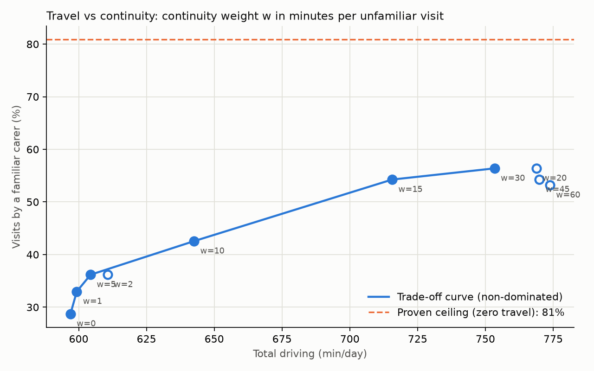

# 13 — Continuity of care: travel vs continuity trade-off

## 1. What was built

| File | Purpose |
|---|---|
| `app/matching/continuity.py` | `Familiarity` (preferred / recent / new), `penalty_s()` (new = w, recent = w/2, preferred = 0), `continuity_stats()` (familiar %, preferred %, distinct carers per multi-visit client) |
| `app/matching/solver.py` | `SolverParams.continuity_weight_s`: per-carer arc cost = drive + continuity penalty on arriving at a visit. A guard ensures dropping a visit always costs more than any travel + continuity it could save. `solve(..., initial=)` warm-starts from an existing schedule |
| `app/matching/bounds.py` | Refactored around one travel-free CP-SAT model. Adds `travel_free_continuity_bound`: the most visits a familiar carer could ever cover |
| `scripts/sweep_continuity.py` | Fixes coverage first, then sweeps w = 0…60 min (30 s per point), computes the Pareto front and marginal costs. Writes `docs/results/tier2_continuity.md` and `docs/figures/tier2_pareto.png` |
| `tests/test_continuity.py` | 9 tests: familiarity levels, the weight flipping an assignment exactly at the travel break-even, continuity never causing a drop, the penalty guard, the distinct-carers metric, the continuity ceiling, Pareto dominance over three objectives, warm start |

## 2. Why this way

- **Continuity is a cost, not a constraint.** Requiring "preferred carer only" would make most of this day infeasible: the proven ceiling is 81% even with zero travel. A weighted penalty lets the solver trade, and the weight has a business meaning: **w = minutes of extra driving we'd accept to avoid sending a stranger**. A registered manager can reason about "10 minutes", not about an abstract coefficient.
- **Three familiarity levels.** NICE QS123 statement 3 asks for a *consistent team*, not one person. A carer who visited recently is familiar even if not named as preferred, so recent costs half.
- **A per-vehicle arc cost puts the penalty on the arrival arc.** OR-Tools costs live on arcs, but continuity depends on the (carer, client) pair. Giving each carer its own cost callback, drive(i,j) + penalty(carer, j), counts each served visit's penalty exactly once, because every visit has exactly one incoming arc.
- **Continuity must never cost a visit.** A guard checks that drop penalty > maximum travel + visits × w. A stranger is always better than no care. This is tested.
- **Coverage is fixed first, then travel is traded against continuity.** The first sweep varied all three outcomes at once, and drop counts wobbled between 12 and 14 from heuristic noise. That made the curve meaningless: w=2 looked cheaper than w=0 only because it dropped two more visits.
  - The fix is a **lexicographic** approach: serve as many visits as possible (continuity-blind), freeze that set of 94, then sweep.
  - Each run **warm-starts from the reference routes**, so the solver can't lose coverage: the returned best is never worse than the start, and a drop costs more than any continuity gain.
- **A proven ceiling frames the curve.** CP-SAT shows at most 76 of the 94 visits (81%) can be covered by familiar carers even with zero travel. Familiar carers' times overlap: a dementia-trained early carer is "familiar" to many clients whose morning calls collide. So 100% continuity was never on the table.

## 3. Alternatives considered

| Option | Pros | Cons | When I'd choose it |
|---|---|---|---|
| **Weighted sum + weight sweep, chosen** | Simple; interpretable weight; one solver run per point | Only finds supported (convex-hull) points; heuristic noise at large w | Most practical bi-objective work with a heuristic solver |
| ε-constraint (minimise travel subject to continuity ≥ ε) | Reaches non-convex parts of the front; constraint matches policy ("≥ 60% familiar") | Needs a constraint on a count across routes (awkward in OR-Tools routing; natural in CP-SAT or MIP) | When the provider sets a continuity target |
| Hard constraint: preferred carers only | Maximal continuity | Infeasible here (ceiling 81% with zero travel); collapses coverage | Very small, stable caseloads |
| Fixed "patches" or teams per client (assign first, then route) | Mirrors how many providers organise rotas; stable teams | Two-stage, so suboptimal travel; rigid when staff are absent | Operational simplicity over optimality |

## 4. How it works

**Multi-objective optimisation.** With two goals that conflict (less driving, more familiar carers), there's no single best schedule. A schedule is **Pareto-optimal** (non-dominated) if no other schedule is at least as good on every objective and strictly better on one. The set of these is the **Pareto front**: every point on it is a defensible choice, and choosing among them is a value judgement, not a technical one.

**The weighted sum:** minimise `drive + w × (penalised unfamiliar visits)`. Each w picks the point where the front's slope equals −1/w. Sweeping w traces the front. A weighted sum can only find points on the front's convex hull. That's a known limitation, and the ε-constraint method handles it.

**Results** (94 visits, coverage fixed, tabu search, 30 s per point):

| w (min) | Drive (min) | Familiar visits | Preferred | On front |
|---|---|---|---|---|
| 0 | 597 | 28.7% | 16.0% | yes |
| 1 | 599 | 33.0% | 19.1% | yes |
| 5 | 604 | 36.2% | 24.5% | yes |
| 10 | 643 | 42.6% | 27.7% | yes |
| 15 | 716 | 54.3% | 37.2% | yes |
| 30 | 753 | 56.4% | 40.4% | yes |
| 2, 20, 45, 60 | 611–774 | 36–56% | 21–38% | dominated |

Proven ceiling: 81% familiar.

**Reading the curve:**
1. **A free lunch at the start.** w = 0 → 5 adds about 7 familiar visits (28.7% → 36.2%) for **7 extra minutes** across the whole day. Among near-equal routes, continuity-blind optimisation picks strangers arbitrarily. Any small positive weight is strictly better for clients.
2. **A steady middle.** w = 5 → 15 adds about 17 familiar visits for 111 minutes, roughly **6.5 minutes of driving per extra familiar visit**.
3. **Diminishing returns, then search degrades.** w = 15 → 30 costs about 19 minutes per extra familiar visit. Above that, solutions get *worse* on both axes (w = 45 and 60 are dominated). Large penalties make the landscape rugged for local search: moves that improve travel are swamped by continuity terms. This is a heuristic artefact, not a property of the problem, and it's why the front is computed from all points rather than trusting monotonicity.
4. **Run-to-run variation.** The search stops on a wall-clock limit, so its depth depends on CPU timing. An identical rerun changed 3 of the 10 points (w = 2, 30 and 45, by up to 19 minutes of driving). The front's shape and knee stayed the same, but single numbers carry a few percent of noise. A deterministic budget (a solution limit) would fix that, and it's in the backlog.
5. **Distinct carers per client barely moves** (2.5–2.9). Anyone with morning and bed calls needs an early and a late carer, so the floor is 2. Continuity here improves *which* carers come, not how many.

**How a care provider would choose a point:**
- **Price the axes.** Driving costs carer time, roughly 10 hours a day across the rota, plus mileage. For example, at £12/h and 45p a mile (≈ 0.4 miles a minute), an extra 6.5 minutes costs about £2.50 per extra familiar visit.
- **Set a floor from policy,** for example "at least 50% of visits by a familiar carer, and 80% for dementia clients". The weighted sum then picks the cheapest point above the floor; a *per-client-group* weight is a natural extension.
- **Look for the knee,** where marginal cost jumps: here, after w = 15 (6.5 → 19 minutes per familiar visit).
- **Check robustness** on other days before fixing a weight. A weight chosen on one synthetic day is a starting point, not a policy.

## 5. Interview questions and answers

**Q1. How did you model continuity of care in the solver?**
As a soft cost. Each visit costs w if the carer is new to the client, w/2 if they've visited recently, and 0 if they're the preferred carer. In OR-Tools that's a per-carer arc cost: drive time plus the penalty for arriving at that client, which counts each visit exactly once. The weight is in seconds of driving, so it reads as "how many minutes of extra travel would we accept to send someone the client knows". A guard ensures dropping a visit always costs more than any continuity gain.

**Q2. What is a Pareto front and how did you trace it?**
With two conflicting objectives there's no single optimum. A schedule is Pareto-optimal if nothing beats it on one objective without losing on the other. I swept the weight from 0 to 60 minutes and solved each point, then kept the non-dominated ones. Each weight picks the front point whose slope matches the price of continuity in driving minutes. The result runs from 29% familiar at 597 minutes of driving to 56% at 753 minutes.

**Q3. Trade-off: your first sweep produced a nonsense curve. What went wrong?**
I varied the weight on the full day, and the time-limited heuristic dropped 12, 13 or 14 visits depending on its search path. Since dropped visits need no driving, some higher-weight points looked cheaper than lower-weight ones. I fixed it lexicographically. First maximise coverage with a continuity-blind solve and freeze that set of 94 visits. Then sweep with each run warm-started from those routes, so coverage can't be lost. The lesson: with a heuristic solver, control the objectives you're not studying.

**Q4. How would a care provider choose a point on the curve?**
- **Price it:** the middle of this curve costs about 6.5 minutes of driving per extra familiar visit, roughly £2.50 at typical wages and mileage.
- **Use the cheap part:** the first 7 points of continuity cost only 7 minutes for the whole day, so any small positive weight is a no-brainer.
- **Set policy floors,** for example higher continuity for dementia clients, and look for the knee where marginal cost jumps.
- **Decide as a team:** the registered manager decides with carers and families, and the tool's job is to make the price of each option visible.

**Q5. Why can't you reach 100% continuity?**
I proved a ceiling. A travel-free relaxation solved exactly with CP-SAT shows at most 81% of the 94 visits can be covered by a familiar carer. A few familiar, skilled carers are wanted by many clients at the same morning and evening times. The remaining gap, from 56% to 81%, is travel plus heuristic quality. To close it, the levers are workforce ones (train more carers in dementia care, adjust preferred-carer lists), not algorithmic ones.

**Q6. With real PBL data, what changes?**
- **Familiarity from history:** derive it from actual visit records (visits in the last 4–8 weeks, recency-weighted), not stated lists.
- **Week-level measurement:** continuity matters across a week, not a day. Planning a week at once, with "same carer on the same weekday" as an objective, is a bigger model.
- **Weights by need:** higher for dementia and end-of-life clients.
- **Validation:** check weights across many days, and measure the outcome that matters, such as client-reported experience or complaints, rather than our proxy.

**Q7. Why did higher weights produce worse solutions?**
At w = 45 and 60 the penalty terms dominate the objective, so most local-search moves change continuity cost by large jumps and the landscape gets rugged. Tabu search with a 30-second limit gets stuck in worse regions. Mathematically the optimum can't get worse on continuity as w rises; this is a search artefact. I computed the front from all points, so dominated runs are visible rather than hidden, and I'd cap the practical weight range at about 30 minutes or give large-w runs more time.

## 6. Learn more

**Official documentation**
- OR-Tools, [Routing Options](https://developers.google.com/optimization/routing/routing_options): the local-search metaheuristics whose behaviour changes with the weight.
- OR-Tools, [Penalties and Dropping Visits](https://developers.google.com/optimization/routing/penalties): the drop penalty that must dominate continuity costs.
- NICE QS123, [Quality statement 3: Consistent team of home care workers](https://www.nice.org.uk/guidance/qs123/chapter/quality-statement-3-consistent-team-of-home-care-workers): the policy basis for continuity. It suggests measuring the number of care workers per person, which is this note's "distinct carers per client". *Confirmed by web search; the site blocks automated fetching (HTTP 403), so I couldn't read the full page this session.*

**Videos**
- I couldn't verify a video this session. Search YouTube for **"multi-objective optimization Pareto front explained"** and **"epsilon constraint method"**, preferring university lecture channels. Check that the video covers weighted-sum limitations (convex hull) before relying on it.

## 7. Check your understanding

The weight has an exact break-even. In `tests/test_continuity.py::test_weight_switches_assignment_to_familiar_carer`, a stranger starts next to the client and the preferred carer starts 4.7 km away. Compute the break-even weight by hand from the fallback model (115 s + 1.34 × straight-line distance at 42.3 km/h). Predict which carer is chosen at w = break-even − 60 s and at break-even + 60 s, then run the test.

**Expected (verified):**
- **Stranger:** 222 m straight line, giving 140 s (115 s overhead + 297 m of road).
- **Preferred carer:** 4,670 m, giving 648 s.
- **Break-even:** w = **508 s (8.5 min)**. The overheads cancel, so it's (4,670 − 222) × 1.34 ÷ 11.75 m/s ≈ 507 s, plus 1 s of rounding.
- **Outcome:** at 448 s the stranger is chosen; at 568 s the preferred carer is.
- In words: if you value continuity at more than 8.5 minutes of driving, this client gets their preferred carer.
