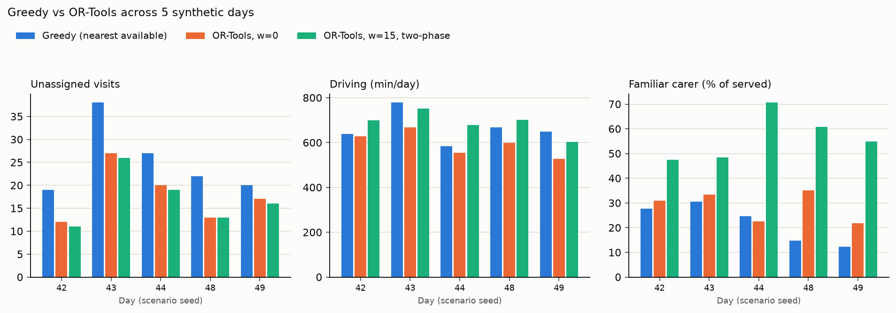

# 14 — Greedy baseline and evaluation

## 1. What was built

| File | Purpose |
|---|---|
| `app/matching/greedy.py` | `solve_greedy()`: visits in window order (time-critical first on ties), each to the eligible carer who can arrive in time with the shortest drive; otherwise dropped. Returns the same `Solution` type as OR-Tools, so the same checker and metrics apply |
| `app/matching/solver.py` | `Solution.params` is now optional (`None` for non-OR-Tools solvers) |
| `scripts/compare_solvers.py` | Greedy vs OR-Tools (w=0) vs OR-Tools (w=15, two-phase) over **5 valid synthetic days**. Metrics: unassigned, time-critical unassigned, driving, continuity, utilisation, runtime. Writes `docs/results/tier2_comparison.md` and a chart |
| `data/scheduling/travel/*.json` | OSRM matrices for the extra days (seeds 43, 44, 48, 49) |
| `tests/test_greedy.py` | 4 tests: a hand-built case where greedy's myopia loses a visit that OR-Tools keeps, the time-critical tie-break, late departure, and validity and determinism on the committed scenario |

## 2. Why this way

- **A baseline must be a credible alternative.** "Nearest available carer who can make it" is roughly what an experienced coordinator does with a whiteboard: fill the morning in time order and send whoever is closest and free. If OR-Tools can't beat that clearly, it isn't worth the complexity.
- **Same output type, same checker.** Greedy returns a `Solution`, so the independent checker verifies it and the metrics are computed by identical code. Differences in the table are differences in decisions, not in bookkeeping.
- **Five days, not one.** The seed-42 day drove every design choice so far. A comparison on it alone would be tuned to it. The script tries seeds from 42 upwards until it has 5 days that pass validation. Seeds 45, 46 and 47 failed with skill-mix gaps, which is reported rather than hidden.
- **The production-like continuity configuration is two-phase.** Step 2.4 showed that a single solve with continuity can lose coverage through search noise. Here w=15 warm-starts from the w=0 solution, so adding continuity *cannot* cost a visit. On these days it served slightly more than w=0 (17.0 against 17.8 unassigned), because the second phase is simply more search time.
- **The metrics serve the stakeholders:**
  - unassigned and time-critical unassigned: client safety
  - driving: cost and carer time
  - familiar carer: quality of care
  - utilisation: workforce efficiency
  - runtime: whether a coordinator can use it interactively

## 3. Alternatives considered

| Option | Pros | Cons | When I'd choose it |
|---|---|---|---|
| **Nearest-available greedy, chosen** | Mirrors manual practice; instant; transparent | Myopic, never revisits a choice; ignores continuity | Baseline, or a fallback when the optimiser is down |
| Greedy + continuity tie-break (familiar carer if within X minutes) | Closer to a good coordinator; still instant | Another tuning knob; still myopic | A quick operational upgrade before deploying an optimiser |
| Regret-based insertion (insert the visit you'd regret most to postpone) | Much better than plain greedy; the classic VRPTW construction | More complex; still a construction heuristic | A stronger baseline for research comparisons |
| The real historical rota | The honest comparison: does it beat what PBL actually did? | Needs real data and governance | The KTP evaluation proper |

## 4. How it works

**Greedy, step by step**, for each visit in window order:

```
for visit in sorted(visits, by window_start, time-critical first):
    for each eligible carer:
        drive = travel(carer's current location -> client)
        start = max(carer free time + drive, window opens)
        feasible if start <= window closes and start + duration <= shift end
    assign to the feasible carer with the shortest drive (earliest start breaks ties)
    otherwise: drop
```

**Why it's myopic** (tested in `test_greedy_is_myopic_where_ortools_is_not`). Two 08:00 visits at one client. The nearby carer is the only one trained in medication; a far carer isn't. Greedy sends the nearby carer to the first visit, the medication visit then has nobody, and it's dropped. OR-Tools sends the far carer to the first visit and serves both. Greedy commits to locally good choices with no look-ahead, and scarce skills are exactly where that hurts.

**Results** (5 days, mean; OSRM travel; each run verified by the checker; full per-day table in `docs/results/tier2_comparison.md`):

| | Greedy | OR-Tools w=0 | OR-Tools w=15, two-phase |
|---|---|---|---|
| Unassigned visits (of ~106) | 25.2 | 17.8 | **17.0** |
| **Time-critical visits unassigned** | **5.4** | **0.0** | **0.0** |
| Driving (min/day) | 663 | **596** | 687 |
| Familiar carer (% of served) | 22.0% | 28.7% | **56.4%** |
| Utilisation (visit + driving ÷ shift time) | 50.7% | 52.8% | 54.5% |
| Runtime | 0.007 s | 10 s | 20 s |



**What it shows:**
1. **Coverage:** greedy leaves about 42% more visits unassigned (25.2 vs 17.8), consistently on all five days.
2. **Safety:** greedy drops about **5 time-critical medication visits a day**. OR-Tools drops none, because its objective prices them higher and its search can rearrange other visits to protect them. This is the strongest argument for optimisation in a care setting, and greedy can't be patched to match it without look-ahead.
3. **Cost:** OR-Tools drives 10% less (596 vs 663 min) while *serving more*.
4. **Continuity:** the two-phase w=15 configuration doubles familiar-carer visits (28.7% → 56.4%) for 15% more driving (+91 min a day) and *no* loss of coverage.
5. **Runtime:** 10–20 seconds is fine for overnight or start-of-day planning, but not for a live "who can cover this call now?" query. There, greedy (or a short OR-Tools re-optimisation around locked assignments) fits better.

**Utilisation is low (about 50–55%) for everyone.** Shifts include long mid-shift idle gaps waiting for the lunch and tea windows (see the Gantt chart in note 12), and peak-time capacity, not total capacity, is what binds. Even an optimiser can't fix demand that clusters at 08:00 and 20:00 with continuous shifts. Split shifts or staggered start times would.

**Honest limits of this comparison:**
- **Synthetic, overloaded days.** Every day has 12–27 visits unserved even by OR-Tools, because the generator's staffing is tight for its demand peaks. Real rotas are planned against known demand.
- **Generator validity.** 3 of 8 seeds were rejected for skill-mix gaps, so the valid days are a filtered sample.
- **Time-limited search noise.** A few percent run to run.
- **The fair real-world baseline is PBL's actual rota,** not my greedy.

## 5. Interview questions and answers

**Q1. How does the optimiser compare with a simple heuristic?**
Over five synthetic days, OR-Tools left 17.8 visits unassigned per day against greedy's 25.2, drove 10% less, and never dropped a time-critical medication visit, while greedy dropped about 5 a day. With a continuity weight of 15 minutes, solved two-phase, it doubled familiar-carer visits to 56% for 15% more driving, with no loss of coverage. Every solution from both methods passed the same independent checker.

**Q2. Why is greedy so bad at protecting time-critical visits?**
It decides visits in time order and never revisits a choice. By the time it reaches a time-critical medication call, the only qualified carers may already be committed to routine visits it assigned minutes earlier. OR-Tools prices a dropped time-critical visit at twice the usual penalty, and local search can move routine visits to other carers to free the qualified one. You can't fix that in greedy without look-ahead, at which point you're writing an optimiser.

**Q3. Trade-off: when would you still use the greedy method?**
- **Speed:** it runs in milliseconds, so it suits live re-assignment when a carer phones in sick at 07:30 and a coordinator needs a suggestion now.
- **Fallback:** if the optimiser fails or times out.
- **Transparency:** "the nearest qualified carer who could make it" is easy to explain.

In production I'd use OR-Tools for the overnight plan and something greedy-like (or a short, locked re-optimisation) for same-day changes.

**Q4. Why evaluate on five days rather than the scenario you'd been using?**
Every design choice so far (default metaheuristic, continuity knee, penalty settings) was made on the seed-42 day. Evaluating only there would be like testing a model on its training data. Five independent days showed the ranking is consistent: OR-Tools beats greedy on both coverage and driving on every one of the five days. The generator rejected three seeds for skill-mix gaps, and I report that rather than hide it.

**Q5. Why is utilisation only about 50–55%, even for the optimiser?**
Demand clusters at morning and bedtime peaks, and carers on continuous shifts wait through the late-morning and afternoon troughs. The binding constraint is peak capacity, not total hours. The optimiser can reduce driving and protect critical visits, but it can't create carers at 08:00. The levers are workforce design: split shifts, staggered starts, or moving flexible calls out of the peak, which belongs in a conversation with commissioners and clients.

**Q6. With real PBL data, how would you evaluate this properly?**
- **Compare against reality:** replay historical days and compare against the rota PBL actually ran. Measure unfilled and late calls, mileage, continuity and overtime from electronic call-monitoring data.
- **Pilot carefully:** run in shadow mode first (optimiser suggests, coordinators decide), and measure acceptance rates and why suggestions are overridden.
- **Measure what matters:** client-level outcomes such as complaints, missed medication incidents and continuity per client over a month, plus carer outcomes such as idle time and mileage, which feed into Tier 3.

## 6. Learn more

**Official documentation**
- OR-Tools, [Routing Options](https://developers.google.com/optimization/routing/routing_options): the construction heuristics (path cheapest arc, insertion) that greedy resembles, and the local search that greedy lacks.
- OR-Tools, [Penalties and Dropping Visits](https://developers.google.com/optimization/routing/penalties): the per-visit penalties that let OR-Tools protect time-critical calls.
- NICE QS123, [Quality statement 3: Consistent team of home care workers](https://www.nice.org.uk/guidance/qs123/chapter/quality-statement-3-consistent-team-of-home-care-workers): why continuity is a headline metric in the comparison. *Confirmed by web search; the site blocks automated fetching.*

**Videos**
- I couldn't verify a video this session. Search YouTube for **"greedy algorithm vs optimal vehicle routing"** or **"regret insertion heuristic vehicle routing"**, preferring university lecture channels.

## 7. Check your understanding

Greedy assigns the *nearest* feasible carer. Change one line in `app/matching/greedy.py` so it prefers the carer who can **start earliest** instead (swap `(drive, start)` to `(start, drive)` in the comparison). Predict the effect on unassigned visits and driving for the seed-42 day, then run:

```bash
uv run python -c "from scripts.solve_baseline import load; from app.matching.greedy import solve_greedy; s,m=load(); g=solve_greedy(s,m); print(len(g.dropped), g.travel_s//60)"
```

Restore the line afterwards.

**Expected (verified, seed 42):**

| Greedy rule | Unassigned | Driving |
|---|---|---|
| Nearest carer (default) | 19 | 639 min |
| Earliest start | **16** | **847 min** (+33%) |
| *OR-Tools w=0, for reference* | *12* | *629 min* |

Earliest start serves 3 more visits, because spreading work to whoever is free first keeps more carers available. But it sends people across the city, adding 3.5 hours of driving. Each simple rule optimises one thing at the other's expense. Only search over whole routes gets both: fewer drops and less driving.
