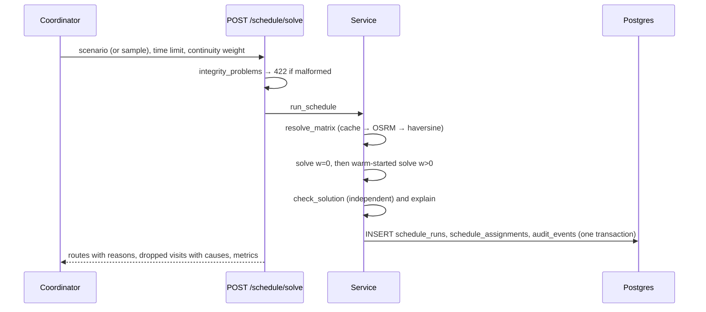

# 15 — Schedule API and explainability

## 1. What was built

| File | Purpose |
|---|---|
| `app/matching/explain.py` | For each assignment: skills matched, drive minutes and from where, arrival vs window, familiarity, how many other carers were eligible, and a time-critical note. For each unassigned visit: `no_eligible_carer` (structural) or `eligible_carers_busy` (capacity), plus a detail sentence |
| `app/matching/service.py` | `resolve_matrix()`: cached OSRM, else live OSRM if configured, else the haversine fallback. `run_schedule()`: solve (two-phase if w > 0), check, explain, persist the run and its assignments, and write a `schedule_solved` audit event, all after the solve |
| `app/matching/models.py` + migration `0003` | `schedule_runs` (params, status, objective, backend, metrics, dropped with reasons, keyed scenario hash, requester) and `schedule_assignments` (ordered visits with reasons). A hand-written swap of the `event_type` CHECK constraint |
| `app/api/schedule.py` | `POST /schedule/solve` (scenario in the body or the committed sample; time limit ≤ 30 s; weight 0–60 min) and `GET /schedule/{id}` |
| `app/matching/data.py` | Validation split into `integrity_problems` (422) and `unservable_visits` (reported, not rejected). Skill sets now serialise sorted, for canonical JSON |
| `app/matching/solver.py` | Timing rule: serve as early as each window allows, depart as late as still reaches the first visit |
| `tests/test_schedule_api.py` | 8 tests: reasons and drop causes, end-to-end persistence and audit (with no locations in the audit log), integrity 422, parameter limits, identity header, 404, and the sample day on the cached OSRM matrix |

## 2. Why this way

- **Explanations are facts the coordinator can check,** not the solver's internals. "Drives 11 min from previous visit (CL-0003)", "Arrives 08:12, within 08:00–09:00", "Client's preferred carer", "2 other carers were qualified". Each is recomputed from the scenario and matrix, so it holds whatever the search did. A coordinator who disagrees knows exactly which fact to dispute.
- **Dropped visits come with causes, because the fix differs:**
  - `no_eligible_carer`: no rota change can help; train or hire someone with the skill.
  - `eligible_carers_busy`: capacity; move a flexible call, add hours, or accept the trade.

  This is the same structural-vs-capacity split as the bounds in note 12, now on every run.
- **Unservable visits are reported, not rejected.** I first returned 422 when any visit had no possible carer. But the coordinator still needs the other 105 planned, plus a clear flag on the impossible one. Malformed input (unknown references, duplicates) is still a 422.
- **Data minimisation and audit:**
  - The scenario with client locations is **not stored**: only its name, seed and an HMAC of its JSON.
  - The audit event records parameters, scenario seed, objective, status, OR-Tools version, travel backend and run id. The audit test asserts no coordinates leak into it.
  - The OR-Tools routing search has no random seed, so the *scenario* seed plus parameters, solver version and backend are what identify a run.
- **Canonical serialisation for hashes.** The first end-to-end test failed because frozenset order varies, so the same scenario hashed differently after a JSON round trip. An audit hash that changes for equal inputs is useless as evidence. Skill sets now always serialise sorted.
- **The audit event is written once, complete.** My first draft added `run_id` to the event after flushing, which is an UPDATE that the append-only trigger would reject. Generating the run's UUID before insert lets the event reference it from the start.
- **Arrive early, not at the last minute.** The Step 2.3 timing rule pushed visits to the end of their windows: correct for the objective but brittle, since any delay makes the carer late. Serving at the earliest feasible time keeps slack for traffic. Routes and objective are unchanged.
- **Capped, synchronous solving.** `time_limit_s ≤ 30`, so one request can block a worker for at most about 60 s (two phases). That's acceptable for a prototype planning tool. A job queue is the production answer, and rate limiting comes in Tier 4.

## 3. Alternatives considered

| Option | Pros | Cons | When I'd choose it |
|---|---|---|---|
| **Fact-based reasons recomputed per assignment, chosen** | Checkable, solver-agnostic, cheap | Doesn't say *why not* another carer in detail | Operational explainability for coordinators |
| Counterfactuals ("CR-0007 would add 14 min and break continuity") | Answers the coordinator's real question | Needs extra solves per question; slower | An interactive "why not X?" button in the app |
| Objective decomposition (cost share per visit) | Shows which visits drive cost | Penalty-based costs are hard for non-specialists to read | Analyst dashboards |
| Store the full scenario with each run | Perfect reproducibility | Keeps client location data per run (minimisation, retention) | Only with a lawful basis, a retention policy and encryption |

## 4. How it works



An assignment and a dropped visit as returned live by the API (sample day, w = 15):

```json
{"carer_ref": "CR-0005", "sequence": 3, "visit_id": "V-0001", "client_ref": "CL-0001",
 "familiarity": "new",
 "reasons": ["Has the required skills: manual_handling",
             "Drives 6 min from previous visit (CL-0014)",
             "Arrives 09:11, within the 08:25-09:25 window",
             "New to this client",
             "4 other carer(s) were qualified and on shift"]}

{"visit_id": "V-0078", "client_ref": "CL-0028", "reason": "eligible_carers_busy",
 "eligible_carers": ["CR-0002", "CR-0003", "CR-0010"], "time_critical": false,
 "detail": "3 qualified carer(s) (CR-0002, CR-0003, CR-0010) were fully booked for the 07:00-08:00 window"}
```

The 09:11 arrival is the earliest this route allows, because it's CR-0005's third visit. The dropped visit is the morning dementia-and-medication bottleneck from note 12, now explained on every run.

**Hand-writing the migration for a new enum value.** `event_type` is VARCHAR + CHECK (ADR-010), so adding `schedule_solved` means dropping and re-creating the CHECK constraint. Alembic autogenerate can't see this (it compares tables and columns, not CHECK expressions), so the migration does it by hand. The downgrade deliberately fails if any `schedule_solved` events exist, rather than quietly making recorded audit rows violate the schema.

## 5. Interview questions and answers

**Q1. How does a coordinator know why the system assigned a carer?**
Every assignment carries reasons recomputed from the input: skills matched, drive time and from where, arrival time against the window, whether the carer is preferred, recent or new to the client, and how many other carers could have done it. They're facts the coordinator can check against what they know, not solver internals. Unassigned visits are labelled either "no eligible carer" (a skills or shift gap, which needs training or hiring) or "eligible carers busy" (capacity, which needs rota changes).

**Q2. What do you store about each solver run, and what don't you?**
- **Stored:** parameters, status, objective, driving, travel backend, OR-Tools version, metrics, dropped visits with reasons, the ordered assignments with reasons, and who requested it, plus an append-only audit event with the same summary and the run id.
- **Not stored:** the scenario itself. It contains client locations, so I keep only a keyed HMAC of its canonical JSON, its name and its seed. That proves which input produced a run without retaining another copy of where people live.

**Q3. Trade-off: why return a partial plan instead of rejecting an impossible input?**
A visit nobody can do is a fact about the workforce, not a malformed request. Rejecting the whole day would leave the coordinator with nothing for the 105 visits that *can* be planned. So the API plans what it can and flags the impossible visit with its cause. Genuinely malformed input, such as unknown client references or duplicates, still returns 422, because no sensible plan can come from it.

**Q4. Your audit hash failed a test. What was wrong?**
Skill sets are frozensets, and their iteration order isn't stable, so the same scenario could serialise to different JSON and hash differently after a round trip. A hash meant to prove "this is the same input" was not deterministic for equal inputs. I made serialisation canonical by always emitting skill lists sorted, and the end-to-end test now checks the stored hash equals the hash of the submitted scenario.

**Q5. With real PBL data at scale, what changes?**
- **Async solving:** a job queue, 202 Accepted and a status endpoint, instead of up to 60 s blocking requests.
- **Access control:** authenticated identity and roles replace `X-Reviewer` (Tier 4).
- **"Why not X?":** counterfactual explanations computed on demand.
- **Audit model:** a generic subject id on audit events (run id, carer id) rather than a field designed for notes (Tier 4.2).
- **Locked assignments:** coordinators can lock assignments and re-solve around them.
- **Retention:** a policy for runs and assignments, which reference real clients and carers.

**Q6. Why did you change when carers arrive within their windows?**
OR-Tools finalisers choose exact times once routes are fixed. My first choice, the latest departure for each carer, pushed service to the end of each window. It was optimal on paper, but any traffic delay would make the carer late. Now each visit is served as early as its window allows, and the carer departs as late as still reaches the first visit. Routes and objective are unchanged; only slack moves to where it protects clients.

## 6. Learn more

**Official documentation**
- ICO, [Explaining decisions made with AI](https://ico.org.uk/for-organisations/uk-gdpr-guidance-and-resources/artificial-intelligence/explaining-decisions-made-with-artificial-intelligence/): UK guidance (with the Alan Turing Institute) on explaining AI-assisted decisions to the people affected. *The page currently states it is under review following the Data (Use and Access) Act.*
- FastAPI, [Response Model – Return Type](https://fastapi.tiangolo.com/tutorial/response-model/): explicit response models, here `ScheduleOut`, so stored internals aren't exposed accidentally.
- OR-Tools, [Vehicle Routing Problem with Time Windows](https://developers.google.com/optimization/routing/vrptw): the time dimension whose values become the "arrives at" explanations.

**Videos**
- I couldn't verify a video this session. Search YouTube for **"explainable optimization scheduling"** or **"Alan Turing Institute explaining AI decisions"**, preferring the Turing Institute's own channel or conference recordings.

## 7. Check your understanding

Call the API with the committed sample day twice: once with `continuity_weight_min: 0` and once with `15`. Compare `metrics.familiar_pct` and the reasons for one client's visits. With the API running (`uv run uvicorn app.main:app`):

```bash
for w in 0 15; do curl -s -X POST localhost:8000/schedule/solve -H 'X-Reviewer: you' \
  -H 'content-type: application/json' -d "{\"time_limit_s\": 10, \"continuity_weight_min\": $w}" \
  | python3 -c "import json,sys; d=json.load(sys.stdin); print(d['metrics'], len(d['dropped']))"; done
```

**Expected (verified live, 10 s per phase):**

| | w = 0 | w = 15 (two-phase) |
|---|---|---|
| Unassigned | 12 | 11 |
| Familiar carer (% of served) | 30.9% | 47.4% |
| Driving | 629 min | 700 min |
| Runtime | 10 s | 20 s |

Visits that switched carer now show "Client's preferred carer" or "Has visited this client recently" instead of "New to this client". Exact values vary a little between runs (time-limited search).
