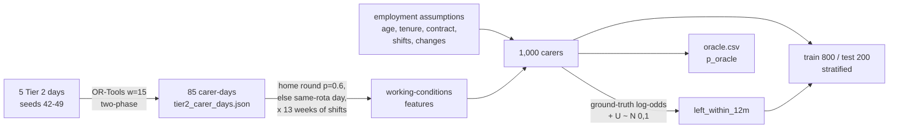

# 16 — Synthetic workforce data

## 1. What was built

| File | Purpose |
|---|---|
| `app/workforce/features.py` | `carer_days(scenario, solution)`: one `CarerDay` per carer from a solved Tier 2 day. Records visits, visit and driving minutes, unpaid gaps between visits, the longest gap, whether it was a split day (a single gap ≥ 90 min) and the share of visits to familiar clients |
| `app/workforce/data.py` | `CarerRecord` Pydantic schema; `FEATURES` (12 model inputs), `LABEL`, `PROTECTED` (`age_band`: audit only) |
| `scripts/calibrate_workforce.py` | Solves the 5 Tier 2 evaluation days (OSRM, OR-Tools w=15 two-phase) once and commits 85 carer-days to `data/workforce/tier2_carer_days.json` |
| `scripts/generate_workforce.py` | 1,000 synthetic carers: working conditions aggregated from those carer-days, employment features from stated assumptions, label from a **known ground-truth logistic model** plus an unobserved factor. Stratified 80/20 split. Writes `train.csv`, `test.csv`, `oracle.csv` |
| `data/workforce/DATA_CARD.md` | Generating assumptions, the full ground-truth table, anchors, oracle ceiling, biases |
| `tests/test_workforce_data.py` | 8 tests: hand-checked feature arithmetic (including an idle carer), committed files equal generator output, schema validity and stratification, the protected attribute is not a feature, age and the null features have no direct effect, every ground-truth term is learnable, oracle maths |
| `pyproject.toml` | Adds `scikit-learn` (split now, models in 3.2) and `pandas` |

**Headline numbers** (seed 42, n = 1,000):
- **Leavers:** 298 (29.8%); test set 200 rows, 60 of them leavers.
- **Oracle ROC-AUC:** **0.726** overall and 0.795 on the test split, which sits at the 97th percentile of possible splits.

## 2. Why this way

- **Features come from Tier 2, not from thin air.** The brief says attrition features should be derived from scheduling outputs. Driving, unpaid gaps, split days and familiarity are computed from real solver routes, aggregated over a simulated 13 weeks of shifts. This ties the tiers into one story: the scheduler's choices (e.g. the continuity weight) change working conditions, and the attrition model can then put a price on that in retention risk.
- **Solve once, commit, then generate deterministically.** Time-limited OR-Tools search varies run to run (note 13). If the generator re-solved, the dataset would change every run and no Tier 3 result would be reproducible. Two scripts with a committed hand-off file keep the noisy step out of the deterministic one, and a test proves the committed CSVs equal the generator output.
- **A known mechanism is the only honest use of synthetic labels.** Inventing a label rule and then "discovering" it with a model proves nothing about real carers. What it can prove is that the *pipeline* works: models recover planted effects, explanations rank real effects above null ones, calibration can be checked against the true probability. So the ground truth is explicit, documented and shaped to stress the pipeline:
  - steps and hinges, which are non-linear;
  - an interaction;
  - five null features (weekly paid hours was omitted from this list at first and corrected in Step 3.3);
  - correlated features (gaps and split shifts, r = 0.82);
  - a large unobserved factor.
- **An oracle sets the ceiling.** `p_oracle` is the best calibrated probability any model of these 12 features could produce. Without it, an AUC of 0.72 sounds mediocre. With it, 0.72 means "within 0.01 of perfect for this data". It also catches leakage: a model that *beats* the oracle on held-out data must be cheating.
- **The protected attribute is kept apart from the features.** Age is a protected characteristic under the Equality Act 2010. It is stored so Step 3.3 can audit for indirect discrimination, never used as an input. It has no direct effect in the generator, yet 18–24s leave at twice the rate of 55+ (47% vs 23%), through tenure and contract type. That is exactly how proxy discrimination looks in real data.
- **Care-sector framing.** The features are about *working conditions the provider controls*: rotas, gaps, short-notice changes, contract type. They are not about the person. That makes the intended use supportive (fix the rota) rather than punitive (watch the person), which the model card in 3.3 relies on.
- **The unlucky test split was kept.** The split rule (stratified, `random_state=42`) was fixed before I saw the oracle's test AUC. Re-drawing the split because it looked "too easy" would be choosing a test set by its results. Instead, Step 3.2 reports cross-validation as the main estimate and each test score next to the oracle on the same rows.

## 3. Alternatives considered

| Option | Pros | Cons | When I'd choose it |
|---|---|---|---|
| **Known-mechanism generator calibrated on Tier 2 outputs (chosen)** | Ties the tiers together; ground truth allows pipeline checks (recovery, null features, calibration vs oracle) | Circular: says nothing about real attrition; effect sizes invented | Building and validating a pipeline before real data exists |
| Independent random features with a rule-based label | Simplest | Disconnected from Tier 2; no realistic correlations | A unit-test fixture |
| A public HR attrition dataset (e.g. the IBM HR Analytics sample) | Not my own mechanism, so less circular | A fictional dataset itself; not care-sector; lacks travel, gaps and continuity; licence and provenance to check | Benchmarking model code, not the care story |
| Survival-time generator (time to leaving, with censoring) | Matches the real data shape; enables Cox / survival models | More complex; the brief asks for classification | With real PBL data, where carers are observed for different lengths of time |

## 4. How it works

**Data flow**



**From a route to features.** Take one carer's day: 08:00–08:30 at client A, then a 10-minute drive and 12:00–12:30 at client B.
- service = 60 min; drive = 15 min (including 5 from home to A); paid = 75 min;
- gap = (12:00 − 08:30) − 10 min drive = 200 min unpaid waiting;
- longest gap 200 ≥ 90, so it's a split day;
- the carer is preferred at A and new at B, so familiar share = 0.5.

This is `test_carer_days_gaps_split_and_familiarity`, checked by hand.

**The label model.** For carer *i* with features *x*:

    log-odds_i = b0 + Σ_k f_k(x_i) + U_i,    U_i ~ N(0, 1)
    P(left_i)  = sigmoid(log-odds_i);  left_i ~ Bernoulli(P(left_i))

The *f_k* are the terms in the data-card table, e.g. +1.2 if tenure < 6 months, or +0.3 per short-notice change above 2 a month (plus another 0.3 if on zero hours). *b0* is found by bisection so the average probability is 30%.

**Why the oracle isn't just sigmoid(b0 + Σf).** A model sees *x* but not *U*. The best probability it can give is the average over the *U* it can't see:

    p_oracle(x) = E_U[ sigmoid(b0 + z(x) + U) ]

This is flatter than sigmoid(b0 + z) (pulled towards 0.5 at the extremes), because uncertainty about U blurs the curve. It is computed exactly with 40-point Gauss–Hermite quadrature, which replaces the integral over a normal distribution with a weighted sum at fixed points. A model whose predictions are calibrated should match `p_oracle`, not sigmoid(z). Step 3.2's calibration curves will be read against this.

**Why the ceiling is only 0.73.** There are two separate sources of irreducible noise (oracle AUC on all 1,000 carers):

| Unobserved factor SD | 0 | 0.5 | **1.0 (used)** | 2.0 |
|---|---|---|---|---|
| Oracle ROC-AUC | 0.754 | 0.756 | **0.726** | 0.683 |

Even with nothing hidden, a carer with a 40% risk may or may not leave: the coin flip alone caps AUC at about 0.75. The hidden factor then lowers it further. Real attrition data behaves like this, so a real model with AUC 0.70 may already be close to its ceiling, and the next gains come from new data sources, not new algorithms.

**Circularity, precisely.** Training and evaluating on synthetic data answers *"given that the world works like my generator, does my pipeline recover it?"* It cannot answer *"does the world work like my generator?"* What this data can and cannot support:

| Can support | Cannot support |
|---|---|
| The code and the metrics are correct | "Driving causes attrition" |
| Explanations rank real effects above null ones | Real effect sizes or their ranking |
| Calibration can be checked against a known truth | That the model would work at PBL |
| Comparisons of model families on known non-linearities | Fairness conclusions about real carers |

**Why `split_shift_share` is bimodal** (quartiles 0.17 / 0.27 / 0.77). A carer's home round either has a mid-shift gap of 90+ minutes or it doesn't, and 60% of their shifts repeat it. That is realistic: real carers on a given round tend to always or never get the long gap.

## 5. Interview questions and answers

**Q1. Your attrition data is synthetic. What can a model trained on it tell you?**
Only whether the pipeline works. The generator has a documented ground truth, so I can check that models recover planted effects, that SHAP ranks the five null features near zero, and that calibrated probabilities match the oracle. It says nothing about why real carers leave: any effect the model "finds" is one I put in. I state that limit in the data card, the model card and the README, and the real evaluation would happen on PBL's HR data under a DPIA.

**Q2. What is the oracle and why compute it?**
It's the probability of leaving given only the observed features, averaging over the unobserved factor: the best calibrated prediction any model could make from this data. It gives three things:
- **a ceiling:** AUC 0.726, so a model at 0.71 is nearly perfect, not mediocre;
- **a calibration target;**
- **a leakage alarm:** beating the oracle on held-out data means information is leaking in.

With real data there's no oracle, so I'd use proxies: a learning curve, repeated CV spread, and comparison with a simple strong baseline.

**Q3. Why derive the features from the Tier 2 scheduler instead of generating them directly?**
It makes the platform one system rather than three demos. Driving, unpaid gaps, split days and continuity come from actual routes, so a scheduling decision such as raising the continuity weight changes the inputs to the retention model. That lets a coordinator weigh scheduling choices in retention terms as well as minutes. It's also where PBL's real data would come from: rota and call-monitoring systems, not surveys.

**Q4. Age band is in the dataset. Isn't that risky?**
It's there to be audited, not used. Age is a protected characteristic, and it's excluded from `FEATURES`, with a test enforcing that. But excluding it doesn't make a model fair. In this data, 18–24s leave at 47% against 23% for 55+, purely through tenure and contract type. A model using tenure will score younger carers as higher-risk. Whether that is acceptable depends on use: offering mentoring to new starters is fine; using scores in hiring or shift allocation could be indirect discrimination. Step 3.3 measures it.

**Q5. Your test split turned out unusually easy. Why didn't you re-draw it?**
The split rule was fixed before I saw any results. Re-drawing until the test set looks typical is still choosing the test set by its outcome, which is a mild form of test-set tuning. With only 60 test leavers, the oracle's test AUC ranges from 0.65 to 0.80 across random splits. So I report the spread, use repeated stratified cross-validation on training data as the main estimate, and quote each test score next to the oracle on the same rows. That 15-point range is itself a key message: a few hundred carers can't support precise AUC claims.

**Q6. Trade-off: why classification ("left within 12 months") rather than survival analysis?**
Classification is simpler to evaluate, explain and calibrate, and it matches an operational question ("who might we lose this year?"). It throws away timing and needs every carer observed for a full year. Real data has censoring: carers hired 3 months ago haven't had 12 months to leave. With real PBL data I'd at least use a fixed label window and drop or reweight carers with less than a year of follow-up, and probably move to a survival model (Cox, or gradient-boosted survival), which uses partial follow-up and predicts *when*, not just *whether*.

**Q7. With real PBL data, what would change?**
- **Features from systems:** pull them from the rota and call-monitoring systems, computed strictly before each snapshot date to avoid leakage. "Hours in the last month" collapses just before someone hands in notice, which would leak the label.
- **Split by time:** train on earlier years, test on later ones, to reflect how the model would be used.
- **Separate the reasons for leaving:** voluntary leavers, dismissals and retirements should be distinguished.
- **Governance first:** a DPIA, worker consultation, and a lawful basis (likely legitimate interests, with a balancing test), because this is profiling of employees.
- **Expect the ceiling:** much of why people leave is never recorded, so I'd expect modest AUCs.

**Q8. Why did you include features with no effect?**
To test the explanation method. If SHAP gives `skills_count` or `late_shift` meaningful importance, either the model has overfitted noise or the explanations are misleading, and I'd rather find that on synthetic data than in front of a care manager. The correlated pair (gaps and split shifts, r = 0.82) tests something else: importance shared or swapped between near-duplicates, a known weakness of feature attributions.

## 6. Learn more

**Official documentation**
- scikit-learn, [`train_test_split`](https://scikit-learn.org/stable/modules/generated/sklearn.model_selection.train_test_split.html): the `stratify` argument that keeps the 30% leaver rate equal in train and test.
- scikit-learn, [Common pitfalls and recommended practices](https://scikit-learn.org/stable/common_pitfalls.html): section 12.2 on data leakage, the main risk when building snapshot features from real HR data.
- Gebru et al., [Datasheets for Datasets](https://arxiv.org/abs/1803.09010): the paper that started the dataset-documentation practice this data card follows.
- Skills for Care, [The state of the adult social care sector and workforce in England](https://www.skillsforcare.org.uk/Adult-Social-Care-Workforce-Data/Workforce-intelligence/publications/national-information/The-state-of-the-adult-social-care-sector-and-workforce-in-England.aspx): the official source for UK care turnover. *Page verified; the turnover and zero-hours figures in the data card come from secondary reporting of it and were not checked in the report itself.*

**Videos**
- **"StatQuest: Logistic Regression"** (StatQuest with Josh Starmer), https://www.youtube.com/watch?v=yIYKR4sgzI8. The ground truth is a logistic model: log-odds as a sum of terms, passed through a sigmoid. This is the clearest explanation of exactly that, and it sets up Step 3.2. *Title verified; the page didn't state the channel name, but the title carries the StatQuest brand.*
- I couldn't verify a video on synthetic data or data leakage. Search YouTube for **"data leakage machine learning PyData"** or **"synthetic data evaluation pitfalls PyData"**.

## 7. Check your understanding

The unobserved factor U has SD `LATENT_SD = 1.0`. **Predict** what happens to (a) the oracle ROC-AUC on all carers and (b) the intercept if you set it to 2.0, then run:

```bash
uv run python -c "
import scripts.generate_workforce as g; from sklearn.metrics import roc_auc_score
g.LATENT_SD = 2.0; r, o = g.generate()
print(round(roc_auc_score(r.left_within_12m, o.p_oracle), 3), round(o.intercept[0], 3))"
```

**Expected (verified):** AUC falls from 0.726 to **0.683**, and the intercept falls from −1.828 to **−2.167**.
- **Why the AUC falls:** more of each carer's risk is invisible, so ranking by observed features gets worse.
- **Why the intercept moves:** a wider U pushes more probability mass into the right-hand tail of the sigmoid. The average risk would rise above 30%, so the bisection lowers b0 to hold the leaver rate at 30%.

**Bonus:** set it to `0.0001`. AUC rises only to **0.754**, because the coin flip itself is irreducible noise.
