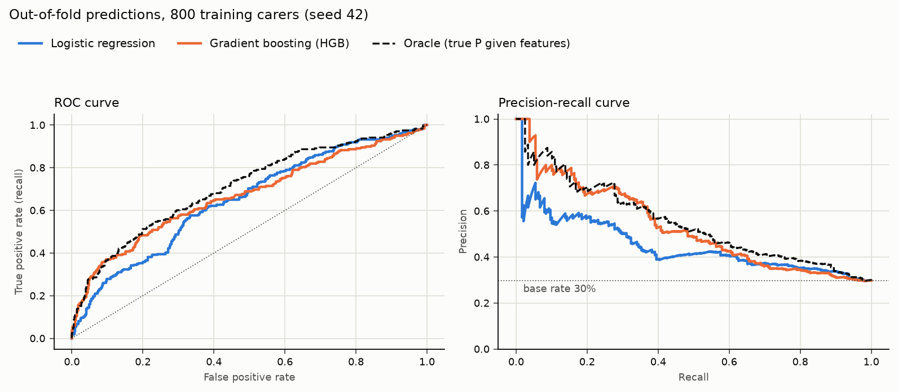
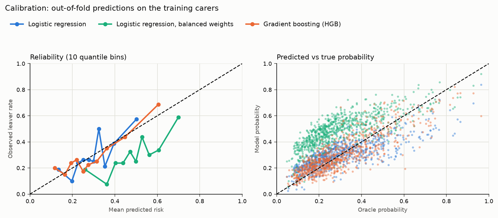
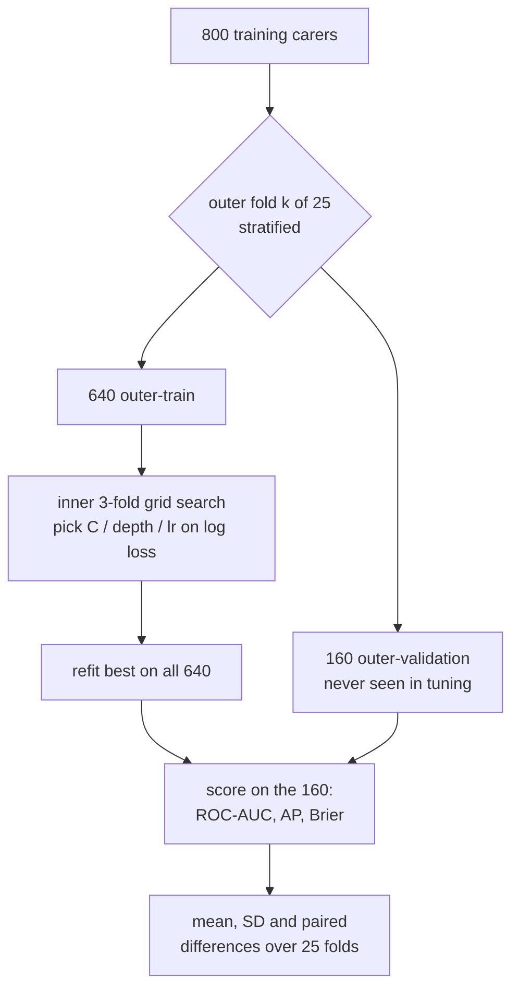

# 17 — Attrition models: LR vs gradient boosting, calibration

## 1. What was built

| File | Purpose |
|---|---|
| `app/workforce/models.py` | Three candidates, each a `GridSearchCV` tuned on log loss: logistic regression (scaled), LR with `class_weight="balanced"`, and `HistGradientBoostingClassifier`. Also `cross_validate_nested()` (outer 5×5 repeated stratified CV; scores fixed reference predictions such as the oracle on the same folds; returns out-of-fold predictions), `bootstrap_ci()`, `precision_at_top()` and `calibration_table()` |
| `scripts/train_attrition.py` | Runs the protocol and writes `docs/results/tier3_models.md`, `docs/figures/tier3_roc_pr.png` and `docs/figures/tier3_calibration.png` (~2 min, fully reproducible: two runs gave identical output) |
| `tests/test_workforce_models.py` | 7 tests. The headline one logs every `fit`/`predict` call and proves no fit for an outer fold (inner search or refit) ever sees that fold's validation rows. Others: balanced weights inflate risk without changing ranking; LR recovers the planted directions; metric helpers |
| `pyproject.toml` | Allows capital `X` in the ML modules (scikit-learn convention) |

**Results** (synthetic, seed 42; CV is 25 outer folds of 160 carers; full tables in `docs/results/tier3_models.md`):

| | ROC-AUC | PR-AUC (AP) | Brier ↓ | Top-10% precision | Error vs true P |
|---|---|---|---|---|---|
| Base rate (constant) | 0.500 | 0.297 | 0.209 | 30% | — |
| Logistic regression | 0.655 | 0.483 | 0.196 | 57% | 0.076 |
| LR, balanced weights | 0.653 | 0.476 | **0.232** | 59% | **0.195** |
| **Gradient boosting** | **0.675** | **0.538** | **0.188** | **69%** | **0.065** |
| Oracle (ceiling) | 0.709 | 0.556 | 0.181 | 71% | 0 |

**Test split** (200 carers, 60 leavers, used once): LR 0.772 (95% CI 0.700–0.836), HGB 0.759 (0.682–0.829), oracle 0.795. The intervals overlap almost entirely, so **the test set cannot separate the models**, as ADR-020 predicted.

## 2. Why this way

- **Nested CV because I'd already peeked.** Before writing the protocol I compared three HGB settings on the folds I meant to report, and the best looked 0.05 AUC better than the default. Reporting that best score would be optimistic: I would have chosen the winner on the same data I scored it on. Nested CV puts the grid search *inside* each outer training fold, so the outer score measures "the model *plus* its tuning procedure" on unseen rows. A test proves the separation by logging every call.
- **CV as the main estimate; the test set as a check.** With 800 rows, a single validation split is very noisy (fold SDs are about 0.04 AUC), and the test split is known to be easy. Twenty-five outer folds, with paired comparisons on identical folds, are the honest basis for "HGB beats LR". The test score is reported because it was promised, alongside the oracle on the same rows.
- **Tuning on log loss, not AUC.** The output will be read as a probability ("30% risk"), so selection rewards good probabilities, not just good ordering.
- **The balanced-weights variant is kept as a warning, not a candidate.** "My classes are imbalanced, so I'll reweight" is a reflex worth challenging in an interview. Here, reweighting did nothing for ranking but inflated every probability to an average of 48% against a true 30%. A manager told "48% of your workforce is at high risk" would act very differently. In this domain, probabilities are the product.
- **Precision in the top 10% is the operational metric.** A provider has a retention budget: perhaps 80 supportive conversations a quarter. "Of the people we contact, how many were really at risk?" is what that budget buys. HGB gets 69% against LR's 57% (a random choice gets 30%), and the oracle's 71% shows almost nothing is left to gain at the top of the list.
- **The oracle turns the scores into a story.** 0.675 sounds weak. As a share of the possible gain over chance it is (0.675 − 0.5)/(0.709 − 0.5) ≈ **84%**. LR achieves 74%. On synthetic data I can also measure error against the true probability directly (HGB 0.065), which no real project can.

## 3. Alternatives considered

| Option | Pros | Cons | When I'd choose it |
|---|---|---|---|
| **LR + HGB, nested CV, unweighted (chosen)** | Honest estimate including tuning; calibrated probabilities; one transparent and one flexible model | ~2 min per run; nested CV is harder to explain | Small data, where both the estimate and the probabilities matter |
| Class weighting or SMOTE oversampling | Raises recall at the default 0.5 threshold | Distorts probabilities; SMOTE invents synthetic minority rows; no ranking gain here | Rarely. Better to move the decision threshold on calibrated probabilities |
| LR with engineered features (tenure steps, hinges, splines) | Keeps LR's transparency while capturing non-linearity | Needs domain hypotheses; risk of fishing | With PBL domain experts, if a coefficient-level explanation is required |
| Post-hoc calibration (`CalibratedClassifierCV`, isotonic or sigmoid) | Fixes miscalibrated models (e.g. SVMs, over-confident boosting) | Needs extra data; isotonic overfits at 800 rows | When a reliability diagram on a large validation set shows systematic error |

## 4. How it works

**Logistic regression vs gradient boosting on *this* mechanism.** LR models log-odds as a straight-line sum, w₁·tenure + w₂·zero_hours + …. The true mechanism has:
- a **step** (+1.2 if tenure < 6 months);
- a **hinge** (short-notice changes only matter above 2);
- an **interaction** (changes matter more on zero hours).

LR can only approximate the step with a line through all tenures, so it under-predicts brand-new starters and over-predicts carers at 8–12 months. HGB builds an additive ensemble of small trees, each fitted to the remaining errors (the gradient of log loss). A depth-2 tree can split "tenure < 6" exactly and can represent a two-way interaction. The inner search picked depth 2 and learning rate 0.03 in most folds: many small, cautious steps, which is what 800 rows can support.

**Where the difference shows.** On the precision–recall chart, HGB tracks the oracle at low recall (the top of the risk list, dominated by new starters on zero hours) and LR falls well below it. At high recall all three converge, because the bulk of risk is spread thinly and is mostly unobserved (U).



**Class imbalance, and why PR-AUC.** Thirty per cent leavers is only mild imbalance, but the logic holds more strongly for rarer events.
- **ROC-AUC** is the probability that a random leaver is ranked above a random stayer. It ignores the base rate: a model can have a high ROC-AUC and still fill its top-k list mostly with stayers when positives are rare.
- **Precision–recall** looks only at the positive class: of those flagged, how many leave (precision), and of those who leave, how many were flagged (recall). A random model scores the base rate (0.30), not 0.5. So PR-AUC is read against 0.30, and the scale stretches where it matters.
- **Average precision (AP)** summarises the PR curve as Σ (Rₙ − Rₙ₋₁)·Pₙ. scikit-learn notes this differs from the trapezoidal area, so I report it as "PR-AUC (AP)".

**Calibration.** A model is calibrated if, among carers it gives 30%, about 30% leave. Two views:



- **Reliability diagram (left):** bin carers by predicted risk (10 quantile bins of 80), and plot mean predicted risk against the observed leaver rate. Unweighted LR and HGB hug the diagonal within noise (each bin's observed rate has a standard error of about 0.05). The balanced model sits far to the right: everything is over-predicted.
- **Predicted vs true probability (right):** only possible with synthetic data. HGB's cloud is closer to the diagonal (error 0.065) than LR's (0.076).

**The Brier score** is the mean of (p − y)². It rewards calibration *and* discrimination together. A constant prediction of the base rate scores 0.30 × 0.70 = 0.21; that is the bar. The oracle's 0.181 shows how little room there is, because U and the coin flip dominate. A lower Brier doesn't by itself prove better calibration (scikit-learn makes this point), which is why the reliability diagram is shown as well.

**Why reweighting breaks probabilities, from first principles.** `class_weight="balanced"` multiplies each leaver's loss by 1/(2 × 0.30) ≈ 1.68 and each stayer's by 1/(2 × 0.70) ≈ 0.71. The fitted model now believes the world is 50:50, so its intercept rises by about ln(0.70/0.30) ≈ 0.85 log-odds and every probability goes up. The ordering hardly changes (Spearman correlation > 0.95 in the test), so AUC is unchanged. If you want to flag more carers, lower the threshold on a calibrated model: that buys the same recall without lying about the probabilities.

**Nested CV, as a picture:**



## 5. Interview questions and answers

**Q1. Which model would you deploy, and why?**
Gradient boosting, on this evidence. Over 25 identical CV folds it beat logistic regression on ROC-AUC in 18, on average precision in 20 and on Brier in 22. It captures 84% of the achievable gain over chance against LR's 74%. Most importantly for use, its top-10% list is 69% true leavers against 57%, close to the oracle's 71%. I'd still keep LR as a challenger and sanity check: if HGB's explanations ever disagree with LR's coefficient signs on a major driver, that's worth investigating before anyone acts on it.

**Q2. Your test set says LR is better. Why trust CV over the test set?**
The test difference (0.772 vs 0.759) is far inside the bootstrap intervals (each about ±0.07), so the test set simply can't distinguish the models: 60 leavers is too few. CV gives 25 paired comparisons on 800 rows, and HGB wins most of them. I committed in advance that CV would be the main estimate, because I knew the test split was unusually easy. Changing that rule after seeing which way the test went would be the real mistake.

**Q3. Why not use class weights or SMOTE for the imbalance?**
They change the decision threshold, not the information. In my CV, balanced weights left ROC-AUC unchanged (0.653 vs 0.655) but pushed the mean predicted risk to 48% against a true 30%, and worsened Brier in all 25 folds. For a risk score read by managers, that's actively harmful: it inflates everyone's risk. If I want higher recall, I keep the calibrated model and lower the threshold, or better, rank carers and work down the list as budget allows.

**Q4. Why is PR-AUC more informative than ROC-AUC here?**
ROC-AUC asks whether a random leaver outranks a random stayer, and it's blind to the base rate. PR-AUC asks, of the carers I flag, how many actually leave, which matches how a retention budget is spent. Its chance level is the base rate (0.30), so HGB's 0.538 against LR's 0.483 is a meaningful gap. With rarer events, say 5% leaving in a quarter, ROC-AUC can look excellent while precision is poor, and PR makes that visible.

**Q5. What is calibration and how did you check it?**
A calibrated model's 30% means 30% of such carers leave. I checked it three ways:
- **Reliability diagram:** out-of-fold predictions in 10 quantile bins against the observed leaver rate.
- **Brier score:** against the 0.21 base-rate bar.
- **Error vs the true probability:** possible only on synthetic data.

The unweighted models are calibrated within noise, so I didn't add post-hoc calibration. Isotonic calibration on 800 rows would likely overfit. With real data I'd re-check calibration over time, since a drifting base rate breaks it first.

**Q6. Trade-off: why accept a black-box model in an HR context?**
HGB isn't a black box in the way that matters if each prediction gets a faithful explanation; Step 3.3 adds SHAP. The gain is real: 12 more true leavers in every 100 flagged. Against that, HGB's explanations are approximate attributions rather than coefficients, and it can learn odd shapes from noise; the shallow, cautious settings (depth 2, learning rate 0.03) limit that. If a regulator or works council required coefficient-level transparency, I'd use LR with domain-agreed engineered features (a tenure step, a changes hinge). The exercise below shows that recovers part of the gap.

**Q7. With real PBL data, what would change?**
- **Validation:** time-based, not random: train on 2023–24, validate on 2025, because the real question is whether last year's pattern predicts this year.
- **Size:** expect a few hundred carers, so CIs will be wide. I'd report them, prefer simpler models if HGB's edge is within the noise, and consider pooling years.
- **Base rate and drift:** watch for drift (recruitment policy, wage rises), recalibrate periodically, and monitor top-k precision against what actually happened.
- **Label:** voluntary leavers only, with censoring handled properly.
- **Fairness:** a fairness audit before any use (Step 3.3).

**Q8. What does nested cross-validation protect against, concretely?**
Optimism from choosing hyperparameters on the same data you score. I'd compared HGB settings on my evaluation folds before writing the protocol, and the best looked about 0.05 better than the default. Part of that was selection noise. With nested CV, each outer fold runs its own grid search on its 640 training rows only, so the 160 validation rows are untouched until scoring. I have a test that logs every fit and predict call to prove it. The estimate then describes the whole procedure ("HGB tuned by this grid"), which is what would be deployed.

## 6. Learn more

**Official documentation**
- scikit-learn, [Probability calibration](https://scikit-learn.org/stable/modules/calibration.html): reliability diagrams, why Brier mixes calibration and discrimination, and calibration methods.
- scikit-learn, [Nested versus non-nested cross-validation](https://scikit-learn.org/stable/auto_examples/model_selection/plot_nested_cross_validation_iris.html): a worked example showing non-nested scores are optimistic.
- scikit-learn, [Precision-Recall](https://scikit-learn.org/stable/auto_examples/model_selection/plot_precision_recall.html): PR curves, the average precision formula, and why AP differs from the trapezoidal area.
- scikit-learn, [`HistGradientBoostingClassifier`](https://scikit-learn.org/stable/modules/generated/sklearn.ensemble.HistGradientBoostingClassifier.html): parameters, and when early stopping switches on (above 10,000 rows, so not here).

**Videos**
- **"ROC and AUC, Clearly Explained!"** (StatQuest), https://www.youtube.com/watch?v=4jRBRDbJemM. ROC curves and the meaning of AUC, which you need before seeing why PR curves are preferred for imbalanced problems.
- **"Gradient Boost Part 3 (of 4): Classification"** (StatQuest), https://www.youtube.com/watch?v=jxuNLH5dXCs. How boosting fits successive trees to residuals on the log-odds scale: exactly what HGB does here.
- *Titles verified on the pages; the channel name wasn't shown in the fetched content, but both match StatQuest's series naming.*

## 7. Check your understanding

LR can't represent the "new starter" step (+1.2 log-odds if tenure < 6 months). Give it that step as a feature and **predict** how much of HGB's lead (0.655 → 0.675 ROC-AUC, 0.483 → 0.538 AP) it closes:

```bash
uv run python -c "
import pandas as pd, statistics as st
from app.workforce.models import candidates, cross_validate_nested, xy
X, y = xy(pd.read_csv('data/workforce/train.csv'))
X = X.assign(new_starter=(X.tenure_months < 6).astype(float))
rows, _ = cross_validate_nested({'lr': candidates()['Logistic regression']}, X, y)
print({k: round(st.mean(r.scores[k] for r in rows), 3) for k in ('roc_auc', 'pr_auc', 'brier')})"
```

**Expected (verified):** ROC-AUC **0.662**, AP **0.507**, Brier **0.193**. That closes about a third of the ROC gap and nearly half of the AP gap, mostly at the top of the list, where new starters sit. The rest of HGB's lead comes from the first-year step, the changes hinge and the zero-hours interaction. Engineering all of them would bring LR close to HGB, but only because I *know* the mechanism. With real data you'd be guessing, which is HGB's real advantage.
