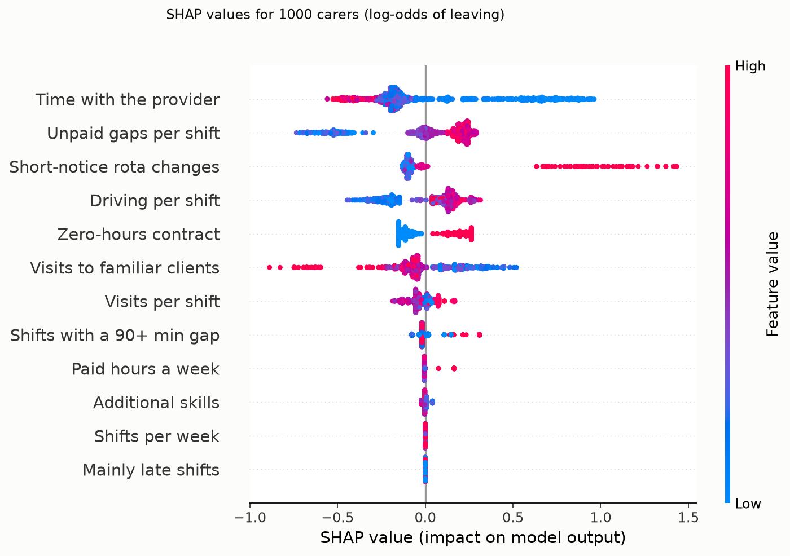
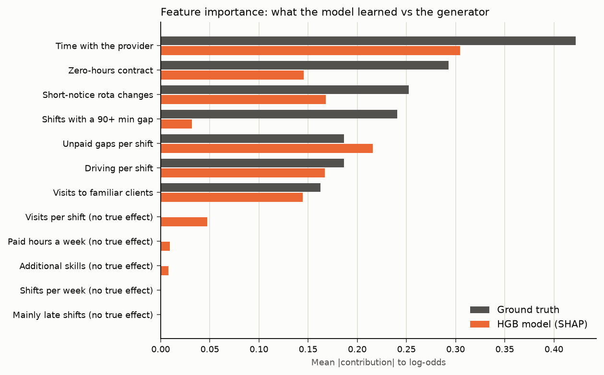
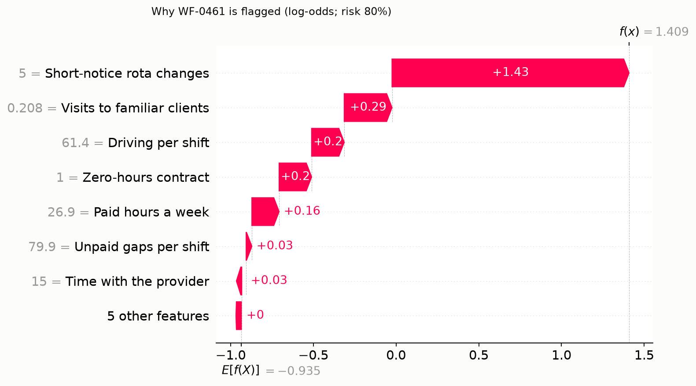

# 18 — Explainability: SHAP, a ground-truth check, and the model card

## 1. What was built

| File | Purpose |
|---|---|
| `app/workforce/explain.py` | `fit_final_model()` (re-tuned HGB on all training carers); `make_explainer()` (SHAP TreeExplainer, `tree_path_dependent`); `global_importance()` (mean \|SHAP\|); `explain_carer()` (top contributions with readable values, whether the provider can change each one, and a support action only when it raises risk); `group_audit()` (selection rate by group, ratio to the most-flagged group). `FEATURE_INFO` holds labels, formats, lever flags and support wording. Code that would run unchanged on real data |
| `scripts/explain_attrition.py` | `true_shapley()`: exact Shapley values of the *generator's* log-odds per carer (one- and two-feature terms). Compares them with the model's SHAP values, runs the age audit on 1,000 out-of-sample predictions, and writes `docs/results/tier3_explain.md` plus 3 figures |
| `scripts/generate_workforce.py` | Adds `TERM_FEATURES` (which features each truth term reads). **Corrects `NULL_FEATURES`**: `weekly_paid_hours` was missing (5 null features, not 4; the data itself was unaffected) |
| `docs/model-cards/attrition-model.md` | Intended use, prohibited uses, factors, metrics, results, age audit, ethical considerations (punitive use, proxy discrimination, surveillance, misleading explanations) |
| `tests/test_workforce_explain.py` | 7 tests: SHAP additivity (guards the bug below), unused features get exactly zero, reason ordering and support logic, the audit arithmetic, each truth term reads only its declared features, and Shapley efficiency of `true_shapley` |
| `pyproject.toml` | Adds `shap` 0.54.1 |

**Headline results** (synthetic, seed 42; `docs/results/tier3_explain.md`):
- **Mechanism recovery:** the global importance ranking matches the truth with Spearman **0.81**. Per-carer SHAP tracks the true contributions for tenure (r 0.93), zero hours (0.95) and short-notice changes (0.90).
- **Correlated features swap credit:** split shifts get 0.03 against a true 0.24 (r 0.13), and unpaid gaps take the credit.
- **Age audit:** the top 20% includes **47% of 18–24s and 8% of over-55s** (ratio 0.17), driven by tenure (+0.52 log-odds). Age is never an input.

## 2. Why this way

- **SHAP, not built-in importance.** HGB has no `feature_importances_`, and impurity-based or split-count importance is biased towards high-cardinality features and gives no per-person view. SHAP gives one consistent framework for both. A **local** explanation (why this carer) is what a coordinator acts on; a **global** one (what drives the model) is what a manager and an auditor need.
- **Log-odds, not probability.** SHAP values are additive in log-odds (base + Σ = model output, exactly). In probability space, the same feature's effect depends on everything else. The table converts only the final total to a probability.
- **Path-dependent mode, because the interventional mode failed its own check.** The interventional mode, which measures "change this feature alone, keep the rest", was my first choice for "which rota lever matters". SHAP's additivity check rejected it. I isolated the failure:
  - same data and background, scikit-learn's `GradientBoostingClassifier`: error 2.5e-8;
  - `HistGradientBoostingClassifier`: up to 0.51 log-odds, growing with the number of trees.

  So it's a shap 0.54.1 defect with HGB, not my code. I switched to `tree_path_dependent`, which is exact here (1e-15), left the check on, and added a test. Turning off `check_additivity` would have shipped explanations that don't add up to the score they explain.
- **Check explanations against truth when you can.** Explanation methods have their own failure modes. With a synthetic ground truth I can compute the *true* Shapley value of each feature for each carer and compare. That turned up the split-shift result, which on real data would be invisible and would lead a coordinator to the right fix (the idle time) under the wrong name.
- **Supportive framing is built in, not added later.** Each reason says whether the provider can change it and offers a support action *only* when the factor raises risk. Tenure is labelled "not changeable" but still points to induction and buddying. The model card makes the prohibited uses explicit. This is the ICO's "explaining decisions made with AI" spirit applied to a high-stakes HR setting.
- **The audit runs on out-of-sample predictions.** In-sample predictions overstate how well the model separates groups. Out-of-fold predictions for the training carers plus final-model predictions for the test carers give 1,000 honest scores.

## 3. Alternatives considered

| Option | Pros | Cons | When I'd choose it |
|---|---|---|---|
| **TreeSHAP, path-dependent (chosen)** | Exact and fast for trees; additive; local and global views | Follows the data's correlations, so credit can move between correlated features; "explains the model, not the world" | Default for tree models, when additivity checks pass |
| TreeSHAP, interventional | "Change one feature, hold others" semantics, closer to a lever | Needs a background sample; **fails additivity for HGB in shap 0.54.1** | Once fixed upstream, or with `GradientBoostingClassifier` |
| Permutation importance | Model-agnostic; measured on held-out data | Global only; correlated features share or lose importance; noisy at 200 rows | A sanity check on global rankings |
| Logistic regression coefficients | Exact, global, simple to audit | Linear only; per-person view = coefficient × value, with the same correlation problems | When governance requires coefficient-level transparency |
| Counterfactual explanations ("risk falls to 40% if changes drop to 2 a month") | Directly actionable | Can propose unrealistic changes; one counterfactual among many | A next step for the coordinator UI (backlog) |

## 4. How it works

**Shapley values in one paragraph.** Treat the features as players cooperating to move the prediction away from the average. A feature's Shapley value is its marginal contribution averaged over every order in which features could be added:

    φ_j = Σ over subsets S not containing j of  |S|!(p−|S|−1)!/p!  ×  [v(S ∪ {j}) − v(S)]

Here v(S) is the expected model output when only the features in S are known. It is the unique attribution satisfying:
- **efficiency:** the values sum to output minus average;
- **symmetry:** identical features get equal credit;
- **dummy:** a feature that never matters gets zero;
- **additivity:** the explanation of a sum of models is the sum of their explanations.

TreeSHAP computes this exactly for trees in polynomial time instead of over all 2¹² subsets.

**Worked example: two features.** The truth's interaction term is h = 0.3 · zero_hours · max(0, changes − 2). Take a zero-hours carer with 5 changes, so h = 0.9. Suppose, over the background, E[h] = 0.10, E[h | zero_hours = 1] = 0.40 and E[h | changes = 5] = 0.33. Then:

    φ_zero_hours = ½[(0.40 − 0.10) + (0.90 − 0.33)] = 0.435
    φ_changes    = ½[(0.33 − 0.10) + (0.90 − 0.40)] = 0.365
    sum = 0.80 = 0.90 − 0.10   (efficiency)

`true_shapley()` does exactly this for every carer. The test checks efficiency on real rows.

**Reading the beeswarm.** Each dot is one carer; its horizontal position is the SHAP value; its colour is the feature value (red high, blue low).



- **Tenure:** low (blue) pushes risk up to +1.0, the new-starter step; long tenure pushes down.
- **Short-notice changes:** two separate clusters, the hinge: nothing below 3 changes, then a jump of +0.7 to +1.4 (including the zero-hours interaction).
- **Familiar clients:** high familiarity (red) lowers risk. Continuity protects carers as well as clients.
- **Split shifts:** almost nothing, because unpaid gaps carry their signal (next point).

**Correlated features and "credit moving".** Gaps and split-shift share correlate at r = 0.82 (both measure idle time). Gradient boosting picks whichever splits slightly better at each step and then has little left for the other. The model is still right *about idle time*: the gap family together gets 0.25 against a true 0.43, shrunk like everything else by regularisation and noise. But it is wrong about *which name* idle time goes by. Remove the gap feature and split shifts' importance rises from 0.03 to 0.12 (the exercise below).



Model bars are generally shorter than truth bars: shallow trees with a low learning rate shrink effects, as LR's regularisation does. The ordering is still largely right.

**A local explanation** for the highest-risk test carer (WF-0461; model risk 80% against 28% on average; actually left):



Short-notice changes (5 a month on a zero-hours contract) dominate at +1.43, then low familiarity, long drives and the contract itself: all provider levers, each with a support action. The fifth line, "paid hours 26.9 h" (+0.17), is a **null feature**: the model picked up a noise split at 25.55 hours. On real data nobody could know that, which is why the coordinator view should present these as "factors to discuss", not causes.

**Accurate and disparate.** The age audit shows three things together:
1. **Roughly calibrated within groups** (predicted 39.7% vs observed 46.8% for 18–24s; 25.1% vs 23.3% for 55+).
2. **Very unequal selection:** the top-20% list is 47% of 18–24s and 8% of 55+.
3. **Carried by a legitimate-looking feature:** tenure. Young carers are new carers.

Removing age from the inputs did nothing to prevent this, and it never could. Whether it is acceptable depends entirely on what a flag *leads to*. That is why the model card restricts use rather than "fixing" the model.

## 5. Interview questions and answers

**Q1. How do you explain an individual carer's risk to a coordinator?**
With SHAP values from the gradient boosting model, shown as the top five factors in plain units ("5 short-notice changes a month", "21% of visits to familiar clients"). Each line says whether it raises or lowers risk, whether the provider can change it, and what support to offer. The values add up exactly to the model's score, and a test checks that for every carer. The view leads with what the provider can change, because the intended action is a better rota, not a conversation about the carer's commitment.

**Q2. How do you know the explanations are right?**
On synthetic data I can check: I computed the true Shapley values of the generator's own function for every carer and compared them with SHAP on the model. The ranking agrees with Spearman 0.81, and the per-carer correlation is above 0.9 for tenure, contract and rota changes. The check also showed a real failure: split shifts were almost uncredited because the model used the correlated unpaid-gap feature instead. With real data there's no ground truth, so I'd rely on stability across retrains, agreement with LR's coefficient signs, and domain review with coordinators.

**Q3. You removed age from the model. Is it fair now?**
No. Removing a protected attribute doesn't remove its proxies. In my audit, the top 20% contains 47% of 18–24s and 8% of over-55s, a ratio of 0.17, far below the four-fifths heuristic. It's carried almost entirely by tenure. The model is roughly calibrated within each age band, so it's "accurate" and still disparate. Under the Equality Act that's potential indirect discrimination unless the use is a proportionate means to a legitimate aim. Offering new-starter support plausibly is; anything adverse is not. So the control is on use, plus a published audit per model version.

**Q4. Why didn't you use interventional SHAP, which better matches "change one lever"?**
I tried it first, and SHAP's own additivity check failed. I isolated it: on the same data and background, it was exact for scikit-learn's `GradientBoostingClassifier` and off by up to 0.5 log-odds for `HistGradientBoostingClassifier`, growing with the number of trees. So it's a library defect with that model type. I used the path-dependent mode, which is exact here, kept the check on, added a regression test, and noted it in the backlog to re-test on upgrade. The lesson I'd stress: never set `check_additivity=False` to make an error go away.

**Q5. Trade-off: SHAP vs logistic regression coefficients for explainability.**
LR coefficients are global, exact and easy to audit, but can't represent the new-starter step or the zero-hours interaction, and HGB's top-10% precision is 12 points higher. SHAP gives faithful local explanations of the better model, but they're attributions, not causes, and they shift between correlated features. If a works council required simple, fixed rules, I'd choose LR with agreed engineered features and accept the lower precision. Otherwise HGB plus SHAP, with LR as a consistency check.

**Q6. What are the ethical risks of an attrition model, and how does the design address them?**
- **Punitive use:** flagged carers get fewer shifts or no training, and the prediction becomes self-fulfilling. Mitigated by written prohibited uses, explanations framed as provider levers with support actions, role-restricted and audited access, and reviewing whether flagged carers were offered support.
- **Proxy discrimination:** a published age audit, plus handling tenure-driven risk with a new-starter programme rather than individual flags.
- **Surveillance:** worker consultation, a transparency notice, and carers' right to see and contest their own explanation.

**Q7. With real PBL data, what changes?**
- **A DPIA first:** this is profiling of employees, so the lawful basis is likely legitimate interests with a balancing test. Consult carers before building.
- **Audit more characteristics:** sex, ethnicity, disability and visa status, where they can lawfully be measured, with sample-size caveats for small groups.
- **Validate explanations without ground truth:** stability across retrains and time periods, agreement with a simple model, and coordinator review of a sample.
- **Watch for feedback loops:** once support is offered to flagged carers, their outcomes change, so later training data reflects the intervention. You need to record who received support.

**Q8. A null feature appears in a carer's explanation. What does that tell you?**
The model fitted a little noise: a split at 25.55 paid hours that has no true effect, worth +0.17 log-odds for that carer. SHAP correctly reports what the model does; the model is wrong. On real data you can't tell which features are null, so explanations should be presented as factors to discuss, small contributions shouldn't drive actions, and reviewers should look for features that make no domain sense. Stronger regularisation or a larger dataset reduce it; nothing eliminates it.

## 6. Learn more

**Official documentation**
- SHAP, [`shap.TreeExplainer`](https://shap.readthedocs.io/en/latest/generated/shap.TreeExplainer.html): the `feature_perturbation` modes (interventional vs tree path dependent) and what each needs.
- SHAP, [beeswarm plot](https://shap.readthedocs.io/en/latest/example_notebooks/api_examples/plots/beeswarm.html) and [waterfall plot](https://shap.readthedocs.io/en/latest/example_notebooks/api_examples/plots/waterfall.html): how to read the two figures used here.
- Lundberg & Lee, [A Unified Approach to Interpreting Model Predictions](https://arxiv.org/abs/1705.07874): the SHAP paper.
- Mitchell et al., [Model Cards for Model Reporting](https://arxiv.org/abs/1810.03993): the structure of the model card.
- Equality Act 2010, [section 19: Indirect discrimination](https://www.legislation.gov.uk/ukpga/2010/15/section/19): the legal test behind the age audit.
- ICO, [What is the impact of Article 22 of the UK GDPR on fairness?](https://ico.org.uk/for-organisations/uk-gdpr-guidance-and-resources/artificial-intelligence/guidance-on-ai-and-data-protection/how-do-we-ensure-fairness-in-ai/what-is-the-impact-of-article-22-of-the-uk-gdpr-on-fairness): meaningful human review. *The page notes it is under review after the Data (Use and Access) Act.*

**Videos**
- I couldn't verify a SHAP video this session. Search YouTube for **"SHAP values explained Scott Lundberg"** (talks by the SHAP author) or **"Shapley values machine learning PyData"**.

## 7. Check your understanding

Gaps and split shifts are correlated (r = 0.82), and the model credits gaps. **Predict** what happens to split shifts' mean |SHAP| (currently 0.032) if you drop `gap_min_per_shift` from the model:

```bash
uv run python -c "
import pandas as pd, numpy as np, shap
from app.workforce.data import FEATURES; from app.workforce.models import candidates
tr = pd.read_csv('data/workforce/train.csv'); f = [c for c in FEATURES if c != 'gap_min_per_shift']
m = candidates()['Gradient boosting (HGB)'].fit(tr[f].astype(float), tr.left_within_12m.astype(int)).best_estimator_
sv = shap.TreeExplainer(m)(tr[f].astype(float))
print(pd.Series(np.abs(sv.values).mean(0), index=f).sort_values(ascending=False).round(3).head(6))"
```

**Expected (verified):** split-shift share rises to **0.120** (about 4×) and moves from 8th to 6th place. The idle-time signal didn't disappear; it moved to the remaining feature that carries it. The lesson for coordinators: when two features measure the same underlying thing, SHAP divides the credit arbitrarily between them. Group them ("idle time between visits") when explaining.
