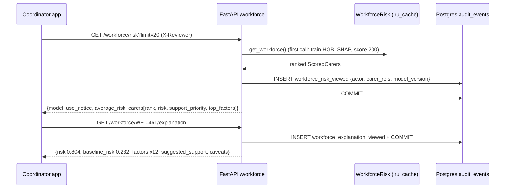

# 19 — Workforce risk API

## 1. What was built

| File | Purpose |
|---|---|
| `app/workforce/service.py` | `WorkforceRisk`: trains the tuned HGB from `data/workforce/train.csv` on first use (cached with `lru_cache`, ~4 s cold start), then scores and explains the **200 held-out carers** as the "current workforce". `model_version()` is a 12-character digest of the training data, estimator, grid, and scikit-learn and SHAP versions |
| `app/api/workforce.py` | `GET /workforce/risk` (ranked list, paging, `priority_only`, top 3 factors each) and `GET /workforce/{carer_ref}/explanation` (all 12 factors in log-odds, baseline and average risk, suggested support, caveats). Every response carries the supportive-use notice. Every read writes an audit event |
| `app/api/deps.py`, `app/main.py` | `get_workforce()` dependency (overridable in tests); router registered |
| `app/audit/models.py`, `migrations/versions/0004_workforce_audit_events.py` | New audit events `workforce_risk_viewed` and `workforce_explanation_viewed`. The CHECK constraint is changed by hand, as in 0003; downgrade fails if such events exist (append-only) |
| `app/workforce/explain.py` | `average_risk` renamed to `baseline_risk` on explanations (see section 2) |
| `scripts/explain_attrition.py` | Seeds NumPy's global RNG before SHAP plots, so the beeswarm PNG is byte-identical across runs |
| `tests/test_workforce_api.py` | 10 integration tests (real router, real model, test Postgres): ranking and paging, the priority filter, validation, additivity through the API, support only for raising levers, **label and age never in any response**, 404/422, every read audited with actor and model version, version digest tracks the data |

Live check: `uvicorn` with `curl` returned WF-0461 at rank 1 (risk 0.804; model version `a1e13de56757`).

## 2. Why this way

- **Serve out-of-sample scores only.** The "current workforce" is the 200 test carers, never seen in training. In production the equivalent is: train on carers whose 12-month outcome is known, and score current carers whose outcome isn't. Serving training-set scores would show inflated confidence.
- **Retrain on start-up rather than unpickle.** scikit-learn's docs warn that pickle "has many documented security vulnerabilities by design" (loading can run arbitrary code), and that loading across versions is "entirely unsupported". Training from committed data takes about 4 seconds and is deterministic, and the version digest pins exactly what produced the model. At PBL scale I'd move to a model registry with signed `skops` artefacts plus the same metadata, because training would no longer be instant and you want to deploy *exactly* the evaluated model.
- **Audit on read.** This is profiling of employees, and the model card promises that every view is logged. Each request records who looked, which carers (the list of refs on the page), the model version and the parameters. The audit row is committed with the request, so an unlogged view is impossible. A GET with a side effect is unusual, but audit logging is the accepted exception: it changes no resource state the client can see.
- **Minimal response properties (OWASP API3:2023).** The responses never include the label (a future outcome: meaningless to serve, and harmful if misread) or the age band (a protected characteristic kept only for audits). The response models list exactly what is returned, rather than serialising the record, and a test scans the raw JSON for forbidden fields and values.
- **Supportive design in the contract, not just the UI.**
  - The use notice is in every response, so any client (React, Flutter, a spreadsheet export) inherits it.
  - The flag is called `support_priority`, not `likely_to_leave`.
  - `suggested_support` lists actions only for provider-side factors that add at least 0.1 log-odds, because small contributions are the likeliest to be noise (note 18).
- **Two different "average risks", named apart.**
  - `average_risk` (0.306) is the mean predicted probability over the workforce.
  - `baseline_risk` (0.282) is the SHAP base value converted to a probability: where the explanation starts.

  They differ because sigmoid(mean log-odds) ≠ mean(sigmoid(log-odds)). The sigmoid is convex below 50%, so averaging after converting gives a higher number than converting the average (Jensen's inequality). A coordinator would otherwise see two "averages" that disagree. A test asserts baseline < average.
- **No database table for scores.** Scores are recomputed from the versioned model, so storing them would duplicate derived personal data (data minimisation). Only access is persisted, in the audit log.

## 3. Alternatives considered

| Option | Pros | Cons | When I'd choose it |
|---|---|---|---|
| **Train on first use, cache in process (chosen)** | No pickle risk; deterministic; versioned by digest | ~4 s cold start; each worker process trains its own copy | Small models and data, prototype or demo |
| Pickle/joblib artefact | Instant load | Arbitrary-code risk on load; version-fragile; the artefact can drift from the code | Never from untrusted storage; acceptable inside a locked-down pipeline |
| `skops` artefact + model registry (MLflow) | Safe-ish loading; exact evaluated model deployed; lineage | More infrastructure; same-environment requirement | Production at PBL |
| Batch scoring job writing scores to a table | Fast reads; history of scores over time | Stores derived personal data; stale between runs | A monthly retention review, with retention limits |

## 4. How it works



**Additivity survives the API.** For any carer, Σ factor log-odds = logit(risk) − logit(baseline_risk). For WF-0461: logit(0.804) − logit(0.282) = 1.410 − (−0.935) = 2.345, and the 12 factors sum to 2.34 (rounded to 3 decimals each). The test checks this within 0.05, so a client can draw a faithful waterfall from the JSON alone.

**The version digest:**

    sha256({data_sha256: sha256(train.csv), estimator: repr(HGB), grid: {...}, sklearn: "1.9.1", shap: "0.54.1"})[:12]

A change to any input that could change the model produces a new version, recorded in every audit event. "Which model showed this manager this score?" always has an answer.

**What it would take to go live** (Tier 4 and beyond): JWT auth with only `manager` and `coordinator` roles allowed; per-carer access scoping (a coordinator sees their own patch); the carer's own read-only explanation endpoint (right of access, the ability to contest); rate limiting; and a retention policy for audit rows.

## 5. Interview questions and answers

**Q1. Walk me through the workforce API.**
Two endpoints:
- **`GET /workforce/risk`** returns carers ranked by predicted 12-month leaving risk, each with its top three factors and a `support_priority` flag for the top 20%. It supports paging and a priority filter.
- **`GET /workforce/{carer_ref}/explanation`** returns all 12 SHAP factors in log-odds (they add up to the score), the baseline and average risk, suggested support actions and caveats.

Every response carries a supportive-use notice. Every read writes an audit event with the viewer, the carers shown and the model version. Scores are out of sample: the served workforce is the held-out test set.

**Q2. Why retrain at start-up instead of loading a saved model?**
Pickle can execute arbitrary code when loaded, and scikit-learn doesn't support loading across versions. Training from committed data takes about 4 seconds and is deterministic, and a digest of the data, hyperparameter grid and library versions identifies the model in every audit row. For production I'd switch to a registry with `skops` artefacts and the same metadata, so the exact evaluated model is what's deployed and start-up doesn't depend on training time.

**Q3. Why audit reads, not just writes?**
Risk scores about employees are sensitive personal data. Misuse, such as a manager browsing scores before a disciplinary meeting, happens through reading. Logging who saw which carers, and when, supports accountability, investigations, and carers' right-of-access requests. The audit insert commits with the request, so there's no path to a score without a log entry. The cost is a write per read, which is trivial at this scale.

**Q4. What do you deliberately leave out of the responses, and how do you enforce it?**
The label and the age band. The label is a future outcome and is meaningless for current carers; age is a protected characteristic kept only for fairness audits. Each endpoint has an explicit response model listing exactly the fields returned, rather than serialising the stored record (OWASP API3:2023, broken object property level authorization), and a test scans the raw JSON for the forbidden names and values. In Tier 4, role-based access will limit *who* can call these endpoints at all.

**Q5. Trade-off: in-process cached model vs a separate scoring service.**
In-process is simple: no network hop, one deployable, and fine for a 150-tree model. The costs: each worker trains its own copy, the first request is slow, and model updates need a redeploy. A separate service (or batch scores in a table) scales independently and allows canary releases of new versions, but adds infrastructure and, for a score table, stores derived personal data. At PBL's size I'd keep it in-process with a registry-loaded artefact, and revisit only if latency or release cadence demanded it.

**Q6. With real PBL data, what changes in this API?**
- **Auth:** JWT and roles, with per-patch scoping so a coordinator sees only their carers.
- **Carer access:** a self-service endpoint for carers to see their own explanation and contest it.
- **Data freshness:** scoring from live rota-system features, with a snapshot date in the response.
- **Monitoring:** drift checks (feature distributions, calibration against later outcomes) that can flag a model as stale.
- **Governance:** a DPIA covering the endpoint, an audit-retention policy, and periodic reporting of the age (and other) audits per model version.

**Q7. Why do `average_risk` and `baseline_risk` differ?**
The baseline is the SHAP base value, the mean log-odds, converted to a probability: 0.282. The average is the mean of the predicted probabilities: 0.306. Because the sigmoid is convex below 50%, the mean of the probabilities is higher than the probability of the mean log-odds (Jensen's inequality). I name them separately and test the inequality, so a UI can't present two disagreeing "averages".

## 6. Learn more

**Official documentation**
- scikit-learn, [Model persistence](https://scikit-learn.org/stable/model_persistence.html): pickle's security risks, `skops`, and the metadata to store with a model.
- OWASP, [API3:2023 Broken Object Property Level Authorization](https://api-security.owasp.org/editions/2023/en/0xa3-broken-object-property-level-authorization): why responses should list only the fields a client needs. *The owasp.org/API-Security path now redirects here.*
- FastAPI, [Query parameters and string validations](https://fastapi.tiangolo.com/tutorial/query-params-str-validations/): the `Annotated[..., Query(...)]` validation used for `limit` and `offset`.

**Videos**
- I couldn't verify a video for this step. Search YouTube for **"ML model serving FastAPI PyData"** or **"MLflow model registry tutorial"** (official MLflow channel).

## 7. Check your understanding

`MIN_SUPPORT_LOG_ODDS = 0.1` controls which factors produce a support suggestion. **Predict** how many suggestions WF-0461 gets at thresholds 0, 0.1 and 0.5, using the factor values (+1.43 changes, +0.29 familiarity, +0.20 driving, +0.20 zero hours, +0.17 paid hours, then small ones). Then check:

```bash
uv run python -c "
from app.workforce.service import get_workforce_risk
c = get_workforce_risk().carers['WF-0461']
for t in (0, 0.1, 0.5):
    print(t, [r.label for r in c.explanation.reasons if r.support and r.lever and r.log_odds >= t])"
```

**Expected (verified):** threshold 0 gives **7** (including "visits per shift" and unpaid gaps, both tiny); 0.1 gives **5** (changes, familiarity, driving, zero hours, paid hours); 0.5 gives **1** (changes only). The threshold trades completeness against noise. "Paid hours" survives at 0.1 even though it's a null feature (note 18), which is why the caveats say to discuss factors before acting.
