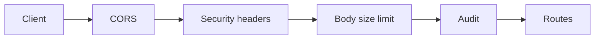

# 22 — Security review (OWASP API Top 10)

## 1. What was built

| File | Purpose |
|---|---|
| `docs/SECURITY.md` | The review: all ten OWASP API 2023 risks with status (addressed, partial, open), the controls, the tests that prove them, and the gaps. Also supply chain, static analysis and secrets management |
| `app/core/config.py` | Refuses to start outside `environment=local` with the public JWT or audit-key defaults, a JWT key under 32 bytes, or `*` in CORS, listing every problem at once. New settings: CORS origins, body limit, rate limits |
| `app/core/ratelimit.py` | In-memory sliding-window limiter (thread-safe, memory-bounded, `Retry-After`). Refused requests aren't counted |
| `app/core/http.py` | `BodySizeLimitMiddleware` (413 for a declared *or* chunked body over 1 MB), `SecurityHeadersMiddleware` (OWASP REST headers; HSTS outside local), and a 422 handler that doesn't echo submitted values |
| `app/main.py` | Middleware order (CORS → headers → size → audit → routes), strict CORS without credentials, the 422 handler, docs off outside local |
| `app/api/auth.py`, `notes.py`, `schedule.py` | Limits: login per IP (20/min) and per username (5/min), both before Argon2; notes 30/min and solves 3/min per user. Scenario caps (60 carers, 200 clients, 400 visits, at least one carer) |
| `app/nlp/schemas.py` | Note ids constrained to `^[A-Za-z0-9_.-]{1,50}$` |
| `app/matching/solver.py` | Refuses a scenario without carers (see section 2: this was crashing the process) |
| `pyproject.toml` | Ruff flake8-bandit rules (`S`) on, with triaged, documented suppressions |
| `tests/test_security_hardening.py` (19), `tests/test_solver.py` (+1) | Config refusal (including a subprocess "production" start), limiter maths, login, solver and note limits, 413 for declared and chunked bodies, headers, HSTS, CORS allow/deny, id bounds, scenario caps, the zero-carer regression, 422 without echo |

Tests: 312 → **332**. `pip-audit` over 350 locked requirements: no known vulnerabilities. Live check: headers present; five wrong logins give 401, then 429 with `Retry-After: 60` even with the right password; preflight from `localhost:5173` gets 200 with no credentials header; a 1.1 MB body gets 413.

## 2. Why this way

**What the review found.** The checklist mattered because it made me try inputs I hadn't. Three real defects:

1. **A zero-carer scenario killed the API process.** OR-Tools aborts natively (SIGABRT, exit −6) on a routing model with no vehicles. No Python exception, no 500: the worker dies. One authenticated request could take the service down. The solver now raises `ValueError` before calling OR-Tools, the API returns 422, and both are regression-tested. This is the strongest argument in the review: native extensions don't respect Python's error model, so **validate before handing input to C++**.
2. **An overlong `note_id` became a 500, after an LLM call.** The column is `String(50)`, but the schema had no maximum. The request was redacted and sent to the model, then failed at `INSERT`. Ids are now constrained by pattern and length at the edge.
3. **Validation errors echoed health data.** FastAPI's default 422 includes each invalid field's `input`. Send a note with a bad id and the response contains the note text, which then ends up in browser consoles and error trackers. The custom handler keeps `loc`, `msg` and `type`, and drops `input` and `ctx`.

**Rate limits where the cost is.** OWASP API4 says to limit how often a client can call the API, more strictly for some endpoints.
- **Login is the brute-force target.** It's limited per IP (stuffing many accounts) and per username (guessing one account from many IPs). Both checks run *before* Argon2, otherwise an attacker could use the 33 ms hash as a CPU amplifier.
- **Notes (an LLM call each) and solves (up to a minute of CPU each) are limited per user.**

**In-memory, per process: a declared prototype limit.** A sliding log of timestamps is exact and easy to reason about. The honest gaps are that with N workers the limit is N×, and a restart forgets it. Production would use Redis or the gateway.

**Refusing default secrets.** Every dev default is public, because it's committed. The validator turns a deployment mistake (forgetting to set a secret) into a start-up failure rather than a silent vulnerability. It reports all problems at once, so the fix takes one round, not four.

**CORS without credentials.** Tokens travel in `Authorization`, not cookies, so the browser never attaches anything automatically, and CSRF doesn't apply. With `allow_credentials=False` and an explicit origin list, a malicious site can't read responses, and couldn't authenticate anyway. This changes the plan sketched in note 20 (an `httpOnly` refresh cookie): cookies would need CSRF tokens and `SameSite` handling across two origins. Instead, the React dashboard keeps tokens **in memory only**, so a reload means logging in again, which is acceptable for a demo. Mobile uses platform secure storage. The production answer is a backend-for-frontend (ADR-027).

**Security headers on a JSON API.** The OWASP REST Security Cheat Sheet recommends `Cache-Control: no-store`, `frame-ancestors 'none'`, `nosniff`, `X-Frame-Options` and HSTS for API responses. It also suggests `default-src 'none'` and `Referrer-Policy` as defence in depth. `no-store` matters most here: a proxy or shared computer must never cache a risk explanation or a note. Swagger UI is exempt from the CSP and only exists in local development.

**Bandit via ruff, triaged rather than silenced.** Nine findings, all false positives. Each suppression is scoped to a file or line and states its reason. A blanket ignore would hide the next real one.

## 3. Alternatives considered

| Option | Pros | Cons | When I'd choose it |
|---|---|---|---|
| **In-process sliding window (chosen)** | Exact; no infrastructure; easy to test with a fake clock | Per process; lost on restart; memory per key | One process; prototype |
| `slowapi` / `limits` library | Decorators, several strategies, Redis backend ready | Another dependency; endpoints need a `Request` parameter; less to explain | Wanting Redis-backed limits quickly |
| Redis token bucket (Lua script) | Shared across workers; atomic; survives restarts | Redis to run and secure; network hop per request | Several workers or replicas at PBL |
| Gateway or WAF limits (nginx `limit_req`, Azure API Management) | Stops floods before Python; central policy | Coarser (per IP, per path); no app identity unless tokens are parsed | Production edge, *as well as* per-user app limits |

## 4. How it works

**Sliding-window log, worked example.** Limit 3 per 60 s, hits at t = 1000, 1010, 1020:

    t=1030: drop hits <= 970 -> [1000,1010,1020], len 3 >= 3 -> 429, Retry-After = 1000+60-1030 = 30
    t=1060: drop hits <= 1000 -> [1010,1020], len 2 < 3 -> allowed, log [1010,1020,1060]

This is exactly `test_sliding_window_refuses_then_recovers`. A fixed window (reset at each minute boundary) would allow up to 6 requests in 2 seconds across a boundary; the sliding log never allows more than 3 in any 60 s.

**Middleware order.** `add_middleware` wraps the current app, so the last one added is outermost:



- **CORS is outermost,** so even 413s and audit 500s carry CORS headers and a browser client can read the error.
- **Headers wrap everything,** including 413s.
- **Size runs before audit:** an oversized body never reaches routing, so there's no route to audit.

**Why both a `Content-Length` check and byte counting.** The declared length lets the server refuse before reading a single byte. Chunked uploads carry no length, so the `receive` wrapper counts bytes as they arrive and raises `HTTPException(413)`. FastAPI re-raises HTTP exceptions from body parsing unchanged, which I confirmed with a 20-line experiment first.

**The start-up refusal in practice:**

    $ SMARTPBL_ENVIRONMENT=production SMARTPBL_JWT_SECRET=short uvicorn app.main:app
    pydantic_core.ValidationError: ... refusing to start (production):
      SMARTPBL_JWT_SECRET is shorter than 32 bytes; SMARTPBL_AUDIT_HASH_KEY is the public development default

## 5. Interview questions and answers

**Q1. Walk me through your OWASP API Top 10 review.**
I went through all ten 2023 risks and recorded, for each, the controls, the tests that prove them, and the gaps, in `docs/SECURITY.md`.
- **Strongest:** authentication and function-level authorisation (Argon2id, pinned JWTs, rotation with reuse detection, deny-by-default with a matrix test), property-level exposure (explicit response models), and unsafe consumption of the LLM (schema-constrained output, grounding, human review).
- **Partial:** object-level authorisation, because there's no per-patch scoping, and limits that are per process.

The review also found three real defects: a crash, a 500 and a data echo. All three are fixed with regression tests.

**Q2. Tell me about the crash you found.**
A schedule scenario with zero carers made OR-Tools abort the process with SIGABRT. Because it happens in native code, there's no Python exception to catch: the worker just dies, so one authenticated request was a denial of service. I found it while writing a rate-limit test with an "empty" scenario. I fixed it at both layers: the solver raises a `ValueError` before building the model, and the API rejects carer-less scenarios with 422. The lesson I'd generalise: validate preconditions before handing input to any C or C++ extension (solvers, image libraries, parsers), because their failure mode is the process, not an exception.

**Q3. How do you protect login from brute force without locking users out?**
Two sliding-window limits, both checked before the deliberately slow Argon2 verification: 20 attempts per minute per IP, and 5 per minute per username. Refused attempts aren't counted, so a user who waits a minute gets back in; there's no permanent lockout an attacker could trigger. The trade-off is that someone who knows a username can keep it locked out a minute at a time. For staff accounts, the production answer is SSO with MFA through PBL's identity provider, which also gives adaptive, risk-based throttling.

**Q4. Trade-off: why in-memory rate limiting?**
It's exact, needs no infrastructure, and is testable with a fake clock, which is right for one process. The limitations are real and documented: with N uvicorn workers the effective limit is N times higher, and a restart resets every window. For PBL I'd keep the per-user application limits but move their state to Redis (a token bucket in a Lua script for atomicity), and add coarse per-IP limits at the gateway, so floods never reach Python.

**Q5. Why no cookies, and what does that mean for CORS and CSRF?**
Tokens travel in the `Authorization` header, so the browser never attaches credentials automatically, and CSRF doesn't apply. CORS can then run with `allow_credentials=False` and an explicit origin list. The cost is XSS exposure: a script running in the dashboard could read in-memory tokens. I limit that with short access tokens, refresh rotation with reuse detection, and a strict CSP on the dashboard. The stronger production design is a backend-for-frontend that keeps tokens server-side and gives the browser only an `httpOnly`, `SameSite` session cookie.

**Q6. What does "secure by default" mean in your configuration?**
The dangerous state should fail loudly. Every development default (JWT key, audit HMAC key) is public, because it's in the repo, so outside `local` the app refuses to start with them, with a key shorter than 32 bytes, or with a wildcard CORS origin. All problems are reported together. A subprocess test starts the app as "production" both ways. Docs and the OpenAPI schema are disabled outside local too, so the attack surface published is only what's needed.

**Q7. With real PBL data, what's next after this review?**
- **Object-level authorisation:** branch or patch scoping, plus carers' access to their own records.
- **Distributed limits** in Redis and the gateway.
- **TLS and proxy configuration**, so the limiter sees real client IPs.
- **Secrets** from a vault (Azure Key Vault fits a Microsoft estate), with key ids on audit hashes before rotating the HMAC key.
- **Encryption** of `raw_text` at rest.
- **Dependency and static scans** in CI, run on a schedule rather than only on push.
- **An external penetration test** before go-live, and a DPIA that references this document.

## 6. Learn more

**Official documentation**
- OWASP, [API Security Top 10, 2023](https://api-security.owasp.org/editions/2023/en/0x11-t10) and [API4:2023 Unrestricted Resource Consumption](https://api-security.owasp.org/editions/2023/en/0xa4-unrestricted-resource-consumption): the checklist used; rate limits and payload limits.
- OWASP, [REST Security Cheat Sheet](https://cheatsheetseries.owasp.org/cheatsheets/REST_Security_Cheat_Sheet.html): the "Security Headers" section, and the CORS advice ("as specific as possible").
- FastAPI, [CORS](https://fastapi.tiangolo.com/tutorial/cors/): `CORSMiddleware`, and why wildcards can't be combined with credentials.
- PyPA, [pip-audit](https://github.com/pypa/pip-audit): dependency scanning against the PyPI advisory database (or OSV).

**Videos**
- **"OWASP API Security Top 10 Course – Secure Your Web Apps"**: [youtube.com/watch?v=YYe0FdfdgDU](https://www.youtube.com/watch?v=YYe0FdfdgDU). About 1.5 hours covering each 2023 risk with examples. The title is verified on the page; the channel (freeCodeCamp.org, created with APIsec University) comes from a listing, not the fetched page.

## 7. Check your understanding

In `app/core/http.py`, `BodySizeLimitMiddleware` has two defences: the declared-`Content-Length` check, and counting chunks in `limited()`. Replace the declared check's condition with `if False:`. **Predict:**
1. Does `test_oversized_bodies_are_refused_declared_or_chunked` still pass?
2. What does `GET /health` return if a client sends `Content-Length: 5000000` with no body?

```bash
uv run pytest tests/test_security_hardening.py -q -k oversized
```

**Expected (verified):**
1. **The test still passes.** FastAPI reads the body *before* resolving dependencies, so the byte counter trips at 1 MB and returns 413, even for an unauthenticated POST. The declared check is an *early* rejection: it refuses before reading anything, which matters when a client claims gigabytes.
2. `GET /health` returns **200** without the check (nothing reads a body), and **413** with it.

Takeaway: an unauthenticated client can make the server read up to `max_body_bytes` before authentication runs, so that limit is part of your denial-of-service budget. Restore the line afterwards.
