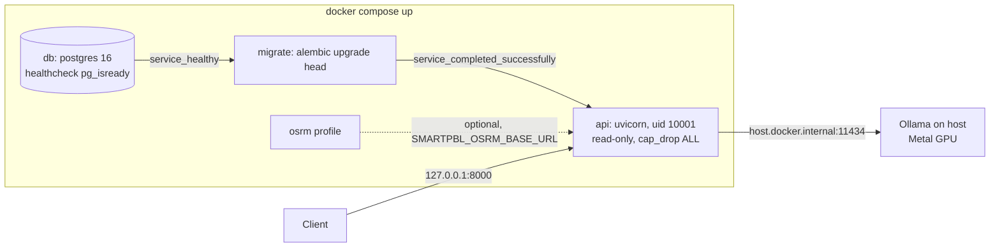

# 23 — Containerisation and CI

## 1. What was built

| File | Purpose |
|---|---|
| `Dockerfile` | Two stages. **build:** uv 0.11.16 creates `/app/.venv` from `uv.lock` (`--locked --no-dev --no-install-project`), as a cached layer that changes only with the lockfile. **runtime:** `python:3.12.13-slim` with the virtualenv and the app source only; no uv, no build cache, no dev tools. Runs as unprivileged uid 10001, with a `HEALTHCHECK`, and uvicorn with `--no-server-header --proxy-headers` (trusted proxies from `FORWARDED_ALLOW_IPS`) |
| `.dockerignore` | Keeps `.env`, `.git`, `.venv`, local notes, OSRM extracts, tests and docs out of the build context |
| `docker-compose.yml` | `db` (healthy) → `migrate` (one-shot `alembic upgrade head`, must exit 0) → `api` (127.0.0.1:8000), plus the opt-in `osrm` profile. The API runs with a **read-only root filesystem**, a tmpfs `/tmp`, all Linux capabilities dropped and `no-new-privileges`. Ollama stays on the host, reached at `host.docker.internal` |
| `.github/workflows/ci.yml` | On every push and PR, four jobs: **lint** (ruff check and format, dev group only); **test** (Postgres 16 service container, `SMARTPBL_REQUIRE_DB=1`, full pytest); **audit** (`pip-audit` over the lockfile); **docker** (build the image with the GitHub Actions cache, no push). Token permissions are `contents: read`; actions are pinned to commit SHAs; `UV_LOCKED=1` |

**Verification:**
- **Image:** built locally in about 100 s; 2.3 GB unpacked (the spaCy `lg` model is 425 MB of that). Runs as `smartpbl` (uid 10001) and contains no `.env`, no local notes and no pytest.
- **Stack:** `docker compose up -d` gave migrate exit 0 and api healthy. An end-to-end smoke test through the container exercised all three tiers:
  - a note was redacted, then extracted by llama3.1:8b on the host;
  - a solve using the cached OSRM matrix assigned 93 of 106 visits;
  - the workforce explanation for WF-0461 came out at risk 0.804 with model version **`a1e13de56757`, the same digest as on the host**.
- **Workflow:** actionlint 1.7.12 is clean.
- **CI rehearsals:** in a fresh copy of the tracked files on macOS, all three steps pass (ruff check, format check, then 332 pytest tests). The linux/amd64 rehearsal is reported in section 2.

## 2. Why this way

- **Two stages, so the runtime holds only what runs.** Build tools, the uv binary and the download cache stay in the build stage. The runtime gets the finished virtualenv plus source. Less in the image means a smaller attack surface and fewer CVEs for scanners to flag. The dependency layer is keyed on `uv.lock` alone, so editing code rebuilds in seconds.
- **`--locked` everywhere.** The image and CI both fail if `uv.lock` disagrees with `pyproject.toml`, so they can never quietly resolve different versions from the ones tested. That's the same supply-chain argument as SHA-pinned actions: what runs is exactly what was reviewed.
- **Migrations as their own job.** Running `alembic upgrade` inside the API's start-up would race when several replicas start at once, and would mix schema changes with serving. Compose's `service_completed_successfully` starts the API only after the migration job exits 0. A failed migration stops the deploy instead of serving against a half-migrated schema.
- **Container hardening is cheap here.**
  - **Read-only root filesystem:** the app never writes to disk, apart from the matplotlib cache, pointed at the tmpfs.
  - **No capabilities, `no-new-privileges`, non-root user:** an exploited process can't modify the code, install tools or escalate.
  - **Ports bound to 127.0.0.1:** like the database, nothing is exposed to the local network. A reverse proxy with TLS would sit in front.
- **Ollama on the host.** Containers on macOS can't use the Metal GPU, so containerised Ollama would run the 8B model on CPU, many times slower. On a Linux server with an NVIDIA GPU I'd run the official Ollama image with the NVIDIA container toolkit. The API only needs `SMARTPBL_OLLAMA_BASE_URL`.
- **CI jobs run in parallel and do different things.**
  - **Lint** gives feedback in seconds without installing 1.4 GB of runtime dependencies.
  - **Test** uses a real Postgres, because the append-only trigger, JSONB containment and row locks are Postgres behaviour a mock or SQLite would fake. `SMARTPBL_REQUIRE_DB=1` turns "database unreachable, skip" into a failure, so CI can't go green by skipping half the suite.
  - **Audit** scans every push for known vulnerabilities.
  - **Docker** proves the image still builds; no registry push yet.
- **SHA pinning and least-privilege tokens.** GitHub's secure-use guidance says to pin third-party actions to a full commit SHA (tags can be moved to malicious code) and to give `GITHUB_TOKEN` minimum permissions. I pinned four actions to SHAs looked up from the GitHub API, with the version in a comment, and set `contents: read`. `persist-credentials: false` keeps the token out of `.git/config` for later steps.
- **The same model digest inside and outside Docker.** The workforce model is retrained at start-up (ADR-023). The container reproduced version `a1e13de56757` exactly: same data, same seed, same library versions from the lockfile. That's the practical payoff of locking dependencies.

**The linux/amd64 rehearsal.** GitHub's runners are x86-64 Linux, unlike this arm64 Mac. Solver and model tests assert specific outcomes, so a platform difference in OR-Tools, NumPy or scikit-learn wheels could break CI. I ran the test job in a `python:3.12.13-slim` container with `--platform linux/amd64` (emulated; `uname -m` = `x86_64`), installing from the same lockfile, against the same Postgres. **All 332 tests passed.** CI's first real run happens when this is pushed.

## 3. Alternatives considered

| Option | Pros | Cons | When I'd choose it |
|---|---|---|---|
| **Multi-stage uv build on `python:slim` (chosen)** | Small-ish, debuggable (has a shell), official uv pattern, cached dependency layer | Still Debian userland; 2.3 GB because of ML deps | Prototype and most production APIs |
| Distroless / Chainguard Python base | No shell or package manager; very few CVEs | Harder to debug; wheels must match its libc and Python | Hardened production once the image is stable |
| Single-stage image | Simplest Dockerfile | Ships uv, caches and build tooling; bigger attack surface | Throwaway experiments |
| Migrations at API start-up | One fewer service | Races between replicas; serving mixed with schema changes | Single-instance hobby apps |

## 4. How it works

**Layer caching, worked example.** The image is a stack of layers, each the diff produced by one instruction. Docker reuses a layer if the instruction and its inputs are unchanged:

    COPY --from=uv ...                         # cached unless the uv tag changes
    RUN --mount=bind,source=uv.lock uv sync    # cached unless uv.lock / pyproject change  (~90 s)
    COPY app ./app                             # rebuilt when code changes                  (<1 s)

Editing `app/api/notes.py` reuses the 1.4 GB dependency layer and rebuilds only the copy layers. If `COPY . .` came *before* `uv sync`, every code edit would reinstall all dependencies.

**CI service container networking.** The test job runs directly on the runner VM, so the Postgres service's port is published to the VM (`5442:5432`), and the job connects to `localhost:5442`, the same URL the conftest builds `smartpbl_test` from in local development.

## 5. Interview questions and answers

**Q1. Walk me through your container setup.**
A two-stage Dockerfile. The build stage uses uv to create the virtualenv from the lockfile, with dev tools excluded and the build failing if the lock is stale. The runtime stage copies only that environment and the source into a slim Python image, and runs as a non-root user with a health check. Compose orders the start-up: Postgres must be healthy, a one-shot migration job must exit successfully, and then the API starts. It runs with a read-only filesystem, no Linux capabilities and its port bound to localhost. Ollama stays on the host for GPU access, reached via `host.docker.internal`.

**Q2. Why run migrations as a separate job?**
If every API replica ran `alembic upgrade` at start-up, two replicas could try to apply the same migration at once. It also couples serving traffic with schema changes. A one-shot job runs once, and the API only starts when it has exited 0, via Compose's `service_completed_successfully` (a Kubernetes init job or a pipeline step in production). A failed migration halts the rollout, and the old version keeps serving, rather than the new code running against a half-migrated schema.

**Q3. What does your CI pipeline guarantee?**
On every push and pull request:
- **lint:** ruff lint and format checks;
- **test:** the full suite against a real Postgres 16, with a missing database a hard failure;
- **audit:** the locked dependencies scanned for known vulnerabilities;
- **docker:** the image still builds.

`UV_LOCKED=1` means CI uses exactly the locked versions, the token is read-only, and every third-party action is pinned to a commit SHA. What it doesn't guarantee: anything involving the real LLM. Those tests are opt-in (`-m ollama`), because CI has no GPU or model, which is why extraction quality is evaluated offline (Step 1.9).

**Q4. Why pin actions to SHAs rather than tags like `@v7`?**
A tag is a movable pointer. If an action's repository is compromised, the attacker can retarget `v7` at malicious code, and every workflow using `@v7` runs it with access to that job's token and secrets. That has happened to popular actions. A full commit SHA is immutable. GitHub's own secure-use guidance recommends it, and I keep the version as a comment so Dependabot or a human can update it deliberately.

**Q5. Trade-off: why a 2.3 GB image, and would you shrink it?**
Most of it is the ML stack: the spaCy large model (425 MB), scipy, OR-Tools, pandas and scikit-learn. It's what the redaction, solver and attrition model need. I'd shrink it in order of value:
1. Try the medium spaCy model, re-running the redaction tests to check recall.
2. Split the attrition training out of the API, so serving loads a small artefact instead of training at start-up.
3. Only then consider a distroless base.

Image size mostly costs pull time and registry storage, so it matters less than correctness for a single-tenant care provider.

**Q6. With real PBL data, what changes in deployment?**
- **Images:** pushed to a private registry, signed, and scanned (e.g. Trivy) in CI.
- **Secrets:** injected from a vault at runtime, never in images or Compose files.
- **TLS:** terminated at a reverse proxy or ingress, with `FORWARDED_ALLOW_IPS` set to that proxy.
- **Database:** a managed Postgres with backups, point-in-time recovery and encryption at rest, in a UK region for data residency.
- **Ollama:** on a GPU node inside the same private network, so note text never crosses the public internet.
- **Rollouts:** staged environments with the migration job as a gate, and readiness probes that check the database and Ollama (currently `/health` is liveness only).

## 6. Learn more

**Official documentation**
- uv, [Using uv in Docker](https://docs.astral.sh/uv/guides/integration/docker/) and [Using uv in GitHub Actions](https://docs.astral.sh/uv/guides/integration/github/): the pinned `COPY --from` uv image, the dependency-only layer, bytecode compilation, and SHA-pinned setup-uv.
- Docker, [Control startup and shutdown order in Compose](https://docs.docker.com/compose/how-tos/startup-order/): `service_healthy` and `service_completed_successfully`. Also [Multi-stage builds](https://docs.docker.com/get-started/docker-concepts/building-images/multi-stage-builds/).
- GitHub, [Secure use reference](https://docs.github.com/en/actions/reference/security/secure-use): pinning actions to full commit SHAs, and least-privilege `GITHUB_TOKEN`.
- GitHub, [Creating PostgreSQL service containers](https://docs.github.com/en/actions/use-cases-and-examples/using-containerized-services/creating-postgresql-service-containers): ports and health options for a job on the runner.

**Videos**
- **"Docker concepts - Multi-stage builds"**: [youtube.com/watch?v=vR185cjwxZ8](https://www.youtube.com/watch?v=vR185cjwxZ8). The title is verified. Docker's documentation repository embeds this video in its multi-stage concept guide, but the channel name wasn't visible on the fetched page.

## 7. Check your understanding

The `api` service runs with `read_only: true` and a tmpfs at `/tmp`, and the image sets `MPLCONFIGDIR=/tmp/matplotlib`. **Predict:** what happens if you remove the `tmpfs` entry and recreate the API (`docker compose up -d --force-recreate api`)? Does it start, and do requests still work?

**Expected (verified):** the API **never becomes healthy**: it crash-loops, and requests get connection refused. The log shows two errors:

    mkdir -p failed for path /tmp/matplotlib: [Errno 30] Read-only file system
    FileNotFoundError: [Errno 2] No usable temporary directory found in ['/tmp', '/var/tmp', '/usr/tmp', '/app']

The first is a warning, because matplotlib falls back to a temp dir. The second is fatal: at import time, a library asks Python's `tempfile` for a writable directory and finds none.

Lesson: a read-only filesystem is a strong control, but you have to find out exactly what the app writes and give it exactly that (a tmpfs `/tmp`), nothing more. Restore the entry and `docker compose up -d --force-recreate api`.
