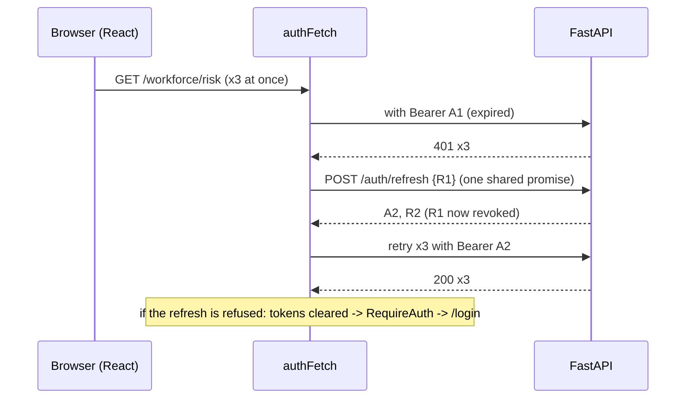

# 24 — Coordinator dashboard architecture

## 1. What was built

**Backend**

| File | Purpose |
|---|---|
| `app/auth/permissions.py` | Coordinators gain `workforce.read` and `audit.read`, matching the Tier 5 designs (ADR-029). The model card already named coordinators as primary users |
| `app/auth/models.py`, migration `0007` | `users.display_name` ("Hannah K."), returned by `GET /auth/me` |
| `scripts/seed_demo.py` | Creates or resets the three public demo accounts from the sign-in design (`hannah@demo.smartpbl / demo-coordinator`, ...). Refuses unless `SMARTPBL_ENVIRONMENT` is `local` or `demo` |
| `scripts/export_openapi.py` → `web/openapi.json` | The API contract the web client is generated from, built from the app object (works where `/openapi.json` is disabled) |
| `tests/test_frontend_contract.py`, `test_seed_demo.py`, `test_auth_api.py` | Schema drift guard; seeding and its environment refusal; display name; the updated route × role matrix |

**Frontend (`web/`)**: Vite 8, React 19, TypeScript 5.9 (strict), Tailwind v4, shadcn/ui, React Router 8, TanStack Query 5, openapi-fetch.

| Path | Purpose |
|---|---|
| `src/index.css` | Design tokens from DESIGN.md as CSS variables, mapped onto Tailwind utilities (`bg-high-bg`, `text-ai-text`, ...) and onto shadcn's semantic variables (`--primary` = `#111113`). Self-hosted Inter; light-only (`dark:` bound to a class we never set); `line-height: normal` as in the designs |
| `src/api/schema.d.ts` | Generated by `openapi-typescript` from `openapi.json` (`npm run gen:api`) |
| `src/api/client.ts` | Typed `openapi-fetch` client with `authFetch`: adds the bearer token; on 401, **one shared refresh**, then retry; `ApiError` carries the `X-Request-ID` as the design's "Reference: req_8f2c41" |
| `src/auth/` | `tokens.ts` (in-memory store, ADR-027), `AuthProvider.tsx` (sign in, `/auth/me`, sign out), `auth.ts` (context, `useAuth`, `can()`, role labels, initials) |
| `src/app/pages.ts` | One table of pages: rail item, title, permission, denial copy and the page's API "probe" |
| `src/app/AppShell.tsx`, `guards.tsx`, `router.tsx` | 76 px rail filtered by permission; header with breadcrumb, **"Demo data · synthetic"** badge, search, bell, user chip; `RequireAuth` (sign-in, then back to the original page); `Guarded` (access-denied state plus a server probe) |
| `src/pages/LoginPage.tsx` | Sign in, rebuilt from `Login.dc.html` with shadcn `ToggleGroup`, `Input`, `Label`, `Button` and `Card` |
| `src/components/states/States.tsx` | Empty, loading, error and access-denied states from `States.dc.html` (`Card`, `Skeleton`, `Button`) |
| `src/components/ui/*` | shadcn components, with design variants added: `Badge` (`high`, `medium`, `low`, `success`, `ai`, `elevated`, `demo`), `Button` (`pill`, `xl`), `Toggle` (`segment`) |
| `src/pages/OverviewPage.tsx`, `PendingStep.tsx`, `PendingPage.tsx` | Overview header and greeting. The panels need a summary endpoint and come in 5.2; review, schedule, workforce and audit are labelled stand-ins until their steps |
| 3 test files (19 tests) | Client (bearer, single-flight refresh, session end, no refresh on sign-in, error reference); sign-in (design copy, role switch, success, 401, 429, unexpected error, return-to); shell (rail per role, access denied, sign out); states and date copy |
| `.github/workflows/ci.yml` | New `web` job: `npm ci`, regenerate types and fail on diff, typecheck, `oxlint --deny-warnings`, tests, build |

**Verification**
- Python: 336 tests. Web: 19 tests, lint and typecheck clean, production build 397 kB JS (125 kB gzip).
- I rendered `Login.dc.html` and our `/login` in headless Chrome at the design's 1440×900 preview size, side by side, and fixed three differences: input fields grey in dark mode, line height, and a sparkle icon. They now match closely.
- A Playwright run with the system Chrome signed in as Hannah against the real API (overview with rail and header), then as Joy, the carer: access denied in the design's copy, and **the API's audit log shows `user:joy@demo.smartpbl /review/queue 403`**.

## 2. Why this way

**The design is the spec.** Copy is transcribed verbatim. Tokens are CSS variables with the exact hex values from DESIGN.md. DESIGN.md's component mapping is followed: the role switch is a `ToggleGroup`, cards are `Card`, loading is `Skeleton`. Wherever the design and the backend disagreed, I stopped and asked, or recorded a decision:
- **Access policy.** The designs show coordinators workforce risk and the audit log; ADR-025 said managers only. You chose the design (ADR-029). The model card already listed coordinators, so the backend had been stricter than its own documentation.
- **Demo credentials.** The design's `demo-carer` is 10 characters, below the 12-character minimum for real accounts. A seed script creates the design's exact accounts, and refuses in any environment other than `local` or `demo`: public passwords must never exist in production.
- **States the design doesn't draw:** a failed or rate-limited sign-in, and sign-out. I added them in the design's vocabulary: a `high`-coloured inline message, and a small menu on the user chip. They're listed as design gaps for review.

**A typed client generated from the API.** The backend's OpenAPI schema is exported to `web/openapi.json`, and `openapi-typescript` turns it into types. A renamed field becomes a TypeScript error in the dashboard, not a blank cell in production. Two drift guards close the loop:
- a pytest test fails if `openapi.json` no longer matches the app;
- the CI `web` job regenerates the types and fails on any diff.

openapi-fetch is about 6 kB and wraps native `fetch`, so the auth layer is a plain `fetch` function, which is easy to test.

**Single-flight refresh.** Refresh tokens are single use, with reuse detection (ADR-025). If three requests hit 401 together and each refreshed, the second and third would replay the first's now-revoked token, and the server would treat it as theft and end the session. `refreshOnce()` shares one promise, so every waiting request retries with the same new token. A mutation test proves it: removing the sharing fails the test.

**Server-authoritative access denial.** The rail hides what a role can't use, but the browser is never the gate. When a page is denied, `Guarded` still calls that page's API read. The server refuses with 403, and its audit middleware (note 21) records the attempt. Only then does the screen say "This attempt was recorded in the audit log", so the sentence is true by construction. Verified against the real API.

**Self-hosted fonts.** The design file loads Inter from Google Fonts. In January 2022 the Munich Regional Court (LG München I, 3 O 17493/20) awarded a visitor €100 because a site sent their IP address to Google by loading fonts this way. For a care provider's staff tool, the font is bundled from npm (`@fontsource/inter`), and no third party sees who opens the dashboard.

**Light-only, deliberately.** shadcn components ship `dark:` classes, and Tailwind v4 ties those to the OS colour scheme. Headless Chrome rendered our inputs grey, because a dark-mode preference was half-applying. Binding `dark:` to a class that's never set keeps the design's light theme for everyone.

**Supply-chain choices made along the way:**
- **`cn` package dropped.** `shadcn add` installed a package named `cn` and imported from it. It was legitimate (published by shadcn's GitHub organisation), but the release was 5 days old and duplicated the two-line `clsx` + `tailwind-merge` helper. I removed it.
- **TypeScript 7 → 5.9.** The template's TypeScript 7 broke `openapi-typescript`'s peer range, so I pinned TypeScript 5.9.

## 3. Alternatives considered

| Option | Pros | Cons | When I'd choose it |
|---|---|---|---|
| **openapi-typescript + openapi-fetch (chosen)** | Types straight from the API contract; tiny runtime; native fetch | Types only (no generated hooks); you write query hooks yourself | A single first-party API with an accurate OpenAPI schema |
| orval / openapi-generator (generated TanStack hooks) | Hooks and mocks generated too | Heavier generated code; more to review; template lock-in | Many endpoints and several frontend teams |
| Hand-written types | No tooling | Drift between API and UI is caught by users | Never for a contract this size |
| Next.js / React Router framework mode (SSR) | Server rendering, server-side token handling (a BFF) | Needs a Node server; the dashboard is a private tool with no SEO need | A public site, or when moving to a BFF for tokens |

## 4. How it works



**Role-aware routing:**

    /login                      public
    RequireAuth > AppShell      signed in, or redirect to /login {from}
      /                         Guarded(overview: review.queue.read)
      /review/:noteId?          Guarded(review.queue.read)
      /schedule                 Guarded(schedule.read)
      /workforce/:carerId?      Guarded(workforce.read)
      /audit                    Guarded(audit.read)

`Guarded` checks `me.permissions` from `/auth/me`. The server computes these from the same role → permission table that enforces the API, so the UI and the API can't disagree about who may see what. Denial renders `AccessDenied` and fires the page's probe.

**Tokens → CSS.** `--high-text: #b42318` in `:root` → `@theme inline { --color-high: var(--high-text) }` → Tailwind generates `text-high` → the `Badge` variant `high` = `bg-high-bg text-high`. Changing a token in one place changes every screen.

## 5. Interview questions and answers

**Q1. Walk me through the dashboard's architecture.**
A Vite-built React 19 single-page app in strict TypeScript. Routing uses React Router, server state TanStack Query, and the UI is Tailwind with shadcn/ui components carrying the design's tokens and variants. The API client is generated from the backend's OpenAPI schema, and drift is caught in CI on both sides. Auth keeps tokens in memory, attaches them in one fetch wrapper, refreshes once on 401 and retries. Routes are role-aware: the rail shows what the role can use, but the API remains the only real gate, and denied attempts are refused and audited by the server.

**Q2. Why generate the client from OpenAPI?**
The API and the dashboard are two codebases sharing one contract. If I rename `display_name` in Python, the regenerated types make every TypeScript use of the old name a compile error, before anyone sees a blank field. The schema is exported from the app object, a pytest test fails if the committed copy is stale, and CI regenerates the TypeScript types and fails on any difference. That's a cheap substitute for full contract testing between two services I control.

**Q3. Explain the single-flight refresh and why it matters here specifically.**
Our refresh tokens are single use, with reuse detection: presenting a rotated token revokes the whole session as suspected theft. A dashboard page fires several requests at once, so when the access token expires, all of them get 401 together. If each refreshed independently, the second refresh would present an already-used token and log the user out. So every 401 awaits one shared refresh promise and then retries with the new token. A mutation test removes the sharing and the test fails.

**Q4. How do you stop a carer seeing workforce risk in the dashboard?**
Three layers, with only one of them trusted:
- **The rail** doesn't render items the role lacks, which is just usability.
- **The route guard** renders the access-denied state instead of a page that would fail to load.
- **The API** is the gate: it returns 403 whatever the browser does, and its middleware records the attempt.

The guard deliberately calls the page's API anyway, so the attempt is server-logged, and the "recorded in the audit log" line appears only after that 403 comes back.

**Q5. Trade-off: in-memory tokens mean a reload signs you out. Why accept that?**
Anything in `localStorage` can be read by any script that runs in the page, so one XSS bug would leak long-lived refresh tokens. Memory-only tokens die with the tab. A cookie would survive reloads, but then needs CSRF protection and cross-origin credentials, which ADR-027 avoided. For a demo, re-entering a password after a reload is acceptable. For production I'd add a backend-for-frontend that holds tokens server-side and gives the browser an httpOnly, SameSite session cookie, which survives reloads without exposing tokens to scripts.

**Q6. The design and the backend disagreed about permissions. How did you handle it?**
I didn't pick silently. The designs showed coordinators workforce risk and the audit log; my Tier 4 policy said managers only. That's a product and governance decision, so I asked, with a recommendation. While checking, I found the model card already named coordinators, so my Tier 4 rule had been stricter than the documented intended use. The change is one line in the permission table, two rows in the independent matrix test, and an ADR. Every such read is still audited.

**Q7. With real PBL data, what changes in the frontend?**
- **Auth and tokens:** SSO through PBL's identity provider (OIDC with PKCE) instead of the demo password form, and a backend-for-frontend for tokens.
- **Scoping:** per-branch scoping reflected in the UI, so a coordinator sees their patch.
- **Monitoring:** error tracking with personal data scrubbed before it leaves the browser (we already strip input values from 422s).
- **Content Security Policy** on the dashboard origin: no inline scripts, `connect-src` limited to the API.
- **Accessibility:** a WCAG 2.2 AA audit with screen-reader testing, because care staff include people using assistive technology.

## 6. Learn more

**Official documentation**
- openapi-ts, [openapi-fetch](https://openapi-ts.dev/openapi-fetch/): a type-safe fetch client using `openapi-typescript`'s `paths`, and replacing the underlying fetch.
- shadcn/ui, [Vite installation](https://ui.shadcn.com/docs/installation/vite): the `@` alias in Vite and tsconfig; components added into your project.
- Tailwind CSS, [Dark mode](https://tailwindcss.com/docs/dark-mode): defaults to `prefers-color-scheme`; `@custom-variant dark (&:where(.dark, .dark *))` for class control.
- React Router, [Picking a mode](https://reactrouter.com/start/modes): declarative vs data (`createBrowserRouter`) vs framework mode. Also TanStack Query, [Overview](https://tanstack.com/query/latest/docs/framework/react/overview): server state.
- On self-hosting fonts: activeMind.legal's summary of [LG München I, 20 Jan 2022, 3 O 17493/20](https://www.activemind.legal/guides/ruling-google-fonts/) (Google Fonts and IP addresses under GDPR).

**Videos**
- I couldn't verify a suitable video for this step. Search YouTube for **"TanStack Query" Tanner Linsley talk** or **"React Router data mode" Remix channel**.

## 7. Check your understanding

In `src/api/client.ts`, `authFetch` won't refresh for `/auth/token`, `/auth/refresh` or `/auth/logout` (`NO_REFRESH`). Remove `'/auth/token'` from that list. **Predict:** which test fails, and what would a user experience if a wrong password were typed while an old session's tokens were still in memory?

```bash
cd web && npx vitest run src/api
```

**Expected (verified):** `never tries to refresh a failed sign-in` fails. The wrong-password 401 triggers a refresh, and the call list becomes `['/auth/token', '/auth/refresh', ...]` instead of `['/auth/token']`.

For a user: a failed sign-in would silently spend the old session's refresh token and might retry the sign-in with stale credentials, mixing two identities. A sign-in 401 means "wrong credentials", not "expired token", so it must never trigger a refresh. Restore the line afterwards.
