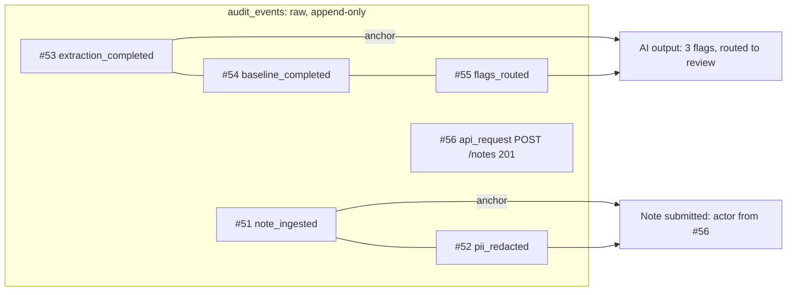

# 26 — Overview panels and audit log screen (Step 5.2b)

## 1. What was built

**Backend**

| File | Purpose |
|---|---|
| `app/api/overview.py` | `GET /overview` (`review.queue.read`): one summary for every panel of `Main.dc.html`. It returns review counts and the top four notes in queue order, flags by category over 7 days (rejected flags excluded), and pipeline health over 7 days (schema-valid rate, grounded rate, median latency via `percentile_cont`, model). It also returns the latest saved rota (preset, visits, served, unassigned, carers used, travel, continuity, **greedy baseline**, first unassigned visit) and the workforce summary (elevated count, first support-priority carer with a provider-side factor). The notes and the carer it shows are audited (`review_queue_viewed`, `workforce_risk_viewed`, both with `"view": "overview"`) |
| `app/audit/timeline.py` | A **read-only projection** of the append-only log. It groups raw rows into one entry per meaningful event: *note submitted*, *AI output*, *human decision*, *schedule run*, *access denied*, *security alert*. Each entry has an actor, subject, version, result and detail tiles, and lists the ids of the raw rows it was built from. Uses keyset pagination on each entry's anchor row, filters by kind, and searches client ref, note id, username, display name, run id and carer id (wildcards escaped) |
| `app/api/audit.py` | `GET /audit` (timeline), `GET /audit/summary` (today's tiles in Europe/London time), `GET /audit/export` (the filtered timeline as CSV, at most 5000 entries, with spreadsheet-formula cells neutralised). The existing `GET /audit/{note_id}` is unchanged |
| `app/matching/service.py`, `presets.py` | Each solve also runs the greedy baseline on the same day and matrix and stores `metrics.baseline` and `metrics.carers_used`. Presets name the continuity weights: Travel 0, Balanced 15, Continuity 45 (changed to 30 in Step 5.3: 45 is dominated in the sweep, ADR-033), otherwise Custom |
| `app/workforce/service.py`, `app/api/workforce.py` | `band` on every risk item and explanation: **elevated** = top 20 % (the support-priority group), **moderate** = above the team's average risk, **low** = the rest |
| `app/api/review.py` | `queue_items()` extracted, so the overview and the queue sort notes identically |
| Tests | `test_overview_api.py` (10), `test_audit_timeline.py` (18), RBAC matrix +4 routes, schedule metrics updated |

**Frontend**, rebuilt from `Main.dc.html` and `Audit.dc.html`:

| Piece | Design element |
|---|---|
| `overview/panels.tsx` | Today at a glance (4 linked tiles), Needs attention, Flags by category (CSS bars, read out as "Falls: 9"), Today's schedule (preset pill, travel and continuity with "−3.1 h vs greedy baseline"), AI pipeline health ("llama3.1:8b · local") |
| `overview/attention.ts` | Pure, unit-tested row builder: high notes → one unassigned visit → other notes → one supportive check-in |
| `pages/AuditPage.tsx`, `audit/AuditTable.tsx` | Title with the **Append-only** and demo badges, Export CSV, four "Today" tiles, debounced search, five filter pills (`aria-pressed`), a table with expandable rows (detail tiles plus the raw row ids), "Load older entries" |
| States | Overview: the States sheet's loading skeleton, plus an error state with retry and request reference. Audit: skeleton rows, an empty message, and an error state. A carer gets the access-denied page, recorded after the server's 403 (the probe is now `GET /audit/summary`) |

Tests: Python **395**, web **55**. Smoke test on the dev database: `/overview`, `/audit`, `/audit/summary` and `/audit/export` return the expected copy for the notes, decisions, denials and rota already stored. A page of 200 entries takes about 35 ms.

## 2. Why this way

**One overview request, not five.** The panels need data from four tables and the workforce model. Five browser requests would mean five loading states, five audit rows and five chances for the numbers to disagree mid-refresh. One endpoint returns a consistent snapshot. Each section reuses the code its own screen uses: `queue_items()` is shared with the review queue, so "Flags awaiting review: 6" always matches the queue. Sections the role can't read come back as `null`, not 403, so the page degrades rather than fails.

**The overview's disclosures are audited too.** "Needs attention" quotes evidence from notes, and "Support check-in suggested · WF-0461" names a carer from a profiling model. The review queue and the risk list already audit exactly what they display. The overview is just another window onto the same data, so it writes the same events. Otherwise the cheapest way to see a carer's risk would be the one path that leaves no trace.

**"vs greedy baseline", not "vs manual".** The design compares against a "manual" rota. There isn't one, and inventing a number would be exactly the dishonesty CLAUDE.md rules out. The Tier 2 greedy heuristic is the documented stand-in for what a coordinator might do by hand (note 14). It now runs on the same day and travel matrix as every solve (cheap: milliseconds), so the comparison is real, reproducible and stored with the run. Runs saved earlier have no baseline, and the line is hidden rather than estimated.

**Relative risk bands.** The scores come from a model trained on synthetic data. A fixed cut-off ("elevated ≥ 0.5") would imply a calibration we can't claim for real carers. Bands tied to the existing support-priority rule (top 20 %, from the model card) and to the team average keep one definition of "elevated" across the API, the overview tile and the workforce screen.

**A projection over the log, not a second log.** The append-only table is the evidence. It stays fine-grained, because an investigator needs the individual rows: which hash, which prompt, which request. A person scanning the day needs "Hannah K. approved and escalated CL-0142". `timeline.py` derives the second from the first at read time. It writes nothing, copies nothing, and every entry lists its source row ids (shown in the expanded row and in the CSV). That also keeps one source of truth: if the copy is wrong, fix the projection and every past entry is corrected, with no migration of audit data, which would be impossible anyway since the table rejects updates.

**What is and isn't shown.** Successful requests and "viewed" rows are data-access records. They're kept, counted in "Entries today" and listed per note by `GET /audit/{note_id}`, but they'd drown the decision timeline (every page load writes one). Denied requests *are* shown: refusals by role are the interesting access events. The rules baseline is a comparison output, not a decision, so it isn't shown either.

**Copy on the server.** Result strings ("3 flags · routed to review") are built in Python. The CSV export needs the same words, and one implementation means the screen and the export can't disagree. The web client only lays the strings out.

**CSV export is fetched, not linked.** Tokens are in memory (ADR-027), so a plain `<a href>` can't authenticate. The page fetches the file with the bearer token and hands the blob to the browser. Exporting is itself an audited read. Cells starting with a formula trigger are prefixed with `'` (OWASP CSV Injection): actor names and search-derived subjects are user-influenced, and an export is exactly the file someone opens in Excel.

**A disclosure row, not Collapsible.** DESIGN.md maps the expandable row to shadcn's Collapsible, but its root renders a `
`, and a `
` can't wrap two table rows. The row uses the WAI-ARIA disclosure pattern directly (a button with `aria-expanded` and `aria-controls`), which is what Collapsible implements. The category bars are CSS, not Recharts: the design draws them as plain bars, and an accessible list costs no chart library.

## 3. Alternatives considered

| Option | Pros | Cons | When I'd choose it |
|---|---|---|---|
| One `/overview` endpoint (chosen) | Consistent snapshot, one loading state, one place to audit | A slow section slows all; one larger response | A dashboard whose panels are read together |
| Panels call existing endpoints | No new API surface | 5 requests and 5 audit rows; the queue endpoint returns full note text just to count | Panels loaded independently or lazily |
| Materialised summary table, refreshed by events | Constant-time reads at scale | A second copy of state to keep correct; staleness | Thousands of notes a day, many viewers |
| Timeline as a read-time projection (chosen) | Single source of truth; fix copy once; traceable to row ids | Grouping costs CPU per page; search needs joins | Prototype to medium volume |
| Write a "timeline" row alongside each action | Trivial reads | Two logs that can disagree; past rows can't be fixed | Never, for an evidence log |
| OFFSET pagination | Simple; jump to page N | Rows shift as the log grows (duplicates and gaps), and cost grows with depth | Small static tables |

## 4. How it works

**Grouping.** One `POST /notes` writes these rows, all sharing a request id:

Each entry kind has **anchor** event types (a row that starts an entry) and **companion** types (rows that complete it when they share the anchor's request id and note id). A decision request writes one `review_decision` per flag plus maybe `review_escalated`. Only the *first* decision in the request is an anchor, found in SQL with `NOT EXISTS (an earlier review_decision with the same request and note)`. Three queries then fetch everything a page needs: the companions (by request id and note id), the users (for names and roles) and the notes and runs (for client refs and "145 / 148 assigned").

**Keyset pagination.** The page query is `WHERE <is anchor> AND id < :before ORDER BY id DESC LIMIT n+1`. The extra row says whether there's another page, and `next_before` is the last anchor's id. Because the cursor is a position in an ever-growing, never-updated sequence, new rows arriving while you read only ever appear *above* page one. Older pages never shift, so you can't see an entry twice or miss one. OFFSET would shift by one for every new row. Paging over anchors (not raw rows) also means a page boundary can never split a group.

**Worked example (summary tile).** Today two notes were routed with high flags (`review_reasons` contains `high_severity`), and one was decided. The tile reads 1 / 2 = **50 %**. Routing-time severity is used because a reviewer may edit a flag down to medium, and that is still a high flag a person looked at.

**Median latency.** `percentile_cont(0.5) WITHIN GROUP (ORDER BY latency_ms)` interpolates between the two middle values. The median is used rather than the mean because LLM latency is right-skewed (a retry doubles one call's time).

## 5. Interview questions and answers

**Q1. Why build the audit screen as a projection rather than store display rows?**
The audit table is evidence, and evidence should have one source. If I wrote a "timeline row" next to every action, the two could disagree, and since the table is append-only I could never correct a wrong one. A read-time projection writes nothing: fix the grouping and every past entry displays correctly. Every entry lists its raw row ids, so an auditor can always go from the friendly line to the exact rows, hashes and prompt versions behind it.

**Q2. How does the pagination stay correct while new events are being written?**
It's keyset pagination: the client sends the id of the last entry it saw, and the server returns entries with smaller ids. Ids come from a sequence and rows are never updated or deleted, so the set below a cursor never changes. New rows only appear above page one. With OFFSET, every new row would push everything down one place, so the next page would repeat an entry. I also page over anchor rows, so a group of related rows can't be split across pages.

**Q3. Your overview compares the rota with a "greedy baseline". The design says "vs manual". Why change it?**
There is no manual rota in the prototype, and inventing a figure would be misleading in a portfolio meant to show honest evaluation. The greedy heuristic from Step 2.5 is the documented stand-in for hand scheduling. Running it on the same day and travel matrix makes the comparison like-for-like and reproducible. One caveat: greedy sometimes serves fewer visits, so its lower travel isn't a fair win. With PBL data I'd compare against their actual historical rotas, on travel per visit served.

**Q4. Is it a trade-off to return several sections from one endpoint?**
Yes. One endpoint gives a consistent snapshot, one loading state and one place to audit what was disclosed. But the slowest section sets the response time: the first call after start-up waits about 5 seconds while the workforce model trains. At scale I'd load the model at start-up (or from a signed artefact), and if one section stayed slow I'd split it out or cache it. Sections the role can't read come back as null, so the page degrades instead of failing.

**Q5. What's CSV injection, and why does an audit export need to care?**
If a cell starts with `=`, `+`, `-` or `@`, Excel may run it as a formula, which can exfiltrate data via hyperlinks or run commands through old DDE features. Audit exports contain user-influenced text (display names, subjects) and are exactly the files a manager opens in Excel. Following OWASP, cells starting with a trigger character, a control character or a full-width lookalike get a leading apostrophe. A test covers each trigger.

**Q6. Why audit the overview at all? It only shows summaries.**
It's not only summaries: it quotes evidence from up to four notes and names the top support-priority carer. The review queue and the risk list already record exactly what they show. If the overview didn't, it would be an unaudited path to the same personal data. "Every disclosure is recorded, whichever screen it's on" is the rule; the screen is irrelevant.

**Q7. What would you do differently with real PBL data and volume?**
Index `audit_events` on `(event_type, id)` and the JSON status field, or add an `entry_kind` column at write time so the anchor filter is a plain index scan. Move search to a proper index (trigram or full-text), and partition the log by month with a retention policy agreed in the DPIA. "Today" would follow the provider's real working day and patches, scoped by object-level authorisation, and the overview's "today's schedule" would be the rota dated today, not the latest saved run. I'd also replace the synthetic-only relative risk bands with thresholds validated on real outcomes, or keep them relative and say so on screen.

**Q8. Why relative risk bands rather than a probability threshold?**
A threshold like 0.5 implies the probability is well calibrated for real carers, which a model trained on synthetic data can't claim. "Top 20 %" is the support capacity the model card already defines, and "above the team average" is meaningful without calibration. The trade-off is that a relative band always labels someone as elevated, even in a team where everyone is fine, which is why the wording is supportive ("check-in"), never punitive.

## 6. Learn more

**Official documentation**
- [TanStack Query: Infinite Queries](https://tanstack.com/query/latest/docs/framework/react/guides/infinite-queries): `useInfiniteQuery`, `initialPageParam` and `getNextPageParam`, as used for "Load older entries".
- [PostgreSQL 16: Aggregate Functions](https://www.postgresql.org/docs/16/functions-aggregate.html): `percentile_cont ... WITHIN GROUP` (ordered-set aggregates), used for the median latency.
- [OWASP: CSV Injection](https://community.owasp.org/attacks/CSV_Injection): the attack and the mitigations implemented in `_cell`.
- [WAI-ARIA APG: Disclosure (Show/Hide) Pattern](https://www.w3.org/WAI/ARIA/apg/patterns/disclosure/): the `aria-expanded` / `aria-controls` button pattern used for the expandable rows.
- Reading: [Markus Winand, "We need tool support for keyset pagination"](https://use-the-index-luke.com/no-offset): why OFFSET is slow and unstable, and how seek pagination works.

**Videos**
- *The Hidden Dangers of SQL OFFSET: Pagination Woes Explained*: https://www.youtube.com/watch?v=LFjtgFPQ734. About 6 minutes on why OFFSET degrades and how the seek method fixes it. The title is verified on YouTube; the channel name could not be confirmed from the page (a mirror lists it as "Th30z Code").
- Greg Young's *CQRS and Event Sourcing* talk (Code on the Beach 2014) is the classic explanation of projections over an append-only log. I could not verify a YouTube URL. Search YouTube for "Greg Young CQRS and Event Sourcing Code on the Beach 2014". A verified transcript is at https://kurrentdb.kurrent.io/blog/transcript-of-greg-youngs-talk-at-code-on-the-beach-2014-cqrs-and-event-sourcing

## 7. Check your understanding

In `tests/test_audit_timeline.py::test_keyset_pages_never_repeat_or_skip`, add a note **between** fetching page 1 and page 2 (call `post_note` inside the loop after the first page). Predict: does the walk over pages still equal the original `everything` list?

**Expected outcome:** yes. The new note's two entries have ids larger than every cursor, so they never appear in pages fetched with `before=<cursor>`. The walk returns exactly the 6 original entries in the same order. Now change `timeline_page` to page by `OFFSET` (replace `id < before` with `.offset(n)`) and rerun: the second page repeats two entries, the bug keyset pagination prevents.
