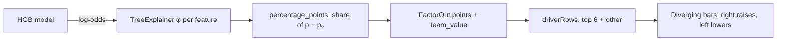

# 28 — Workforce risk screen (Step 5.4)

## 1. What was built

| File | What it does |
|---|---|
| `app/workforce/explain.py` | `percentage_points()` turns SHAP log-odds into percentage points that add up exactly from the baseline to the score; `format_value()` shared formatting; `Reason.points` |
| `app/workforce/service.py` | `team_values()`: team median per feature (share "yes" for yes/no features), computed once when the model is built |
| `app/api/workforce.py` | `FactorOut` gains `points` and `team_value` on both workforce endpoints |
| `web/src/workforce/api.ts` | `useRiskList()` (whole workforce, 200), `useExplanation(ref)` (404 → `null`) |
| `web/src/workforce/model.ts` | Pure view logic: band labels, `signedPoints`, `driverRows` (top 6 + "N other factors"), `barWidth`, key signals, `supportActions`, `profileLine` |
| `web/src/workforce/panels.tsx` | Risk list, carer header with the risk tile, key-signal tiles, the custom diverging SHAP bar chart, supportive actions, use notice, model-card panel |
| `web/src/pages/WorkforcePage.tsx` | `/workforce/:carerId`; `/workforce` redirects to the highest-ranked carer |
| `web/src/pages/LazyPages.tsx` | Replaces `LazySchedulePage.tsx`; the workforce screen is also loaded on first visit |
| `web/src/index.css` | Tokens `--shap-up`, `--shap-down`, `--elevated-strong` |
| Removed | `PendingPage.tsx`, `PendingStep.tsx`: no stand-ins remain in the dashboard |
| Tests | `test_percentage_points_*` (4 cases), an API test that points add up and team values are present, `model.test.ts` (5), `WorkforcePage.test.tsx` (10) |

## 2. Why this way

- **Percentage points, not log-odds, on screen.** The design shows "+14" against "Team baseline 43% → Joy 68%". A coordinator reads percentages; "+0.29 log-odds" means nothing to them. But SHAP for a tree classifier is additive in log-odds, not in probability, so converting each factor on its own would leave the rows not adding up to the score. I rescale proportionally: each factor gets its share of the probability gap in proportion to its log-odds. The rows then add up exactly, keep their signs and keep their order. This is done on the server, so every client shows the same numbers.
- **Team median instead of a 4-week trend.** The design's "+18% over 4 weeks" needs history; the synthetic workforce is one snapshot. Comparing with the team median is honest and still answers "is this unusual?". A median, not a mean, so a few very long rounds don't decide what "typical" is.
- **Supportive framing built into the structure, not only the wording.**
  - Actions come only from `suggested_support`, which the API already limits to factors the provider can change that add at least about 2 points. Tenure, for example, never becomes an action, because "be here longer" is not something a coordinator can offer.
  - The check-in card appears only for the Elevated band (the top 20%, as in the model card), worded as "about workload, not a performance review".
  - The use notice sits on every carer page, and the label and age band are never sent.
- **Carers are refs, not names.** As on the schedule screen, the synthetic data has no carer names, and inventing them would add realistic-looking personal data for no purpose. The avatar is an icon, not initials.
- **No "Plan" buttons.** The design's "Plan" buttons need a planning or task backend that doesn't exist; a button that does nothing is worse than none. "Open in schedule" appears only for factors set by the rota (driving, round size, familiar clients, gaps, split shifts) and only for roles that can read the schedule. Recorded in the backlog.
- **The model card is a panel, not a link.** It shows the served model's name, version, training data, use notice and caveats from the API, so it can't drift from what's running. The full card is in the repo.
- **Small factors folded.** Twelve features would make a long chart of near-zero bars. The six largest are shown, and the rest are summed into one row so the chart still adds up.

## 3. Alternatives considered

| Option | Pros | Cons | When I'd choose it |
|---|---|---|---|
| Show raw log-odds SHAP | Exact SHAP values; no transformation to defend | Unreadable for coordinators; "+0.2" looks negligible next to a 68% score | A data-science audience (the 3.3 waterfall plot does this) |
| Per-factor probability change, sigmoid(base + φ) − sigmoid(base) | Each number means "this factor alone, from the baseline" | Rows don't add up to the score; it depends on where you start | A "what if only this changed" view |
| Sequential attribution (add factors one at a time in order) | Adds up exactly | Order-dependent: the same carer gets different numbers if the order changes, which is the problem Shapley values exist to avoid | Rarely |
| **Proportional rescaling (chosen)** | Adds up exactly; keeps signs and ranking; one line of maths | Splits the non-linear part of the sigmoid in proportion, which is a convention, not a unique answer | Showing SHAP to non-specialists |
| Explain the probability directly (SHAP on `predict_proba`) | Natively additive in probability | Needs the interventional mode, which doesn't add up for HGB in shap 0.54.1 (ADR-022); much slower | If that bug is fixed |

## 4. How it works

**Why log-odds don't add in probability.** The model outputs log-odds z. TreeExplainer splits z exactly:
z = base + φ₁ + … + φₙ. Probability is p = σ(z) = 1 / (1 + e^(−z)), which is a curve, so equal steps in z are not equal steps in p. Near p = 0.5 the curve is steep (one log-odds unit ≈ 25 points); near p = 0.05 it is flat (≈ 5 points).

**Proportional rescaling.** Let p₀ = σ(base), p = σ(base + Σφ) and Δ = p − p₀. Give factor j:

  ppⱼ = 100 · Δ · φⱼ / Σφ

Σ ppⱼ = 100 · Δ exactly. Because σ is increasing, Δ and Σφ have the same sign, so ppⱼ has the sign of φⱼ. If Σφ ≈ 0 (factors cancel), Δ ≈ 0 too, and the code uses the local slope p₀(1 − p₀)·φⱼ instead of dividing by zero.

**Worked example: WF-0461.** base gives p₀ = 28.2%, and the score is p = 80.4%, so Δ = 52.2 points. The log-odds total is about 2.35. Short-notice changes have φ = 1.433, so pp = 52.2 × 1.433 / 2.35 ≈ +31.9. Driving has φ = 0.197, giving ≈ +4.4. The 12 rows add up to 52.2.

**The diverging bar chart.** It is a three-column CSS grid: label | left half | right half, with the zero line as the border between the halves. A positive row draws an orange bar from the line to the right; a negative row draws a blue bar to the left. Lengths are relative to the largest bar, which fills 90%. No chart library is used: it's twelve rectangles, and a custom grid keeps it accessible.
- **Accessibility:**
  - Each row is a `<li>` whose label includes visually hidden text such as ", raises risk by 32 points", so screen readers don't depend on colour or bar length.
  - The visible bars and numbers are `aria-hidden` to avoid reading them twice.
  - The legend pairs each colour with text, as DESIGN.md requires.
- **The model card toggle** follows the WAI-ARIA disclosure pattern: a button with `aria-expanded` and `aria-controls`.

## 5. Interview questions and answers

**Q1. SHAP values are in log-odds. How do you show them as percentages without lying?**
SHAP for a tree classifier is exact in log-odds, but probability is a sigmoid of log-odds, so per-feature contributions don't translate one-to-one. I split the actual probability gap between the baseline and the carer's score in proportion to each feature's log-odds. That keeps every sign, keeps the ranking and adds up exactly to the score, so the chart is internally consistent. It is a presentation convention, so the footnote says the numbers describe the model, and the log-odds stay in the API for anyone who needs the exact values.

**Q2. Why compare with the team median rather than show the design's 4-week trends?**
The synthetic workforce is a single snapshot, so a trend would have to be invented, and inventing numbers on a screen about real people's jobs is the wrong habit. The team median answers the same question, "is this unusual?", from data we actually have. With real PBL data I'd store weekly feature snapshots and show both: the trend says whether things are getting worse, and the comparison says whether they're out of line.

**Q3. How does this screen stop the model being used punitively?**
The rule is enforced in several layers, not just in wording. The API sends only actions for factors the provider can change, never the label or the age band, and it audits every view. The UI phrases every action as support ("Give more rota notice"), offers a check-in only for the top-20% support group, and shows the use notice on every page. The rule underneath is in the model card. It still relies on policy and training: a determined manager could misuse any score, which is why the audit log records who looked at whom.

**Q4. Why build the SHAP chart yourself instead of using Recharts?**
It's twelve rectangles on a zero line; a chart library adds bundle weight and makes the accessible structure harder to control. With a grid of list items, each row carries a text version of its value, the colours always have text alongside them, and the layout scrolls horizontally on phones instead of squashing. Recharts earns its place on the trade-off curve, which needs real axes and scales.

**Q5. What would change with real PBL data and at scale?**
- Carer names would appear, behind least-privilege scoping (a coordinator sees their own patch).
- Every view stays audited, and the carer could see their own explanation (a backlog item).
- Feature history would replace the snapshot.
- The model would be trained on real leaver records, with the drift and fairness checks re-run.
- Before any of this goes live, the provider would run a DPIA and consult staff, because the ICO's monitoring-workers guidance expects transparency and a DPIA for high-risk monitoring.
- For thousands of carers, the list would page and filter by band and patch instead of loading everyone.

**Q6. Trade-off: why load all 200 carers in one request?**
At this size one request is simpler and makes the list instant to scroll; paging 200 rows would add code and round trips for no visible gain. The cost is that the audit event for that view lists 200 carer refs, which is accurate (they were all shown) but large. At real scale I'd page by band and patch, which also shrinks what each coordinator sees, a data-minimisation gain.

**Q7. Why lazy-load a screen that's only 16 kB?**
After this step, the initial bundle went to 508 kB, just over Vite's 500 kB warning. Workforce is visited rarely and only by managers and coordinators, so splitting it off brought the first load back to 492 kB at no cost. The rule I use: split by route when a screen is heavy or rarely used, not everywhere, because each split adds a loading state.

## 6. Learn more

**Official documentation**
- SHAP, [An introduction to explainable AI with Shapley values](https://shap.readthedocs.io/en/latest/example_notebooks/overviews/An%20introduction%20to%20explainable%20AI%20with%20Shapley%20values.html): includes explaining a logistic model in probability vs log-odds ("explaining the probability of a linear logistic regression model is not linear in the inputs"), the reason the conversion here is needed.
- W3C WAI-ARIA APG, [Disclosure (Show/Hide) Pattern](https://www.w3.org/WAI/ARIA/apg/patterns/disclosure/): `aria-expanded` and the optional `aria-controls`, used by the Model card button.
- React, [`lazy`](https://react.dev/reference/react/lazy): deferring a component's code until first render, with a `Suspense` fallback.
- ICO, [Employment practices and data protection: monitoring workers](https://ico.org.uk/for-organisations/uk-gdpr-guidance-and-resources/employment/monitoring-workers/): the UK guidance a real deployment of workforce risk scoring would have to meet (lawful basis, transparency, DPIAs).

**Videos**
- I couldn't verify a SHAP video from an established channel this session (the ones found were from small or unidentified channels). Search YouTube for **"Scott Lundberg SHAP talk"** (the SHAP author) or **"PyData Shapley values explainability"**.

## 7. Check your understanding

`DRIVER_ROWS` in `web/src/workforce/model.ts` is 6. Change it to 3 and predict what `driverRows` returns for the test fixture (factors +31.9, +6.4, +4.4, +4.4, +3.7, −2.4, +0.6, 0.0), and whether the "rows add up" assertion in `model.test.ts` still passes.

**Expected outcome:** three factor rows (+31.9, +6.4 and the first +4.4, since sorting is stable), then "5 other factors" with points 4.4 + 3.7 − 2.4 + 0.6 + 0 = **+6.3**. The sum still matches (the fold keeps the total), but the test that lists the row keys and expects "2 other factors" fails. Revert afterwards.
