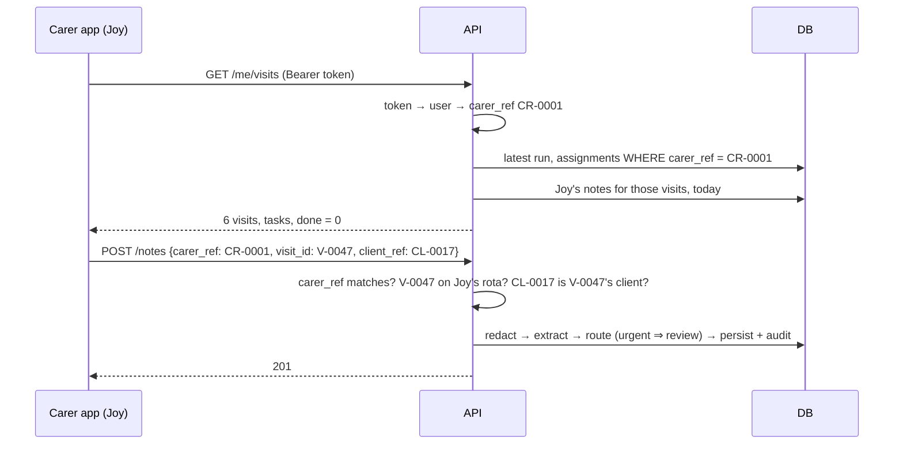

# 29 — Carer app API and object-level authorisation (Step 5.6a)

## 1. What was built

| File | What it does |
|---|---|
| `app/api/me.py` | `GET /me/visits` (the signed-in carer's day: visits in order, tasks, timing, familiarity, place, whether a note was sent) and `GET /me/visits/{visit_id}` (one visit plus the client's last 3 notes, redacted, audited as `client_notes_viewed`) |
| `app/matching/rota.py` | `carer_day()`: a carer's assignments in the latest run, joined to the sample day's visit details; `TASKS` turns required skills into carer-facing tasks |
| `app/matching/runs.py` | `latest_run()`, `sample_scenario()`, `sample_for()`, moved out of the schedule router so both APIs share them |
| `app/api/notes.py` | `_check_carer_owns()`: a carer may only submit a note as themselves, for a visit (and its client) on their own current rota |
| `app/auth/models.py`, `permissions.py` | `users.carer_ref` links a carer login to its scheduling identity; new permission `visits.read.own`, carers only |
| `app/nlp/schemas.py`, `models.py`, `pipeline.py` | `CareNote` gains optional `visit_id`, `urgent` and `tasks_done`. An urgent note always needs review. |
| `app/api/review.py` | Urgent notes sort first and count as high priority. A flag-less urgent note can be acknowledged. |
| `app/audit/*` | Event `client_notes_viewed`; subject type `visit`, so the middleware records `/me/visits/{visit_id}` against the visit |
| `migrations/versions/0010_carer_app.py`, `0011_visit_subject.py` | The new columns and the extended CHECK constraints |
| `scripts/seed_demo.py` | Joy (`joy@demo.smartpbl`) is linked to `CR-0001` |
| `web/src/review/*` | The dashboard queue names "Urgent concern" (also when there are no flags) |
| Tests | `tests/test_me_api.py` (11), RBAC matrix rows for both routes, `queueTitle` test |

## 2. Why this way

- **`/me/...` instead of `/carers/{carer_ref}/visits`.** The carer's identity comes from the token, so there is no carer id in the URL to change. That removes the most common Broken Object Level Authorization (BOLA) bug, where one carer swaps an id to read another's data.
- **Ownership is checked against the object, not just the identity.** OWASP warns that comparing the session user's id with an id in the request is not enough on its own. So the note check also confirms that the visit is on this carer's current rota and that the note's client is that visit's client. A carer can't write a note for another carer's client, even with their own `carer_ref`.
- **404 for someone else's visit.** A 403 would confirm the visit exists. Returning 404 for both "not yours" and "doesn't exist" leaks nothing.
- **Need-to-know client notes.** A carer arriving at a visit benefits from a short handover ("knee pain on stairs"), which is also good care practice. They see only:
  - clients on today's rota;
  - the last 3 notes;
  - redacted text;
  - kept flags (rejected ones are hidden).

  Every read is audited with the note ids, like the review queue. This is UK GDPR data minimisation applied to a read path.
- **The urgent concern is a human-review trigger, not a model output.** Whatever the LLM and the rules find, a carer saying "this is urgent" puts the note at the top of the queue as high priority. A flag-less urgent note is acknowledged through the existing note-level decision, which is audited.
- **`users.carer_ref` is a nullable unique column, not a separate table.** One login acts as at most one carer, and staff accounts have none. A link table would only be needed if logins could represent several carers.
- **"Done" means a note was written today, by calendar day.** I first wrote "created after the run was saved", which compared the API's clock (run timestamps) with the database's transaction-start clock (note timestamps). That is the same class of bug as the `now()` issue in 5.3, so I compare by local day instead.

## 3. Alternatives considered

| Option | Pros | Cons | When I'd choose it |
|---|---|---|---|
| `/carers/{carer_ref}/visits` with a check | RESTful; also works for coordinators | Every handler must remember the check; one missed check is a BOLA bug | A multi-role resource |
| **`/me/...` from the token (chosen)** | No id to tamper with; the check is structural | Coordinators need a different route to see a carer's day | Self-service apps |
| Row-level security in Postgres | Enforced even if app code is wrong | Per-request DB role or session variables; harder to test and explain | Many services sharing one database |
| A policy engine (OPA, Cerbos) | Central, auditable rules | Another service to run for three rules | Large, changing policy sets |

## 4. How it works

**Worked example of the note check** (Joy is `CR-0001`; `V-0047` is her visit to `CL-0017`):

| Body | Result | Why |
|---|---|---|
| `CR-0001`, `V-0047`, `CL-0017` | 201 | Hers, on her rota, matching client |
| `CR-0002`, … | 403 "own notes" | Writing as another carer |
| `CR-0001`, `V-0019` (CR-0002's visit) | 403 "rota" | Not on her rota |
| `CR-0001`, `V-0047`, `CL-0999` | 403 "rota" | The visit's client is CL-0017 |
| `CR-0001`, no `visit_id` | 403 "rota" | Carer notes must name a visit |

**Tasks.** Visits carry required skills (`medication`, `catheter_care`, …). `TASKS` maps each one to a carer-facing label and hint, ordered so the tasks that must not be missed (medication, catheter) come first.

## 5. Interview questions and answers

**Q1. What is BOLA and how does this API prevent it?**
Broken Object Level Authorization is when an API checks *who* you are but not whether *this object* is yours: change `/carers/7/visits` to `/carers/8/visits` and you see someone else's data. It is first in the OWASP API Top 10 because it is easy to miss in one handler. Here the carer reads go through `/me`, which takes the identity from the token, and writes check the specific object: own `carer_ref`, a visit on their own rota, and that visit's client. Tests try each tampered field.

**Q2. Why 404 rather than 403 for another carer's visit?**
A 403 tells an attacker the visit exists and belongs to someone else, which is information. Returning 404 for "not yours" and "doesn't exist" alike gives nothing away. The audit middleware still records the attempt with the visit as its subject, so misuse is visible to us without being visible to the attacker.

**Q3. Carers can read other carers' notes about a client. Isn't that a privacy problem?**
It is a deliberate, bounded disclosure. A handover is part of safe care (a carer should know about yesterday's fall), but the access is limited to:
- clients on the carer's rota today;
- the last 3 notes;
- redacted text, with rejected flags hidden;
- an audit record of every read.

With real data I'd confirm the scope with PBL's Caldicott Guardian and DPIA, and possibly limit it to notes from the last 7 days.

**Q4. Why does the urgent switch bypass the model?**
The model can miss things, and the carer was there. A human-review trigger the carer controls is a safety net that doesn't depend on extraction quality; it also covers LLM outages. The cost is some urgent notes that turn out to be routine, which is the right trade for safety signals, as recall-first thinking in Tier 1 argued.

**Q5. What would change with real PBL data and at scale?**
- **Identity:** carer identity would come from the provider's HR or rostering system, not a seed script.
- **Rota:** "today's rota" would be a real dated rota, not "the latest run".
- **Locations:** they would come from the client record under its own access control, not the sample-scenario gate.
- **Offline:** the app would need offline note drafts and a sync queue, because homes often have poor signal.
- **Scale:** the queue sort and the "done" lookup would move into SQL, with an index on `(carer_ref, visit_id, created_at)`.

**Q6. Trade-off: why did you add columns to `care_notes` rather than a separate visit-notes table?**
A note is still one note, and the new fields describe it (which visit, urgent, tasks done). A separate table would need a join on every read, for no extra integrity. I made the fields optional so the Tier 1 datasets, evaluation and coordinator flow are unchanged. If tasks became a full medication record (eMAR), they would need their own table with per-dose rows.

## 6. Learn more

**Official documentation**
- OWASP, [API1:2023 Broken Object Level Authorization](https://api-security.owasp.org/editions/2023/en/0xa1-broken-object-level-authorization): the risk, and why comparing the session user's id with the request id alone is not a sufficient fix.
- FastAPI, [Sub-dependencies](https://fastapi.tiangolo.com/tutorial/dependencies/sub-dependencies/): how `_carer` builds on `require(...)`, and FastAPI's per-request dependency caching.
- ICO, [Principle (c): Data minimisation](https://ico.org.uk/for-organisations/uk-gdpr-guidance-and-resources/data-protection-principles/a-guide-to-the-data-protection-principles/data-minimisation/): the basis for limiting the handover to today's clients and three redacted notes.

**Videos**
- *API Security & the OWASP API Top 10 (#1 - BOLA/IDOR) - Part 1 of 4*, Traceable AI, https://www.youtube.com/watch?v=W5MeVrIuoLg: presented by Inon Shkedy, a co-author of the OWASP API Top 10, on the #1 risk. It's on a security vendor's channel, so expect some product framing. (Title and channel verified via YouTube oEmbed.)
- *APISEC CON: Mitigating APIs Broken Object Level Authorization (BOLA)*, Ade Oladele, APIsec University, https://www.youtube.com/watch?v=-gHVL6w-70A: where BOLA hides in real APIs and how to design it out. (Verified via oEmbed.)

## 7. Check your understanding

In `tests/test_me_api.py`, add a case to `test_carer_can_only_write_own_notes_for_own_visits` where Joy submits her own visit but with `"client_ref"` set to the client of her **second** visit. Predict the status and the detail before running it.

**Expected outcome:** 403 with "that visit isn't on your rota". The visit is hers, but its client is a different client from the one she sent, so the client check fails. This is exactly the "own id, someone else's object" case OWASP describes.
