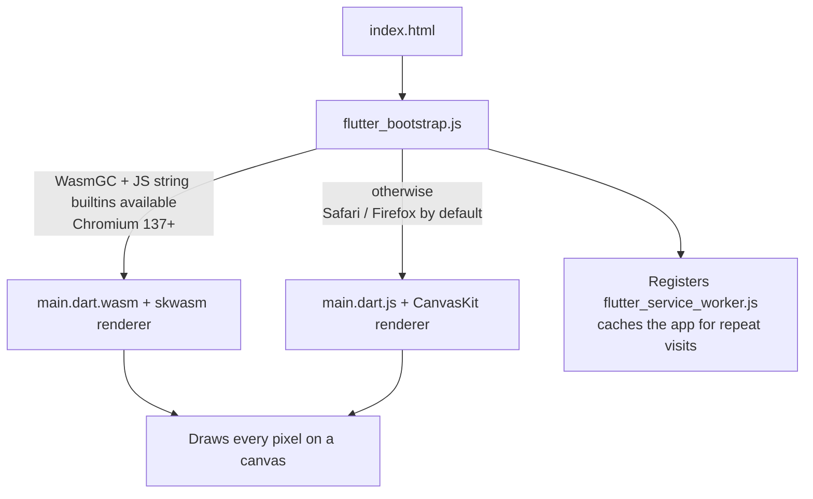

# 30 — Flutter carer app as a web PWA (Step 5.6b)

## 1. What was built

| File | What it does |
|---|---|
| `mobile/lib/app.dart` | `CarerApp` and the GoRouter routes `/login`, `/`, `/visit/:id`, `/visit/:id/note`, `/visit/:id/submitted`, with a redirect driven by the session |
| `mobile/lib/core/api.dart` | Dio plus `AuthInterceptor`: bearer token, **one shared refresh** for parallel 401s, one retry, and a failed refresh ends the session. `TokenStore` keeps tokens in memory. `ApiError` carries the server detail and a `req_…` reference. |
| `mobile/lib/core/repository.dart` | Every API call (sign in, me, sign out, `/me/visits`, `/me/visits/{id}`, `POST /notes`) behind one class that tests fake |
| `mobile/lib/core/providers.dart` | Riverpod: `authProvider` (refuses non-carers), `dayProvider`, `visitProvider` (family), `submissionProvider` |
| `mobile/lib/core/theme.dart`, `config.dart` | DESIGN.md tokens; `--dart-define=API_URL`; the Ofcom drama number for "Call office"; the demo account |
| `mobile/lib/auth/login_screen.dart` | CarerLogin.dc.html |
| `mobile/lib/visits/today_screen.dart` | Visits.dc.html: progress, next-visit card (Directions, Start visit), the rest of the day with done rows last, floating nav |
| `mobile/lib/visits/visit_detail_screen.dart` | VisitDetail.dc.html: tasks, agreed window, handover notes, Call office / Write care note |
| `mobile/lib/notes/note_screen.dart`, `submitted_screen.dart` | Note.dc.html (task toggles, text, urgent switch) and Submitted.dc.html |
| `mobile/lib/visits/models.dart`, `format.dart`, `widgets/common.dart` | Typed responses, pure display helpers, shared cards, pills and states |
| `mobile/web/manifest.json`, `index.html`, `icons/*`, `vercel.json` | PWA manifest (name, colours, icons generated from the design's "S" tile), COOP/COEP headers |
| `mobile/test/*` | 22 tests: formatting, interceptor (fake HTTP adapter), the full flow and an idempotent retry as widget tests, and real-font loading in `flutter_test_config.dart` |
| `.github/workflows/ci.yml` | A `mobile` job: format, analyze (infos fatal), test, `build web --wasm` |

## 2. Why this way

- **One codebase, web-first.** Carers already have phones; asking them to install an app from a store is friction, and a home-care provider may not manage devices. A PWA from `flutter build web --wasm` opens from a link and can be added to the home screen. The same code still builds for Android and iOS when PBL wants store apps.
- **A repository class behind providers.** Screens never touch Dio. Widget tests override `repositoryProvider` with `FakeRepository`, so they test real screens, real routing and real Riverpod state without a server. The interceptor is tested separately against a fake HTTP adapter.
- **A single-flight refresh, mirroring the dashboard.** Refresh tokens are single use with reuse detection (ADR-025). Two parallel 401s refreshing separately would look like token theft and end the session, so they share one future.
- **A plain `Interceptor`, not `QueuedInterceptor`.** The queued version serialises error handling. A retried request that also failed would queue behind the handler awaiting it, which is a deadlock.
- **Tokens in memory only (ADR-027).**
  - On the web, every storage option can be read by injected script, so memory is the safest place.
  - The cost is signing in again after a reload, acceptable for a demo.
  - A production PWA would need a short session plus a refresh cookie (`HttpOnly`, `SameSite=Strict`), or native keystores (backlog).
- **The next visit is "the first not written up", not "the next by clock".** The synthetic day's visits start at 07:00. Ordering by clock would make an afternoon demo look like everything was missed. The "in 25 min" text appears only when the visit really is later today.
- **Failure keeps the note, and retries are idempotent.**
  - If submitting fails, the text stays in the box and the message says so. Losing a carer's note to bad signal would be the worst failure for this app.
  - The note id is created once per note. If a response is lost and the carer taps again, the API answers 409 ("already exists") and the app treats that as sent, so a retry never creates a duplicate.
- **Departures from the design** (ADR-036):
  - Clients appear by ref with no area name, since the synthetic data has none.
  - The Rota and My notes tabs, the notifications bell, "Good to know" and "Familiar client · 14 visits" are left out, because there's no data or backend for them yet.
  - The demo badge replaces the bell, since DESIGN.md requires it on every screen.
  - "Call office" dials an Ofcom drama number.

## 3. Alternatives considered

| Option | Pros | Cons | When I'd choose it |
|---|---|---|---|
| **Flutter web PWA + native builds (chosen)** | One codebase for web, Android and iOS; uses my Flutter experience; looks the same everywhere | ~3 MB gzipped first load; canvas rendering instead of DOM, so weaker SEO and text selection | App-like tools for a known user group |
| A React mobile view in the dashboard | Shares code with the dashboard; ~150 kB load | Two UIs in one codebase; no native path; CLAUDE.md asks for Flutter | A thin mobile companion page |
| Native-only (store apps) | Best device integration, offline storage, keystore | Install and update friction; app-store review; MDM questions for care staff | When offline and push notifications are must-haves |
| Flutter web, JS only (no `--wasm`) | Works in every browser the same way | Slower rendering; the JS bundle plus CanvasKit is larger (~3.6 MB gzipped) | Targeting browsers without WasmGC |

## 4. How it works

**What the browser downloads.** `flutter build web --wasm` produces two builds, and `flutter_bootstrap.js` picks one at runtime:



Measured from this build (gzip -9, which approximates what a host sends):

| Path | Files | Gzipped |
|---|---|---|
| Wasm (Chrome, Edge) | `main.dart.wasm` 0.89 MB + `skwasm.wasm` 1.47 MB + JS glue | ≈ 2.4 MB + fonts |
| JS fallback | `main.dart.js` 0.78 MB + `canvaskit.wasm` 2.84 MB | ≈ 3.6 MB + fonts |
| React dashboard, for comparison | initial bundle | ≈ 0.15 MB |

Icon fonts are tree-shaken: Material Icons went from 1.6 MB to 7.7 kB, and Lucide from 980 kB to 5 kB. Inter is bundled (4 weights, 1.6 MB raw), so the app makes no request to Google Fonts.

**Multi-threading.** Skwasm can render on a separate thread, but only when the page is cross-origin isolated. That requires the response headers `Cross-Origin-Embedder-Policy: credentialless` (or `require-corp`) and `Cross-Origin-Opener-Policy: same-origin`, which `mobile/web/vercel.json` sets. Without them the app still works, single-threaded.

**PWA basics.**
- **The manifest** (`manifest.json`) gives the name, `start_url`, colours, `display: standalone` and 192/512 px icons, including maskable ones. With these the browser can offer "Add to Home Screen".
- **The service worker** (`flutter_service_worker.js`) is a script the browser runs between the page and the network. Flutter's version caches the app files on first load, so the second open is fast.
- **What it does not cache:** API data. The app needs a connection to load visits or send a note. Offline drafts are in the backlog.

**Routing.** Flutter web's default URL strategy is the hash (`/#/visit/V-0047`). The server only ever serves `index.html`, so a refresh or deep link needs no rewrite rule. That is simpler to host than the dashboard, which needs one.

**The note flow, end to end** (verified in headless Chrome against the local API):

```mermaid
sequenceDiagram
  participant J as Joy (PWA)
  participant API
  J->>API: POST /auth/token (form) → tokens in memory
  J->>API: GET /auth/me → role carer ✓
  J->>API: GET /me/visits → 6 visits, 0 done
  J->>API: GET /me/visits/V-0047 (audited handover)
  J->>API: POST /notes {visit_id, client_ref, carer_ref, tasks_done, urgent}
  API-->>J: 201 → Submitted screen; dayProvider invalidated
  J->>API: GET /me/visits → 1 done, row shows "Note sent for review"
```

## 5. Interview questions and answers

**Q1. Why Flutter for the carer app when the dashboard is React?**
They serve different users with different constraints. Coordinators work on laptops with dense tables, where React and the DOM are the best fit. Carers need a phone-first app that could become a store app with offline support, and Flutter gives web, Android and iOS from one Dart codebase. Both talk to the same typed API, so the backend doesn't care which client it serves.

**Q2. What does `--wasm` change, and what is the fallback?**
It compiles Dart to WebAssembly with garbage collection (WasmGC) and uses the skwasm renderer, which is faster and can render off the main thread. The same build also contains a JavaScript + CanvasKit version. `flutter_bootstrap.js` checks at runtime whether the browser has WasmGC and the other required features, and falls back to JS if not; Safari and Firefox fall back by default. Users never see a broken page, just a slower renderer.

**Q3. The first load is about 3 MB. Is that acceptable?**
For this app, yes, with mitigations:
- It's a work tool used daily by the same people, and the service worker caches it after the first visit.
- A marketing site or a one-off form would be the wrong use of Flutter web; I'd use React or plain HTML there.
- To reduce it further, I'd defer screens with deferred imports, check that the host compresses `.wasm`, and preload the renderer.

I measured the sizes rather than guessing, which is the habit I'd bring to PBL.

**Q4. How does token refresh work with parallel requests?**
The interceptor holds a single `Future<bool>` for an in-flight refresh. Every request that gets a 401 awaits the same future, then retries once with the new token. A failed refresh clears the tokens and emits `sessionEnded`, and the router sends the user to sign-in. I avoided `QueuedInterceptor` because a retry that fails would wait behind the handler awaiting it. The interceptor test runs two parallel requests and asserts exactly one refresh call.

**Q5. What would change with real PBL data and at scale?**
- **Offline first:** local storage of the day's rota and draft notes, then a sync queue. Submits are already idempotent: one client-generated id per note, and a 409 on retry means "saved".
- **Notifications:** push for rota changes.
- **Device security:** managed devices, or at least a short session and a PIN.
- **Accessibility:** testing with real carers, including those with English as a second language, and a larger text size option.
- **Monitoring:** client-side error reporting, with request ids already in error messages.

**Q6. Trade-off: why test with a fake repository instead of mocking Dio in widget tests?**
Faking at the repository boundary tests what matters on screen: what's shown, what's sent, where navigation goes. It doesn't couple widget tests to URL strings or JSON details. Dio itself is tested once, in the interceptor tests, against a fake HTTP adapter. The contract between app and API is still checked: the backend's tests use the same JSON shapes, and the full flow was run once against the real local API.

**Q7. How do you know the screens match the designs?**
- The widget tests check content, order and behaviour at the designs' 390×844 phone size, with the real Inter font loaded. The default test font draws every glyph as a square, which makes layouts wrap wrongly.
- I also drove the release build in headless Chrome and compared screenshots with the `.dc.html` files. That found two real issues: the greeting wrapped next to the badge, and "Call office" wrapped in its button.

## 6. Learn more

**Official documentation**
- Flutter, [Support for WebAssembly (Wasm)](https://docs.flutter.dev/platform-integration/web/wasm): the COOP/COEP headers for multi-threading, browser requirements, and the automatic fallback to `dart2js` + CanvasKit.
- Flutter, [Configuring the URL strategy on the web](https://docs.flutter.dev/ui/navigation/url-strategies): hash URLs are the default, which is why the carer app needs no rewrite rule.
- web.dev, [Add a web app manifest](https://web.dev/articles/add-manifest): the fields that make a site installable (name, start_url, 192/512 icons).
- MDN, [Service Worker API](https://developer.mozilla.org/en-US/docs/Web/API/Service_Worker_API): the worker that sits between page and network, its lifecycle, and why it needs HTTPS.

**Videos**
- *Learn how Flutter enhances web apps*, Flutter (official channel), https://www.youtube.com/watch?v=kCnYRhkfWHY: the Flutter team on where Flutter web fits. (Title and channel verified via YouTube oEmbed.)
- *Flutter web superfast: WASM*, Renan Araujo, Flutter & Friends conference, https://www.youtube.com/watch?v=85SKTuHn61g: what the Wasm build changes and why it's faster. (Verified via oEmbed.)

## 7. Check your understanding

In `mobile/lib/core/api.dart`, temporarily change `_refreshOnce()` to call `_refresh()` directly, with no shared future. Predict what `test/api_test.dart` "parallel 401s share one refresh" reports, and what would happen against the real API.

**Expected outcome:** the test fails, finding **2** `POST /auth/refresh` calls instead of 1. Against the real API, the second refresh would present an already-rotated token. Reuse detection (ADR-025) would then revoke the whole token family, and Joy would be signed out mid-shift. Revert afterwards.
