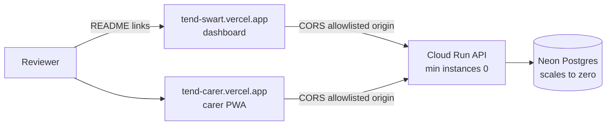

# 31 — Demo access (Step 5.7)

## 1. What was built

| File | What it does |
|---|---|
| `README.md` | **Try the demo**: the two live links (coordinator dashboard, carer app), the demo account for each role, a three-step walkthrough, and what to expect (cold starts, no cloud LLM, synthetic data). Also a **Tier 5** section (architecture diagram, screens, engineering points, limitations), the Tier 5 status tick and the `web/` and `mobile/` folders in the layout. |
| Dashboard sign-in (`web/src/pages/LoginPage.tsx`, from 5.1) | Already met 5.7: a "Carer app" link (from `VITE_CARER_APP_URL`) and a Demo accounts card listing all three roles. Only the URL needed setting in Vercel. |
| Carer sign-in (`mobile/lib/auth/login_screen.dart`, from 5.6b) | Pre-filled with Joy's account and a "Demo carer account" card, as the design shows. |

The hosting itself was done by the user (Step 5.5): Vercel for both frontends, Cloud Run for the API, Neon for Postgres (`docs/DEPLOYMENT.md`).

## 2. Why this way

- **Links to production domains, never deployment URLs.** Each Vercel deploy gets its own generated URL (`tend-carer-awax01na7-…vercel.app`). With Standard Protection those URLs need a Vercel login, while the production domain (`tend-carer.vercel.app`) is public and stays the same across deploys. The first link the user shared redirected (302) to a login page for exactly this reason. The same stable domain is what goes into the API's CORS list.
- **Public demo passwords, deliberately bounded.**
  - Reviewers need to sign in without asking anyone, so the credentials are printed on the sign-in screens and in the README.
  - The risk is contained: the accounts exist only where `seed_demo` was allowed to run (`local` or `demo`), the data is synthetic, and login is rate-limited per username.
  - Every action is still audited under the demo user's name.
- **Say what the demo can't do.** The README states that the hosted API has no LLM and that the first request is slow. A reviewer who submits a note and sees "extraction failed" in the queue then reads it as a documented limitation, not a bug, which matters more in an interview than hiding it.
- **A scripted three-step walkthrough** (optimise as coordinator, write an urgent note as carer, review and audit as coordinator). It crosses both apps and every tier in under three minutes, and it feeds the Tier 6 demo script.

## 3. Alternatives considered

| Option | Pros | Cons | When I'd choose it |
|---|---|---|---|
| **Public demo accounts on a live stack (chosen)** | Real API, real audit trail, both apps; nothing to install | Cold starts; no cloud LLM; public passwords | Portfolio demos with synthetic data |
| Static "demo mode" with precomputed JSON (no API) | Instant, free, no backend to keep running | Not the real system: no audit, no auth, nothing persists | When hosting a backend isn't possible |
| Invite-only accounts | No public credentials | Reviewers must ask first; friction kills demos | Real or sensitive data |
| A recorded video only | Always works, shows the LLM | Not interactive; can't be probed | Alongside a live demo (Tier 6.4) |

## 4. How it works

**The cold-start path.**
- **No traffic:** Cloud Run runs no container (`--min-instances=0`) and Neon suspends the database.
- **The first request** starts a container (a few seconds), then opens a connection that wakes Neon (about 1–3 s). The first workforce request also trains the model (about 5 s).
- **Later requests** are fast until things go idle again.
- **Removing the wait:** `--min-instances=1` keeps one container warm, at the cost of paying for it around the clock. Cloud Run's documentation describes min instances as the way to "avoid slow container start times".

**Two origins, one API.** The browser sends an `Origin` header with each cross-site request. The API answers with `Access-Control-Allow-Origin` only for origins on `SMARTPBL_CORS_ORIGINS`, so each frontend's production domain must be listed exactly. When I checked, the carer domain wasn't listed yet: the preflight returned 400 until the user added it.

## 5. Interview questions and answers

**Q1. Your demo has passwords in the README. Isn't that a security problem?**
It's a deliberate, bounded exposure:
- The data is synthetic.
- The accounts can only be created in `local` or `demo` environments, because the seed script refuses anywhere else.
- Login is rate-limited per username.
- Every action is audited.

The production design differs: no seeded accounts, SSO or invited users, and the start-up checks refuse dev secrets. The point of the demo is that a reviewer can try it in ten seconds.

**Q2. Why is the first request slow, and would you fix it?**
Both the API (Cloud Run) and the database (Neon) scale to zero when idle, so the first request pays for starting a container and waking the database. For a portfolio, paying nothing between demos is the right trade, and I warm it up before an interview. For PBL in production I'd keep at least one instance warm during working hours, which costs a little but removes the wait for carers starting a shift.

**Q3. What does a reviewer not see in the hosted demo?**
The LLM extraction. It runs on my laptop through Ollama, because local inference keeps care notes on our own hardware, which is part of the data-protection design. The hosted demo shows flags that were produced locally on the same synthetic notes. New notes submitted there are saved and routed to review without AI flags. A real deployment would run the model on a GPU server inside PBL's own network, still not with a third-party API.

**Q4. What would change at scale or with real data?**
- **No public accounts:** SSO through PBL's identity provider, and short sessions.
- **Separate environments:** staging and production, each with its own database, secrets and CORS origins.
- **Warm capacity** during working hours, plus uptime monitoring.
- **A real DPIA** before any real data, and the deployment region pinned to the UK.
- **A private demo:** behind Vercel's protection or an allowlist, not public links.

## 6. Learn more

**Official documentation**
- Vercel, [Deployment Protection](https://vercel.com/docs/deployment-protection): Standard Protection covers every URL except production domains, which is why the generated deployment URL needed a login.
- Google Cloud, [Minimum instances for services](https://docs.cloud.google.com/run/docs/configuring/min-instances): keeping instances warm to "avoid slow container start times", and how idle instances are billed.

**Videos**
- I couldn't verify a suitable video for this step. Search YouTube for **"Cloud Run cold starts min instances"** (Google Cloud Tech channel) or **"Vercel deployment protection"** (Vercel channel).

## 7. Check your understanding

Without changing anything, predict what `curl -sI https://tend-carer.vercel.app/` and `curl -sI https://<a generated deployment URL>/` return, then run both.

**Expected outcome:** the production domain returns `200` with the `cross-origin-embedder-policy` and `cross-origin-opener-policy` headers from `mobile/web/vercel.json`. The generated deployment URL returns a redirect (302/307) to Vercel's login, because Standard Protection covers every URL except production domains.
