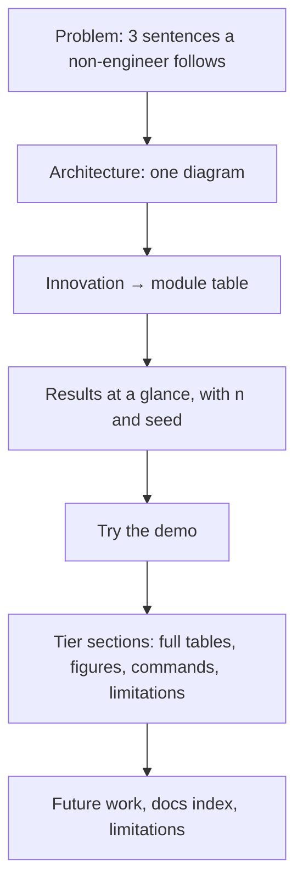

# 32 — Final README (Step 6.1)

## 1. What was built

The `README.md` was restructured from a build log into the project's front page:

| Section | What it does |
|---|---|
| **The problem** | Three problems a home-care provider has at scale (risks hidden in notes, travel vs continuity, carer turnover), in plain language |
| **End-to-end architecture** (Mermaid) | Both apps, the three AI modules, human review, Postgres with the audit log, and Ollama receiving redacted text only |
| **SMARTPBL innovations mapped to this prototype** | Each innovation → what implements it → the code path, endpoint and screen |
| **Results at a glance** | One headline per tier, with the evaluation set named next to every number |
| **Try the demo** | Live links and accounts (Step 5.7) |
| **Tier 4: production layer** (new) | Authentication, authorisation, audit, OWASP and delivery in one table, with the learning note for each |
| **Future work** (replaces the stale Tiers 4–6 roadmap) | Five priorities for real PBL data, data protection first |
| **Documentation** index | Learning notes, ADRs, security review, model cards, results, data cards |
| **Limitations** | Cross-cutting limitations up front; each tier keeps its own detailed list |

The Tier 1–3 and Tier 5 sections were kept: they hold the full results tables, figures, reproduction commands and per-tier limitations.

## 2. Why this way

- **Written for two readers.**
  - A panel member who reads for two minutes needs the problem, the picture, the mapping to SMARTPBL and the headline numbers.
  - An engineer who digs in needs the commands, the tables and the caveats.

  So the order goes from "why" to "what" to "how well", then "try it", then detail. GitHub's own guidance says a README should cover purpose, value, how to start, where to get help and who maintains it.
- **The innovation table is the KTP link.** It turns "I built some AI" into "here is each part of the SMARTPBL proposal, running, and where to find it". That is the question a KTP panel is really asking: can this person deliver the project?
- **Numbers always come with their denominator.** Each headline names its evaluation set (40 notes, 5 days, 800 carers), as CLAUDE.md's quality bar requires. A number without its sample size invites the wrong question in an interview.
- **The limitations stay on the front page.** Hiding them would be the bigger risk: an interviewer will find the circularity of synthetic data in two minutes anyway. Stating it first shows I know what the numbers can and can't support.
- **Mermaid, not images.** GitHub renders Mermaid from a fenced code block. The diagrams then stay in version control as text, diff cleanly and can't drift silently from an exported PNG.

## 3. Alternatives considered

| Option | Pros | Cons | When I'd choose it |
|---|---|---|---|
| **One README with a summary up front, detail below (chosen)** | One link to share; the summary and the evidence sit together | Long file (about 480 lines) | Portfolio repositories, read by assessors |
| A short README plus a docs site (MkDocs) | Clean landing page; searchable docs | Another tool to build and host; panels rarely click through | Larger projects with many users |
| A README per tier | Smaller files | No single overview; repeated setup | Monorepos with separate teams |
| A slide deck instead | Good for presenting live | Not next to the code; goes stale | Alongside the README, for the interview |

## 4. How it works

The page is designed as a funnel:

Each claim on the first screen links down to its evidence. For example, "0 of 19 high-severity flags escaped" is backed by Tier 1's pipeline table, which in turn comes from `docs/results/tier1_eval_test.md`.

## 5. Interview questions and answers

**Q1. Explain SMARTPBL to a care manager in one minute.**
Carers write notes after every visit. The system reads them, highlights anything that looks like a fall, a medication problem or a safeguarding worry, and puts it in front of a coordinator to confirm, with the exact sentence highlighted. It plans the day's rota to cut driving while keeping clients with carers they know. It also shows where working conditions, like late rota changes, are making a carer more likely to leave, so the provider can fix them. A person makes every decision, and everything is logged.

**Q2. Which result are you most and least confident in?**
- **Most confident:** the scheduling comparison. OR-Tools beat the greedy heuristic on coverage, time-critical visits and continuity on every one of the 5 days, every solution is re-checked independently, and a proven bound shows how far from optimal it can be.
- **Least confident:** the absolute NLP numbers. 40 synthetic notes written by the same person who wrote the prompts make the 0.906 F1 optimistic. The honest claim is that the pipeline design (redaction, grounding, routing and a rules safety net) works, not that real notes would score 0.9.

**Q3. What would you change first with real PBL data?**
Data protection comes before any model work: a DPIA, a data-sharing agreement and Caldicott sign-off. Then a fresh, properly labelled evaluation set, with clinicians or senior carers agreeing severity labels, because every number here is on synthetic data. Only then would I tune prompts and rules, against a held-out set that stays untouched until the end.

**Q4. Trade-off: why keep everything in one README rather than a docs site?**
The audience is assessors with limited time, and one link that opens on the summary is easier for them than a site to navigate. The learning notes and ADRs give depth for anyone who wants it. If the project grew users beyond assessors, I'd move the detail into a docs site and keep the README as the landing page.

**Q5. How do you avoid overclaiming in a portfolio?**
- Every number is stated with its sample size and seed.
- Confidence intervals are given where they matter.
- Each section says what the results don't show, and there are separate limitations for each tier and overall.

I'd rather an interviewer probe the caveats I've written than discover ones I haven't.

## 6. Learn more

**Official documentation**
- GitHub Docs, [About the repository README file](https://docs.github.com/en/repositories/managing-your-repositorys-settings-and-features/customizing-your-repository/about-readmes): what a README should tell a visitor.
- GitHub Docs, [Creating diagrams](https://docs.github.com/en/get-started/writing-on-github/working-with-advanced-formatting/creating-diagrams): Mermaid in fenced code blocks, as used for the architecture diagrams.

**Videos**
- I couldn't verify a suitable video for this step. Search YouTube for **"Write the Docs README talk"** (Write the Docs conference channel).

## 7. Check your understanding

Show the README's first screen (down to "Results at a glance") to someone non-technical for two minutes, then ask them three questions: what problem it solves, what a person still decides, and what the data is.

**Expected outcome:** they should answer, roughly:
- it helps a home-care company spot risks in notes, plan rotas and keep carers;
- people approve every flag and decision;
- the data is made up.

If any answer is missing, the problem paragraph or the synthetic-data note needs rewording.
