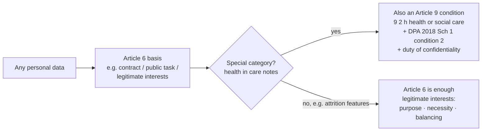

# 33 — Data protection note (Step 6.2)

## 1. What was built

`docs/DATA_PROTECTION.md` is a DPIA-style assessment of SMARTPBL with seven sections:
1. Why a DPIA is needed.
2. What is processed, and where it lives.
3. Lawful basis.
4. The controls already in the design, each linked to its learning note.
5. Proposed retention.
6. A risk register with mitigations and residual risk.
7. What must happen before any real data is used.

The README's documentation index now links to it.

## 2. Why this way

- **It's written to prompt a real DPIA, not to replace one.** A DPIA is the controller's (PBL's) document, signed by its DPO and Caldicott Guardian. As a prototype author, my job is to show where the risks are, what the design already does, and what's still open. Every lawful-basis line is marked "to be confirmed".
- **Controls are tied to evidence.** Each principle (minimisation, local inference, oversight, access, accountability) points to the learning note and code that implement it. The assessment describes the system as built, so it can't drift into describing the system as hoped for.
- **Residual risk is stated honestly.** Two risks stay at "Medium" after mitigation: punitive use of attrition scores, and proxy discrimination. Technical controls can't remove them, so they need policy, training and consultation. Saying so is more credible than a register where everything ends up "Low".
- **The two modules get different lawful bases.** Care notes are health data used to deliver care: Article 9(2)(h) with Schedule 1 condition 2. Attrition scoring is employee profiling with no special category data: legitimate interests with the three-part test. Conflating them is a common mistake.

## 3. Alternatives considered

| Option | Pros | Cons | When I'd choose it |
|---|---|---|---|
| **DPIA-style note tied to the code (chosen)** | Shows privacy-by-design reasoning; evidence-linked; short | Not a legal document | Prototype or proposal stage |
| A full ICO-template DPIA | Complete, recognisable format | Pretends to a controller's role I don't have; much longer | When PBL is the controller and real data is near |
| A privacy section in the README only | Less to maintain | Too shallow for a care provider audience | Low-risk projects |
| No assessment until real data | Less work now | Privacy by design means thinking before building | Never, for health data |

## 4. How it works

**When is a DPIA needed?** The ICO requires one where processing is likely to be high risk. That always applies to large-scale special category data and to systematic profiling with significant effects. It also applies when innovative technology such as AI is combined with another risk factor. SMARTPBL hits three of these criteria.

**Lawful basis in two layers** (for health data):

**A risk register row:** risk → likelihood × impact before controls → mitigation → residual risk. The residual column is the one a DPO reads. It says what the organisation is accepting.

## 5. Interview questions and answers

**Q1. What is the lawful basis for processing care notes with AI?**
Care notes are health data, so two things are needed:
- **An Article 6 basis:** whatever PBL already relies on to deliver care, likely contract or public task.
- **An Article 9 condition:** 9(2)(h) health or social care, with DPA 2018 Schedule 1 condition 2, which requires processing by or under someone owing a duty of confidentiality.

Using AI to prioritise review sits within delivering care. Using notes to train or evaluate a model is a further purpose that the DPIA must assess separately. I'd confirm all of this with the DPO rather than decide it myself.

**Q2. Why legitimate interests for the attrition model, and how would you justify it?**
It uses employee working-condition data, not special category data, and the purpose is keeping staff and continuity of care. The three-part test:
- **Purpose:** retention and continuity of care.
- **Necessity:** show that team-level reporting alone isn't enough.
- **Balancing:** workers would expect support offers, not adverse use, so prohibiting adverse use is what makes the balance work.

Staff are told and consulted, and no decision is solely automated.

**Q3. How does the design minimise data?**
- Text is redacted before the LLM, and only redacted text appears in the API and UI.
- The audit log stores keyed hashes, not inputs.
- Schedule runs don't store locations.
- The attrition label and age are never served.
- Carer handovers show only the last 3 notes for today's clients.
- Inference is local, so care data never reaches a third-party AI service.

**Q4. Which risk would worry you most with real data?**
The attrition score being used against carers: offering fewer shifts to someone "likely to leave anyway". The technical controls (supportive actions, use notices, audited views) help, but this is a policy and culture risk. That's why the residual risk is Medium and consultation with staff is a precondition.

**Q5. How does "right to erasure" interact with an append-only audit log?**
Care records have legal retention periods, so erasure often doesn't apply while they're held. The audit log is designed to be retained without re-exposing content, because it stores HMAC hashes and identifiers, not note text. When a record reaches the end of retention, the record is deleted. The audit rows remain as evidence that decisions were made, holding no readable personal content. I'd confirm the approach with the DPO.

## 6. Learn more

**Official documentation**
- ICO, [When do we need to do a DPIA?](https://ico.org.uk/for-organisations/uk-gdpr-guidance-and-resources/accountability-and-governance/data-protection-impact-assessments-dpias/when-do-we-need-to-do-a-dpia/): the high-risk criteria, including innovative technology such as AI, large-scale special category data and profiling.
- ICO, [What are the conditions for processing?](https://ico.org.uk/for-organisations/uk-gdpr-guidance-and-resources/lawful-basis/special-category-data/what-are-the-conditions-for-processing/): condition (h) and Schedule 1 condition 2.
- ICO, [What is the 'legitimate interests' basis?](https://ico.org.uk/for-organisations/uk-gdpr-guidance-and-resources/lawful-basis/legitimate-interests/what-is-the-legitimate-interests-basis/): the purpose, necessity and balancing tests.
- ICO, [Principle (c): Data minimisation](https://ico.org.uk/for-organisations/uk-gdpr-guidance-and-resources/data-protection-principles/a-guide-to-the-data-protection-principles/data-minimisation/).

I couldn't verify a stable link to the current Records Management Code of Practice for Health and Social Care (England): the gov.uk page redirects to an NHS England address that didn't resolve from here. Search for **"Records Management Code of Practice health and social care NHS England retention schedule"**.

**Videos**
- I couldn't verify a suitable video. Search YouTube for **"ICO DPIA webinar"** (Information Commissioner's Office channel).

## 7. Check your understanding

Add a new row to the risk register for "client locations exposed through the schedule map". Decide its likelihood × impact, the mitigation that already exists in the code, and the residual risk.

**Expected outcome:**
- **Likelihood × impact:** Low × High.
- **Mitigation:** runs store no locations. `GET /schedule/{run_id}/map` returns locations only for the committed synthetic sample, gated by the input HMAC. Carers get only their own visits' locations. Map tiles come from a third party that sees the viewed area (ADR-033).
- **Residual:** Low for the prototype. With real data it would rise to Medium until locations come from the client record under its own access control and tiles are self-hosted.
