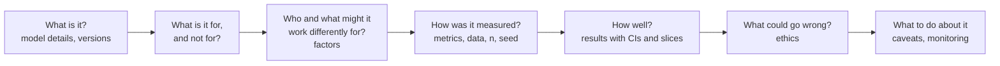

# 34 — Model cards (Step 6.3)

## 1. What was built

| File | What it does |
|---|---|
| `docs/model-cards/extraction-pipeline.md` (new) | Model card for the **whole Tier 1 pipeline**: redaction → LLM (digest, decoding, prompt SHA) → rules → grounding → routing. It covers intended and out-of-scope use, factors, metrics, evaluation data, test-split results, ethics and caveats |
| `docs/model-cards/attrition-model.md` (updated) | New **Serving** section: the API and its access rules, scores computed on read, relative bands, percentage-point explanations, the rule for support actions, what's never served, and the use notice |
| `README.md` | Links to both cards |

## 2. Why this way

- **The extraction card describes the pipeline, not just llama3.1.** The model alone has a recall of 0.857, but what reaches a coordinator is the pipeline's output: union recall 0.929, 0 of 19 high-severity escapes, 0 auto-accepted false positives. A card that described only the LLM would misstate how the system behaves and hide the safety net that makes it acceptable.
- **Mitchell et al.'s sections, fitted to care.** "Factors" names what wasn't measured (dialect, non-native English, voice-to-text), because that's where real notes will differ. "Out-of-scope" says the pipeline must never replace reading notes or the incident procedure: a missed flag must never mean a missed concern.
- **Versioning makes the card checkable.** The model digest and prompt SHA in the card are the same values stored on every extraction and audit event. An auditor can confirm that a given flag came from the model the card describes.
- **The serving section closes the gap between card and product.** The attrition card was written in Tier 3, before the API and screens existed. Bands, percentage points and support rules are decisions about *use*, which is where most of this model's risk lies, so they belong on the card.

## 3. Alternatives considered

| Option | Pros | Cons | When I'd choose it |
|---|---|---|---|
| **Pipeline-level card (chosen for Tier 1)** | Describes what users actually get; includes the safety net and routing | Longer; mixes ML and rules | Compound AI systems |
| An LLM-only card | Simple; matches vendor cards | Omits grounding, routing and rules; misstates behaviour | A standalone model release |
| A datasheet for the dataset instead | Documents data provenance well | Doesn't cover use, metrics or ethics | Alongside a card (the data cards do this) |
| A system card covering all of SMARTPBL | One document | Too broad to be precise about each model's risks | An umbrella over per-model cards |

## 4. How it works

A model card answers, in order:

**How the version is traced:** model digest `46e0c10c039e` and prompt SHA `132928aea6e4` appear in the card, in `docs/results/tier1_eval_test.md`, and on every `extraction_completed` audit event. If any one changes, the card's numbers no longer apply, and the evaluation must be re-run.

## 5. Interview questions and answers

**Q1. What goes in a model card and who is it for?**
- **Contents:** what the model is (versions), what it's for and explicitly not for, which factors might change its behaviour, how it was evaluated (metrics, data, sample size), the results with uncertainty and slices, ethical risks, and recommendations.
- **Audiences:** users and managers (what to trust), auditors and DPOs (what was tested), and future engineers (what must be re-run when something changes).

**Q2. Why describe the pipeline rather than the LLM?**
Because people experience the pipeline's output. The LLM alone misses about 14% of gold flags. With the rules safety net and routing, 7% get no flag at all and no high-severity flag escapes. Reporting only the LLM would understate safety, and would hide that the rules are load-bearing. If someone removed them, the card would show the cost.

**Q3. Which caveat matters most for the extraction pipeline?**
That the numbers are on synthetic notes I wrote myself, so they're optimistic. The next most important: the LLM's confidence is uninformative (it clusters at 1.0). Routing therefore deliberately doesn't trust it; it relies on policy, grounding and the rules. I'd want both caveats read before anyone quotes the F1.

**Q4. What would you monitor in production?**
- **Recall by category,** from periodic double-reading samples, since the model can't report its own misses.
- **Workload:** the share of notes sent to review.
- **Accuracy of auto-accepted flags,** from spot checks.
- **Grounding and schema-failure rates.**
- **Latency.**

Any change to the model, prompt or redaction triggers a re-evaluation, and the audit log shows which version produced each flag.

**Q5. Trade-off: why not hide prohibited uses in terms and conditions?**
Because the model card is where users look when deciding what to do with an output. For the attrition model, the prohibited-use section is the main control, and it's echoed in every API response and on every screen. Burying it would make the controls depend on people reading fine print.

## 6. Learn more

**Official documentation**
- Mitchell et al., [Model Cards for Model Reporting](https://arxiv.org/abs/1810.03993): the original structure used for both cards (verified in Step 3.3).
- ICO, [What is the impact of Article 22 of the UK GDPR on fairness?](https://ico.org.uk/for-organisations/uk-gdpr-guidance-and-resources/artificial-intelligence/guidance-on-ai-and-data-protection/how-do-we-ensure-fairness-in-ai/what-is-the-impact-of-article-22-of-the-uk-gdpr-on-fairness): meaningful human review, which both cards rely on (verified in Step 3.3).

**Videos**
- I couldn't verify a suitable video this session. Search YouTube for **"Margaret Mitchell model cards talk"**.

## 7. Check your understanding

Suppose you switch the extraction LLM to `qwen2.5:3b` to save memory. Using only the two model cards and the results file, list what in the extraction card becomes invalid and what you'd have to re-run.

**Expected outcome:**
- **Invalid:**
  - the Model details row (digest, and possibly the prompt version);
  - every quantitative table;
  - the slice results;
  - the "0 / 19 high-severity escapes" claim. qwen let 11/56 gold flags escape in the same evaluation, though still 0 high-severity, and sent 68% of notes to review.
- **Re-run:** `scripts/run_extraction.py` and `scripts/eval.py` on a **new** held-out set (the test split is spent), then update the card.
- **Unchanged:** the attrition card, which is unaffected.
