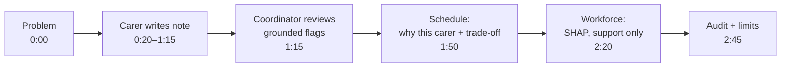

# 35 — Demo script (Step 6.4)

## 1. What was built

`docs/DEMO_SCRIPT.md` contains:
- a 10-minute preparation checklist (local stack with the LLM, a saved rota, a warmed-up model, window layout, a prepared note);
- a **7-beat, 3-minute script**, where each beat has a time window, the screen, the actions, the words (about 330 in total) and what it demonstrates;
- a recovery table for live failures;
- 60-second and 90-second cut-down versions.

The README's documentation index links to it.

## 2. Why this way

- **One story, not a feature tour.** The demo follows one care note from the carer's phone to the coordinator's decision and the audit log, with the schedule and workforce in between. A single thread is easier to follow and shows that the parts connect, which is the KTP's integration question.
- **Record locally, so the AI is real.** The hosted demo has no LLM by design (local inference). A video that shows "extraction failed" would undersell the main component, so the script records against the local stack and says once that it runs locally.
- **Every beat carries a claim and its evidence.** "None of 19 high-severity risks through unflagged" is said over the screen where flags are reviewed. The numbers are the README's, spoken with their caveat ("held-out synthetic notes").
- **Ethics shown on screen, not just stated.** The workforce beat points at the support actions and says "never performance decisions"; the last beat says "synthetic". These are the questions a care provider's panel will ask.
- **A plan for failure.** A live demo that breaks with no script for it looks worse than one with a planned recovery. Each failure mode has a line that turns it into a design point (graceful degradation, scale-to-zero).

## 3. Alternatives considered

| Option | Pros | Cons | When I'd choose it |
|---|---|---|---|
| **One narrative thread through both apps (chosen)** | Shows integration; memorable; fits in 3 minutes | Some features unseen (audit filters, CSV, overview) | Interviews and applications |
| Feature tour by tier | Covers everything | Feels like a list; overruns | Technical deep-dive sessions |
| Slides with screenshots | Never breaks | Not proof the system works | As a fallback only |
| Live on the hosted demo | Reviewers can repeat it | No LLM; cold starts | After the video, as "try it yourself" |

## 4. How it works

**Pacing:** about 140 spoken words a minute, so 330 words take about 2:20, and clicks and screen changes fill the rest of the 3 minutes. Each beat is 15–35 seconds, and the longest goes to the main idea (review: 35 s).

The note written in beat 2 *is* the note reviewed in beat 3. That is the thread that holds the story together.

## 5. Interview questions and answers

**Q1. Walk us through SMARTPBL in three minutes.**
This is the script. Say the problem, follow one note from carer to coordinator to audit log, show the rota's reasons and trade-off, show workforce risk framed as support, and close on limitations. Practise it until the beats come without notes, and keep the 90-second opener for when there's no screen.

**Q2. What did you leave out of the demo, and why?**
- **Not shown:** the overview, audit filters and CSV export, the evaluation charts, and the security work.
- **Why:** they don't change the story of "AI suggests, a person decides, everything is recorded". They're one click away if the panel asks, and the README covers them.

Choosing what to cut is part of communicating to a mixed audience.

**Q3. What if the model gets something wrong during the demo?**
I'd say so and use it: "This is why every flag is reviewed by a person, and why the pipeline has a rules safety net." A wrong flag is caught by grounding or review, and a missed one is why carers have the urgent switch and why notes are still read. The design assumes the model is fallible.

**Q4. Trade-off: why a recorded video rather than only a live demo?**
A video always works, shows the local LLM, and can be watched before the interview. The live demo proves it's real and lets reviewers probe it. I'd send both: the video first, then "try it yourself" with the demo accounts.

## 6. Learn more

**Official documentation**
- No external documentation is specific to this step. The script draws on the README, the model cards and `docs/DATA_PROTECTION.md`.

**Videos**
- I couldn't verify a suitable video. Search YouTube for **"how to give a great software demo talk"** or **"PyCon lightning talk demo tips"**.

## 7. Check your understanding

Time yourself reading the "Say" column aloud, while clicking through the stack.

**Expected outcome:** between 2:45 and 3:15. If you're over, shorten the schedule beat first: drop the "next best" sentence and keep the trade-off curve, because the curve is the stronger idea. If you're well under, you're probably rushing: slow the review beat, which carries the main claim.
