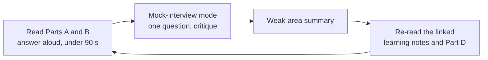

# 36 — Final interview pack (Step 6.5)

## 1. What was built

`docs/learning/INTERVIEW_PREP.md` was reorganised from a step-by-step log into an interview pack:

| Part | What it contains |
|---|---|
| How to use, and contents | A reading order for the weeks before 9 December |
| **Must-know 20** | The questions most likely to come up, each pointing to its answer |
| **Part A: system-level** (8 Q&As) | End-to-end architecture, scaling, the real-data migration plan, evaluation with real data and stop criteria, a failure-mode table, ethics, what I'd do differently, what I'm proudest of |
| **Part B: KTP context** (6 Q&As) | Three-way benefit, knowledge transfer, the first 3 months, use of the development budget, why this KTP, risks to the KTP |
| **Part C: mock-interview mode** | How Claude runs a practice interview: one question at a time, critique against the model answer, follow-ups, a summary of weak areas |
| **Part D: per-step bank** | Everything written during the build (setup to 6.4), unchanged |

## 2. Why this way

- **Questions are prioritised, not piled up.** About 200 Q&As can't be revised the night before. The must-know 20 and Parts A and B are what a 45-minute panel can actually cover; Part D is for depth when probed.
- **The system-level questions are the ones per-step notes can't answer.** "How would it scale?", "what's the plan with real data?" and "what are the failure modes?" cut across tiers. Panels ask them to see whether I understand the whole system, not just the parts I built.
- **The KTP questions are asked as often as technical ones.** A KTP panel includes the company and a KTP adviser, who care about benefit to PBL, knowledge staying in the company and a realistic plan. Answering those well matters as much as explaining OR-Tools.
- **Facts are checked.** The development budget is stated as Innovate UK describes it (a dedicated budget for each associate), with the figure universities give (about £2,000 a year, so about £4,000 over two years) and a note to confirm with BCU. The 75% permanent-offer figure is from Innovate UK's own page.

## 3. Alternatives considered

| Option | Pros | Cons | When I'd choose it |
|---|---|---|---|
| **Prioritised pack plus the full bank (chosen)** | Revisable; depth still there | One long file | Interview preparation |
| Flashcards (Anki) | Spaced repetition | Answers lose their context and evidence links | Memorising facts and numbers |
| Only the per-step bank | No extra work | No system-level or KTP answers; no priorities | Never, for a panel interview |
| Rehearsal only, nothing written | Natural answers | Easy to forget evidence and numbers | Combined with this pack in mock mode |

## 4. How it works

The pack is built for practice in rounds:

**A good interview answer:** point, evidence, limitation, what I'd do next. For example: "recall-first because a missed fall costs more than an extra review (point); 0 of 19 high-severity escapes on held-out notes (evidence); but 40 synthetic notes (limitation); so real-data evaluation with clinician labels comes first (next)."

## 5. Interview questions and answers

**Q1. How would you prepare a care provider's staff to work with AI flags?**
Short sessions by role:
- **Coordinators:** what a flag means, why the evidence is highlighted, that the pipeline misses things (automation bias), and how to escalate.
- **Carers:** that the urgent switch always reaches a person, and what happens to their notes.
- **Managers:** reading workforce risk as a prompt for support.

Then measure: are flags reviewed, are urgent concerns handled, and are notes still read?

**Q2. What does success look like for this KTP after two years?**
- **Notes:** the pipeline runs in production across branches, with recall on high-severity risks monitored and above the agreed threshold.
- **Rotas:** rota decisions use the continuity trade-off, with measurable changes in driving and familiar-carer share.
- **Workforce:** a supportive retention process informed by working conditions, with staff agreement.
- **Capability:** PBL staff can run the evaluation and change prompts without me.
- **Research:** at least one academic output with BCU.

**Q3. How do you handle disagreement between the company's wishes and data-protection advice?**
- **Bring the DPO and Caldicott Guardian in early,** and frame options rather than refusals. For example, if the business wants carer-level attrition alerts, offer team-level reporting plus opt-in supportive check-ins as a lower-risk alternative.
- **Document the decision** in the DPIA and an ADR.
- **Where the law is clear, it wins.** Where it's a judgement, the controller (PBL) decides, informed by the risk analysis.

**Q4. You've used AI tools to help build this. How do you make sure you understand it?**
- **Decisions are mine:** every step has a learning note explaining the decision and its alternatives, and an ADR records each significant choice.
- **I can defend them:** I can explain each from first principles. That's the purpose of the notes and of mock-interview practice.
- **Claims are checked:** tests, independent checkers (such as the schedule checker) and held-out evaluations verify behaviour, rather than trusting generated code.

I'd bring the same discipline to PBL: tools speed up writing, but understanding and verification can't be delegated.

**Q5. Trade-off: breadth (three modules) vs depth (one module done thoroughly)?**
The SMARTPBL proposal names all three innovations, so showing that I can deliver each end to end answers the panel's main question. Depth comes from evaluation discipline in each module, with held-out sets, baselines, bounds, calibration and fairness audits, not from extra features. In the KTP itself I'd sequence the modules (notes, then scheduling, then workforce) rather than run them in parallel.

## 6. Learn more

**Official documentation**
- Innovate UK, [Knowledge Transfer Partnership guidance: who can take part](https://www.ukri.org/councils/innovate-uk/guidance-for-applicants/guidance-for-specific-funds/knowledge-transfer-partnership-guidance/who-can-take-part/): the business, knowledge base and associate roles, the associate's dedicated development budget, and the 75% permanent-offer figure.
- University of Bristol, [Knowledge Transfer Partnership](https://www.bristol.ac.uk/research-enterprise-innovation/industry/knowledge-transfer-partnerships/): states the associate's personal development budget as £2k per year.

**Videos**
- I couldn't verify a suitable video. Search YouTube for **"Knowledge Transfer Partnership associate experience Innovate UK"** (Innovate UK channel).

## 7. Check your understanding

Ask Claude for mock-interview mode and answer the first five questions without looking at the pack.

**Expected outcome:** each answer runs 60–90 seconds and follows point → evidence → limitation → next step. The critique should name at most one missing element per answer. If two or more answers lack evidence (a number with its sample size), re-read the README's "Results at a glance" before the next round.
