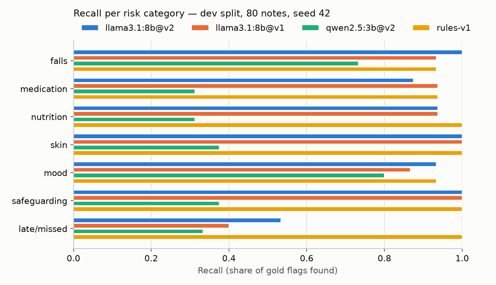
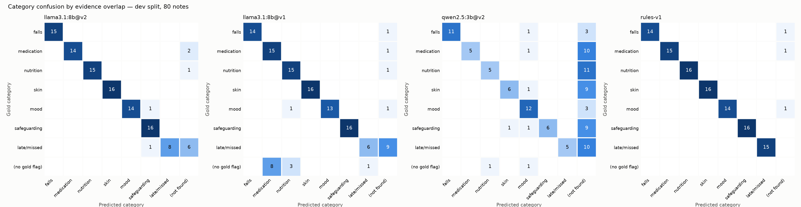

# Tier 1 evaluation — `dev` split

- Notes: **80**; gold flags: **109**; data seed 42 (`scripts/generate_notes.py`); bootstrap: 1000 resamples of notes, seed 42.
- Matching is per note and category. Failed extractions count as no flags.
- Synthetic data written by the same author as the rules and prompts: treat absolute numbers as optimistic (see `data/care_notes/DATA_CARD.md`).

| System | Model digest | Prompt (sha) |
|---|---|---|
| llama3.1:8b@v2 | 46e0c10c039e | extraction/v2 (132928aea6e4) |
| llama3.1:8b@v1 | 46e0c10c039e | extraction/v1 (c642597ea1b9) |
| qwen2.5:3b@v2 | 357c53fb659c | extraction/v2 (132928aea6e4) |
| rules-v1 | rules-v1 | n/a |

## Overall

| System | Micro P | Micro R (95% CI) | Micro F1 (95% CI) | Macro F1 | Severity agreement | Valid 1st try / final | Grounded | Latency p50 / p95 |
|---|---|---|---|---|---|---|---|---|
| llama3.1:8b@v2 | 0.980 | 0.899 (0.846-0.946) | 0.938 (0.902-0.970) | 0.929 | 0.827 (81/98) | 80/80 / 80/80 | 100.0% | 5.7 s / 10.2 s |
| llama3.1:8b@v1 | 0.880 | 0.872 (0.807-0.929) | 0.876 (0.825-0.919) | 0.867 | 0.558 (53/95) | 80/80 / 80/80 | 100.0% | 5.5 s / 10.0 s |
| qwen2.5:3b@v2 | 0.877 | 0.459 (0.388-0.528) | 0.602 (0.531-0.671) | 0.585 | 0.640 (32/50) | 80/80 / 80/80 | 98.2% | 2.3 s / 3.5 s |
| rules-v1 | 1.000 | 0.972 (0.940-1.000) | 0.986 (0.969-1.000) | 0.986 | 0.953 (101/106) | 80/80 / 80/80 | 100.0% | 0.3 ms / 0.5 ms |

## Per category (P / R / F1)

| Category | Gold | llama3.1:8b@v2 | llama3.1:8b@v1 | qwen2.5:3b@v2 | rules-v1 |
|---|---|---|---|---|---|
| falls | 15 | 1.00 / 1.00 / 1.00 | 1.00 / 0.93 / 0.97 | 1.00 / 0.73 / 0.85 | 1.00 / 0.93 / 0.97 |
| medication | 16 | 1.00 / 0.88 / 0.93 | 0.65 / 0.94 / 0.77 | 1.00 / 0.31 / 0.48 | 1.00 / 0.94 / 0.97 |
| nutrition_hydration | 16 | 1.00 / 0.94 / 0.97 | 0.79 / 0.94 / 0.86 | 0.83 / 0.31 / 0.45 | 1.00 / 1.00 / 1.00 |
| skin_integrity | 16 | 1.00 / 1.00 / 1.00 | 1.00 / 1.00 / 1.00 | 0.86 / 0.38 / 0.52 | 1.00 / 1.00 / 1.00 |
| mood_behaviour | 15 | 1.00 / 0.93 / 0.97 | 1.00 / 0.87 / 0.93 | 0.71 / 0.80 / 0.75 | 1.00 / 0.93 / 0.97 |
| safeguarding | 16 | 0.89 / 1.00 / 0.94 | 1.00 / 1.00 / 1.00 | 1.00 / 0.38 / 0.55 | 1.00 / 1.00 / 1.00 |
| missed_late_visit | 15 | 1.00 / 0.53 / 0.70 | 0.86 / 0.40 / 0.55 | 1.00 / 0.33 / 0.50 | 1.00 / 1.00 / 1.00 |

## Robustness slices (recall)

| Slice | Gold flags | llama3.1:8b@v2 | llama3.1:8b@v1 | qwen2.5:3b@v2 | rules-v1 |
|---|---|---|---|---|---|
| hard | 56 | 0.86 | 0.84 | 0.43 | 0.98 |
| lowercase | 18 | 0.94 | 0.89 | 0.44 | 0.94 |
| multi | 76 | 0.89 | 0.84 | 0.45 | 0.96 |
| negation | 45 | 0.93 | 0.91 | 0.38 | 1.00 |
| noisy | 84 | 0.90 | 0.86 | 0.49 | 0.96 |
| pii | 74 | 0.88 | 0.85 | 0.43 | 0.97 |
| single | 33 | 0.91 | 0.94 | 0.48 | 1.00 |
| negation false positives | 32 negated mentions | 1 | 2 | 1 | 0 |

## Paired comparison against rules-v1 (2000 paired resamples)

| System | Recall diff (95% CI) | P(not better) | F1 diff (95% CI) | P(not better) | Recall of LLM + rules (union) |
|---|---|---|---|---|---|
| llama3.1:8b@v2 | -0.073 (-0.133 to -0.018) | 0.998 | -0.048 (-0.088 to -0.014) | 0.998 | 1.000 |
| llama3.1:8b@v1 | -0.101 (-0.164 to -0.039) | 1.000 | -0.110 (-0.163 to -0.067) | 1.000 | 0.991 |
| qwen2.5:3b@v2 | -0.514 (-0.594 to -0.433) | 1.000 | -0.384 (-0.460 to -0.311) | 1.000 | 1.000 |

## Deployed pipeline: LLM + rules safety net + routing

| System | Notes to review | Gold flags escaped (no flag at all) | High-severity escaped | Auto-accepted | Auto-accepted false positives |
|---|---|---|---|---|---|
| llama3.1:8b@v2 | 51/80 (64%) | 0/109 (0.0%) | 0/51 | 37 | 0 |
| llama3.1:8b@v1 | 40/80 (50%) | 1/109 (0.9%) | 1/51 | 66 | 12 |
| qwen2.5:3b@v2 | 65/80 (81%) | 0/109 (0.0%) | 0/51 | 6 | 0 |

## Figures

