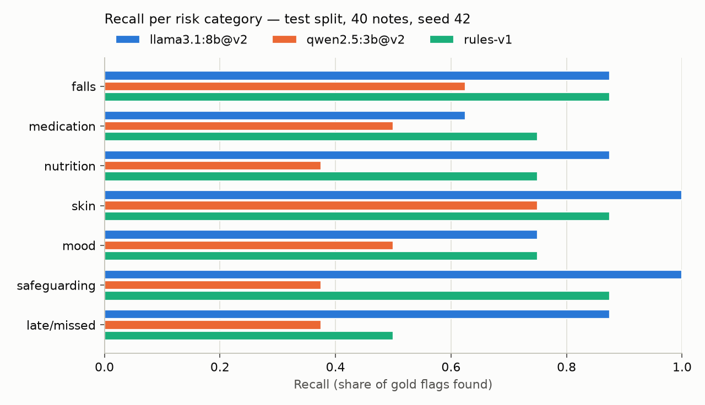
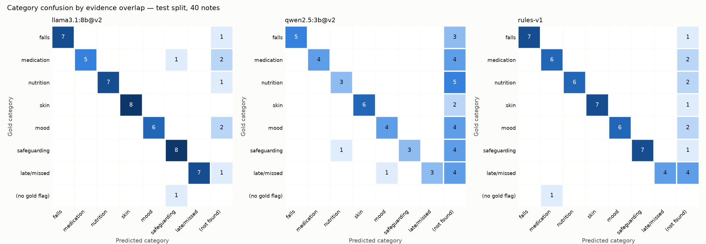

# Tier 1 evaluation — `test` split

- Notes: **40**; gold flags: **56**; data seed 42 (`scripts/generate_notes.py`); bootstrap: 1000 resamples of notes, seed 42.
- Matching is per note and category. Failed extractions count as no flags.
- Synthetic data written by the same author as the rules and prompts: treat absolute numbers as optimistic (see `data/care_notes/DATA_CARD.md`).

| System | Model digest | Prompt (sha) |
|---|---|---|
| llama3.1:8b@v2 | 46e0c10c039e | extraction/v2 (132928aea6e4) |
| qwen2.5:3b@v2 | 357c53fb659c | extraction/v2 (132928aea6e4) |
| rules-v1 | rules-v1 | n/a |

## Overall

| System | Micro P | Micro R (95% CI) | Micro F1 (95% CI) | Macro F1 | Severity agreement | Valid 1st try / final | Grounded | Latency p50 / p95 |
|---|---|---|---|---|---|---|---|---|
| llama3.1:8b@v2 | 0.960 | 0.857 (0.776-0.930) | 0.906 (0.847-0.955) | 0.902 | 0.812 (39/48) | 40/40 / 40/40 | 100.0% | 5.8 s / 9.8 s |
| qwen2.5:3b@v2 | 0.933 | 0.500 (0.391-0.618) | 0.651 (0.541-0.759) | 0.643 | 0.571 (16/28) | 40/40 / 40/40 | 100.0% | 2.3 s / 3.7 s |
| rules-v1 | 0.977 | 0.768 (0.642-0.885) | 0.860 (0.777-0.933) | 0.854 | 0.977 (42/43) | 40/40 / 40/40 | 100.0% | 0.4 ms / 1.2 ms |

## Per category (P / R / F1)

| Category | Gold | llama3.1:8b@v2 | qwen2.5:3b@v2 | rules-v1 |
|---|---|---|---|---|
| falls | 8 | 1.00 / 0.88 / 0.93 | 1.00 / 0.62 / 0.77 | 1.00 / 0.88 / 0.93 |
| medication | 8 | 1.00 / 0.62 / 0.77 | 1.00 / 0.50 / 0.67 | 0.86 / 0.75 / 0.80 |
| nutrition_hydration | 8 | 1.00 / 0.88 / 0.93 | 0.75 / 0.38 / 0.50 | 1.00 / 0.75 / 0.86 |
| skin_integrity | 8 | 1.00 / 1.00 / 1.00 | 1.00 / 0.75 / 0.86 | 1.00 / 0.88 / 0.93 |
| mood_behaviour | 8 | 1.00 / 0.75 / 0.86 | 0.80 / 0.50 / 0.62 | 1.00 / 0.75 / 0.86 |
| safeguarding | 8 | 0.80 / 1.00 / 0.89 | 1.00 / 0.38 / 0.55 | 1.00 / 0.88 / 0.93 |
| missed_late_visit | 8 | 1.00 / 0.88 / 0.93 | 1.00 / 0.38 / 0.55 | 1.00 / 0.50 / 0.67 |

## Robustness slices (recall)

| Slice | Gold flags | llama3.1:8b@v2 | qwen2.5:3b@v2 | rules-v1 |
|---|---|---|---|---|
| hard | 36 | 0.81 | 0.33 | 0.69 |
| lowercase | 8 | 0.75 | 0.62 | 0.75 |
| multi | 39 | 0.79 | 0.44 | 0.79 |
| negation | 24 | 0.83 | 0.54 | 0.75 |
| noisy | 46 | 0.85 | 0.48 | 0.78 |
| pii | 25 | 0.92 | 0.44 | 0.92 |
| single | 17 | 1.00 | 0.65 | 0.71 |
| unseen_phrase | 32 | 0.81 | 0.34 | 0.59 |
| negation false positives | 16 negated mentions | 1 | 1 | 1 |

## Paired comparison against rules-v1 (2000 paired resamples)

| System | Recall diff (95% CI) | P(not better) | F1 diff (95% CI) | P(not better) | Recall of LLM + rules (union) |
|---|---|---|---|---|---|
| llama3.1:8b@v2 | +0.089 (-0.039 to +0.235) | 0.113 | +0.046 (-0.034 to +0.141) | 0.136 | 0.929 |
| qwen2.5:3b@v2 | -0.268 (-0.397 to -0.125) | 1.000 | -0.209 (-0.323 to -0.089) | 0.999 | 0.804 |

## Deployed pipeline: LLM + rules safety net + routing

| System | Notes to review | Gold flags escaped (no flag at all) | High-severity escaped | Auto-accepted | Auto-accepted false positives |
|---|---|---|---|---|---|
| llama3.1:8b@v2 | 20/40 (50%) | 4/56 (7.1%) | 0/19 | 27 | 0 |
| qwen2.5:3b@v2 | 27/40 (68%) | 11/56 (19.6%) | 0/19 | 4 | 0 |

## Figures

