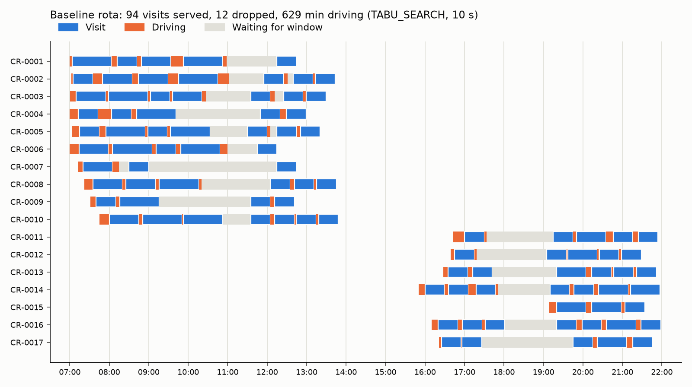

# Tier 2 baseline VRPTW (OR-Tools)

- Scenario `birmingham-day-seed42`: 17 carers, 106 visits; travel `osrm:car:d12835fa63ef`.
- Objective = drive seconds + 1,000,000 per dropped visit (2,000,000 if time-critical).
- Every solution is re-verified by `app/matching/check.py` (column *Checked*).
- **Reproducibility:** search stops on a wall-clock limit, so results depend on CPU speed and load. Repeats here matched, but identical reruns of the continuity sweep changed 3 of 10 points (up to 19 min driving). Treat single numbers as ±a few %.

## First-solution strategies (construction only, no local search)

| Strategy | Status | Dropped | Drive (min) | Objective | Wall (s) | Checked |
|---|---|---|---|---|---|---|
| PATH_CHEAPEST_ARC | PARTIAL_SUCCESS_LOCAL_OPTIMUM_NOT_REACHED | 47 | 374 | 57,022,422 | 0.02 | yes |
| PARALLEL_CHEAPEST_INSERTION | PARTIAL_SUCCESS_LOCAL_OPTIMUM_NOT_REACHED | 15 | 730 | 15,043,827 | 0.02 | yes |
| LOCAL_CHEAPEST_INSERTION | PARTIAL_SUCCESS_LOCAL_OPTIMUM_NOT_REACHED | 16 | 744 | 16,044,625 | 0.01 | yes |
| SAVINGS | PARTIAL_SUCCESS_LOCAL_OPTIMUM_NOT_REACHED | 40 | 514 | 49,030,861 | 0.69 | yes |
| CHRISTOFIDES | PARTIAL_SUCCESS_LOCAL_OPTIMUM_NOT_REACHED | 45 | 527 | 57,031,632 | 0.02 | yes |

## Local-search metaheuristics (from PARALLEL_CHEAPEST_INSERTION)

| Metaheuristic, limit | Status | Dropped | Drive (min) | Objective | Wall (s) | Checked |
|---|---|---|---|---|---|---|
| GREEDY_DESCENT, 10 s | SUCCESS | 13 | 625 | 13,037,485 | 1.68 | yes |
| GREEDY_DESCENT, 60 s | SUCCESS | 13 | 625 | 13,037,485 | 1.73 | yes |
| GUIDED_LOCAL_SEARCH, 10 s | SUCCESS | 13 | 608 | 13,036,510 | 10.00 | yes |
| GUIDED_LOCAL_SEARCH, 60 s | SUCCESS | 12 | 621 | 12,037,278 | 60.00 | yes |
| SIMULATED_ANNEALING, 10 s | SUCCESS | 13 | 623 | 13,037,373 | 10.00 | yes |
| SIMULATED_ANNEALING, 60 s | SUCCESS | 13 | 623 | 13,037,373 | 60.00 | yes |
| TABU_SEARCH, 10 s | SUCCESS | 12 | 629 | 12,037,733 | 10.00 | yes |
| TABU_SEARCH, 60 s | SUCCESS | 11 | 650 | 11,038,978 | 60.00 | yes |

## Why visits are dropped

- **Proven lower bound:** even with *zero* travel, at least **2** visits cannot be served (CP-SAT, optimal): V-0070, V-0076.
- **Best found:** 11 dropped (TABU_SEARCH, 60 s). The gap is the cost of travel plus heuristic sub-optimality; this bound cannot separate the two.

Dropped by the default configuration (TABU_SEARCH, 10 s):

| Visit | Window | Min | Extra skills | Eligible carers |
|---|---|---|---|---|
| V-0078 | 07:00-08:00 | 60 | dementia_care, medication | 3 |
| V-0063 | 07:30-08:30 | 45 | dementia_care, medication | 3 |
| V-0102 | 07:40-08:40 | 30 | catheter_care, medication | 2 |
| V-0014 | 07:55-08:55 | 30 | medication | 6 |
| V-0005 | 08:05-09:05 | 45 | dementia_care | 3 |
| V-0074 | 08:15-09:15 | 45 | catheter_care, dementia_care, medication | 2 |
| V-0031 | 08:25-09:25 | 30 | medication | 6 |
| V-0013 | 19:10-20:10 | 45 | none | 7 |
| V-0100 | 19:15-20:15 | 45 | none | 7 |
| V-0062 | 19:50-20:50 | 45 | manual_handling | 4 |
| V-0076 | 20:05-21:05 | 45 | catheter_care, dementia_care, medication | 1 |
| V-0017 | 20:10-21:10 | 45 | medication | 7 |

## Staffing what-ifs (same locations, default configuration)

| Change | Dropped | Drive (min) | Travel-free bound | Checked |
|---|---|---|---|---|
| None (baseline) | 12 | 629 | 2 | yes |
| Train CR-0001 (early) in dementia care + medication | 10 | 611 | 1 | yes |
| Add one late carer (CR-0018, at CR-0011's location) | 9 | 670 | 1 | yes |
| Both | 7 | 642 | 0 | yes |

## Default solution summary

- 94 visits served by 17 carers; 629 min driving (6.7 min per visit).
- Busy share of each carer's working span (visit + driving, excluding waiting): median 77%.

