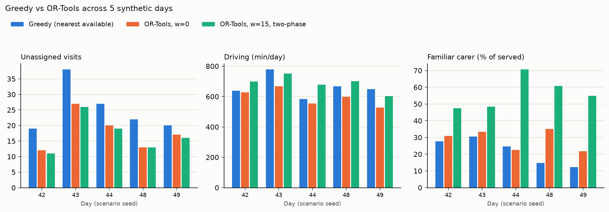

# Tier 2 comparison: greedy vs OR-Tools

- Days (seeds): 42, 43, 44, 48, 49; skipped (invalid scenario): 45 (2 problems), 46 (1 problems), 47 (2 problems).
- OR-Tools: PARALLEL_CHEAPEST_INSERTION + TABU_SEARCH, 10 s; continuity weight 15 min (the knee from note 13), solved two-phase (warm-started from the w=0 solution; runtime is the sum of both phases).
- Every solution passed the independent checker. Utilisation = (visit + driving) time / total shift time of all carers.
- Time-limited search: single numbers vary by a few % between reruns (see note 13).

## Mean over days

| System | Unassigned | Time-critical unassigned | Driving (min) | Familiar carer | Utilisation | Runtime (s) |
|---|---|---|---|---|---|---|
| Greedy (nearest available) | 25.2 | 5.4 | 663 | 22.0% | 50.7% | 0.007 |
| OR-Tools, w=0 | 17.8 | 0.0 | 596 | 28.7% | 52.8% | 10.001 |
| OR-Tools, w=15, two-phase | 17.0 | 0.0 | 687 | 56.4% | 54.5% | 20.003 |

## Per day

| Seed | Travel backend | System | Unassigned | Driving (min) | Familiar | Utilisation |
|---|---|---|---|---|---|---|
| 42 | osrm | Greedy (nearest available) | 19 | 639 | 27.6% | 52.7% |
| 42 | osrm | OR-Tools, w=0 | 12 | 629 | 30.9% | 55.4% |
| 42 | osrm | OR-Tools, w=15, two-phase | 11 | 700 | 47.4% | 56.6% |
| 43 | osrm | Greedy (nearest available) | 38 | 778 | 30.6% | 51.0% |
| 43 | osrm | OR-Tools, w=0 | 27 | 668 | 33.3% | 53.7% |
| 43 | osrm | OR-Tools, w=15, two-phase | 26 | 751 | 48.5% | 55.1% |
| 44 | osrm | Greedy (nearest available) | 27 | 584 | 24.7% | 46.8% |
| 44 | osrm | OR-Tools, w=0 | 20 | 554 | 22.6% | 49.0% |
| 44 | osrm | OR-Tools, w=15, two-phase | 19 | 679 | 70.6% | 51.5% |
| 48 | osrm | Greedy (nearest available) | 22 | 667 | 14.8% | 51.3% |
| 48 | osrm | OR-Tools, w=0 | 13 | 599 | 35.1% | 53.8% |
| 48 | osrm | OR-Tools, w=15, two-phase | 13 | 701 | 60.8% | 55.8% |
| 49 | osrm | Greedy (nearest available) | 20 | 648 | 12.4% | 51.7% |
| 49 | osrm | OR-Tools, w=0 | 17 | 527 | 21.7% | 52.3% |
| 49 | osrm | OR-Tools, w=15, two-phase | 16 | 603 | 54.8% | 53.7% |

