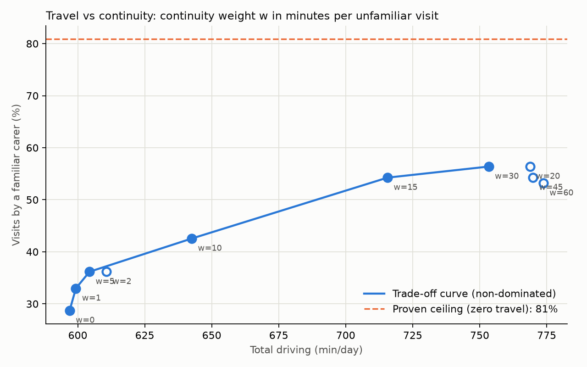

# Tier 2 continuity sweep: travel vs continuity of care

- Scenario `birmingham-day-seed42`; travel `osrm:car:d12835fa63ef`; TABU_SEARCH, 30 s per point.
- **Coverage fixed first (lexicographic):** a continuity-blind solve served 94 of 106 visits; the sweep schedules exactly those 94, so points differ only in travel and continuity. Percentages below are of these visits.
- Weight *w* = minutes of driving the solver will trade to avoid one visit by a new carer (a recent carer costs w/2, a preferred carer 0).
- **Proven ceilings (zero travel, CP-SAT):** at most 76 of these 94 visits (80.9%) can be covered by a familiar carer; on the full day at least 2 visits must be dropped.

| w (min) | Dropped | Drive (min) | Familiar, % of visits | Familiar, % of served | Preferred, % of served | Distinct carers per multi-visit client | Pareto |
|---|---|---|---|---|---|---|---|
| 0 | 0 | 597 | 28.7% | 28.7% | 16.0% | 2.62 | yes |
| 1 | 0 | 599 | 33.0% | 33.0% | 19.1% | 2.65 | yes |
| 2 | 0 | 611 | 36.2% | 36.2% | 21.3% | 2.62 |  |
| 5 | 0 | 604 | 36.2% | 36.2% | 24.5% | 2.65 | yes |
| 10 | 0 | 643 | 42.6% | 42.6% | 27.7% | 2.77 | yes |
| 15 | 0 | 716 | 54.3% | 54.3% | 37.2% | 2.58 | yes |
| 20 | 0 | 769 | 56.4% | 56.4% | 37.2% | 2.73 |  |
| 30 | 0 | 753 | 56.4% | 56.4% | 40.4% | 2.77 | yes |
| 45 | 0 | 770 | 54.3% | 54.3% | 37.2% | 2.88 |  |
| 60 | 0 | 774 | 53.2% | 53.2% | 38.3% | 2.77 |  |

## Marginal cost along the curve (non-dominated points)

| From w | To w | Extra driving (min) | Extra familiar visits | Extra drops | Minutes per extra familiar visit |
|---|---|---|---|---|---|
| 0 | 1 | +2 | +4 | +0 | 0.6 |
| 1 | 5 | +5 | +3 | +0 | 1.7 |
| 5 | 10 | +38 | +6 | +0 | 6.4 |
| 10 | 15 | +73 | +11 | +0 | 6.6 |
| 15 | 30 | +38 | +2 | +0 | 18.9 |

