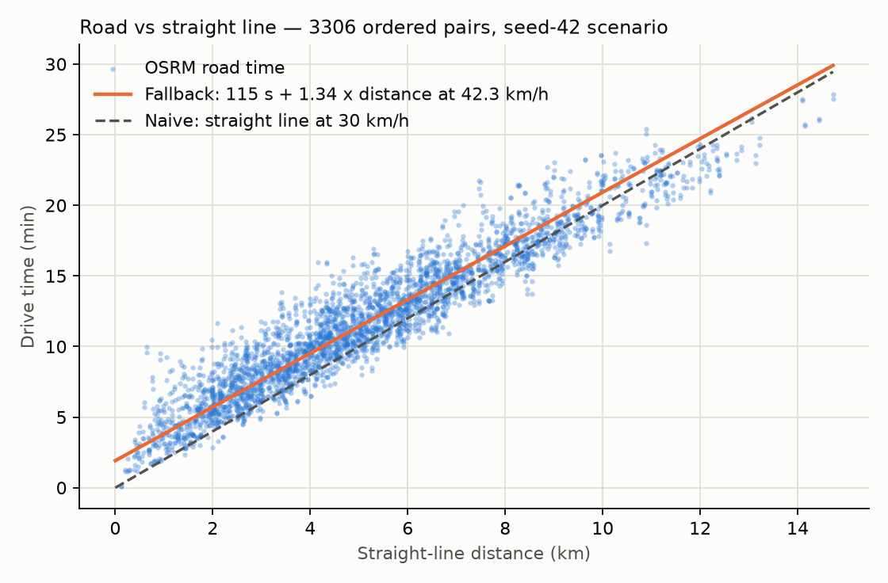

# Tier 2 travel times: OSRM vs straight line

- Scenario: `birmingham-day-seed42`; 58 unique points, 3306 ordered pairs.
- OSRM backend: `osrm:car:d12835fa63ef` (Geofabrik West Midlands, car profile, free-flow).
- Drive times: median 11.4 min, max 27.9 min.
- Road / straight-line distance (median detour factor): **1.34**.
- Fitted time model: **115 s + road distance at 42.3 km/h**.
- Asymmetry |A→B - B→A|: mean 0.5 min, max 3.2 min.

| Estimator vs OSRM | Bias (min) | MAE (min) | P90 abs error (min) | Max abs error (min) | MAPE |
|---|---|---|---|---|---|
| Calibrated fallback | -0.0 | 1.3 | 2.7 | 6.8 | 14% |
| Naive straight line, 30 km/h | -1.4 | 1.8 | 3.8 | 8.7 | 18% |

