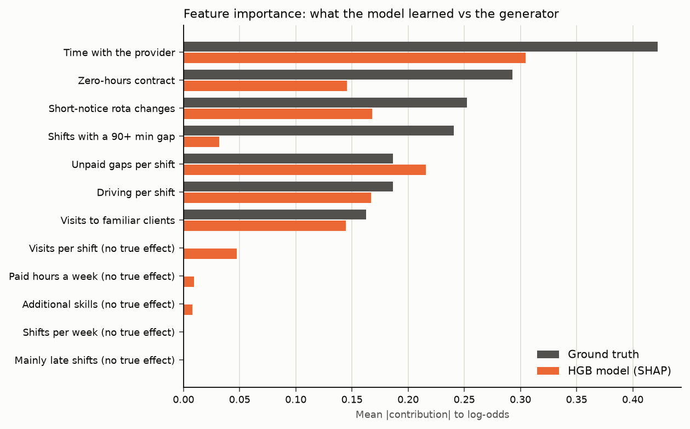
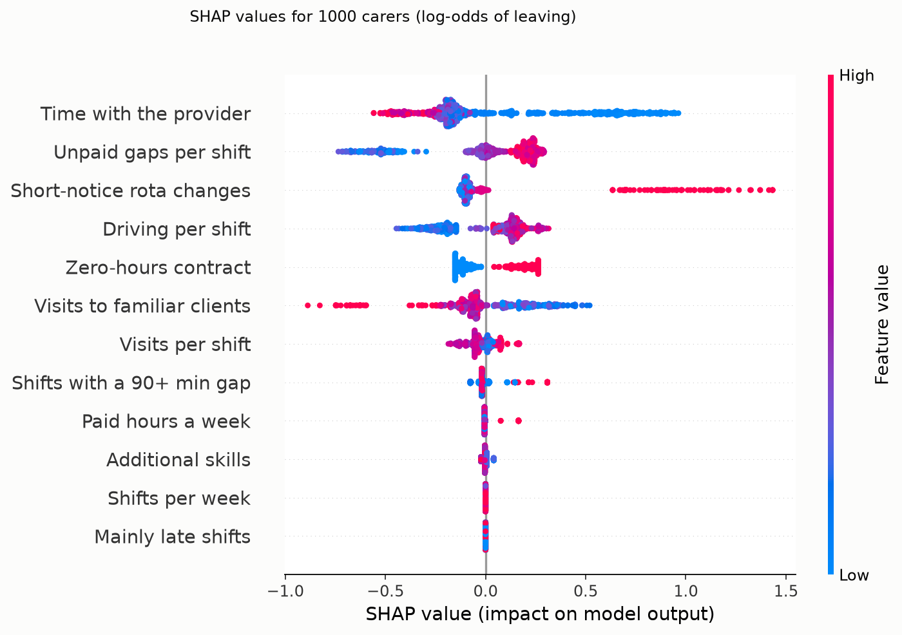
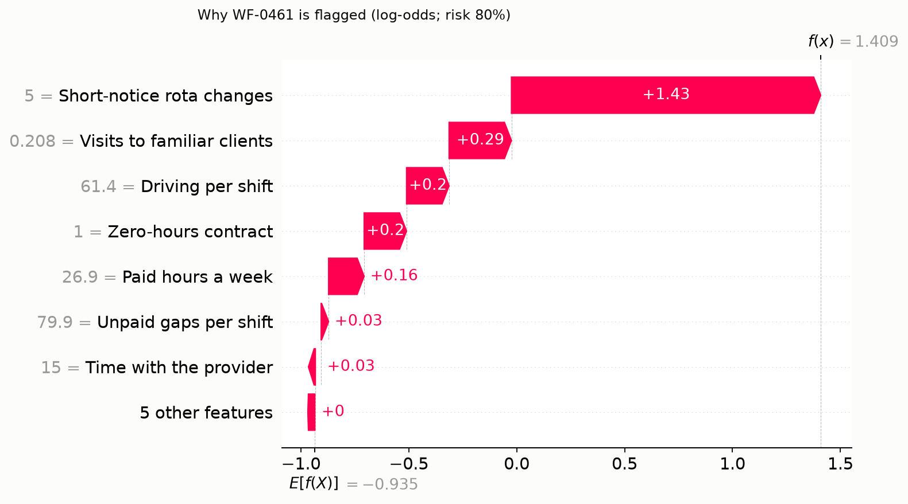

# Tier 3 explainability: SHAP, ground-truth check and age audit

- Model: HGB re-tuned on the 800 training carers (max_depth=2, learning_rate=0.03, min_samples_leaf=20); seed 42.
- SHAP 0.54.1, TreeExplainer, tree_path_dependent (ADR-022); truth computed against 800 training carers; log-odds. Base value -0.935.

## Does SHAP recover the mechanism? (synthetic data only)

- Rank correlation of global importance, model vs truth: **0.81** (Spearman, 12 features).
- Null features: largest mean |SHAP| 0.047 vs smallest real effect 0.032.
- Per-carer agreement (Pearson r between SHAP and true Shapley value, 1000 carers), median 0.83:

| Feature | Mean \|SHAP\| (model) | Mean \|true\| | Per-carer r |
|---|---|---|---|
| Time with the provider | 0.304 | 0.422 | 0.93 |
| Zero-hours contract | 0.146 | 0.293 | 0.95 |
| Short-notice rota changes | 0.168 | 0.252 | 0.90 |
| Shifts with a 90+ min gap | 0.032 | 0.241 | 0.13 |
| Unpaid gaps per shift | 0.216 | 0.187 | 0.83 |
| Driving per shift | 0.167 | 0.187 | 0.72 |
| Visits to familiar clients | 0.145 | 0.163 | 0.77 |
| Mainly late shifts | 0.000 | 0.000 | no true effect |
| Shifts per week | 0.000 | 0.000 | no true effect |
| Additional skills | 0.008 | 0.000 | no true effect |
| Paid hours a week | 0.009 | 0.000 | no true effect |
| Visits per shift | 0.047 | 0.000 | no true effect |

## Local explanation: WF-0461 (highest model risk in the test split)

Model risk **80%** vs 28% at the baseline (base value). Actually left: yes.

| Factor | This carer | Effect (log-odds) | Provider can change it? | Support to offer |
|---|---|---|---|---|
| Short-notice rota changes | 5 a month | +1.43 (raises risk) | yes | give more rota notice and limit late changes |
| Visits to familiar clients | 21% | +0.29 (raises risk) | yes | build a regular round of the same clients |
| Driving per shift | 61 min | +0.20 (raises risk) | yes | review round geography to cut driving |
| Zero-hours contract | yes | +0.20 (raises risk) | yes | discuss a guaranteed-hours contract |
| Paid hours a week | 26.9 h | +0.17 (raises risk) | yes | check hours match what the carer wants |

## Age audit (age is never a model input)

Out-of-sample predictions for all 1000 carers (out-of-fold for training, final model for test). Flagged = top 20% by risk.

| Age band | Carers | Observed leaver rate | Mean predicted | Mean oracle | Flagged | Ratio to most-flagged |
|---|---|---|---|---|---|---|
| 18-24 | 126 | 46.8% | 39.7% | 42.5% | 46.8% | 1.00 |
| 25-39 | 316 | 31.3% | 31.8% | 32.7% | 25.0% | 0.53 |
| 40-54 | 326 | 26.4% | 27.1% | 26.7% | 13.2% | 0.28 |
| 55+ | 232 | 23.3% | 25.1% | 24.2% | 8.2% | 0.17 |

Features carrying the age gap (mean SHAP, 18-24 minus 55+, log-odds):

- Time with the provider: +0.519
- Short-notice rota changes: +0.080
- Zero-hours contract: +0.068
- Visits to familiar clients: +0.026
