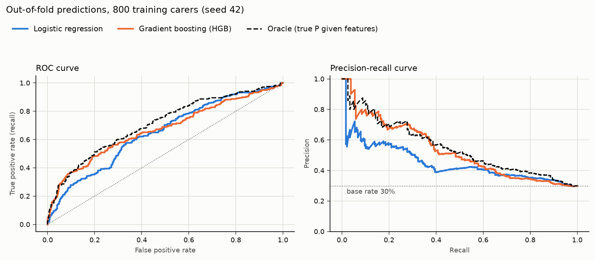
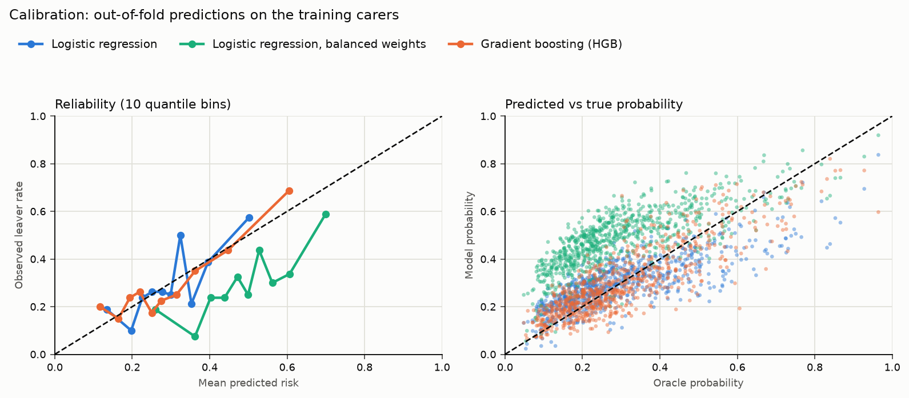

# Tier 3 models: attrition prediction

- Data: 800 training carers (238 leavers, 29.8%); test 200 (60 leavers). Seed 42. Synthetic: see `data/workforce/DATA_CARD.md`.
- Main estimate: nested CV, 5-fold x 5 repeats stratified (25 outer folds of 160); hyperparameters chosen by a 3-fold inner grid search on log loss, inside each outer training fold.
- Mean ± SD over outer folds. Folds overlap, so the SD shows spread, not a standard error of the mean.

## Cross-validation (training carers)

| Model | ROC-AUC | PR-AUC (AP) | Brier (lower is better) |
|---|---|---|---|
| Logistic regression | 0.655 ± 0.039 | 0.483 ± 0.061 | 0.196 ± 0.006 |
| Logistic regression, balanced weights | 0.653 ± 0.041 | 0.476 ± 0.062 | 0.232 ± 0.008 |
| Gradient boosting (HGB) | 0.675 ± 0.045 | 0.538 ± 0.056 | 0.188 ± 0.009 |
| Oracle (true P given features) | 0.709 ± 0.046 | 0.556 ± 0.053 | 0.181 ± 0.010 |
| Base rate (constant) | 0.500 ± 0.000 | 0.297 ± 0.003 | 0.209 ± 0.001 |

## Paired comparison over the same folds

| Comparison | Metric | Mean difference | Folds where first is better |
|---|---|---|---|
| Gradient boosting (HGB) vs Logistic regression | ROC-AUC | +0.020 | 18/25 |
| Gradient boosting (HGB) vs Logistic regression | PR-AUC (AP) | +0.055 | 20/25 |
| Gradient boosting (HGB) vs Logistic regression | Brier | -0.008 | 22/25 |
| Logistic regression, balanced weights vs Logistic regression | ROC-AUC | -0.002 | 9/25 |
| Logistic regression, balanced weights vs Logistic regression | PR-AUC (AP) | -0.007 | 2/25 |
| Logistic regression, balanced weights vs Logistic regression | Brier | +0.036 | 0/25 |
| Oracle (true P given features) vs Logistic regression | ROC-AUC | +0.053 | 24/25 |
| Oracle (true P given features) vs Logistic regression | PR-AUC (AP) | +0.073 | 24/25 |
| Oracle (true P given features) vs Logistic regression | Brier | -0.014 | 25/25 |
| Oracle (true P given features) vs Gradient boosting (HGB) | ROC-AUC | +0.034 | 22/25 |
| Oracle (true P given features) vs Gradient boosting (HGB) | PR-AUC (AP) | +0.018 | 16/25 |
| Oracle (true P given features) vs Gradient boosting (HGB) | Brier | -0.006 | 22/25 |

## Hyperparameters chosen in the outer folds

- **Logistic regression:** `{'logisticregression__C': 0.01}` x13, `{'logisticregression__C': 0.1}` x12
- **Logistic regression, balanced weights:** `{'logisticregression__C': 0.01}` x13, `{'logisticregression__C': 0.1}` x12
- **Gradient boosting (HGB):** `{'learning_rate': 0.03, 'max_depth': 2, 'min_samples_leaf': 20}` x19, `{'learning_rate': 0.03, 'max_depth': 2, 'min_samples_leaf': 50}` x6

## Test split (used once)

Each model is re-tuned and fitted on all 800 training carers. 95% bootstrap intervals (2,000 resamples). *Error vs truth* is the mean |model - oracle| probability, only measurable because the data is synthetic.

| Model | ROC-AUC | PR-AUC (AP) | Brier | Error vs truth |
|---|---|---|---|---|
| Logistic regression | 0.772 (0.700 to 0.836) | 0.632 (0.506 to 0.742) | 0.171 (0.149 to 0.195) | 0.067 |
| Logistic regression, balanced weights | 0.776 (0.704 to 0.839) | 0.623 (0.493 to 0.739) | 0.211 (0.194 to 0.228) | 0.186 |
| Gradient boosting (HGB) | 0.759 (0.682 to 0.829) | 0.610 (0.489 to 0.725) | 0.172 (0.147 to 0.198) | 0.069 |
| Oracle (true P given features) | 0.795 (0.730 to 0.854) | 0.638 (0.520 to 0.745) | 0.164 (0.142 to 0.188) | 0 |

## Precision at the top of the risk list

Leaver rate among the highest-risk 10% / 20% of carers (a fixed retention budget). Base rate is the expected hit rate when choosing at random.

| Model | CV out-of-fold top 10% | top 20% | Test top 10% | top 20% |
|---|---|---|---|---|
| Logistic regression | 57% | 48% | 75% | 62% |
| Logistic regression, balanced weights | 59% | 46% | 80% | 62% |
| Gradient boosting (HGB) | 69% | 56% | 75% | 62% |
| Oracle (true P given features) | 71% | 57% | 75% | 57% |
| Base rate (constant) | 30% | 30% | 30% | 30% |

## Calibration (out-of-fold, first CV repeat, 10 quantile bins)

| Model | Mean predicted | Observed rate | Worst bin gap | Error vs truth |
|---|---|---|---|---|
| Logistic regression | 0.296 | 0.297 | 0.176 | 0.076 |
| Logistic regression, balanced weights | 0.483 | 0.297 | 0.287 | 0.195 |
| Gradient boosting (HGB) | 0.295 | 0.297 | 0.084 | 0.065 |

